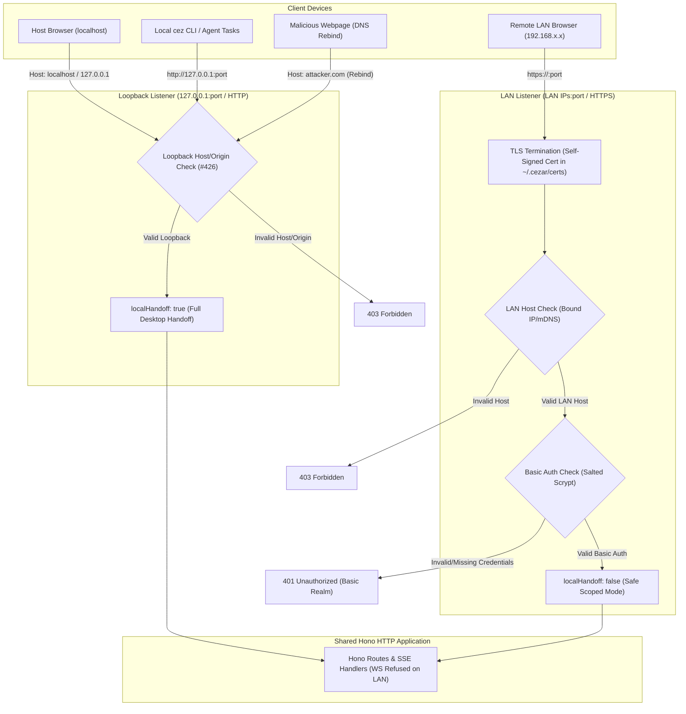

# Protected LAN Access with Self-Signed HTTPS, Basic Auth, and Dynamic Capability Detection

- **Date:** 2026-10-20
- **Category:** feature, security
- **Status:** implemented (see § Resolved during implementation)
- **Source Brief:** [.ai/specs/briefs/2026-10-20-lan-basic-auth-https.md](file:///D:/cezar/.ai/specs/briefs/2026-10-20-lan-basic-auth-https.md)

---

## 📝 TLDR

Operators running Cezar on a home/office host machine want to access the cockpit and monitor runs from a secondary device (e.g. laptop) on the same local network. Today, Cezar binds strictly to loopback (`127.0.0.1`) without authentication; binding to `0.0.0.0` exposes the server to anyone on the LAN, strips local desktop handoff capabilities, sends credentials in plaintext, and creates a DNS rebinding vulnerability. This specification introduces an integrated **LAN Access & Security** configuration in Settings: single-user HTTP Basic Auth backed by salted `scrypt` password hashing, automated self-signed HTTPS encryption, per-request capability detection to preserve local desktop features on `127.0.0.1` while safely scoping LAN clients, and a dedicated dual-listener architecture where loopback stays plain HTTP and a second TLS listener binds to LAN addresses (superseding earlier designs for an internal bearer token and socket rebinding; see § Resolved during implementation).

---

## 📝 Problem Statement

Cezar is built as a zero-config, local-first coding agent orchestrator. By default, `cezar serve` listens exclusively on loopback (`127.0.0.1`) and enforces strict `Host` and `Origin` headers to prevent malicious websites in the operator's browser from interacting with the daemon.

When an operator wants to access their Cezar instance from another computer on the same LAN:
1. **No Authentication on Non-Loopback:** Cezar has no native credentials or user login. Binding `0.0.0.0` allows any device on the LAN to access the API and execute arbitrary code via AI agent tasks.
2. **DNS Rebinding Vulnerability:** If loopback traffic is blindly exempted from authentication when bound to `0.0.0.0`, any website visited on the host machine using DNS rebinding (`rebind.attacker.com` pointing to `127.0.0.1`) can bypass origin checks and issue unauthenticated agent commands.
3. **Local Desktop Downgrade:** `capabilities.localHandoff` currently depends globally on `isLoopbackHost(bindHost)`. Binding to `0.0.0.0` switches the entire server to hosted mode, disabling VS Code handoff, the terminal drawer, Design Mode, and making agent config files read-only on the host's own desktop.
4. **Plaintext Sniffing & Insecure Contexts:** Plain HTTP Basic Auth sends base64 credentials over the LAN, susceptible to packet sniffing. Furthermore, modern browsers treat `http://192.168.x.x` as an insecure context, breaking clipboard APIs (`navigator.clipboard.writeText`) across cockpit components.
5. **Process Lifecycle Disruption:** A process-level restart to switch socket binding breaks parent supervisors like `scripts/dev.mjs` (`npm run dev`) and Windows Service managers (NSSM / WinSW / SCM).

---

## 📝 Proposed Solution

Provide a native, secure, single-operator remote LAN experience directly in the cockpit:

1. **Cockpit Settings UI:** A *LAN Access & Security* card in Settings with:
   - Toggle: *Allow LAN access* (defaults to OFF).
   - Form: *Username* and *Password* (required when LAN access is enabled).
   - Dynamic Status: Displays active listening address (`127.0.0.1` vs `0.0.0.0`) and TLS status.
2. **Built-in Self-Signed TLS:** When LAN access is enabled, the server generates (or loads) a self-signed certificate and private key stored in `~/.cezar/certs/` using Node's `node:crypto`.
3. **HTTP Basic Auth with Scrypt Hashing:** All external LAN requests must supply valid Basic Auth credentials, matched against a salted `scrypt` hash stored in `~/.cezar/config.json`.
4. **Dual Listener Architecture (Supersedes In-Process Socket Rebinding and Internal Bearer Token):** Loopback (`127.0.0.1`) remains plain HTTP, so local child tasks, the Vite proxy, the desktop shell, and the `cez` CLI continue untouched under the #426 Host/Origin guard without needing credentials or bearer tokens. A separate listener on each non-loopback LAN IPv4 address terminates TLS and feeds decrypted sockets into the same HTTP server.
5. **Per-Request `localHandoff` Detection:** `capabilities.localHandoff` is evaluated per request via `lanClientScope`: requests originating from loopback keep full desktop capabilities; LAN requests run in safe scoped mode.
6. **In-Process Dynamic Listener Management:** Toggling LAN access opens or closes the dedicated LAN listeners dynamically in-process without restarting Node.js or affecting the loopback listener.

---

## 📝 Resolved during implementation

Three parts of the proposal were changed while building it. Each kept the goal and removed a cost.

1. **No rebind; a second listener instead.** Closing the loopback socket and reopening it on
   `0.0.0.0` with TLS would have moved every loopback client — the `cez` CLIs (`CEZ_API_URL` is
   `http://127.0.0.1:<port>`), the Vite dev proxy, the desktop shell, supervisors — onto HTTPS
   with a self-signed certificate, and binding a wildcard next to a specific address is
   platform-dependent. The loopback `http.Server` is never touched. LAN access opens a separate
   `net.Server` on each non-loopback IPv4 address (same port), terminates TLS there and hands the
   decrypted socket to the SAME `http.Server`, so routes, SSE, WebSocket upgrades and keep-alive
   are shared. Plain HTTP on the LAN port gets a `308` to HTTPS. `listeningHost` in the contract
   became `lanUrls` (the addresses actually bound) plus `active`/`error`.
2. **No `CEZ_INTERNAL_TOKEN`.** With loopback untouched, local callers keep the #426 Host/Origin
   guard — which is what defeats DNS rebinding — and need no credential. A per-boot token in
   every agent's environment would only have added a leakable credential that also works from the
   LAN. The `cez` CLIs are unchanged.
3. **Per-request capabilities through async context.** A request from the LAN listener runs inside
   `lanClientScope` (`capabilities.ts`), so every existing `capabilities()` call answers as hosted
   (`localHandoff`, `terminal`, `designMode` off) without threading the request through ~30 call
   sites; loopback requests are unchanged.

4. **No WebSocket over the LAN.** A LAN cockpit runs in remote mode, which opens no browser
   WebSocket, and the hub's topics publish the host's own view (local capabilities, absolute
   paths) to every subscriber. `verifyWsUpgrade` therefore refuses every LAN upgrade; LAN
   browsers stay live through SSE, which passes the same Basic Auth gate as every other request.
   (§ Security & Edge Cases 4 is superseded for WebSocket.)

Also added: a wrong username costs the same scrypt as a wrong password (no username timing
oracle); a LAN connection must send its first byte within 10 s. `PUT /security/lan` is refused (`409`) from the LAN — a LAN client cannot re-key or
widen its own access; credential changes and switching off drop every open LAN socket; ten failed
sign-ins per address answer `429` for five minutes; verified `Authorization` headers are cached
by SHA-256 so a page load costs one scrypt; the status shows the certificate's SHA-256 fingerprint
so the browser warning can be checked. LAN access is unavailable on a hosted cockpit
(`CEZ_REMOTE=1`, non-loopback `--bind-host`). Recovery is `cezar auth [status|reset]`.

---

## 📝 Architecture & Request Flow



---

## 📝 Data Model & Storage

### 1. `~/.cezar/config.json` Schema Extension
Stored in the user-level configuration file:

```json
{
  "security": {
    "lanAccess": false,
    "auth": {
      "username": "alex",
      "salt": "a4f8... (hex)",
      "hash": "c71e... (hex scrypt output)"
    }
  }
}
```

- When `security.lanAccess` is `false`, Cezar binds strictly to `127.0.0.1` (HTTP).
- When `security.lanAccess` is `true`, Cezar ALSO listens on each LAN IPv4 address, TLS and Basic Auth enforced there; `127.0.0.1` is unchanged.
- **Zero-config default:** Absent or empty `security` block defaults to `lanAccess: false`, zero files written, zero prompt.

### 2. Certificates Directory: `~/.cezar/certs/`
- `~/.cezar/certs/cezar-cert.pem`: X.509 self-signed certificate (valid for 365 days, SAN includes `localhost`, `127.0.0.1`, and detected local LAN IP).
- `~/.cezar/certs/cezar-key.pem`: 2048-bit RSA or P-256 private key (file permissions `0600`).
- Generated on-demand via Node's `node:crypto.generateKeyPairSync` / certificate helpers.

---

## 📝 API Contracts & Schemas

Defined in `packages/contract`:

### 1. Get Security / LAN Configuration
`GET /api/v1/security/lan`

**Response (`200 OK`):**
```ts
export const securityLanStatusSchema = z.object({
  available: z.boolean(),      // false on a hosted cockpit
  editable: z.boolean(),       // the request came over loopback
  lanAccess: z.boolean(),      // what was asked for
  active: z.boolean(),         // the LAN listener is bound right now
  authConfigured: z.boolean(),
  username: z.string().nullable(),
  port: z.number().int(),
  tlsEnabled: z.boolean(),
  lanIp: z.string().nullable(), // detected host LAN IP e.g. "192.168.1.50"
  lanUrls: z.array(z.string()), // e.g. ["https://192.168.1.50:4321"]
  certFingerprint: z.string().nullable(),
  error: z.string().nullable(), // why lanAccess and active differ
});
```

### 2. Update Security / LAN Configuration
`PUT /api/v1/security/lan`

**Request Body:**
```ts
export const setSecurityLanInputSchema = z.object({
  lanAccess: z.boolean(),
  username: z.string().min(1).max(64).optional(),
  password: z.string().min(8).max(128).optional(),
});
```
- If `lanAccess` is set to `true`, `username` and `password` must be present (or previously configured).
- Validates password length ($\ge 8$ chars).
- Calculates `scrypt` hash with cryptographically secure random 16-byte salt (`crypto.randomBytes(16)`).
- Opens or closes the LAN listener in-process; the loopback listener is never rebound.
- `409` from a LAN client or on a hosted cockpit.

---

## 📝 UI / UX Design

Located in **Settings $\rightarrow$ Security & LAN Access**:

```
+------------------------------------------------------------------------+
|  Security & Remote LAN Access                                          |
|  Allow access to this cockpit from other devices on your local network |
+------------------------------------------------------------------------+
|                                                                        |
|  [x] Allow LAN Access                                                  |
|                                                                        |
|  Username: [ alex                                ]                     |
|  Password: [ •••••••••••••                       ]                     |
|                                                                        |
|  Status: 🔒 Active (Listening on https://192.168.1.50:4321)            |
|                                                                        |
|  ℹ️  First-time connection notice:                                      |
|     Cezar uses an automated self-signed certificate to encrypt traffic |
|     over your local network. Your browser will show a one-time privacy |
|     warning — click "Advanced -> Proceed" to connect.                  |
|                                                                        |
|  [ Save & Apply ]                                                      |
+------------------------------------------------------------------------+
```

---

## 📝 Security & Edge Cases

1. **DNS Rebinding Protection:**  
   The `Host` header check is preserved: only connections with `Host: localhost`, `Host: 127.0.0.1`, or `Host: <detected-host-lan-ip>` are accepted. Any unknown host header is rejected with `403 Forbidden`.
2. **Timing-Safe Password Verification:**  
   Password verification uses `crypto.timingSafeEqual` between the stored scrypt hash and the candidate hash to prevent timing attacks.
3. **Lockout Recovery:**  
   - If the operator forgets their credentials or makes a typo:
   - Connecting directly from the host machine via `http://localhost:4321` or `https://localhost:4321` bypasses Basic Auth or allows resetting credentials directly.
   - For headless machines, running `cez auth reset` (or removing `"security"` from `~/.cezar/config.json`) instantly disables auth and reverts to loopback.
4. **WebSocket & SSE Compatibility:**  
   The Hono WebSocket upgrade handler and Server-Sent Events endpoints (`/api/v1/ws`, `/api/v1/runs/:id/events`) pass through the same authentication middleware; browsers send the cached HTTP Basic Auth credentials during the HTTP Upgrade handshake.

---

## 📋 Implementation Plan

### Phase 1: Cryptography & Security Core (Backend)
- **Step 1.1:** Implement certificate generation and loading in `packages/cezar/src/server/certs.ts` using `node:crypto`.
- **Step 1.2:** Implement `scrypt` password hashing and `timingSafeEqual` verification in `packages/cezar/src/server/auth-crypto.ts`.
- **Step 1.3:** Create authentication middleware in `packages/cezar/src/server/auth-middleware.ts` supporting both `Basic` auth and `Bearer CEZ_INTERNAL_TOKEN`.
- **Step 1.4:** Unit tests for certificate generation, password hashing, and authentication guards.

### Phase 2: In-Process Rebinding & Dynamic Capabilities
- **Step 2.1:** Refactor `packages/cezar/src/server/capabilities.ts` to evaluate `localHandoff` dynamically per request based on client IP.
- **Step 2.2:** Implement in-process listener close-and-rebind in `packages/cezar/src/server/server.ts` to swap between loopback HTTP and LAN HTTPS without process exit.
- **Step 2.3:** Add `CEZ_INTERNAL_TOKEN` generation and environment propagation to child agent run processes in `RunManager`.
- **Step 2.4:** Integration tests verifying that `npm run dev` and mock supervised processes survive socket rebinds.

### Phase 3: Contract & Settings API
- **Step 3.1:** Define `securityLanStatusSchema` and `setSecurityLanInputSchema` in `packages/contract`.
- **Step 3.2:** Register `GET /api/v1/security/lan` and `PUT /api/v1/security/lan` route family in `server.ts`.
- **Step 3.3:** Contract parity tests asserting schema and route agreement.

### Phase 4: Cockpit Settings UI
- **Step 4.1:** Build `SecuritySection` component in `packages/web/src/routes/settings/security-section.tsx`.
- **Step 4.2:** Integrate with React Query mutation and Toast notifications.
- **Step 4.3:** Component unit tests for validation, toggle states, and self-signed cert notices.

---

## 📝 Verification Plan

1. **Automated Testing:**
   - `npm run typecheck` across all workspaces.
   - `npm test` verifying all server and contract tests pass.
   - New unit tests for auth middleware, certificate caching, and password verification.
   - Integration tests simulating a socket rebind and verifying `GET /api/v1/health` answers on the new interface.
2. **Manual & Multi-Device Verification:**
   - On the host machine: open `https://localhost:4321` $\rightarrow$ verify full local desktop handoffs (open in editor, terminal) work.
   - On a secondary computer on LAN: open `https://<host-ip>:4321` $\rightarrow$ verify Basic Auth prompt appears; enter credentials $\rightarrow$ cockpit loads; verify clipboard copy actions work.
   - Negative testing: attempt connection from LAN with wrong credentials $\rightarrow$ `401 Unauthorized`; attempt request with fake Host header $\rightarrow$ `403 Forbidden`.
