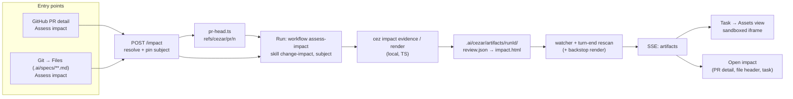

# HTML Artifacts and Assess Impact

## 📝 TLDR

An agent that produces a page — a report, a dashboard, a decision cockpit — has no place to put
it that the cockpit can show. The Preview (`2026-10-09-design-mode.md`) frames a *running dev
server*. Nothing in cezar serves a worktree file as HTML, and `GET /runs/:id/files?raw=1` refuses
anything that is not an image. So today an agent's HTML report is a file the user has to find and
open in another program, which breaks the "one system" premise.

This spec adds two layers.

1. **Artifacts (generic).** Every run gets an artifacts directory outside its worktree:
   `.ai/cezar/artifacts/<runId>/`. The agent is told its path. Whatever it writes there shows up
   **live** in a new **Assets** view of the task workspace. HTML renders in an iframe locked to an
   opaque origin: its scripts run, and pinned CDN libraries load, but the page cannot touch the
   API or send data anywhere. Markdown and images reuse the existing viewers.
2. **Assess Impact (first feature on top).** A built-in `change-impact` skill runs through a
   built-in `assess-impact` workflow. One click launches it from two places:
   - a PR in the GitHub tab;
   - a spec file (`.ai/specs/**/*.md`) in Git → Files.

   The agent does the semantic review and writes a `review.json` model. **cezar itself** validates
   that model (zod) and renders `impact.html` with a TypeScript port of the `pr-impact` renderer,
   so there is no Python dependency. The run records **what** it assessed (its *subject*). That
   lets the PR detail, the spec file and the task itself offer **Open impact**.

The implementation follows separately; this document is the design.

## Owner decisions (2026-10-22)

The four open questions of the first draft were answered by the owner:

| # | Decision |
|---|---|
| O1 | **Artifacts may load scripts from public CDNs, by default** (Q4). This is a default-on network widening, so it must be recorded as an owner-approved exception in AGENTS.md § Zero config in the implementing PR. `CEZ_ARTIFACTS_CDN=0` turns it off. |
| O2 | **Port the renderer to TypeScript.** cezar validates and renders the review model itself, and the skill carries no scripts (Q7). |
| O3 | **The artifacts prompt line goes into every run** (Q2b). |
| O4 | **The skill is named `change-impact`** (Q6). It is distinct from the owner's global `pr-impact`, so the two never shadow each other. |

Design review round 2 (2026-10-22). The owner and the team asked for these on the first mockups:

| # | Decision |
|---|---|
| R1 | **The report is cezar-native, not the `pr-impact` look.** It is built from the cockpit's tokens (both themes, lime/violet, Inter + JetBrains Mono) and has **no sidebar of its own**: its section navigation is a horizontal sticky bar. See § Report design. |
| R2 | **Stop losing width.** The Assets view has no list column: the asset switcher sits in its toolbar. A **Focus** control collapses the cockpit sidebar to its icon rail while Assets is open. Three stacked navigations (app, assets, report) become one. |
| R3 | **A Public API delta section.** The review model gains `api_changes`, and the report shows a breaking-change table. It must work beyond cezar's own stack (for example a Shopware plugin: Store/Admin API routes, events, service decorators, entity definitions), so the skill teaches surface discovery per ecosystem. See § Public API delta. |
| R4 | **Follow-up questions and corrections.** The user can ask about any element of the report, or say it is wrong, from inside the Assets view. The agent revises `review.json`, the report re-renders, and the previous version is kept. See § Ask and correct. |

## Resolved assumptions

| # | Question | Applied default | Why |
|---|---|---|---|
| Q1 | Where does the agent write artifacts: inside its worktree, or outside it? | **Outside**: `<dataDir>/artifacts/<runId>/`. The path is given to the agent in its system prompt and as `CEZ_ARTIFACTS_DIR`. | Inside the worktree, the files would enter autosave commits, the Changes tab and the draft PR. #1126 already shows how costly it is to keep check outputs out of autosave. Outside the worktree, the artifacts also survive worktree pruning and Discard. `dataDir` is already gitignored per entry (`ensureDataGitignore`). |
| Q2 | How does the cockpit learn about a new artifact? | **`fs.watch` on the run's directory while the run is active (debounced 300 ms), plus a rescan in BOTH turn-end handlers.** Both publish the same SSE `artifacts` event. | Users expect "it is generated and immediately visible". `fs.watch` is not reliable on every filesystem, so the turn-end rescan is the guarantee and the watcher only adds speed. Per AGENTS.md, the streaming and non-streaming turn-end handlers in `workflows/run.ts` must both call the same helper. |
| Q2b | Which runs are told about the directory? | **Every agent step of every run (O3)**, through one system-prompt line. | That line is what makes the layer generic: any agent, skill or ad-hoc prompt can show the user a page. It costs a few dozen tokens per step. |
| Q3 | How is HTML served safely? A separate origin (like the design proxy), or the cockpit origin? | **The cockpit origin, with a CSP `sandbox allow-scripts` response header (no `allow-same-origin`) AND an iframe `sandbox="allow-scripts allow-popups allow-popups-to-escape-sandbox"`.** | The CSP `sandbox` directive gives the document an opaque origin even when it is opened directly in a tab. It therefore cannot read cookies or storage, cannot make same-origin API calls, and a mutating request carries `Origin: null`, which the #426 guard rejects. This needs no extra port and no process, and the Tauri shell frames same-origin content without changes. The design proxy needs its own origin only because it frames a *live server* that has to keep its own origin. |
| Q4 | Can artifacts load the network? | **Scripts and styles from a fixed CDN allowlist, nothing else (O1).** CSP: `default-src 'none'; script-src 'unsafe-inline' https://cdnjs.cloudflare.com https://cdn.jsdelivr.net https://unpkg.com; style-src 'unsafe-inline' https://fonts.googleapis.com https://cdnjs.cloudflare.com https://cdn.jsdelivr.net; font-src data: https://fonts.gstatic.com; img-src data: blob:; media-src data: blob:; connect-src 'none'; form-action 'none'; base-uri 'none'`. `CEZ_ARTIFACTS_CDN=0` drops every `https:` source. | Claude-style artifacts load React, Chart.js or D3 from these hosts and render broken without them. `connect-src 'none'`, the data/blob-only `img-src` and `form-action 'none'` still leave no channel to an attacker-chosen host: a fetched script can only come from three public package CDNs. What is left is that the CDN sees the request (an IP and the library URL). That is the widening the owner accepted. The prompt line still asks agents to pin exact versions, and to inline everything when it is small. |
| Q5 | What is an "artifact": any file, or only some kinds? | **Any regular file in the directory, viewed by kind:** `html` (sandboxed frame), `markdown` (Streamdown), `image` (existing `` path), `json`/`other` (Shiki source view / download). The directory is non-recursive, 64 files at most, 10 MB per file. | The generic layer should not care which skill wrote the file. Non-recursive keeps the listing one `readdir`. The caps keep a runaway agent bounded. |
| Q6 | Where does the bundled skill live, and under what name? | **`change-impact` (O4)**, in `packages/cezar/skills/change-impact/` (`SKILL.md` + `references/`), shipped in the tarball and discovered as source `builtin`, below every user location. | Assess Impact must work for every cezar user. After the TS port (Q7) the skill is prose only (~15 KB), but it keeps two reference files, so it stays a directory rather than a TS constant like `automations/builtin-skill.ts`. A user's own `change-impact` anywhere in the discovery path overrides it. |
| Q7 | Who validates and renders the review? | **cezar, in TypeScript (O2).** `packages/cezar/src/impact/`: a zod `reviewModelSchema` (review model v3 plus `subject_kind`), a `validateReview` porting every cross-reference rule of `render_cockpit.py`, a `renderImpact(model) → html`, and the cockpit template as a bundled asset. The agent reaches them through `cez impact evidence` and `cez impact render`, two **local** subcommands that need no server. As a backstop, the server also renders when a valid `review.json` lands without a fresh `impact.html`. | No Python on the user's machine, and no Python at runtime in cezar. Errors come back as zod issue paths the agent can act on. One renderer means the cockpit's "Open impact" and the CLI produce identical output. The local CLI keeps the agent's validate–fix loop working even with `CEZ_DISPATCH=0`, where `cez task` has no server to talk to. |
| Q8 | What does the impact run check out? | **PR:** a normal worktree forked from the PR head, through the existing `pr-head.ts` resolver (`refs/cezar/pr/<n>`). **Spec:** a normal worktree off the base branch. **Never** a `readOnly` run. | `readOnly` restricts tools to `Read/Grep/Glob` (`landing.ts:292`), and the agent needs Bash (`cez impact …`, `git`) and Write (`review.json`). Evidence must be pinned to exact commits that exist locally, and `pr-head.ts` is exactly the fetch that provides them — the head; `launch.ts` also refreshes `<remote>/<base>` (best effort), since `gh` reports the base's current tip and the forkRef path never fetches it. |
| Q9 | A new generic `createRun` field, or a dedicated route? | **A dedicated `POST /impact`** that resolves the subject server-side and creates the run. `createRun`'s contract is unchanged. | Resolving the PR head and pinning the spec's blob sha both have to happen on the server. Widening `createRunInputBaseSchema` with `prHead` would expose a fetch-from-GitHub capability to every caller. |
| Q10 | How is the "Open impact" link found? | **`RunRecord.subject`** (new, optional): `{kind:'pr', number, headSha} \| {kind:'spec', path, blobSha}`. A `GET /artifacts?subject=` route returns the latest matching run's artifacts. | No scan of artifact contents and no second index file. A rerun simply becomes the latest. The pinned `headSha`/`blobSha` lets the UI say **stale** when the PR or spec has moved since. |
| Q11 | Does the impact task end at a review gate with a diff? | **It follows the existing review-gate setting**: with the gate off (the default) it ends `done`, with it on it reaches `review` even with an empty diff. Either way no draft PR is offered for a run with a `subject` (both Draft PR buttons hidden, `POST /runs/:id/pr` 409s). Follow-ups still work, because a message to a `done` run continues it. | Changing the gate's default for one feature would be replacing a working mechanism (AGENTS.md § Changing a mechanism). Never auto-merge, never invent a PR. |

## 📝 Problem Statement

- **No HTML surface.** `browser-view.tsx` accepts only http(s) addresses (`normalizeAddress`,
  `:808-830`). The raw-file routes serve images only (`imageMimeType`, `git-changes.ts:581`) with
  `content-security-policy: … sandbox`, which blocks scripts. That is correct for an image and
  fatal for a report.
- **No run outputs.** `RunRecord` knows about images and attachments the user *sent*
  (`contract/src/runs.ts:130,166`), but not about files the agent *produced* for the user.
- **No "assess" entry point.** The GitHub detail pane offers `HandToAgent` (a free prompt) and the
  merge box. Files views have no actions at all (`repo-files.tsx`, `file-preview.tsx`). No built-in
  workflow reviews an existing PR; `implement-review-pr` and `review-council` implement first.

## 📝 Proposed Solution



**Takeaway:** the artifacts layer (directory → watcher → SSE → Assets view) knows nothing about
impact. Assess Impact is a route, a workflow, a skill, a renderer module and a `subject` field
placed on top. The next HTML-producing skill needs none of it.

### Alternatives considered

- **Artifacts inside the worktree (`.cezar/artifacts/`).** Rejected per Q1, because they leak into
  autosave, Changes and PRs. Codex's `workspace-write` sandbox is the one reason to prefer it, and
  we answer that instead by adding the directory to the Codex runner's writable roots.
- **A separate loopback origin for artifacts (like `design-proxy`).** Rejected per Q3: it means a
  process and a port to manage for content a CSP sandbox already isolates.
- **Reuse the Browser view with a `cezar-artifact://` address.** Rejected. The Browser view's
  sandbox *includes* `allow-same-origin`. Mixing trusted-origin dev servers and opaque-origin
  artifacts in one component invites someone to "simplify" the two sandboxes into one.
- **Ship the Python scripts and gate on `python3`.** Rejected by the owner (O2).
- **Render only server-side, with no CLI.** Rejected as the *primary* path: the agent would learn
  about validation errors only after a turn ends. It is kept as the backstop.

## 📝 Architecture

### Artifacts layer

- **Directory.** `artifactsDir(dataDir, runId)` in `runs/store.ts`, beside `imagesDir`. It is
  created at run start (in `execute` **and** `runContinuation`: both `ActiveRun` construction
  sites, per AGENTS.md) and removed with the run record. `artifacts/` is added to the
  `ensureDataGitignore` allowlist, which `data-gitignore.test.ts` enforces.
- **Telling the agent (every run, O3).** One line is appended to every agent step's system prompt:
  *"To show the user a page or report, write it as a single HTML (or .md/.png) file into
  `<abs dir>`; it appears live in the cockpit's Assets view. Scripts may load only from cdnjs,
  jsDelivr or unpkg with an exact pinned version; no fetch/XHR to any host."* When
  `CEZ_ARTIFACTS_CDN=0`, the second sentence instead says to inline everything. The same path is
  exported as `CEZ_ARTIFACTS_DIR`.
- **Env contract.** Two variables must be added to `.env.example` and the `docs/reference.md` env
  table in the same commit:
  - `CEZ_ARTIFACTS_DIR` is set by cezar for the agent;
  - `CEZ_ARTIFACTS_CDN` is user-facing, with a default of on.
- **Backends.** Claude, OpenCode and Cursor write wherever the process can. For Codex,
  `codex-app-server-runner.ts` must add the directory to the sandbox's writable roots, or a Codex
  run silently cannot publish. `CEZ_DRY_RUN=1`: the mock runner writes a fixture `demo.html`, so
  the e2e suite can see the whole path work.
- **Scanning.** `scanArtifacts(dir)` returns the `RunArtifact[]` below. It never throws; it skips
  symlinks, directories and dotfiles, and applies the Q5 caps. The title is the HTML `<title>`
  from the first 8 KB, or the first `#` heading. A debounced `fs.watch` runs only while the run is
  active. The rescan runs at turn end in both handlers and at the terminal transition. A changed
  listing publishes `{type:'artifacts', runId, artifacts}` on the store's event bus (and therefore
  the global SSE), and the cockpit patches the TanStack cache in place.

### Serving

- `GET /runs/:id/artifacts` → `{ artifacts: RunArtifact[] }`.
- `GET /runs/:id/artifacts/:name` → raw bytes. `:name` must match `^[A-Za-z0-9._-]{1,128}$` and
  must be present in a fresh `scanArtifacts`. That membership check is the traversal guard, the
  same idea as `repoIndexContains`. Headers:
  - HTML: `content-type: text/html; charset=utf-8`, the Q4 CSP prefixed with
    `sandbox allow-scripts allow-popups allow-popups-to-escape-sandbox;`,
    `x-content-type-options: nosniff`, `referrer-policy: no-referrer`,
    `cross-origin-resource-policy: same-origin`, `cache-control: no-store`. The CSP string is built
    in ONE helper (`artifactCsp(cdnEnabled)`) that both the route and its test read.
  - Markdown, JSON and images: the existing image/text header set.
  - `other`: `content-disposition: attachment`.
- `GET /artifacts?subject=pr:<n>|spec:<path>` (project-scoped) → the newest run with that subject
  plus its artifacts and a computed `stale` flag. For a PR, `stale` compares against the cached
  `headSha` from the GitHub list. For a spec, it compares against `git rev-parse HEAD:<path>` on
  the base branch.
- `POST /impact` body `{ subject: {kind:'pr', number} | {kind:'spec', path}, runner?, model?,
  agentProfile? }` → `{ runId }`. Responses:
  - `409 { error }` when the PR is closed or comes from an unadmitted fork (the same rules as
    `pr-head.ts`), `gh` is unavailable for a PR subject, the spec path is not in the repo index, or
    the project is not a git repository.
  - `404` when the PR does not exist.

All routes are chained into existing families and mounted under both `/api/v1/…` and
`/api/v1/p/:projectId/…`. Every shape is in `packages/contract/src/artifacts.ts`.

```ts
export const runArtifactSchema = z.object({
  name: z.string(),                       // file name, also the URL segment
  kind: z.enum(['html', 'markdown', 'image', 'json', 'other']),
  title: z.string().optional(),           // <title> or first # heading
  size: z.number().int(),
  updatedAt: z.string(),                  // mtime, ISO
})
export const runSubjectSchema = z.discriminatedUnion('kind', [
  z.object({ kind: z.literal('pr'), number: z.number().int().positive(), headSha: z.string() }),
  z.object({ kind: z.literal('spec'), path: z.string(), blobSha: z.string() }),
])
```

`RunRecord` gains `subject?: RunSubject`. It is optional, so old `runs.json` still parses.

### Impact renderer (TS port, O2)

`packages/cezar/src/impact/`, with one file per concern:

| File | Ports | Notes |
|---|---|---|
| `model.ts` | the review-model v3 contract (`references/analysis-contract.md`) | zod schema plus `subject_kind: 'pr' \| 'spec'`. The v2 → v3 `normalize` is dropped: cezar never saw a v2 model. |
| `validate.ts` | `render_cockpit.py`'s `validate()` | Unique ids; every evidence/node/edge reference resolves; the view placement rules (each node placed at least once, edge endpoints co-placed, a capability's components in one view, no shared cells, `MAX_VIEWS`/`MAX_PER_VIEW`/`MAX_ROW`); `demo` evidence only in a demo; https-only evidence URLs. Returns zod-style issue paths, never throws. |
| `render.ts` | the template substitution | Escapes every model string and embeds the model as JSON with `<`, `>`, `&`, U+2028 and U+2029 escaped, plus the model digest. The **escaping tests of `test_cockpit.py` are ported 1:1**: they are the reason the renderer exists. |
| `template.html` | *replaces* `assets/cockpit.html` (R1) | A new template built on the cockpit's design tokens, not a copy of the `pr-impact` look. Copied as a build asset (copied to `dist/` beside the code; `check:pack` asserts it). For `subject_kind: 'spec'` it relabels *Before/After* as *Today/Proposed*. Keeps its own meta CSP (no network), which is stricter than the Q4 header and wins. |
| `evidence.ts` | `collect_evidence.py` | Pinned SHAs and merge-base, the name-status diff, context candidates, the `limitations` list, and spec mode (spec text, blob sha, cited paths). Uses the existing `git`/`gh` helpers (never throws, `gh` output zod-validated). It never fetches or checks out; the run's worktree already holds the PR head. |
| `demo-review.json` | `assets/demo-review.json` | A test fixture and `--demo`. |

**CLI** (`src/index.ts`, `parseArgs`, local, no server):

```
cez impact evidence (--pr <n> | --spec <path> | --base <ref> --head <ref>) [--out <file>]
cez impact render   [--input <file>] [--out <file>] [--demo]
```

Both default to `$CEZ_ARTIFACTS_DIR`. `render` prints `ok: impact.html (N views)` or one issue per
line and exits 1. **Parity gate:** a test renders `demo-review.json` and compares the output's
model payload and section skeleton with a golden file produced once from the Python renderer when
the port lands. Byte equality is not required; structural parity is.

**Backstop.** When the scan sees `review.json` newer than `impact.html` (or no `impact.html`) at a
turn end, the server runs the same `validate` + `render`. On failure it writes `impact.errors.txt`
into the directory, so the issues are visible in Assets and the next turn can fix them.

### Assess Impact

- **Skill `change-impact`** (`packages/cezar/skills/change-impact/`).
  - `SKILL.md`: the owner's `pr-impact` method (the semantic model, evidence discipline, and "never
    approve or merge"), with its Python commands replaced by `cez impact evidence` /
    `cez impact render`.
  - `references/analysis-contract.md` (model v3 plus `subject_kind`) and
    `references/visual-contract.md`.
  - **Spec mode:** the "before" is today's architecture as read from the code, the "after" is what
    the spec proposes, and the evidence cites spec lines (`kind: inferred` for anything not yet
    built).

  `skills.ts` gains a `builtin` source tier; `provisionSkills` already copies whole directories into
  the worktree.
- **Workflow `assess-impact`** in `workflows/templates.ts`. It has one agent step,
  `skill: change-impact`, and its prompt ends with: *"Done means `cez impact render` printed
  `ok`."* Being a built-in, it "comes back after delete".
- **Task text.** For a PR: `Assess the impact of GitHub pull request #N: <title>\n\n<url>`. Both
  the PR URL and the worded `pull request #N` match `runs/task-refs.ts` (`:31`, `:40`), so PR
  attribution keeps working without reusing the "Address …" wording, which means "change this PR".
  For a spec: `Assess the impact of the spec <path>`.

### Report design (R1)

- **Tokens.** The template carries the cockpit's palette (`packages/web/src/styles/index.css`:
  `--background`, `--card`, `--muted`, `--border`, the lime `--primary`, violet, and the status
  inks `--success`/`--pending-strong`/`--danger`/`--info`) in both themes, and the same type
  stacks. The CSP allows only `data:` fonts, so it ships no webfonts and falls back to the system
  stack; the cockpit's Inter is used when installed.
- **Change semantics** reuse the cockpit's own words and colours: `+ New` success, `~ Changed`
  pending ink, `− Removed` danger with dashed edges, unchanged soft foreground. The glyph is
  always present, so colour is never the only signal.
- **Theme.** The frame cannot read the parent's theme (opaque origin), so the Assets view loads
  it as `impact.html#theme=dark|light`. Opened standalone, the page follows
  `prefers-color-scheme`.
- **Navigation.** No sidebar. A sticky horizontal section bar (Overview · Capabilities ·
  Architecture n · Public API · Flows · Trade-offs · Fit · Questions) with scroll-spy. The
  numbered architecture views keep their numbers because they are an ordered set.
- **Density.** The content column fills the frame up to 1280 px. Capability cards use an
  auto-fill grid; architecture boards scroll on their own when narrower than their columns.
- The hero answers three things on the first screen: what changes for the user, the provisional
  decision with its main condition, and **whether the public API breaks** (R3).

### Public API delta (R3)

The model gains `api_changes` (model version 4, cezar-owned from the TS port on):

```ts
apiChange = {
  id, surface,                 // 'http' | 'export' | 'event' | 'cli' | 'config' | 'schema' | 'extension-point' | 'other'
  name,                        // 'POST /store-api/checkout/cart/line-item', 'CheckoutOrderPlacedEvent', 'export function foo'
  status,                      // 'added' | 'modified' | 'removed' | 'deprecated'
  breaking,                    // boolean, with the reason in `impact`
  before?, after?,             // signature or shape, short
  consumers?,                  // who is known to depend on it (node ids or free text)
  migration?,                  // what a consumer must do; required when breaking
  evidence,                    // evidence ids, like every other claim
}
```

- **Validation.** `breaking: true` requires `migration` and at least one `observed` evidence.
  `removed` without `breaking` requires an explanation in `impact`. Any breaking change must
  appear in at least one `decision.conditions` entry (validator rule).
- **Report.** A *Public API* section shows a table grouped by surface, breaking rows first, each
  row expandable into before/after signatures and migration. The hero shows `N breaking` or
  `No breaking changes found`. An honest `unknown` row is shown when the agent could not decide.
- **Discovery is the skill's job, per ecosystem.** `references/public-api.md` in `change-impact`
  lists where public surfaces live and how to diff them at the two pinned commits:
  - TS/JS: package `exports`, `index.ts` re-exports, `.d.ts` diffs.
  - HTTP: OpenAPI files, route registrations (for cezar: `packages/contract`).
  - PHP/Symfony/Shopware: Store API and Admin API route attributes, `*Event` classes and
    subscribers, `services.xml` decorators and tags, `EntityDefinition` fields, migrations,
    administration component overrides, and `@internal` / `@deprecated` annotations.
  - Generic: CLI flags, env vars, config schemas, DB migrations.

  `cez impact evidence` adds a `public_surface_candidates` list (paths matching those patterns
  among the changed files) as a starting point, never as proof.

### Ask and correct (R4)

The impact task does not end when the report renders: it sits at the review gate, and a message
resumes it (`deliverMessage`), like any task.

- **Ask from the report.** The Assets view docks the task's composer under the frame. The report
  marks every capability, node, edge, API row, flow step, trade-off and question with
  `data-ref="<model id>"`. Clicking one (or its *Ask* affordance on hover) sends one message to
  the parent: `{type:'cezar.artifact.ref', ref, label}`.
- **The bridge is inbound-only.** The cockpit accepts a message only when
  `event.source === iframe.contentWindow`, parses it with a zod schema from the contract, caps
  `label` at 200 chars, and uses it **only** to put a reference chip into the composer. It never
  sends, never navigates, and never runs an action on the frame's behalf. The user still writes
  and sends the message. Any other message shape is dropped.
- **What the agent receives.** The user's text, prefixed with the reference:
  `About capability cap-review-gate ("Review gate ends in Commit to main"): <text>`. The skill
  tells the agent:
  - for a question, answer in chat and change nothing;
  - for a correction, edit `review.json`, re-run `cez impact render`, and say what changed.
- **Versions.** Every successful render first moves the previous `impact.html` + `review.json`
  into `artifacts/<runId>/.versions/<n>/`. The scan skips dotfiles, so versions never clutter the
  list. `GET /runs/:id/artifacts/:name?v=<n>` serves an older version, with the same headers.
- **What changed.** The toolbar shows `v3 · revised 1 min ago`, with a version menu. The renderer
  compares the model with the previous version by id and marks revised elements with a `Revised`
  tag. A *What changed* strip under the hero lists them (added / changed / removed ids, with
  labels).

## 📝 UI/UX

**Task workspace → Assets view (R2: one navigation, full width).**
- Wiring: a new `ViewId` `'assets'` (`layout-state.ts:30`), mirrored in
  `contract/workspace-layouts.ts` (additive, noted in BACKWARD_COMPATIBILITY.md), with a picker
  tile and route `tasks/:id/assets/:name?`.
- Layout: no list column. The toolbar holds an **asset switcher** (a menu with title, kind and
  age), the **version menu** (R4), **Focus**, **Open in new tab** (the raw URL, still sandboxed by
  the header), **Download** and **Reload**. The frame takes the rest of the width.
- **Focus** collapses the cockpit sidebar to its icon rail and hides the task header's secondary
  row while Assets is open. It is remembered per view, not globally.
- Composer: docked under the frame, with the reference chip from the bridge (R4).
- Live updates: when the open file changes, the frame reloads and keeps its scroll position
  through the `#` fragment.
- Empty state: "No assets yet. Agents publish pages here when they write to the run's artifacts
  folder."

**The moment an artifact appears.**
- The thread shows an inline card at the point it was produced: icon, title, **Open**.
- The tab strip shows a count badge on Assets.
- An `assess-impact` run whose `impact.html` appears while the user is on the task switches to
  Assets **once**, and never again after the user leaves it. Other runs never auto-switch; the
  card is enough.

**GitHub tab → PR detail.**
- The control group sits above the merge box (where the merge decision is made). It is disabled with a reason when `gh` is unavailable.
- If a subject match exists, the button becomes **Open impact** with meta text such as
  `abc1234 · 2 h ago` and a secondary **Re-assess**.
- A **Stale** chip appears when the PR head has moved since.
- When the matching run is still active, the control reads **Assessing…** and links to the task.

**Git → Files.** For a path matching `.ai/specs/**/*.md`, the file header gains the same control
group (Assess / Open / Stale). Other files get nothing.

**Task list / task header.** A run with a `subject` and an `impact.html` shows an **Impact** chip
that opens Assets directly.

**Project Assets page (Phase 3).** `/p/:projectId/assets` lists every artifact across runs, newest
first, filterable by kind and subject.

**Accessibility.**
- The iframe has `title` set to the artifact title.
- The list is a listbox with arrow-key navigation.
- Every disabled control carries its reason as text, not just a tooltip.

## 📝 Edge Cases

| Scenario | Behavior |
|---|---|
| Artifact runs `fetch('/api/v1/…')` or `fetch('https://evil')` | Blocked: `connect-src 'none'`. In addition, the opaque origin means no cookies, and an `Origin: null` mutation is rejected by #426. |
| Artifact injects `<script src="https://evil/…">` | Blocked: not on the script allowlist. |
| Artifact injects `` | Blocked: `img-src data: blob:`. |
| Artifact loads React from cdnjs | Allowed (O1). It fails cleanly offline or with `CEZ_ARTIFACTS_CDN=0`. |
| Artifact navigates `top` | Blocked: no `allow-top-navigation`. Popups open in the system browser (desktop) or a new tab, only for links the user clicks. |
| Name with `../` or a symlink | 404: not a scan member. The scan itself skips symlinks. |
| Agent writes 500 files or a 2 GB file | Listing capped at 64 with a `truncated` flag; files over 10 MB are listed as `other` and served download-only. |
| `review.json` invalid | `cez impact render` exits 1 with the issues. The backstop writes `impact.errors.txt`. No `impact.html` is ever produced from an invalid model. |
| Run deleted | Directory removed with the record. A subject lookup falls through to the previous run. |
| Worktree pruned or discarded | Artifacts survive (Q1). |
| Codex can't write outside the worktree | Prevented by the writable-root change. A golden test asserts the root is passed. |
| PR closed or merged before assessment | `409 pr-not-open` from `pr-head.ts`; the button shows the reason. |
| PR from a fork | Same admission rule as automations; refused unless already admitted. |
| Spec edited after assessment | `stale: true` via the blob sha; **Re-assess** offered. |
| Hosted mode (`CEZ_REMOTE`) | Same routes; the sandbox makes no assumption about loopback. |
| Artifact posts a forged `cezar.artifact.ref` with a 50 KB label, or `{type:'send'}` | Label truncated to 200 chars and shown as a chip the user can remove. Unknown shapes are dropped. Nothing is ever sent without the user pressing Send. |
| A message from another window or frame | Dropped: `event.source` is not the Assets iframe. |
| A correction makes the model invalid | `cez impact render` fails, `impact.html` stays at the last good version, and no new version is cut. |
| The user asks a question while the run is still rendering | Queued like any message to an active run (#472). |
| `CEZ_DRY_RUN=1` | The mock writes `demo.html`, and for `assess-impact` also the demo `review.json`, so the backstop renders a real `impact.html`. `POST /impact` skips the PR fetch. |

## 📝 Risks & Impact Review

- **Security boundary: agent-authored script in the cockpit's origin space.** This is the
  load-bearing decision. Q3/Q4 make it safe only if **both** the response header and the iframe
  attribute carry the sandbox, and `connect-src`/`img-src`/`form-action` stay closed. Tests must
  pin:
  - the exact CSP from `artifactCsp` in both modes;
  - the absence of `allow-same-origin` in the iframe;
  - a fixture artifact whose `fetch` to the API fails.

  Anyone adding `allow-same-origin` "to make localStorage work" re-opens the API to every PR
  author whose text reaches an agent.
- **Default-on network widening (O1).** The implementing PR records it in AGENTS.md § Zero config
  as an owner-approved exception dated 2026-10-22, with the off switch `CEZ_ARTIFACTS_CDN=0`. It
  sits beside the star-count entry.
- **A second implementation of the renderer.** The TS port diverges from the owner's Python
  `pr-impact` over time. That is accepted: `change-impact` is the cezar-owned skill from now on,
  and the parity golden only pins the moment of the port.
- **Shipping skill files in the tarball** changes `"files"` (`skills`) and `check:pack`. It is the
  first non-TS asset of its kind, and `skills/` becomes a reviewed directory.
- **Protected surfaces.** Four new routes, one new CLI subcommand family (`cez impact`), one new
  optional `RunRecord` field, one additive `ViewId`, two env vars. All are additive;
  BACKWARD_COMPATIBILITY.md and `.env.example` are updated in the same PR.
- **Default path diff** (AGENTS.md § Changing a mechanism). Nothing existing is replaced. With
  every knob at default, an old task behaves the same, except for the one prompt line and an
  empty directory.

## 📋 Phasing

1. **Phase 1: the artifacts layer.**
   - Contract.
   - Directory, prompt line, env vars and Codex writable root.
   - Scan, watcher and rescan, SSE event.
   - The two serving routes with the CDN CSP.
   - Assets view and thread card.
   - Dry-run fixture.

   Useful on its own: any agent can publish a page.
2. **Phase 2: Assess Impact.**
   - The TS renderer and `cez impact`.
   - The bundled `change-impact` skill, the `builtin` tier, `check:pack`.
   - The `assess-impact` workflow.
   - `subject`, `POST /impact`, `GET /artifacts?subject=`.
   - The backstop render.
   - PR detail and spec-file controls, the task chip.
   - The cezar-native template (R1) and the Public API delta (R3).
3. **Phase 2b: Ask and correct (R4).** The bridge, the docked composer, versions, *What changed*.
   Phase 2 ships without it; a correction then goes through the task's Chat tab.
4. **Phase 3: the project Assets page.**

## 📋 Implementation Plan (Phase 1–2)

1. `contract/src/artifacts.ts`. *Test:* schema units, plus parity once routes exist.
2. `artifactsDir`, creation in both `ActiveRun` sites, gitignore allowlist entry. *Test:*
   `data-gitignore.test.ts`, plus a Continue-path test that the directory and prompt line are
   present.
3. The prompt line, `CEZ_ARTIFACTS_DIR` and `CEZ_ARTIFACTS_CDN` for all runners, the Codex
   writable root, `.env.example`, `docs/reference.md`, and the AGENTS.md exception entry. *Test:*
   golden runner args; env-contract lint.
4. `scanArtifacts`, watcher and rescan in **both** turn-end handlers, SSE event. *Test:* scan
   caps, symlink skip, title extraction; a turn-end test for each handler (prove red with
   `git stash`).
5. Serving routes and `artifactCsp`. *Test (write first):* exact CSP in both CDN modes;
   traversal and symlink → 404; over-cap file → attachment; `route-parity`,
   `bc-route-inventory`.
6. Assets view, thread card, tab badge, dry-run fixture. *Test:* component tests, including that
   the iframe sandbox lacks `allow-same-origin`; one e2e: create a dry-run task → the Assets view
   shows `demo.html` rendered.
7. `src/impact/`: model, validate, render, template, evidence. *Test:* every validation rule as a
   table; the escaping cases ported from `test_cockpit.py`; the demo parity golden; spec-mode
   relabel.
8. `cez impact evidence|render`. *Test:* the CLI against a fixture repo, its exit codes, and that
   it works with no `CEZ_API_URL`.
9. Bundle `change-impact`; `builtin` skill tier; `"files"` and `check:pack`. *Test:* discovery
   precedence (a user copy wins); `npm run test:package` sees the skill and the template in the
   tarball.
10. `assess-impact` built-in, `subject` on `RunRecord`, `POST /impact`, `GET /artifacts?subject=`,
    the backstop render. *Test:* PR path through a stubbed `pr-head`; spec path index guard; each
    409; stale computation; `task-refs` attribution of the new task text; backstop writes
    `impact.errors.txt` on an invalid model.
11. Entry points: PR detail, spec files, task chip. *Test:* each control's four states
    (assess / assessing / open / stale) and disabled-with-reason.
12. The cezar-native template (R1): tokens, horizontal nav, `#theme=`. *Test:* both themes
    render with no hard-coded colour outside the token block (a lint over the template); the
    escaping suite still passes.
13. `api_changes` (R3): schema, validator rules, report section, `references/public-api.md`,
    `public_surface_candidates`. *Test:* breaking without migration → issue; breaking not named in
    a condition → issue; a PHP fixture repo where a removed Store API route is a candidate.
14. Ask and correct (R4): `data-ref`, the bridge script, the zod message schema, the composer chip,
    `.versions/`, `?v=`, the *What changed* diff. *Test (write the bridge tests first):* a message
    from another source is ignored; an over-long label is capped; an unknown type is dropped;
    nothing is sent without a click; a render keeps the previous version; an invalid revision
    leaves the last good version served.
