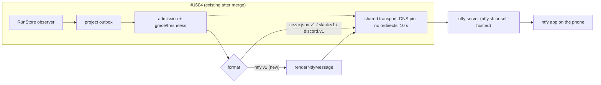

# ntfy receivers for outbound webhooks — phone notifications

Provider contract extending [outbound webhooks](2026-10-12-outbound-webhooks.md), alongside the
[Slack](2026-10-19-slack-webhook-receivers.md) and [Discord](2026-10-19-discord-webhook-receivers.md)
receivers. The outbound-webhooks spec is on `main` (#1401). PR #1604 implements it, revises it and
adds the Slack and Discord contracts; this spec assumes #1604 is merged. Handoff brief:
[2026-10-23-phone-notifications-ntfy](briefs/2026-10-23-phone-notifications-ntfy.md).

## 📝 TLDR

A developer who leaves the cockpit — on a local Mac or a hosted server — wants the phone to say when
a task needs them, is ready for review or failed. Today nothing reaches a phone. **Proposed:** an
`ntfy.v1` receiver format on the outbound-webhook pipeline from #1604. cezar generates a private
ntfy topic and shows a QR code, and one scan in the free ntfy app subscribes the phone. Automation-health alerts, which
the brief also asked for, change #1604's event model and get their own follow-up spec.

## 📝 Problem Statement

- The cockpit's notifications are page-context browser `Notification`s raised by
  `packages/web/src/components/run-notifications.tsx` only while a cockpit tab is alive and hidden.
  Chrome on Android refuses page-context construction without a ServiceWorker, and iOS shows nothing.
  On a phone, effectively nothing arrives.
- The README promises "Start and review tasks from your phone", so the gap is felt exactly when the
  user is away: a task waits an hour for an answer because nobody knew it asked.
- #1604 moves lifecycle capture to the server and sends to Slack, Discord or signed JSON. A
  developer working alone has no team channel, and reaching a phone through Slack means installing
  an Incoming Webhook app in a workspace just to notify yourself.

## 📝 Proposed Solution

An **`ntfy.v1` receiver format** beside `cezar.json.v1`, `slack.v1` and `discord.v1`:

- **Unchanged from #1604:** admission snapshot, queue, grace and freshness, failure disposition,
  task scope, profiles, revision fences, delivery history and rate budgets.
- **New for ntfy:** URL validation, a renderer, a diagnostics map and setup UX.
- **Setup:** the add-receiver form generates an unguessable topic on `https://ntfy.sh` (or a
  self-hosted server). After Save, a QR code with the ntfy subscribe link connects the phone. No
  account, token or bot is needed.
- **Gate:** the feature rides the existing `CEZ_WEBHOOKS=1` gate. It adds no env var and no global
  config.

Each existing rule set applies where it fits:

| Concern | Rule set ntfy follows | Why |
|---|---|---|
| Secrets | Chat formats (Discord): the URL is the credential, with no signing key and no rotation | The topic is the password, and ntfy cannot verify a signature. |
| Network policy | Custom JSON (#1604 Appendix A table): hosted mode is public HTTPS only; local mode allows HTTP(S) and, with consent, private addresses | A self-hosted ntfy on a home LAN is a primary use case. Slack and Discord never need that. |
| Response diagnostics | Public destinations only, `code`/`http` integers only. Private destinations keep status and content type, as #1604 requires | #1604 never retains a private destination's body. |

**Alternatives considered:**

| Option | Why it lost |
|---|---|
| Web Push from the cockpit (service worker, VAPID) | Hosted HTTPS only, so nothing for the local instance. iOS needs a Home Screen app with `display: standalone`/`fullscreen`, while the approved #944 ships `minimal-ui`. Untested behind the installer's basic auth. Kept for a later spec after an iPhone spike. |
| A standalone ntfy sender beside #1604 | A second capture, outbox and retry pipeline for the same events. |
| Telegram / Pushover / email | Each needs an account or a token: not one-scan, and no better delivery than ntfy. |
| Build nothing (Slack/Discord via #1604, GitHub mobile app) | Slack and Discord need a workspace you own. GitHub covers only review, and only when cezar opened a PR. |

**What the market leaders teach.** Uptime Kuma and Healthchecks.io both ship ntfy as a notification
channel configured by server, topic and per-event priority, with a Test button. Healthchecks
publishes "down" at the highest priority. Both make you invent and type the topic. cezar generates
it, hands it over as a QR code, and borrows the priority idea: "needs you" and "failed" are high,
informational events are default or low. Uptime Kuma's "apply on all existing monitors" shows that
reuse across targets matters. cezar cannot share a receiver across projects (a #1604 non-goal), so
reuse is a paste of the same topic URL.

## 📝 Architecture



The new code:
- **Service:** one renderer and one diagnostics map.
- **Contract:** one format value and its URL refinement.
- **Cockpit:** one destination in the receiver form.

Nothing bypasses #1604's admission path, and headless `cezar run` still captures nothing.

## 📝 Data Model

All of it lives in `packages/contract/src/webhooks.ts`.

**Format value.** `webhookFormatSchema` gains `'ntfy.v1'`.

**URL refinement for `ntfy.v1`:**
- Shape: `http(s)://<host>[:port]/<topic>`. `topic` matches `[-_A-Za-z0-9]{1,64}`, the ntfy
  topic rule.
- Exactly one path segment: no sub-path installs. No userinfo, query or fragment.
- Host, port and scheme are classified exactly by #1604 Appendix A:
  - Hosted mode: public HTTPS only.
  - Local mode, public host: HTTP(S), with the visible HTTP warning on `http://`.
  - Local mode, loopback/RFC1918/ULA: only with `allowLocalNetwork` consent.
  - This server's ports, link-local, metadata and reserved ranges: always denied.
- The chat refinement's "Chat destinations cannot use local networks" rule excludes `ntfy.v1`.

**Normalization on save.** Lowercase the host and drop the default port for the scheme. Keep the
topic's case, because ntfy topics are case-sensitive.

**Misrouted ntfy URLs.** A recognized `ntfy.sh` URL submitted with `format: 'cezar.json.v1'` is
rejected with "Choose Phone (ntfy) as the destination type", mirroring the Discord rule.

**Secrets.** The receiver URL is the credential.
- `secrets()` gets the full URL, the normalized URL and the `<host>/<topic>` form.
- The bare topic joins only when it is at least 16 characters long. A short pasted topic such as
  `alerts` must not redact that word from every payload. Generated topics are 30 characters.
- List and history views mask the path, as for Discord.

There is no change to any other schema, run record or `.ai/cezar/` file.

## 📝 API Contracts

No new routes. #1604's receiver create, edit and test routes accept `format: 'ntfy.v1'` through
the existing middleware validators. Contract-parity and typed-bodies tests extend to the new
format value. Rejections keep the `{ error }` shape.

### Rendered message (`packages/cezar/src/webhooks/ntfy.ts`)

`renderNtfyMessage(eventJson: string, ctx): string` maps the **already rendered, redacted,
profile-filtered** cezar event body to an ntfy JSON publish body. ntfy never sees a field the cezar
payload for that profile does not carry. The project label comes from `ctx` (the receiver's owning
project), because `webhook.test` carries no `source`. The body is POSTed to the server's origin
root (`https://ntfy.sh/`), with the topic in the body:

```json
{ "topic": "cezar-7Qm2…", "title": "customer-api · Needs your input",
  "message": "Fix login redirect\nWhich branch should I target?",
  "priority": 4, "tags": ["question"], "click": "https://cezar.example.com/p/customer-api/tasks/598afadb", "markdown": false }
```

| Event | Title (after `<project> · `) | Priority | Tag (emoji) |
|---|---|---|---|
| `task.attention_required` | Needs your input | 4 high | `question` ❓ |
| `task.review_ready` | Ready for review | 3 default | `eyes` 👀 |
| `task.finished` | Finished | 3 default | `white_check_mark` ✅ |
| `task.failed` (manual) | Failed | 4 high | `x` ❌ |
| `task.failed` (scheduled) | Failed — will retry at HH:MM | 2 low | `hourglass_flowing_sand` ⏳ |
| `task.cancelled` | Cancelled | 2 low | `no_entry_sign` 🚫 |
| `webhook.test` | cezar is connected to this topic | 3 default | `white_check_mark` ✅ |

**Message content:**
- `message` is the task title, or task id8 when the profile omits the title.
- Standard adds the first question and its options, or the failure message.
- Times are in the server's time zone, labelled as #1604 labels history times.
- Plain text only (`markdown: false`), so there is nothing to escape. Control characters other than
  `\n` are stripped.

**Limits:**
- `message` is capped at 4000 UTF-8 bytes. ntfy turns anything over 4096 into an attachment.
- `title` is capped at 250 characters.
- When over a cap, questions are dropped first, then text is clipped.

**Click target and the local footer:**
- `click` uses the first that exists: the hosted cockpit task link (only via #1604's unambiguous
  installer `publicUrl` rule), then `links.pullRequest`, then `links.issue`.
- When `source.mode === 'local'` and no link exists, the message ends with "Open cezar on this
  computer". The tap then opens the ntfy app, not a dead `127.0.0.1` link.

### Send path

- Headers: `content-type: application/json`, no `webhook-*` signature headers. #1604's transport
  policy applies unchanged: DNS pinning, no redirects, 10 s timeout, 4 KiB response cap. The
  successful response body is discarded.
- Diagnostics: for public destinations, read at most 512 bytes of a JSON error body and keep only
  its integer `code` and `http` fields. Private destinations keep status and content type only.

| Response | Outcome |
|---|---|
| 2xx | Delivered. This means the ntfy server accepted it, not that the phone displayed it. |
| 401 / 403 | Permanent for this delivery; the receiver stays active. Hint: "This topic is protected. Use an open topic, or a server that allows anonymous publishing — access tokens are not supported yet." |
| 413 | Permanent `payload_invalid`. The renderer caps make this unreachable, and a test pins that. |
| 429 | `rate_limited`: honor `Retry-After`, else the shared backoff. ntfy.sh limits anonymous publishers per visitor. |
| Everything else | #1604 Appendix A table (5xx transient, other 4xx permanent, 410 disables). |

`CEZ_DRY_RUN=1` substitutes synthetic success and sends no ntfy traffic, including Test.

## 📝 UI/UX

Lives in Project Settings → Webhooks (#1604). Global Settings → Notifications stays browser-only.

**Add receiver → Destination: "Phone (ntfy)"** (see
[mockup 01](assets/ntfy-webhook-receivers/mockup-01-add-receiver-ntfy.png)):

- **Server.** `ntfy.sh` by default. "Use my own ntfy server" reveals a URL field and this hint: "iPhones get instant notifications from a self-hosted server only when it
  forwards to ntfy.sh (`upstream-base-url`); otherwise delivery can take hours."
- **Topic.**
  - The default is "Create a private topic". The browser generates `cezar-` plus 24 characters from
    `[A-Za-z0-9]` with `crypto.getRandomValues`, about 142 bits.
  - "Use a topic you already subscribed to" accepts a pasted topic URL. This is for a second
    project on the same phone. The URL comes from the Connect panel or from the ntfy app's topic
    view, because there is no later reveal route.
  - A pasted topic on `ntfy.sh` shorter than 20 characters shows "Anyone who guesses this topic
    can read these notifications."
- **What it shows.** Minimal (the #1604 default) or "Show task titles, questions and errors
  (Standard)". A phone-style preview renders both.
- **Events.** #1604's presets, task scope and grace, unchanged.

**Connect your phone** (see
[mockup 02](assets/ntfy-webhook-receivers/mockup-02-connect-phone.png)) replaces the form after
Save. The receiver is inactive at that point. The panel shows:

- **QR code.** It encodes `ntfy://<host>[:port]/<topic>?display=cezar%20·%20<project>`, adding
  `&secure=false` for an `http://` server. This is the documented Android subscribe link. The
  phase-1 spike settles what iOS does with it.
- **Copy topic URL** and "Install ntfy" store links.
- **Send test** and **Activate.** #1604 allows activation without a test. The panel orders Send
  test first ("check your phone buzzes"), and Activate stays available. After a permanent test
  failure, #1604's `activationBlocked` applies.
- **Copy:** "Closing this panel hides the code. If you lose it, edit the receiver and create a new
  topic." This matches #1604's one-time-secret pattern.
- **Consent for `ntfy.sh` at activation:** "Anyone who knows this topic, and the operators of
  ntfy.sh, can read these notifications."

**Accessibility.**
- The QR code's text alternative is the topic URL with a Copy button.
- The panel is keyboard-reachable and works in light, dark and system themes.
- On a narrow layout it stacks, and on a phone-width cockpit it leads with Copy, because you cannot
  scan your own screen.

**What arrives on the phone:** see
[mockup 03](assets/ntfy-webhook-receivers/mockup-03-phone-notifications.png).

Prototype: `.ai/specs/assets/ntfy-webhook-receivers/` (static mockups; illustrative, not app code).

## 📝 Edge Cases & Failure Scenarios

| Scenario | Behavior |
|---|---|
| A hidden desktop tab and the phone both notify for the same event | The server cannot tell where the user is, so it suppresses neither. #1604's attention grace dedupes the common case: answering at the desk within the grace supersedes the queued phone alert. The setup copy says so, and a user at the desk can raise the grace. |
| ntfy.sh unreachable or rate-limited | Shared retry, backoff and expiry. Tasks are never blocked or failed by delivery. |
| Same topic in several projects, or in the local and hosted instance | Each receiver sends independently. The `<project>` title prefix disambiguates, and the local footer tells local from hosted. |
| Local instance, no PR/issue link | No `click`; the message says to open cezar on this computer. |
| Hosted, `publicUrl` unknown or ambiguous | No cockpit link (#1604 rule). A PR or issue link is used when present. |
| Phone offline | The ntfy server caches the message and delivers it on reconnect. HTTP 200 is not a display receipt, and the guide says so. |
| Protected self-hosted topic | 401/403 with the access-token hint. |
| QR panel closed before scanning | Edit the receiver and create a new topic. That is a new revision, so #1604's activation consent runs again. |
| `CEZ_WEBHOOKS` unset | The Webhooks section shows #1604's "Webhooks are off" copy, extended to mention phones. |

## 📝 Risks & Impact Review

- **Dependency on #1604.** That PR is open with changes requested and labelled `risk-high`. This
  spec reuses its seams (the `format` enum, renderer selection, transport and secrets) and changes
  none of its guarantees. If #1604 reshapes a seam, this spec follows. If #1604 is abandoned, this
  spec has no transport of its own; a new spec is needed, not a patch.
- **Public topic = credential.** Mitigated by:
  - generated topics of about 142 bits;
  - Minimal as the default profile;
  - the guessable-topic warning;
  - activation consent naming the ntfy.sh operators;
  - URL-form redaction in history, logs and toasts, with a test pinning that the topic never
    reaches either.
- **New cockpit dependency.** QR encoding needs a library: `uqr` (zero-dependency, ESM), in
  `packages/web` only. The server package gains nothing. It is reversible, because a copy-link-only
  panel works without it.
- **BACKWARD_COMPATIBILITY.md §2.** The new `ntfy.v1` format value is additive.
- **Env docs.** `.env.example` and the env table in `docs/reference.md` list ntfy beside Slack and
  Discord in the `CEZ_WEBHOOKS` description. No new variable and no default change.
- **Zero config.** Nothing is required. The feature is invisible until `CEZ_WEBHOOKS=1` is set and
  a receiver is created and activated, which is #1604's opt-in path for outbound traffic.

## 📋 Phasing

One phase. It needs #1604 merged, and it is shippable alone.

**Follow-up spec: automation-health events.** The brief asked for alerts when an automation pauses
itself, cannot start a task, or skips a run. That work:
- changes #1604's event model from task-only events to automation events;
- touches the schedule runner, both `automationLogRecordSchema` copies
  (`packages/cezar/src/automations/types.ts` and `packages/contract/src/automations.ts`) and every
  renderer;
- benefits every receiver format.

It is an amendment to #1604, not part of an ntfy format. Facts that spec must carry:
- Log rows hold failure counts and skipped occurrences only in `reason` text. Structured fields
  (`failures`, `occurrenceAt`, `skippedCount`) and a structured `cause` must be added first.
- `retireOnce` writes `result: 'skipped'` after a **successful** one-time run, and the auto-pause
  row is `result: 'failed'`. Mapping log results would alert falsely after every `once` and twice
  on every auto-pause.
- Manual and catch-up launches count toward the auto-pause in `recordFailure`.
- Still to define: freshness and supersession for non-task events, task scope and filters, Custom
  event selection, and whether the toggle is a delivery-affecting edit.

## 📋 Implementation Plan

1. **iOS and Android spike** (before any UI work, about an hour, recorded in this spec). Publish to
   a throwaway ntfy.sh topic and generate QR codes for `ntfy://ntfy.sh/<topic>` and
   `https://ntfy.sh/<topic>`.
   - Record what the Android and iPhone cameras and the ntfy apps do with each.
   - The result fixes the QR payload. Use `ntfy://` if both platforms subscribe. Otherwise use
     per-platform tabs, with iPhone on `https://` plus "In ntfy, tap + and paste the topic".
2. **Format end to end.**
   - **Contract:** `ntfy.v1`, the URL refinement (#1604 Appendix A classification, `http(s)`,
     single segment, the chat local-network exclusion), normalization and `secrets()` forms.
   - **Renderer:** `renderNtfyMessage` with the mapping table, caps, click precedence, local footer
     and `ctx` project label.
   - **Send path:** POST to the origin root, public-only diagnostics, the outcome table, dry-run
     synthetic success.
   - Landing all three together means no commit accepts a format it cannot send.
   - **Tests, accepted:** ntfy.sh, self-hosted public HTTPS, local `http://192.168.x.x:8080/t` with
     consent and the HTTP warning.
   - **Tests, rejected:** sub-path, query, userinfo, a topic with `.`, a 65-character topic, a
     private address in hosted mode, the server's own port, an `ntfy.sh` URL under `cezar.json.v1`.
   - **Tests, rendering:** Minimal never carries a non-user title, question or error. Each event
     maps to its priority and tag. A 10 KB Standard question set fits under 4000 bytes.
     `webhook.test` carries no task data.
   - **Tests, redaction:** a 6-character topic is redacted only in URL form, and a 30-character
     one also bare.
   - **Tests, transport:** a loopback fake ntfy server with local consent. A private destination
     keeps no response body.
3. **Cockpit.**
   - The "Phone (ntfy)" destination: server default or custom, topic generation and paste, the
     guessable-topic warning, the phone-style preview.
   - The Connect your phone panel with `uqr` and the payload decided in step 1, Copy, the
     phone-width layout and the consent copy.
   - Tests: generated topic alphabet, length and entropy source; the QR payload string, including
     `secure=false` and an explicit port; no topic in toasts or `console`; keyboard focus order.
4. **Docs.**
   - In `packages/cezar/docs/webhooks.md`, "Send to your phone (ntfy)" covers setup and scanning,
     the topic as password, Minimal vs Standard, self-hosted servers and the iOS
     `upstream-base-url` note, 401/403, and the desk-and-phone grace note.
   - The `CEZ_WEBHOOKS` wording in `.env.example` and `docs/reference.md`.
   - The BC §2 format inventory.
5. **Live acceptance** (manual, `needs-qa` evidence, explicit authorization, throwaway topic).
   Follow #1604's live-acceptance procedure: Save, Test, Activate. Then a benign question, a
   trivial finished task and a controlled failure, observed on one Android and one iPhone.

## Resolved assumptions (autonomous defaults)

| # | Question | Applied default | Why | Confirm? |
|---|---|---|---|---|
| Q1 | Build on #1604's per-project receivers, or a separate workspace-wide channel? | Build on #1604. Each project gets its own ntfy receiver, and the same phone is reused by pasting the topic URL. | One delivery pipeline instead of two; #1604 rules out global receivers. But the brief asked that every subscribed device get every project's notifications from one setup. A "no" here invalidates this spec's base. | ⚠ NEEDS HUMAN CONFIRMATION |
| Q2 | Automation-health events here, or a separate spec? | A separate follow-up spec. This one ships ntfy only, with a forward pointer. | They change #1604's event model for every format and need log fields that do not exist yet; that is an amendment to #1604, not an ntfy concern. | reversible |
| Q3 | Access tokens for protected self-hosted ntfy now? | Defer. Open topics only; 401/403 explains it. | No new write-only secret field. ntfy.sh and default self-hosted servers accept anonymous publishing. | reversible |
| Q4 | What does the QR code encode? | Decided by the step-1 spike: `ntfy://` when both platforms subscribe from it, otherwise per-platform tabs with an `https://` iPhone fallback. | `ntfy://` is the only documented one-scan subscribe path, and only on Android. | reversible |
| Q5 | QR dependency, or copy-link only? | Add `uqr` to `packages/web` only. | "One scan" was a resolved requirement. Zero-dependency, client-only, removable. | reversible |
| Q6 | Default profile for ntfy receivers? | Minimal stays the default; Standard is one choice in the form. | Never weaken #1604's data-minimization default toward a third-party server. The user's "title + project" is one click away. | reversible |
| Q7 | Which URL shapes are accepted? | `http(s)://host[:port]/<topic>`, classified exactly by #1604 Appendix A. No sub-paths. | Reuses the custom-JSON network policy unchanged, which keeps the review surface small. | reversible |
| Q8 | Dedupe against the cockpit's page notification? | No server-side suppression; #1604's attention grace supersedes the phone alert when the user answers at the desk in time. | The server cannot know which screen the user is at, and the grace already exists for exactly this. | reversible |
