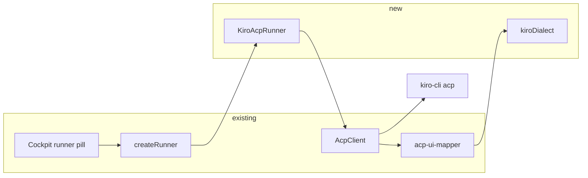

# Kiro CLI agent

> Slug: `kiro-cli-agent` · Status: **designed, awaiting confirmation of Q1** ·
> Delivery: one implementation PR after Q1 is confirmed. CLI V3 is a separate spec.

## 📝 TLDR

Cezar can run Claude, Codex, OpenCode, Cursor, pi, Junie and Copilot. It cannot run [Kiro CLI](https://kiro.dev/docs/cli/) (`kiro-cli`). This spec adds a `kiro` backend that speaks the CLI v2 Agent Client Protocol server (`kiro-cli acp`), reusing the shared ACP client and mapper Copilot already uses. A task picked as Kiro runs in the task worktree, streams tools and text into the same transcript, and accepts follow-up messages on that session. CLI V3 is an incompatible dialect and is not part of this spec.

## Resolved assumptions (autonomous defaults)

| # | Question | Applied answer | Why | Confirm? |
|---|---|---|---|---|
| Q1 | Which Kiro CLI generation does this backend speak? | **CLI v2 ACP**: spawn `kiro-cli acp --trust-all-tools`. CLI V3 (`kiro-cli acp --agent-engine=v3`) is a later spec, not a phase of this one. | `kiro-cli acp` with no engine flag is the server Zed and JetBrains launch, and V3 is documented as an early opt-in that rejects those flags and replaces `session/set_model`, turn completion and permission metadata ([ACP](https://kiro.dev/docs/cli/acp/), [V3 migration](https://kiro.dev/docs/cli/v3/acp-migration/)). Shipping the default server matches zero-config. The two dialects do not share a mapper, so folding V3 into this spec is a second capability. | ⚠ NEEDS HUMAN CONFIRMATION |
| Q2 | ACP session, or headless `chat --output-format stream-json`? | **ACP**, one long-lived process. | stream-json is Kiro's one-shot CI mode. Cezar sessions need `sendMessage`, `interrupt` and `session/load`. The shared `AcpClient` already speaks this. | reversible |
| Q3 | Runner id `kiro` or `kiro-cli`? | **`kiro`**. The binary stays `kiro-cli`. | Every existing id is the product (`copilot`, `junie`), not the executable. The id is additive until it ships; after that, removing it is a breaking change (`BACKWARD_COMPATIBILITY.md` §2, §3, §7). | reversible |
| Q4 | Second Kiro account via `KIRO_HOME`? | **`PROFILE_ENV_VAR.kiro = null`**. Do not offer Add account. | `KIRO_HOME` is documented, and the V3 sentence is the one that says it moves sign-ins and sessions together ([configuration](https://kiro.dev/docs/configuration/)). The profile rule is that a wrong home variable bills the wrong account (`core/agent-profiles.ts`). Copilot stayed `null` for the same reason (spec `2026-09-19-runner-seam-native-backends` Q14). | reversible |
| Q5 | Edit `~/.kiro` in Settings → Agent config? | **No.** | The catalog round-trips vendor files byte-exact. Kiro's file layout is not verified here, and a task can run without cezar editing those files. | reversible |
| Q6 | Cloud sessions (`--cloud`)? | **No.** | A cloud sandbox is not the task worktree. Local `cwd` only. | reversible |
| Q7 | Who holds the access token? | **The CLI.** Never pass `--auth-method=client` and never implement `_kiro/auth/getAccessToken`. | That method exists so a client can hand the agent a token. Cezar must not see it. V2 has no such flag; a future V3 runner keeps CLI-owned login. | reversible |
| Q8 | Mockups on this spec PR? | **Text-only.** | `.ai/qa/test-env.json` is absent, so step 5 of `om-auto-write-spec` skips screenshots. The UI delta is a pill and a settings row. | reversible |

## 📝 Problem Statement

Kiro CLI is a terminal coding agent with a documented editor protocol. Zed and JetBrains already start it as `kiro-cli acp` and talk JSON-RPC over stdio ([ACP](https://kiro.dev/docs/cli/acp/)). Cezar's runner list stops at Copilot (`RUNNER_IDS` in `packages/cezar/src/core/agent-runner.ts`). Someone whose agent is Kiro cannot pick it for a task, a workflow step, or an automation.

The headless chat command (`kiro-cli chat --no-interactive --output-format stream-json`) is a CI batch mode. It is the wrong seam: a cezar session is a process that accepts another message, an interrupt, and a resume after the cockpit restarts.

## 📝 Proposed Solution

Add one runner, `KiroAcpRunner`, beside `CopilotAcpRunner`. It spawns `kiro-cli acp --trust-all-tools` (override `CEZ_KIRO_BIN`), speaks through the existing `AcpClient` (`packages/cezar/src/core/acp-client.ts`), and maps frames with a `kiroDialect` on `mapAcpFrame` (`acp-ui-mapper.ts`). No new transport and no new event type.

The cockpit gains a runner. The protocol does not.

What this deliberately does not do: CLI V3, cloud sessions, a raw config editor, a second account, client-held tokens, slash-command bridging (`_kiro.dev/commands/*`), and usage-window snapshots. Kiro's v2 ACP update table has no usage frame; do not invent one.

## 📝 Architecture

Follow `AGENT_PROTOCOL.md` §9. The shipped Copilot path is the template (`copilot-acp-runner.ts`, `copilot-ui-mapper.ts`). The unshipped "one tuple" phase of spec `2026-09-19-runner-seam-native-backends` is a different change; this spec adds `kiro` beside each existing `copilot` site rather than collapsing those lists.

**Process.** One child and one ACP session per cezar session, as the shared ACP layer already specifies. First turn: `initialize` (protocol version 1, `fs` and `terminal` client capabilities false — the agent uses its own tools in `cwd`), then `session/new` with `{cwd, mcpServers}`, then `session/set_model` when the task names a model, then `session/prompt`. Follow-ups are further `session/prompt` calls. `interrupt()` sends `session/cancel` and keeps the session. `end()` closes stdin, then SIGTERM after the same grace period as Copilot. A child that dies mid-turn fails that turn; the next message respawns and `session/load`s the stored id, or starts a fresh session with a `note` when load fails. Cezar stores the ACP session id on the run. It does not read or write `~/.kiro/sessions/`.

**Prompt.** v2 ACP has no system-prompt flag. Prepend `AgentRunSpec.systemPrompt` to the first user prompt, the same way the shared layer does for Copilot. Images go on that first prompt only when `initialize` advertised `promptCapabilities.image`. If the server rejects the image block, the turn fails visibly; the image is not dropped.

**Models.** Kiro's documented model ids are bare (`claude-sonnet` in the V3 examples; v2 `session/set_model` takes the same kind of id). `BACKEND_MODEL_MAP.kiro` is `{ defaultProvider: 'kiro' }`, so a bare id resolves and `toBackendModel` sends the bare string. An explicit `other/model` is rejected, matching Junie and Copilot. A requested model whose `session/set_model` fails produces a `note` and the run continues on Kiro's own model — the Copilot behavior — never a silent swap with no record. Discovery uses `kiro-cli chat --list-models --format json` when that command exits 0 and the JSON parses; a failure leaves the picker on "backend default" and does not fail boot or the run.

**Permissions.** `auto` only, per spec `2026-09-19-runner-seam-native-backends` Q15. Launch with `--trust-all-tools` (a v2 `acp` flag; V3 rejects it). A `session/request_permission` that still arrives is auto-approved with a `note`, using the same option pick as Copilot. A request with no option cezar can pick is cancelled with a `note`. The run must not park: nothing in the cockpit answers a permission card.

**Credentials.** `BACKEND_ALLOW_PREFIXES.kiro` is `['KIRO_']`, so `KIRO_API_KEY` reaches the child and no other backend gains it. Do not add `AWS_`. Auth precedence stays the CLI's (browser login, then `KIRO_API_KEY`). The probe runs `kiro-cli whoami --format json` and keeps only a status (`connected` / not logged in / `not-installed`). It does not persist or log the body: `whoami` prints an email. Settings → Agents starts login with `kiro-cli login`, the same shape as the Copilot row. Device-flow URL and code are the CLI's own stdout; cezar does not proxy the token.

**Private MCP.** Pass `AgentRunSpec.mcpServers` through `session/new` using the existing ACP translator, and add `kiro` to `PRIVATE_MCP_RUNNERS` only once that path works. A `_kiro.dev/mcp/oauth_request` becomes a `note` that the server needs sign-in. Cezar does not open that URL and does not store it.

**Extra directories.** The v2 `session/new` example accepts `cwd` and `mcpServers` only. Do not send `additionalDirectories` on v2. When the spec asked for any, emit one `note` that they were not attached. Do not invent a flag.

**Resume outside the cockpit.** `resumeCommand('kiro', id)` may return `kiro-cli chat --resume-id <id>` (honoring `CEZ_KIRO_BIN`) only after a captured session id is shown to be accepted by that flag. If the ACP id is not a chat resume id, return `null`. A command that resumes the wrong session is worse than no command (the Junie `--session-id` bug).

**Dry run.** `CEZ_DRY_RUN=1` swaps in a bundled `scripts/mock-kiro-acp.mjs`, same as `mock-copilot-acp.mjs`. Boot must not require a real `kiro-cli`.

**Detection.** Absent binary degrades to `not-installed` with the vendor install hint (the curl installer documented at `https://cli.kiro.dev/install`). It never fails boot. A binary that exits as soon as `acp` starts fails that run with the child's stderr; it does not hang the session.

## 📝 Data Model

No new entity and no migration. `kiro` is an additive value on the runner enum and on every optional per-runner string map that already has a `copilot` key (`packages/contract` health, workspace, agent-profiles). Old `runs.json` files stay valid. The ACP session id reuses the existing session field.

## 📝 API Contracts

No new route. Additive enum and row changes only:

- `runnerSchema` and the provider-name enum in `packages/contract/src/health.ts` gain `kiro`.
- Run create, workflow step `runner`, and workspace `agentDefaults.models` accept `kiro`. Absent keys stay absent.
- `GET /api/v1/providers/status` gains one Kiro row from the existing probe.
- Model discovery, when it succeeds, arrives on the existing models route.

`UiBackend` in `packages/cezar/src/core/ui-events.ts` and `packages/api-client/src/protocol/ui-events.ts` both gain `kiro`. No new `UiEvent` type.

## 📝 UI/UX

The new-task runner control gains a `kiro` pill, description "Kiro CLI (ACP)". Settings → Agents gains a row whose login command is `kiro-cli login`, with the same not-installed / not signed in / connected states as the other CLIs. The model control shows discovered ids or the backend default. There is no new page and no Kiro file editor.

Prototype: none. Mockups skipped — `.ai/qa/test-env.json` is absent.

## 📝 Edge Cases & Failure Scenarios

| Situation | What the user sees |
|---|---|
| `kiro-cli` not on `PATH` and `CEZ_KIRO_BIN` unset | Kiro shows not installed. Other agents and boot are unchanged. |
| Binary present, `whoami` says not logged in, no `KIRO_API_KEY` | Not signed in, with the login action. A run is not started as if it were authenticated. |
| `session/set_model` fails | A note naming the failure. The turn still runs on the CLI's model. |
| `session/load` fails | A note, then a new session. History already in cezar's NDJSON is not replayed into a second copy. |
| `stopReason: refusal` | The turn completes as a refusal, not as a normal `end_turn`. |
| Permission request with no usable option | Cancelled, with a note. The run is not left waiting. |
| MCP OAuth notification | A note. No browser launch from cezar, no stored URL. |
| Malformed or unknown ACP frame | No events. The session stays up. |
| Child exits during a turn | That turn fails with the child's message. The next message respawns. |
| `whoami` output | Status only. The email is not written to logs, run records, or provider state. |
| `CEZ_DRY_RUN=1` | The mock ACP script. No network and no real CLI. |

## 📝 Risks & Impact Review

Q1 is the hard-to-reverse choice. Implementing v2 and then being told to ship V3 replaces the dialect (model method, turn completion, permission metadata, session discovery). That is why the spec PR stays draft until Q1 is confirmed. The runner id, once released, is protected; this spec only adds it.

Auto-approving tools is the same exposure Copilot already has: the agent can run commands in the task worktree. This spec does not add a permission card.

`KIRO_API_KEY` is forwarded and never copied into `.ai/cezar/` or `~/.cezar`. Rollback of an unreleased implementation is deleting the runner. Rollback after release is a deprecation of the `kiro` enum value, not a silent removal.

## 📋 Phasing

Phase 1 is this spec: a v2 ACP Kiro backend, selectable in the cockpit, with dry-run, probe, models, MCP and docs. It ships without V3, without profiles, and without a config editor.

A later spec owns CLI V3 (`--agent-engine=v3`, `session/set_config_option`, turn completion from the prompt response, standard permission options). It should not be started by stretching this one.

## 📋 Implementation Plan

One phase. Each step leaves typecheck and the existing runner tests green. `npm test` and `npm run test:unit` are the gate for the steps; a live `kiro-cli` is not required because fixtures and the dry-run mock stand in for it. Before the implementation PR merges, one fixture file must be a captured v2 transcript, not only the examples copied from the ACP doc (protocol rule: fixtures cite upstream wire, and a doc snippet is not a session).

1. **Id and session.** Add `kiro` beside `copilot` on `runnerSchema`, `RUNNER_IDS`, `UiBackend` (both copies), `PROVIDER_IDS`, the contract per-runner maps, and the web unions that fail typecheck without it (`provider-status`, new-task form, settings, automations, e2e runner lists). Add `KiroAcpRunner` and `createRunner('kiro')`. Spawn `kiro-cli acp --trust-all-tools`, or `CEZ_KIRO_BIN`, or the dry-run mock. Drive `initialize`, `session/new`, `session/prompt`, `session/cancel`, `session/load` through `AcpClient`. Map with `kiroDialect` and fixtures for: text chunks, a tool call and its update, `stopReason` `end_turn` and `refusal`, and an unknown frame that yields nothing. `CEZ_DRY_RUN=1` reaches a single `done`. Document `CEZ_KIRO_BIN` in `.env.example` and `docs/reference.md`.
2. **Probe and env.** `probe` uses `whoami --format json` and never records the body. Missing binary → `not-installed`. `BACKEND_ALLOW_PREFIXES.kiro = ['KIRO_']`. `PROFILE_ENV_VAR.kiro = null`. A test pins that a sibling backend's env does not receive `KIRO_API_KEY`, and that the probe fixture's email does not appear in the status object.
3. **Models.** `BACKEND_MODEL_MAP.kiro = { defaultProvider: 'kiro' }`. Bare id resolves; `anthropic/claude-sonnet` throws `ModelIdentityError`. `session/set_model` failure emits a note and does not drop the request silently. `--list-models --format json` fills the picker only on success.
4. **Permissions, MCP, directories, resume.** Auto-approve a permission request that has an allow option; cancel one that does not; both emit a note. Attach private MCP and add `kiro` to `PRIVATE_MCP_RUNNERS` with a test that the servers are on `session/new`. When `additionalDirectories` is non-empty, one note and no extra param. `resumeCommand` returns the `chat --resume-id` string only if a test fixture shows the ACP id works there; otherwise `null`, with the test naming which.
5. **Parity.** Add `kiro` to `BACKENDS` in `ui-parity.test.ts`. Every row passes, or is listed in that row's `except` with a citation. Expected exclusions until a capture shows otherwise: `usage.updated` and per-turn usage (v2 ACP update table has no usage), and sub-agent `task` items (v2 documents `_session/terminate` but no `task` tool kind — same citation style as Junie). Do not exclude `plan.updated` or reasoning until a captured session shows those frames never arrive; `agent_thought_chunk` and a `plan` update are standard ACP and the shared mapper already emits them.
6. **Cockpit and docs.** Pill and settings row as in UI/UX. New feature page `docs/site/content/docs/03-features/agents-and-models/kiro-agent.mdx` in the Copilot page's shape, and a Kiro row on `docs/site/content/docs/04-architecture/04-agent-runners.mdx`. No agent-config catalog entry.

## 🧪 Review limits

Checked against `AGENT_PROTOCOL.md` §9, `CopilotAcpRunner`, `acp-client.ts`, `acp-ui-mapper.ts`, `agent-profiles.ts`, and the Kiro docs linked above. No `kiro-cli` binary was run in this session, so launch flags and the `whoami` JSON shape are taken from those docs. The implementation step that captures a real v2 transcript is what confirms `--trust-all-tools` on `acp`, the `session/set_model` params, and whether the ACP session id matches `chat --resume-id`.
