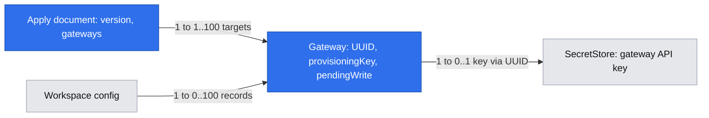

# App Spec: AI Gateways

Date: 2026-10-28
Status: Draft for owner review; documentation only, not authorization to implement.
Scope: AI Gateways in the existing Cezar application; the earlier LLM provider design is unshipped reference material.
Reference design: [LLM provider connections from the earlier proposal](https://github.com/open-mercato/cezar/blob/544d0c76/.ai/specs/2026-10-27-llm-provider-connections.md).

## TLDR — sandbox provisioning amendment

Add explicit, server-independent `ai-gateways apply --file <path|->` for a JSON batch of gateway configurations. One invocation updates the ordinary OpenRouter seed and creates another gateway; repeated invocations preserve their identities. File and stdin use the same contract, with no intermediate file required for stdin. Agent-default assignments remain separate.

The owner accepted **preserve progress and retry**: validate the entire input before writes; after a persistence failure, retain completed records, stop at the failing record, report partial progress and allow retry of the whole document. This is a proposed extension of WF4/G4/US6, grounded in the [accepted brief](briefs/2026-10-28-ai-gateways-batch-apply.md), not implemented runtime behavior. Detailed rules are in §4.6; the amendment's failure-policy question is resolved.

## Branch isolation and implementation baseline

This PR starts independently from `origin/main` at `4040b404b3e7ab8a34f6383c8d0a4f995861e977`. Its initial commit contains only this spec and its review notes. No implementation commits from [the earlier provider-connections PR #1726](https://github.com/open-mercato/cezar/pull/1726) are included, and merging that PR is not a prerequisite for this PR.

The investigation/reviews below used reference implementation `544d0c76`, which is not in this starting `main`. Statements about existing `LlmProviders`, gateway contracts/CLI/routing and their tests describe that reference branch. Shared Cezar infrastructure (workspace storage, SecretStore, runner interfaces, settings shell) is available on the base, but reference-only gateway behavior must be implemented or deliberately ported into this PR with verification if it remains absent from `main`. Do not copy the earlier branch wholesale. Re-evaluate G1–G4 estimates against the base before implementation; the revised 11–17 commit range includes batch apply and shared write safety, not proof that the reference implementation is already merged. Prior review verdicts cover the design and do not certify an implementation on this isolated branch.

The entire implementation will be added to this same PR in later commits. This initial delivery makes no runtime behavior changes.

This document records the conversation's requirements and the proposed operating rules. Once approved, it owns the AI Gateways product behavior; the baseline remains evidence of current behavior until implementation ships. The provisioning amendment is grounded in the linked brief; no runtime implementation is included in this authoring change.

## 1. Business Context

### 1.1 Outcome and decision provenance

The operator of a local or VPS-hosted Cezar should configure API connections once and reuse them across coding agents and projects. In the reference implementation the UI calls these LLM providers, offers create/remove only, treats OpenRouter as a special type, and requires an explicit connection choice on each task.

**Explicit user requirements:**

- Name the feature **AI Gateways**, with the canonical CLI group **`ai-gateways`**, and give it a separate section in **General Settings**. No `llm-providers` compatibility alias: the owner confirmed that this feature has no shipped implementation.
- List gateways with an ON/OFF switch; support adding and editing gateways.
- Supply OpenRouter as an initial, editable seed record, not a privileged built-in provider type.
- Keep the existing secret-storage/keychain pattern.
- Add **Default AI gateway** to each coding agent's settings.
- Preserve programmatic configuration for VPS deployment.
- Provide one explicit batch apply for sandbox gateways, from either a JSON file or stdin; exclude agent-default assignments from that batch. Preserve successfully applied records on a later failure and support safe retry (owner-confirmed provisioning amendment).

**Proposed rules, not separately owner-confirmed:** disabled/keyless seed; ON means available rather than globally selected; native setup remains each agent's initial default; task overrides; no silent fallback; stable connection binding across continuations; disable does not kill a running process. These are specified below so review has a concrete target.

This is an existing-product capability, not a monetization proposal. Paying customer, commercial flywheel, and financial ROI targets were not supplied; this document does not invent them. Operational targets below are proposed acceptance measures, not measured savings. No telemetry is added.

### 1.2 Goals and non-goals

Targets: configure a gateway and an agent default once; create subsequent tasks without reselecting the gateway; repeat a provisioning update without creating another gateway; produce zero unrequested credential/account fallbacks in the regression matrix.

Out of scope: running an inference proxy, load balancing, automatic provider failover, cost-based routing, new accounts/roles, a new secret vault, native-login migration, scheduled API tasks, new provider protocols, and production deployment manifests. No network request or billable turn is caused by the OpenRouter seed.

### 1.3 Ubiquitous language

| Term | Meaning | Source / lifetime |
|---|---|---|
| Agent / runner | Coding-agent program, e.g. Claude Code or Codex | Existing runner registry |
| AI gateway | Named connection to an API endpoint, including a direct provider endpoint | Workspace metadata; shared across projects |
| Protocol | Wire format: Chat Completions, Responses, or Anthropic Messages | Editable gateway capabilities |
| Native setup | Agent's own config and selected native account; it may itself use an external API | Existing profile/config resolution |
| Agent default | Workspace-level native choice or gateway reference for one runner | Persists until operator changes it |
| Task selection | Inherit agent default, explicit native setup, or explicit gateway | Creation/explicit continuation input |
| Resolved binding | Actual native/gateway choice used by a task for a runner | Persisted before launch; stable across continuation |
| Routing revision | Identity of endpoint/protocol/auth settings that own a native session | Changes on routing edits, not renames or secret rotation |
| Seed | One-time creation of an ordinary editable record | Initialization/migration; never resurrects a deleted record |

### 1.4 Domain model and invariants

Conceptual field names below do not require renaming existing persisted fields or public endpoints.

| Entity / field | Type / multiplicity | Required | Rule |
|---|---|---|---|
| Gateway.id | UUID, single | System-set on create | Immutable; preserve existing provider IDs and secret associations |
| Gateway.provisioningKey | Lowercase slug, optional | Set by seed or apply | Unique per workspace, immutable once assigned; CLI input `key` maps to this field; name/URL are never identity |
| Gateway.pendingWrite | Boolean, optional | Internal; absent means false | True durably blocks use while a secret-bearing update is incomplete; never controlled by manifest/UI input |
| Gateway.name | Text, single, 1–80 trimmed chars | Yes | Editable display label; not an identity key |
| Gateway.baseUrl | HTTP(S) URL, single, max 2048 chars | Yes | Existing URL validation: no credentials, query or fragment |
| Gateway.protocols | Non-empty set of existing protocol enum | Yes | At least one; compatibility depends on this data, not name/host/kind |
| Gateway.auth | Object: `protocols: Record<Protocol, AuthMode>`, `catalog: AuthMode`; `AuthMode = bearer or x-api-key` | Yes; exactly one entry per supported protocol plus catalog | Bearer means Authorization: Bearer; x-api-key means the existing Anthropic API-key header mode. No arbitrary header names, executable commands or templates |
| Gateway.enabled | Boolean | Yes; proposed default false for new records | Enabled and readable key are separate facts |
| Gateway.routingRevision | Opaque system-generated value, single | System-maintained | Changes when URL, supported protocols or auth changes |
| Gateway.hasApiKey | Boolean, derived | Response only | Means stored key exists; not a claim that upstream accepts it |
| Gateway secret | SecretStore value, single | Required to enable/use, optional while disabled | Write-only; existing workspace scope and `cezar` audience |
| AgentDefault.runner | Existing RunnerId, single | Yes | One default per runner |
| AgentDefault.choice | Native or gateway UUID, single | Yes when set | Absent means native for an unconfigured agent |
| TaskSelection | Default / native / gateway UUID, single | New callers may omit to inherit | Explicit native must be representable separately from omission |
| ResolvedBinding | Runner + native profile or gateway UUID + routing revision + selected protocol | Before process launch | Persist selected identity and wire protocol, never secret values |
| Seed completion | Optional boolean marker in workspace config, single | System-owned | Written with seed metadata in the same merge-write; remains true after deletion |

Provisioning adds fields to the planned gateway record, not a second store. The following diagram shows direct relationships; gateway metadata is planned, while workspace config and SecretStore already exist. The transient input is discarded after apply, and raw secrets never become config fields.



One gateway can expose multiple protocols. The runner adapter selects a supported format deterministically; Claude Code requires Messages, Codex requires Responses, Cursor remains native-only. Multi-protocol runners retain documented native preferences. The selected protocol is pinned in each resolved gateway binding; a later adapter-preference change cannot reinterpret it. If that protocol is removed or unsupported, reject launch until an explicit compatible selection is made.

OpenRouter seed values must reproduce the current supported runner behavior through ordinary protocol/auth data. Do not carry over reference-only routing decisions based on `kind === 'openrouter'`, including compatibility, Claude auth and catalog auth. Preserve omission of models explicitly declaring no tool support through generic catalog metadata handling; absent tool metadata is not an automatic rejection. Seed endpoint/protocol behavior needs fixture evidence before release; this spec does not claim live vendor verification.

All config writes use existing workspace merge-write/atomic-file discipline. The UI never grants a stronger capability than the server. Missing/deleted/disabled gateways, incompatible protocols and unreadable secrets reject the launch; they never select another account or gateway.

## 2. Identity Model

| Persona | Surface | Access and scope |
|---|---|---|
| Cezar operator | General Settings and agent settings | Same permissions as existing workspace provider management; all projects in this Cezar workspace |
| Task author | New Task / Continue | Select compatible usable gateway or native setup; no secret read-back |
| VPS provisioner | Local CLI or existing protected HTTP API | Same workspace store and validation; OS user and `CEZ_HOME` select local scope |

These are usage personas, not new application roles. Cezar has no new login or tenant boundary. Preserve the existing origin/host guards, hosted deployment access controls, native-file editing restrictions and hosting model-policy locks. No external portal, demo users or passwords are introduced.

## 3. Workflows

### WF1 — Configure a reusable gateway

Journey: General Settings → AI Gateways → edit seed or add connection → save secret/settings → enable → choose it for a task.
Starts with the operator opening gateway settings; ends with a usable connection. Excludes agent defaults and running a proxy.
Measure: one saved connection serves two supported agents without entering the key twice. Saved/enabled means configured, not verified upstream access. Catalog loading is demand-driven: timeout, denied credentials or unsupported `/models` produces a repair/retry message and no native substitution; successful catalog resolution plus a valid explicit model makes the connection selectable for launch.

Edge cases: missing key permits disabled draft but rejects enable; invalid URL rejects save with no mutation; closing an unsaved form changes nothing; failed secret/config persistence never reports a successful update; simultaneous edits must not lose unrelated connections.

| Step | Existing capability | Gap |
|---|---|---|
| View/create/remove | `LlmProviders`, contract, current settings form | Move/rename surface; add editing and state |
| Save secret | `SecretStore` | Reuse; define preserve/replace semantics |
| Initialize OpenRouter | Workspace initialization | One-time, keyless disabled seed; concurrent initialization produces one keyed record |
| Use connection | Runner routing adapter | Replace kind-based branches with protocol/auth data |

### WF2 — Choose an agent default and start a task

Journey: Agent settings → Default AI gateway → save → New Task → resolve choice/model → launch.
Starts with changing a runner's default; ends with a task bound to the intended gateway or native setup. Excludes auto-selecting a model or changing already-existing tasks.
Measure: after one default assignment, two new tasks for that runner inherit it without another gateway selection; explicit native override still works.

Edge cases: disabled/incompatible option is unavailable; stale picker is revalidated server-side; missing gateway model blocks start rather than using native model defaults; changing runner recalculates available choices; policy-locked hosted installations reject unsupported overrides consistently.

| Step | Existing capability | Gap |
|---|---|---|
| Save per-agent choice | Workspace config and agent settings | Optional per-runner gateway default |
| Resolve selection | Workflow manager / run store | Shared resolver; persist actual binding |
| List models / launch | Existing model endpoint and runner factory | Use resolved gateway for catalog, validation, naming and launch |

### WF3 — Maintain routing without silently changing task ownership

Journey: edit/disable gateway or change agent default → running tasks retain current process → next launch validates saved binding → resume or explicit recovery.
Starts with a gateway/default edit; ends when affected tasks either continue on a valid binding or show actionable recovery. Excludes forced process termination and automatic failover.
Measure: zero implicit gateway switches in continuation, restart recovery and dispatch tests.

Edge cases: deleting a referenced gateway leaves an explicit unavailable reference; disabling does not kill an already-running process; changing routing opens a fresh native session with portable context; rotating a key affects future launches, not existing process env; failed edits preserve previous usable configuration or report a recoverable unavailable state, never silently fall back.

| Step | Existing capability | Gap |
|---|---|---|
| Edit/delete | Workspace store / SecretStore | Preserve ID; invalidate catalog on settings/key changes |
| Continue/recover | Existing account/backend/provider affinity | Add route revision and explicit native binding |
| Report availability | Provider gate and UI | Disabled/deleted/unreadable reason; operator can re-enable, repair, or explicitly switch |

### WF4 — Provision gateways without cockpit clicks

Journey: establish the same persistent `CEZ_HOME` as the service → generate JSON or supply a file → apply all gateway entries → inspect the result → repair/retry if necessary. One invocation can change the seeded OpenRouter URL and add a custom provider. It works before the server starts. Selecting an agent default or launching a task remains a separate operation in WF2; apply never performs either.

Measure: file and stdin produce equivalent configuration, and applying the same document twice creates no duplicate records or changed IDs. Unlisted connections and omitted fields/secrets survive; no per-agent native files need manual authoring. No upstream network calls occur during apply, even when enabling a connection.

Edge cases: validate all entries before persistence; malformed or conflicting input leaves config/seed/secrets unchanged. A later storage error preserves completed entries, blocks use of an incompletely updated gateway and leaves subsequent entries unattempted. Report the failure and retry the same document. Wrong home, missing decryption key and read-only state fail explicitly without breaking ordinary boot. Input and error output never echo credentials. See §4.6 for exact identity, merge, failure and exit contracts.

| Step | Existing capability | Gap |
|---|---|---|
| Bootstrap/list/create/update | Earlier CLI/store design as reference | Implement the canonical `ai-gateways` command group, shared batch validation and stable provisioning identity; no old-name alias |
| Read one document | CLI stdin pattern and Node file reads | Bounded file/stdin JSON with one schema; no argv JSON or separate stdin key stream |
| Apply/retry | Workspace writer and SecretStore | Coherent single-gateway writes, cross-process coordination, safe partial progress and structured results |
| Select default/use | Parent feature's WF2 | Remains outside apply; separate default operations remain outside apply |

Reality check: WF4 completes at persisted, inspectable gateway configuration. Integration tests subsequently use it through WF2 to prove the configuration reaches runner launch; that test does not make launching a side effect of apply.

## 3.5 UI Architecture

```text
General Settings
  AI Gateways                         [Add gateway]
    OpenRouter       [OFF] [Edit] [Remove]
    Company Gateway  [ ON] [Edit] [Remove]
  Agents
    Claude Code → Default AI gateway [Native / own config ▾]
    Codex       → Default AI gateway [Company Gateway    ▾]
```

Use existing settings-shell navigation, forms, labels, switches, buttons, dialogs, inline errors and TanStack Query. Proposed global page: `/settings/ai-gateways`; preserve existing agent settings URLs. No dashboard or custom design system.

Gateway editor: name, API base URL, supported API formats, protocol/catalog auth settings, replacement key and enabled state. Hide no OpenRouter-only privileged fields. Existing key displays “API key saved”; blank replacement preserves it. Secret deletion is not inferred from a blank field. An inaccessible stored key has a repair message rather than a ready badge. A `pendingWrite` record shows “Update interrupted — save the API key again or remove this gateway”; ON alone never makes it ready. Retrying apply with an explicit key is the headless equivalent.

New Task offers `Default — <resolved label>`, `Native / own config`, and compatible enabled gateway names. Continue initially shows the task's saved connection; adopting a current default is an explicit action. Unsupported runners show “AI gateways are not supported by this agent”. A removed/disabled selected gateway remains visible as unavailable instead of disappearing into Native.

Fresh workspace: OpenRouter OFF, key missing, edit action. After operator deletes every gateway: empty list with Add gateway; restart does not repopulate. Read/loading errors show Retry; never render them as an empty saved list. Keyboard labels, focus/error handling, mobile layout and light/dark themes follow existing components. From cockpit Settings, AI Gateways and the agent's default control are reachable within three navigation clicks, excluding form entry.

## 4. Workflow Gap Analysis

Evidence: [capability catalog](app-spec-notes/ai-gateways-capability-catalog.md). Local implementation was inspected; no external platform repository or tracker is configured for this spec. Estimates are planning ranges in atomic, testable commits, not a cost commitment.

| Work package | Workflow | Existing mechanism | Gap score / commits | Scope |
|---|---|---|---|---|
| G1 Metadata/edit/enable + generic routing + migration/seed identity and write recovery | WF1, WF3, WF4 | LlmProviders, contract, routing, migrations, workspace writer/vault | 4 / 4–6 | Cezar itself |
| G2 Settings surface and ordinary seed UX | WF1 | Existing provider/settings components | 2 / 1–2 | Cezar itself |
| G3 Defaults, immutable choices, continuation affinity | WF2, WF3 | RunManager, run store, API/client, composer | 4 / 3–5 | Cezar itself |
| G4 Batch apply, file/stdin, partial results and documentation | WF4 | Reference local CLI/store; shared G1 write discipline | 3 / 3–4 | Cezar itself |

Deduplicated estimate: 11–17 commits. These packages are implementation boundaries, not independent release promises. G1/G3 are too coupled for parallel editing of shared contracts or `workflows/run.ts`. No separate proxy service, database, reusable framework or upstream package is warranted.

## 4.5 Module Architecture and Resolution Rules

Reuse `packages/contract` for Zod definitions; extend `workspace/llm-providers.ts` and `workspace/config.ts` for gateway/default state; keep secrets in `workspace/secrets.ts`; keep CLI translation in `core/llm-provider-routing.ts` and process entry in `core/runner-factory.ts`. Extend the existing server family, API client, settings and composer. The internal paths above locate reusable reference code, not shipped public contracts. They need not be renamed solely for presentation. Public CLI help, examples, generated commands and documentation must use `ai-gateways`; reference-only command names, request fields and routes do not require aliases or compatibility serializers.

Resolution order for a new task: explicit native/gateway override → selected runner's workspace default → native if no default is configured. An unavailable configured default is an error, not an absent default. Apply server-side, including direct API callers and supported headless launch paths; never depend on the browser having pre-resolved the choice.

Resolve and persist all statically known workflow-runner choices when the task is accepted; validate again immediately before each process launch. In mixed-runner workflows an explicit task override applies to the selected task runner; other runners use their own saved bindings. For a runner introduced later through an explicit switch, resolve its default once and persist before launch. Do not reread defaults for an existing binding. Same-runner dispatch inherits the parent's resolved choice, including native; a different-runner child resolves that runner's default. Naming and terminal takeover use the task's resolved choice too.

Before any agent process or paid naming turn, preflight all statically known workflow steps: each gateway-bound step needs an explicit compatible model. Use the task model for its selected runner and existing workflow `step.model` for secondary runners. If one is missing, reject the entire start with step ID, runner and gateway, and direct the author to set that step model in the existing workflow editor or inline API step definition. Do not run earlier paid steps first. A different-runner dispatched child likewise requires its own explicit gateway model and is rejected before child launch if absent. No default-model feature or new multi-runner composer is implied.

Task creation pins native explicitly as well as gateway selection. Legacy records without gateway metadata continue as native; new global defaults must not reinterpret old records. New input must distinguish inherit/native/explicit gateway through one canonical gateway-selection contract. Do not add a compatibility input alias for the reference-only `llmProviderId` proposal.

At launch: validate binding + enabled state + runner compatibility + readable key + explicit gateway model. Resolve one coherent routing snapshot and key for the launch. A disable prevents launches validated after the disable has committed; already-authorized launches and running processes may finish. Do not promise upstream cancellation or credential revocation from this switch.

Resume only when runner, native account/gateway identity, selected protocol and routing revision match the session owner. A routing edit keeps gateway UUID and pinned protocol. At the next launch validate the current route, persist its current routing revision as the task’s active binding, and start a fresh session with portable conversation context; previous step/session ownership metadata remains unchanged. Subsequent continuations may resume that new revision. If the pinned protocol was removed, require explicit compatible reselection instead. Merely renaming a gateway, changing defaults or replacing its key must not cause an unrelated provider switch. Isolate generated configuration by routing revision where native files could otherwise be overwritten underneath another session; preserve native session locations for unchanged routing/model changes according to each runner's existing contract.

Mutation effects are bounded: gateway edit invalidates gateway/model queries; default edit invalidates defaults and unsubmitted composer resolution; launch writes binding metadata before emitting normal run events. Reuse existing cache reconciliation and event mechanisms. No new notification bus, polling loop or domain-event framework. Failed/stale client writes must not clobber unrelated records.

Secret update retains the existing key when omitted. Reject malformed input before writes. Metadata/key writes span separate stores: never advertise an update as successful until both are usable. On failure restore the previous usable pair, or persist a repair-required/unavailable condition enforced after restart and offer a specific repair action. Concurrent same-gateway edits and launch reads must not expose a key/settings pair belonging to neither completed update. Use the bounded locking and durable `pendingWrite` mechanism in §4.6 for all gateway mutation/launch paths; it does not claim a filesystem transaction across the stores. URL/protocol edits and credential updates invalidate cached model catalogs.

Seed runs once through existing workspace initialization/migration, atomically with its own completion marker in the same workspace merge-write. The current migration runner writes its general schema version separately, so that version alone is not sufficient for this guarantee; a seed-specific optional marker is required. When initialized gateway state already exists, preserve its IDs, keys and enabled flags. This first implementation requires no migration from reference-only `kind: openrouter` records or old provider input formats. Assign the seed its stable `openrouter` provisioning key in that same write, following §4.6. After initial completion, later deletion or renaming never triggers automatic reseeding; a complete explicit apply entry may create a replacement with a new UUID. Read-only/corrupt homes retain existing graceful boot behavior.

Scheduling restrictions remain: resolve defaults before deferred-start validation; a gateway selected explicitly or through a default is still rejected for deferred API execution. Existing automation launches must use the same resolver/validation and cannot bypass this restriction. Hosting model locks remain authoritative. A deleted default reference stays unavailable until repaired or explicitly changed to native.

## 4.6 Batch apply contract and recovery

### 4.6.1 Identity and field ownership

The manifest's `key` is a workspace-unique provisioning identity matching `^[a-z][a-z0-9-]{0,63}$`. Persist it as optional `Gateway.provisioningKey`; resolve it to the existing immutable UUID on every invocation. It is not the display name, endpoint, protocol or secret name. UI rename/URL edits and individual update operations preserve it. Read/list responses expose it when present; normal create/update request bodies cannot reassign it. Apply introduces no UUID-selection or key-renaming option.

The reserved key `openrouter` identifies the ordinary seed record, with no special routing behavior. Fresh initialization writes UUID, `provisioningKey: openrouter` and seed-completion marker together. There is no legacy provider migration or adoption heuristic: the owner confirmed that the earlier provider implementation has not shipped. On subsequent invocations, find the seed by its persisted provisioning key. Never infer seed identity from the mutable label or URL. Duplicate persisted provisioning keys are an explicit state conflict; do not choose an arbitrary match or treat a corrupted registry as empty.

Custom records created by apply receive a UUID and their key together. Pre-existing unkeyed custom connections remain managed by the individual ID-based operations; matching a manifest key to their name does not adopt them. Applying a previously unused key creates a separate connection. Automatic adoption and reassignment are outside this change.

Deleting a keyed record removes its key association, while the seed-completion marker remains. Restart never recreates it. An explicit apply using the deleted key may create a **new UUID**, but must provide all required creation fields; a URL-only `openrouter` override after deletion fails. Existing task/default references to the old UUID remain unavailable. Before first seed initialization only, preflight may use the virtual standard seed as the merge base for a partial `openrouter` entry; initialization and apply share the same coordinator so this cannot create duplicates.

Each supplied field replaces that field; each omitted field retains its current value. Arrays and the entire `auth` object replace as units rather than deep-merging. Explicit values win over prior UI edits. Name/URL normalization uses the shared gateway contract. New non-seed records require `name`, `baseUrl`, `protocols` and `auth`; `enabled` defaults to false. Null, empty names/URLs/keys, empty protocol lists and unknown fields are rejected. `apiKey` omission preserves the secret; apply has no secret-delete or record-delete syntax. Metadata-only retries must not bump routing revisions, write timestamps or invalidate caches when normalized effective values have not changed. Comparing an explicit API key to the current value happens only in memory; an identical key is also a no-op, without storing a digest in config.

### 4.6.2 Input and credential delivery

```
cezar ai-gateways apply --file <path|->
```

`--file` is required exactly once. A path reads one local UTF-8 JSON document; `-` reads one document from non-TTY stdin through EOF. Reject a TTY immediately with usage guidance. No automatic stdin detection, URLs, globs, directories, YAML, argv JSON, environment interpolation or executable templates. Reject `--key-stdin` with apply: stdin already carries the complete document. All gateway operations belong to `ai-gateways` (including `list`, `add`, `update`, `remove`, `models`, `exec` and `apply`, plus the separately specified default operation). Do not register `llm-providers` as an alias or deprecated spelling, and do not introduce an `ai-gateway` singular alias. The existing application-wide `cezar`/`cez` binary names remain unchanged.

The input has exactly `{ "version": 1, "gateways": [...] }`, with 1–100 entries and at most 1 MiB of UTF-8 bytes from either source. Each entry accepts only `key`, `name`, `baseUrl`, `protocols`, `auth`, `enabled`, `apiKey`. `key` is required and unique in the batch; the other fields follow §4.6.1. Protocol values are the existing `openai-completions`, `openai-responses`, `anthropic-messages` enum. Validate the merged record: auth must describe every selected protocol and catalog, and enabled records require a readable nonempty key. Enforce the 100-record workspace cap from the reference design against the complete prospective result, including seed initialization and new entries.

Define manifest, result and shared gateway schemas in `packages/contract` with inferred types, not parallel CLI interfaces. Persisted state remains additive/tolerant under existing workspace rules; command input is strict. No HTTP batch route is needed: offline CLI calls the same gateway service as the existing routes. If read responses gain the new optional fields, update the contract, API client re-exports and parity checks together. A malformed persisted identity/pending marker must fail closed for the affected gateway; do not salvage it into a usable unkeyed/ready entry.

Example input (credentials below are fake; this is not a live-provider test):

```json
{
  "version": 1,
  "gateways": [
    {
      "key": "openrouter",
      "baseUrl": "https://router.sandbox.example/api/v1",
      "apiKey": "FAKE_ROUTER_KEY",
      "enabled": true
    },
    {
      "key": "sandbox",
      "name": "Sandbox gateway",
      "baseUrl": "https://gateway.sandbox.example/v1",
      "protocols": ["openai-responses"],
      "auth": {
        "protocols": { "openai-responses": "bearer" },
        "catalog": "bearer"
      },
      "apiKey": "FAKE_SANDBOX_KEY",
      "enabled": true
    }
  ]
}
```

Keys are write-only JSON string values, validated by the shared vault rules (nonempty, at most 16 KiB UTF-8, no CR/LF/NUL); do not silently trim credential bytes. Stdin producers can generate those values in memory, so no plaintext config file is required. If a file contains keys, operator documentation requires private file permissions and exclusion from version control. Do not create an input cache or log raw JSON, parser excerpts, supplied values or arbitrary exception text. Reject malformed JSON with a fixed error, not the parser's potentially secret-bearing excerpt. No `apiKeyEnv`/`apiKeyFile` resolver or second secret store is introduced. Read/write through the existing workspace vault with the `cezar` audience; never put values in `process.env`. Treat an unreadable/corrupt existing vault or missing decryption key as failure, not an empty store to overwrite.

### 4.6.3 Shared execution and single-gateway safety

Read and validate the bounded document first. Then acquire the gateway coordinator, load current workspace/vault state, resolve all identities, construct all merged candidates and validate every entry before **any persistent write**, including seed initialization or data-key creation. Preflight includes the full document's capacity and secret requirements. Transient lock acquisition is not a configuration mutation. A state/validation failure in the final entry must leave the first unchanged. After preflight, initialize the seed if needed and process entries sequentially in document order. Keep the gateway coordinator through the batch so UI/gateway mutations cannot invalidate the preflight plan.

Use one bounded cross-process lock per `CEZ_HOME` for gateway mutations and coherent launch/catalog snapshots. All gateway CRUD, seed initialization and mutations of the UUID-derived managed secret names participate; generic secret write/remove paths targeting those names must use the same coordinator. Reuse the existing mkdir-lock ownership/dead-process cleanup pattern from SecretStore; wait at most 10 seconds, never reclaim a lock solely because a live owner is old. Lock timeout fails explicitly. Always release on normal/error exits; dead-owner recovery permits retry after a crash. Do not hold the lock during upstream requests or an agent process: obtain the coherent metadata/key snapshot, then release it.

Also protect `mergeWriteWorkspaceConfig` read-modify-write across processes with a common workspace-file lock for **every** config writer. Its current in-process queue and atomic rename do not prevent an unrelated process from overwriting a newly written gateway. Preserve the existing per-path queue, one-time home resolution, backups, file permissions, sandbox guards and graceful boot callers. Include config restoration/migration write paths in the audit; a backup-restoring read must not race a committed pending marker. Gateway operations take the gateway lock first, then short workspace or vault locks, never both store locks together; no caller may acquire the gateway lock while holding a store lock. Use internal already-coordinated helpers to avoid nested reacquisition. There is no lock configuration knob or new daemon.

For a ready record whose key is omitted, metadata changes commit in one workspace merge-write. For a supplied changed key, or recovery of a pending record, use this single-gateway sequence:

1. Durably write `pendingWrite: true` before changing the secret. Preserve existing metadata until final commit; for a new record, reserve the UUID, provisioning key and complete candidate metadata in this pending record. No raw key goes into config. Before touching the vault, durably checkpoint this pending marker in both the primary config and its recovery backup under the workspace lock. The existing best-effort backup in `mergeWriteWorkspaceConfig` is insufficient for this barrier: a stale ready backup must not be restored beside a replaced key. Failure to establish either copy is a partial failure without a vault write. This stricter checkpoint is required only for the gateway secret-write barrier; retain the ordinary writer’s existing backup policy.
2. Write the key to the existing UUID-derived vault slot (`LLM_PROVIDER_<UUID_WITH_UNDERSCORES>`, as used by the reference implementation), with audience `cezar`.
3. Commit the final metadata and routing revision and clear `pendingWrite` in one workspace merge-write. Only then report success and invalidate the relevant catalogs. A keyless disabled create needs just one metadata write and no pending state.

Every availability check, catalog fetch (including cache hits) and launch path rejects a pending record, including after restart and regardless of its `enabled` value. A process that already took an authorized coherent snapshot can finish; pending state is not process cancellation. If step 2 or 3 fails, retain the pending record and stop the batch. Do not attempt automatic rollback of earlier gateways or claim the failing record is unchanged. On a normal error, re-read if necessary to classify a final-write outcome; an unreadable outcome remains an explicit failure, never guessed success.

Retry looks up the same provisioning key and UUID. A pending record requires an explicit `apiKey` in the retry or an explicit key replacement through the existing editor/update flow; metadata-only apply fails preflight with `repair_required`. Reapply the supplied candidate/key and clear pending only after successful final commit. An operator may instead remove the pending gateway; disabling alone does not clear its pending marker. This bounded unavailable state has explicit repair and removal exits, and does not park a task or hold a run slot. Restart itself never completes an uncertain credential update or deletes pending records. Detect exact ready no-ops before step 1 so routine repetition does not cause temporary unavailability. A running cockpit re-resolves the shared snapshot before using a cached catalog and invalidates its in-memory entry when route settings or the resolved credential differ; a CLI process cannot invalidate another process’s cache by an in-memory event. No new polling loop or persisted credential digest is needed.

This mechanism reuses the current vault format and UUID secret association. It deliberately offers per-gateway safety with visible repair, not a database transaction or an automatic rollback engine. Normal boot must still degrade on a read-only home; explicit apply must return the error. Tests must cover concurrent unrelated config writes and generic managed-secret writes, not only two apply invocations.

### 4.6.4 Results, failure and retry

Write one JSON result to stdout on a handled completion; stderr may contain only sanitized operational guidance. The contract is `{version: 1, status, results, error?}`. `status` is `ok`, `invalid`, `failed` or `partial`; each result is `{index, key, id?, outcome, error?}` in input order. `outcome` is `created`, `updated`, `unchanged`, `failed` or `not_attempted`. Return `id` only when a persisted target UUID is known; never return input metadata or keys. Errors contain a closed `code` and optional numeric `index`/known-schema `field`, never user-supplied values or unknown property names. Codes are `usage`, `invalid_json`, `invalid_input`, `state_conflict`, `key_unavailable`, `repair_required`, `input_io`, `lock_timeout`, `storage_error`.

| Condition | Exit / status | Persistent effect and output |
|---|---|---|
| All entries applied or unchanged | 0 / `ok` | One result for each entry; success is local persistence only |
| Usage, parse, schema or merged-state validation error | 2 / `invalid` | No config/seed/vault changes; empty results and sanitized error with entry index when known |
| Input/state read, vault access or lock failure before mutation | 1 / `failed` | No apply changes; empty results and sanitized error |
| Persistence failure after mutation phase begins | 1 / `partial` | Earlier outcomes retained; failing entry marked failed; all later entries not_attempted; may have zero completed entries |
| Seed initialization fails in mutation phase | 1 / `partial` | All entries not_attempted; top-level storage_error; initialization may have committed, so retry re-reads marker/state |
| Process terminated or stdout pipe lost | Nonzero/signal; complete JSON not guaranteed | State is authoritative; rerun the whole document after fixing the cause |

`partial` describes a mutation-phase failure, not a guarantee that at least one entry succeeded. The failing record may be pending, or may already have committed before the process lost acknowledgement. Report a known UUID even when pending; safe retry re-reads it. If the document is malformed, never echo partially parsed keys or fields. For valid input the validated provisioning keys are identifiers, not credentials. Output is not a persistent transaction journal.

On a later failure, stop immediately rather than continuing with subsequent entries. Already committed records remain available and may be used before the next retry; there is no batch isolation guarantee after the command releases its lock. Repeating the same document retains those UUIDs, treats exact ready matches as unchanged, repairs the pending entry with its supplied key and continues with unattempted entries. Changes made by a user between attempts follow the same field-ownership rules; retry reapplies explicitly supplied values. To undo a successful metadata/key change, explicitly apply the desired previous values; cezar cannot return a prior secret or reverse upstream requests already made by tasks.

### 4.6.5 Comparative research and deliberate limits

[kubectl apply](https://kubernetes.io/docs/reference/kubectl/generated/kubectl_apply/) accepts a filename or stdin via `-f -`; use the same explicit source convention while keeping this input JSON-only. Its directory, YAML and pruning surfaces are unnecessary here. [Terraform's apply guidance](https://developer.hashicorp.com/terraform/tutorials/cli/apply) preserves completed changes on an error and expects a later apply, rather than automatic rollback. That supports the owner-selected recovery model; cezar needs neither a resource graph nor an extra state ledger. These are design comparisons checked on 2026-10-28, not evidence that either tool implements cezar's vault or locking guarantees.

## 5. User Stories and Cross-Story Impact

All personas and surfaces below are those in §2/§3.5; no new identity system.

| Story | Persona, action and measurable success | Happy path | Alternate path | Failure and resulting state |
|---|---|---|---|---|
| US1 / WF1 | Operator edits seeded OpenRouter or adds gateway; one reusable record | Save key/settings, enable, select for task | Save disabled without key; delete seed permanently | Invalid input leaves state unchanged; write failure is explicit, no ready badge |
| US2 / WF3 | Operator disables or edits gateway without a silent account switch | OFF prevents subsequent validated launches; current process finishes | Re-enable; rename; rotate key; edit route opens fresh session next launch | Deleted reference shows unavailable; no fallback; failed update reports recoverable state |
| US3 / WF2 | Operator assigns runner default; two new tasks inherit it | Select compatible enabled gateway in agent settings | Set native; another agent retains its own default | Stale/disabled/incompatible reference rejected or shown unavailable, never silently cleared |
| US4 / WF2 | Task author overrides default and starts intended model | Default resolves, catalog/model chosen, binding saved | Explicit native; explicit different gateway; mixed-runner workflow | Preflight missing models for all known steps before any paid turn; name the step and repair via workflow editor/API; policy/key/compatibility errors block launch |
| US5 / WF3 | Task author continues/restarts/dispatches with predictable ownership | Existing saved binding retained despite global-default changes | Explicit runner/gateway switch opens fresh native session with context | Removed/disabled binding blocks next launch; user repairs or explicitly reselects; task history preserved |
| US6 / WF4 | Provisioner configures multiple gateways without UI; repeat apply makes zero duplicates | One JSON changes OpenRouter URL and creates another provider; repeat preserves IDs | File or stdin; existing keychain/file fallback; separate default assignment remains available | Invalid input writes nothing; runtime failure retains completed entries, stops and reports partial results; retry repairs pending entries without duplicates |

Seed evaluation uses US1. Demo-account/password and sample-inference stories are inapplicable: this is an existing local application feature, not a reference app with demo users.

| Change | Affected stories / precondition | Required consistency |
|---|---|---|
| US1 create/seed/delete | US3, US4, US6 need stable IDs | No duplicate seed; deletion retains unavailable references and never recreates automatically |
| US2 disable | US3–US6 previously saw usable gateway | Revalidate launches; current sessions finish; no implicit native fallback |
| US2 route/key edit | US4–US6 catalog/session assumptions | Invalidate catalog; route revision gates resume; missing key blocks use |
| US3 default edit | US4 unsubmitted tasks; US5 existing tasks | New tasks inherit new choice; saved bindings never change retroactively |
| US4 accepted task | US5 continuation/recovery; US2 concurrent edit | Persist actual native/gateway binding before launch; coherent launch snapshot |
| US5 explicit switch/dispatch | US4 model/runner compatibility | Re-resolve selected runner only; persist ownership; preserve portable context |
| US6 repeated/concurrent update | US1–US5 metadata/key state | Stable provisioning key resolves immutable UUID; shared locks and pending-state guard protect all consumers; preserve unrelated records and completed entries |

## 6. Story Gap Analysis

| Story | Capability ladder match | Shared work / estimate |
|---|---|---|
| US1 | Existing provider CRUD/vault + seed/config + UI extension | G1/G2, 5–8 commits shared with US2/US6 |
| US2 | Existing stores/session machinery + new state/revision rules | G1/G3, shared, not additive |
| US3 | Existing settings/config; new per-runner reference and picker | G3, 3–5 commits shared with US4/US5 |
| US4 | Existing launch/catalog/validators; shared resolver extension | G3, shared |
| US5 | Existing continuation/dispatch/handoff; affinity extension | G3, shared |
| US6 | Reference CLI/vault; batch contract, file/stdin, retry results and smoke tests | G4, 3–4 commits; write safety shared with G1 |

All named mechanisms are from the reference-checkout capability catalog; availability on this isolated base is qualified at the top of this document, and upstream vendor behavior remains unverified. Review estimates are provisional. Detailed work boundaries are in [implementation notes](app-spec-notes/ai-gateways-work-packages.md); they are not feature specs.

## 7. Phasing and Acceptance

Deliver one complete release covering WF1–WF4: a global gateway list without enforced launch behavior or defaults without provisioning would only deliver part of the agreed outcome. G1–G4 may be developed in sequential atomic commits behind the existing working behavior; release only after integration checks. Estimated total 11–17 commits, no new service/dependency or default network activity.

Business acceptance:

- [ ] General Settings contains AI Gateways; every supported agent exposes Default AI gateway.
- [ ] Fresh state contains one ordinary editable OpenRouter record, disabled and keyless; zero seed network requests.
- [ ] Restart preserves edits/deletion; upgrade preserves existing IDs, keys and working connections.
- [ ] Add/edit/disable/enable/remove work end-to-end; blank replacement key preserves current key.
- [ ] Default/native/explicit gateway choices are visibly distinct and resolve identically from UI and API/CLI.
- [ ] Models come from the selected connection; missing/incompatible selection has an actionable error.
- [ ] CLI help, documentation and generated command handoffs use `ai-gateways`; no `llm-providers` command alias is registered.
- [ ] One file or stdin JSON updates OpenRouter and adds another gateway; repeat preserves IDs and omitted fields without duplicate records or credential output. Apply does not change agent defaults. Separate default assignment remains repeatable.

Domain acceptance, authored by the independent challenger and evaluated by the PM:

- [ ] UI, direct API and supported headless creation resolve explicit choice → runner default → native identically. Native/gateway bindings persist before launch; defaults cannot rewrite accepted or legacy tasks.
- [ ] Missing, deleted, disabled, incompatible or unreadable gateways block affected launches with repair guidance, including defaults; no alternate account/gateway is substituted.
- [ ] Before any paid naming/agent turn, every known gateway-bound step has a compatible explicit model; failure identifies step, runner and gateway and launches no earlier step.
- [ ] Continue/recovery/terminal retain saved ownership; same-runner dispatch inherits it; different-runner children require their own compatible gateway model. Explicit switches preserve context without resuming another route/account's native session.
- [ ] Disable timing matches the documented launch boundary. Routing edits persist the current revision and start a fresh session; rename/key rotation do not switch route ownership. Removed pinned protocols require explicit reselection.
- [ ] Omitted keys preserve secrets. Invalid writes mutate nothing. Failed cross-store writes restore the prior pair or remain unavailable across restart; concurrent operations cannot expose an unintended key/settings combination or lose unrelated records.
- [ ] Fresh/concurrent initialization creates one keyless disabled ordinary OpenRouter without requests; upgrade preserves IDs/keys/behavior; restart and later edits/deletion never duplicate or resurrect it.
- [ ] Repeated provisioning updates create no duplicates or credential output. Inherited gateways respect deferred/hosted restrictions; native defaults and graceful boot remain intact.
- [ ] File/stdin inputs share strict validation; an invalid later entry, duplicate key, unknown field, oversize document, missing required creation field or invalid enable request causes zero config/seed/vault writes.
- [ ] A forced failure at each persistence boundary preserves earlier committed entries, leaves later entries unattempted, reports nonzero partial results and never exposes a pending gateway to launch/catalog access. Whole-document retry repairs the same UUID.
- [ ] Concurrent apply, seed initialization, UI edits, managed-secret writes and unrelated workspace writes cannot lose keys/records or combine mismatched settings and credentials. Rename and URL edits retain provisioning identity.
- [ ] Deleted seed stays deleted on restart; explicit complete creation with key `openrouter` gets a new UUID and does not repair old task/default references automatically. Partial seed overrides after deletion fail preflight.
- [ ] Apply success means local configuration persisted, not live upstream verification. Zero network/model-catalog/agent calls occur during apply.

PM disposition: the original eight criteria accepted because they protect the requested selection, editing and VPS workflows. No event-sourcing layer, immediate process-kill semantics, automatic failover, new default-model feature or cross-store database is required. The provisioning amendment adds the explicit write-state/retry mechanism in §4.6 and the additional acceptance criteria above; these do not retroactively inherit the original independent review verdict.

Verification plan: contract parity and typed bodies; store/seed salvage and concurrent writes; key-preserve/rotation/failure cases; routing fixtures for all supported runners; new/continue/recovery/mixed-workflow/dispatch/naming/terminal/headless paths; deferred-policy guards; frontend enabled/disabled/missing/error states and keyboard use; a VPS-style temporary-home CLI smoke for both file and stdin, with fault injection and concurrent processes. Use mock/local endpoints and fake secrets. Live inference is separate and requires explicit credentials/authorization.

### 7.1 Implementation Plan — provisioning amendment

This is one provisioning capability with two input sources, built on the parent feature's gateway service. Extend the existing plan rather than create another feature or parallel implementation. Each step leaves the prior CLI/UI paths working; do not expose apply until its persistence and input behavior are complete. G1's shared persistence work precedes G4; the two packages must not edit the same store independently.

| Phase / step | Change and dependency | Observable result and verification |
|---|---|---|
| A1 — G1 shared persistence | Add cross-process workspace writer coordination and gateway coordinator; retain existing sandbox, backup and error behavior | Concurrent subprocesses changing unrelated workspace fields preserve both changes; live-owner timeout/dead-owner recovery and read-only-home boot checks pass |
| A2 — G1 identity/recovery | Add optional provisioning key and pending marker, seed assignment/initialization, guarded metadata/key writes and coherent snapshots across all callers | Fresh/upgrade/renamed/deleted seed scenarios preserve expected UUIDs; faults before marker, backup checkpoint, vault write and final commit cannot launch a mixed pair, including after config-backup restoration; UI/individual CLI can repair/remove pending records |
| B1 — G4 contract and service | Define strict manifest/result Zod schemas and shared preflight/sequential apply on A2 | Validate last entry before first mutation, reject duplicate/conflicting identities and capacity overflow; first successful entry survives a later storage failure; retry/lost-response scenarios retain UUIDs |
| B2 — G4 CLI inputs/results | Wire `apply --file <path\|->` through existing CLI parser to B1; add no HTTP batch endpoint | File and piped-generator tests produce equivalent results; TTY, EOF/read failures, size bounds, unknown flags and fake-secret redaction pass; every exit/result matches §4.6.4 |
| C1 — G4 integration/docs | Document file/stdin, plaintext-file handling, partial failure, retry, keyless state and separate agent-default selection; update compatibility reference | Temporary-home smoke configures two gateways, repeats, injects failure and recovers; no provider requests during apply. Separately launch a mock-bound task to prove WF2 consumes the result; defaults remain unchanged by apply |
| C2 — release gate | Run parent feature checks and affected contract/client parity, lifecycle and packaging tests | All supported creation/continuation/recovery paths reject pending records and preserve the old native defaults; CLI help and generated handoffs use only `ai-gateways`; `llm-providers` is not registered |

Planned runtime checks belong to the implementation, not this document's authoring evidence. No new `CEZ_*` variables are needed. If implementation adds one anyway, the repository's same-commit env documentation rule still applies.

## 8. Cross-Spec Conflicts and Compatibility

| Existing contract | Change / resolution |
|---|---|
| `2026-10-27-llm-provider-connections.md`: native labelled Default | New tasks distinguish inherited Default from explicit Native; old tasks remain native if no saved gateway |
| Reference-only OpenRouter type and single protocol | Design generic protocol/auth settings directly; no old-format adapter or privileged type is required |
| Reference-only provider CLI/API | First public CLI is `ai-gateways`; do not ship `llm-providers` aliases, deprecated spellings, or adapters for reference-only request shapes |
| Provisioning and gateway persistence | New `ai-gateways apply` preserves UUIDs across subsequent edits/retries; no legacy-provider migration is required. A binary unaware of pending-write state cannot safely enforce its availability guard |
| Provider affinity on UUID | Add routing revision for endpoint/auth/protocol edits; preserve portable context on new sessions |
| Zero-config / no default cost widening | Seed disabled, native initial defaults, no requests until an authorized use; no new required config/env |
| Existing deferred execution and hosting model policy | Enforce after default resolution; no bypass by omitting explicit provider input |

Do not implement a compatibility serializer for the unshipped provider proposal. Define one canonical gateway contract and versioned HTTP route family using chained builders and shared Zod middleware; this CLI naming decision does not require mechanical renaming of internal files or persisted fields. Genuine pre-existing Cezar behavior remains protected. Legacy Continue's explicit native behavior must be preserved. Downgrade is not a supported way to enforce OFF or per-agent defaults: older binaries do not understand those guarantees; stop gateway tasks before downgrade and document that limit. Never rewrite historical NDJSON or migrate task histories destructively.

## 9. Quality Gate

Not a reference app: no demo identities, portal, new modules or business analytics. Reuse the current vault, settings components, workspace writer, runner adapters and test setup. Documentation-only validation for this authoring task is distinct from future runtime verification.

## 10. Decisions and Open Questions

| Item | Status / consequence |
|---|---|
| Name, location, ON/OFF, editable seed, secret pattern, per-agent default | Explicit user requirements; §1.1 |
| Public CLI naming | Owner selected `ai-gateways` without compatibility aliases because no gateway implementation has shipped; applies to help, docs, examples and generated handoffs |
| Seed OFF, no auto-selection, no kill on disable, stable bindings | Proposed operating rules from conversation; owner review needed before implementation |
| Business payer/flywheel/financial target | Not provided; deliberately not invented. No claim of commercial validation; outside this request to record existing feature decisions |
| Default model per gateway/agent | Not requested; initial scope requires a valid model at task creation, no automatic native model fallback |
| Native agent configs beyond gateway routing | Existing behavior preserved; full merge/copy of personal native config is outside this change |
| OpenRouter protocol/auth and model metadata | Local code inspected; upstream live compatibility must be verified with fixtures/documentation during implementation |
| Batch input and scope | Owner confirmed explicit apply, file or stdin, gateway configuration only; §4.6 fixes the contract |
| Batch persistence failure (Q1) | Owner chose preserve completed writes and safe whole-document retry; no all-or-nothing batch guarantee |
| Stable identity, seed reuse, secret input and write discipline | Design decisions in §4.6; no new required user config or env variable |
| Exact non-provisioning wire shapes | Parent feature detail; retain compatibility and contract parity |
| Comparative research | Provisioning amendment checked primary kubectl and Terraform documentation; §4.6.5 records the limited lessons. No tracker operations or new dependency |

## Review and Changelog

- 2026-10-28: Initial draft records the user's AI Gateways and per-agent defaults direction. No code, feature briefs, commits or deployment changes.
- Independent reviews: Phase 0 domain/identity, Phase 1 workflows + architect checkpoint 1, Phase 2 stories + architect checkpoint 2, and Phase 4 rollout/acceptance completed. No CRITICAL findings; all technical warnings incorporated. Final verdict: ready for owner review, not implementation approval.
- Review evidence: [domain](app-spec-notes/ai-gateways-review-domain.md), [workflows](app-spec-notes/ai-gateways-review-workflows.md), [stories](app-spec-notes/ai-gateways-review-stories.md), [final gate](app-spec-notes/ai-gateways-review-final.md).
- Skill source: locally cached `open-mercato/skills` commit `b6885a83dc0877ca2c96b66b8562384c63dd5035`, `skills/om-app-spec-writing/SKILL.md`. Used the existing-product scope requested by the user; no invented commercial validation or downstream feature-spec handoff.
- Documentation validation: Markdown local links, balanced code fences, whitespace and required numbered sections checked. No runtime tests or live provider calls; no production or credential changes.

- 2026-10-28: Prepared a specification-only initial commit for an independent implementation PR based on main; qualified reference-branch evidence and estimates, with no dependency on merging PR #1726.
- 2026-10-28: Extended WF4/G4/US6 from the accepted sandbox-provisioning brief: JSON file/stdin apply, stable provisioning keys, partial progress with retry (owner answer to Q1), and explicit per-gateway write recovery. Added the CLI/result contract, shared-writer coordination requirements, data-model diagram and phased verification plan. Prior review notes remain historical; the amendment received the fresh scope review recorded below. That authoring step made no implementation or publication changes.

- Amendment validation: `git diff --check`, local Markdown links, balanced code fences and JSON-example parsing checked. Attempted the required repository gate in order: typecheck/build lack `tsc`, `npm test` lacks `vitest`, and unit/package suites cannot load `tsx`. These are environment failures, not passing runtime tests; no dependencies were installed for this documentation change.

- Amendment scope review: cezar task `3595ff63-e94b-420b-bae4-e9d08d047cd6`, branch `cez/3595ff63`, reviewed the specification at `440dd61b` and returned **approve**, with no blocking findings. Evidence: WF4 and §7.1 preserve gateway-only provisioning scope; §4.6.1 defines identity/deletion, §4.6.2 file/stdin parity, and §4.6.3–4 coherent partial-write recovery and retry. The parent verified the cited sections and the child’s empty branch diff. This is a specification scope/cohesion verdict, not implementation or runtime approval.

- 2026-10-28: Owner chose `ai-gateways` as the sole public CLI group and explicitly rejected compatibility aliases because the feature is not implemented. Updated command examples, help/handoff acceptance, brief and planning notes; removed reference-only legacy input/seed migration requirements. Existing native-task, workspace and secret-safety guarantees remain. The owner also authorized publishing these documentation changes to the existing PR. The earlier scope-review verdict predates this naming refinement.
