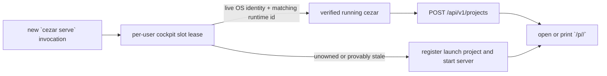
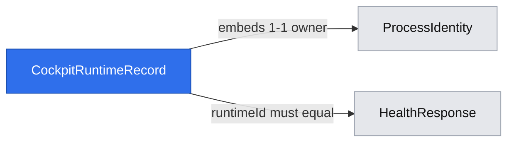

# Safe singleton cockpit handoff

## 📝 TLDR

Developers who run plain `cezar` or `npx cezar-run` from a project need that invocation to reuse the one compatible cockpit already running for their cezar home, register the launch project there, and open its scoped page. Today an interactive launch only walks to the next free port. The proposed behavior adds a crash-safe per-user runtime lease and a verified API handoff; only when no valid owner exists does the command start a server.

## Resolved assumptions (autonomous defaults)

| # | Question | Applied default | Why |
|---|----------|-----------------|-----|
| Q1 | Is singleton ownership global, or may deliberately supervised/installed services coexist? | One interactive slot for ordinary/desktop launches; each installed or strict remote service owns a role-specific slot. A human plain launch discovers and prefers the default installed service, then the interactive slot; supervised service startup only joins its exact slot. | Preserves configured service endpoints and multi-domain installs while preventing accidental duplicates within each launch role. |
| Q2 | What proves the recorded owner is the same cezar process now answering? | Require both OS process identity (`pid` + start/boot/namespace) and a random runtime id echoed by health. | A PID alone is reusable and a busy port alone may be unrelated; the two independent checks fail safely. |
| Q3 | What happens during concurrent starts or when a verified owner is alive but not healthy? | Serialize discovery/startup with a recoverable lease; wait a short bounded readiness period and refuse a duplicate while the exact owner is still alive. | Starting a second process during a slow boot recreates the race the feature is meant to remove. |
| Q4 | Does launch register an unknown CWD even when the registry already contains projects? | Yes, through the existing registration API or the same registry primitive before a new server starts; keep the `$HOME` and task-worktree exclusions. | This is the requested default and makes a CLI launch an explicit project-opening gesture without polluting registries from internal worktrees. |
| Q5 | Do remote mode, `--port`, and `--no-open` change reuse? | A human launch may hand off to a verified default installed/remote service; a supervised or explicit strict-remote launch never abandons its configured endpoint for another role. Within a slot, `--port` is a new-server preference only; `--no-open` prints the scoped URL and exits after registration. | Client reuse and server ownership are separate decisions; service managers must still get the endpoint they started. |
| Q6 | Should version skew prevent handoff? | Accept any running server that supports the additive runtime-id health field and project-registration contract; legacy servers without it are not trusted as singleton owners. | Capability compatibility matters more than exact package version, while old payloads cannot prove process identity. |

## 📝 Problem Statement

`serveCommand` currently calls `pickStartupPort`, which treats any occupied port identically and advances through a 50-port window. A second invocation therefore creates a second `WorkspaceSemaphore`, scheduler set, and workspace view even when the occupied service is cezar. The launch project may also remain unregistered because `initWorkspace` intentionally auto-registers only into an empty registry. The duplicate process doubles workspace-wide work capacity and leaves the first cockpit unaware of the new launch project.

## 📝 Proposed Solution

Before initializing server-only services, plain `serve` claims or joins a per-user cockpit slot. A valid incumbent receives an idempotent project-registration request and the short-lived CLI opens (or prints) `/p/<returned-id>/`. With no valid incumbent, the launcher registers the project, starts the server, publishes its runtime identity after listen, and retains ownership until shutdown.

Alternatives rejected:

- **Probe ports only.** `GET /api/v1/health` can identify cezar, but cannot prove that a loopback service belongs to this user or that a stale file still names the same process after PID/port reuse.
- **PID file only.** PID reuse, containers, zombies, and an unrelated live process make `kill(pid, 0)` insufficient.
- **Always use port 4321.** This breaks explicit ports, non-loopback binds, installed services, and named multi-domain instances.
- **A background daemon or required config.** The runtime lease is disposable state under `cezarHomeDir()` and preserves zero-config startup.

The approach follows the same primary/secondary shape as [Electron's `requestSingleInstanceLock`](https://www.electronjs.org/docs/latest/api/app#apprequestsingleinstancelockadditionaldata): the first process retains ownership and later invocations deliver launch context then exit. [VS Code's CLI](https://code.visualstudio.com/docs/configure/command-line#_core-cli-options) similarly distinguishes reusing the active window from deliberately requesting a new one; cezar makes reuse the human-launch default because a duplicate server also duplicates schedulers and concurrency enforcement, while deliberately supervised services retain their configured roles. Cezar uses its existing HTTP API as the delivery channel because it already validates and broadcasts project registration, while its stronger OS identity check covers headless CLI/server processes rather than relying on an Electron runtime.

Launch registration and singleton handoff ship as one delivery unit even though registration can be coded independently. They form one user-visible invariant: plain `cezar` means "add/open this launch root in my cockpit" on both the no-owner and incumbent-owner paths. Shipping either half alone would make persistent project behavior depend on whether another process happened to be running, which is precisely the default-path split this feature removes.

## 📝 Architecture



The lease makes "who may boot" a per-user decision; the API remains the source of truth for "which project id should open." The new launcher logic must run before `WorkspaceSemaphore`, stores, schedulers, telemetry, backend probes, or any other server-only initialization so a handoff stays a cheap, short-lived CLI operation.

### Runtime slot and ownership

Add a small `cockpit-runtime.ts` module owned by the CLI layer. Its state lives under `cezarHomeDir()/runtime/cockpits/`, never in a repository and never in user-authored `config.json`:

- `interactive/` is shared by ordinary interactive and desktop launches.
- A process with `CEZ_INSTANCE_ID` uses `service-<sha256(exact-instance-id)>/`. Matching `listServerInstances()` determines whether it is the default installed service or a named one; the digest keeps arbitrary internal ids bounded and collision-resistant without treating sanitized spellings as identity.
- An explicit manual `CEZ_REMOTE=1` process without an install identity uses `remote-<sha256(bind-host + strict-port)>/`, so two deliberately configured endpoints neither hand off to nor steal each other's listener.
- A human plain launch first probes the default installed service recorded in `server.json`, then its `interactive` slot. It never auto-selects a named-domain service. A process launched with `CEZ_INSTANCE_ID`, `CEZ_REMOTE=1`, or a supervisor identity resolves only its exact service slot and never exits successfully because a different role is alive.

The slot uses the existing webhook ownership algorithm generalized into a shared process-lease primitive. The owner record contains a random lease token plus OS-verified `pid`, process-start token, boot identity, host and Linux PID namespace. Reclamation is authorized only when that exact identity is provably dead. An unreadable or foreign-namespace owner fails closed: it is never evicted merely because it is old.

The slot has an explicit two-state lifecycle. `owner.lock` (plus the immutable candidate records required by the existing safe-reclaim algorithm) is the pre-listen **claimed** state and contains the random lease token plus process identity. After the HTTP server listens, that owner atomically writes `runtime.json` (`0600`) with the same lease token, schema version 1, slot, random `runtimeId`, API origin, port, bind host, version and process identity; token agreement makes the slot **ready**. It removes only its own token-matching runtime and owner records during graceful shutdown; crashes leave recoverable state. All reads are bounded, schema-validated and no-follow. Failure to create the runtime directory warns once and degrades to today's startup only when no ownership record was created; once a live owner is observed, any unreadable/missing ready record fails closed rather than licensing a duplicate.

### Discovery and handoff

`serveCommand` becomes a two-stage flow:

1. Resolve the slot and attempt lease acquisition before calling `initWorkspace` or constructing server services.
2. If acquired, this invocation is primary: register the launch root under the serve-specific rule, then continue normal boot. Publish `runtime.json` only after the server listens and health can answer.
3. If another owner holds the slot, wait up to five seconds for its ready record and health endpoint. Verify the recorded OS identity is still live, fetch `GET /api/v1/health` with a short timeout, validate the contract, and require `health.runtimeId === runtime.runtimeId`.
4. For a verified owner, call `POST /api/v1/projects` with `{root: repoRoot}` and the private owner token from the `0600` lease record in `x-cezar-runtime-handoff`. Both `200` (new) and the existing structured `409` (already registered) yield the canonical project id. The token authorizes this same-user handoff to bypass hosted browse containment without weakening the remote browser/API boundary; it is never exposed by health. Open `${origin}/p/${id}/` unless `--no-open`; always print the scoped URL and exit 0 without starting stores, agents, schedulers, or another listener.
5. Reclaim only when the exact owner identity is provably dead. A health failure or runtime-id mismatch never authorizes eviction while that owner remains live: it exits non-zero with a recovery message instead of multiplying cockpits. Once death is proven, stale/mismatched HTTP state is discarded and the new owner may boot on a verified port.

Health version equality is deliberately not required. A current server with the additive `runtimeId` and project-registration route is compatible. A legacy health payload without `runtimeId` is not a verified slot owner; because it cannot have written the new lease protocol, it does not block a new-version primary after the lease is safely acquired.

### Launch-project registration

The serve path replaces `initWorkspace`'s seed-once behavior with an explicit launch-registration mode:

- run migrations as today;
- apply `shouldRegisterProject` so `$HOME` and `.ai/cezar/worktrees/` remain excluded;
- otherwise call `registerProject` even when other projects already exist and pass its id as `bootProjectId`.

This is an intentional default-path change: invoking `cezar serve` from a directory now means "open this project in my cockpit," not merely "serve it ephemerally." Headless `cezar run`, `projects list`, and unrelated registry call sites retain their current `initWorkspace` seed-once semantics. When a root is excluded, a running primary is still reused, but the CLI reports that the root is not registrable and opens/prints the incumbent's boot page; it never starts a duplicate merely to serve an internal worktree.

The incumbent registration goes through `POST /api/v1/projects`, not a direct second-process config write. That route already reserves the boot slug, realpath-deduplicates, returns the canonical project row, and emits `project-added` through `WorkspaceEventBus`. `GlobalEventsProvider` already invalidates `workspaceQueryKeys.projects` on that event, so every open tab refreshes its project list without a new WebSocket topic, timer, or reload.

### Flags and launch modes

| Invocation | Compatible verified owner exists | No compatible owner |
|---|---|---|
| `cezar` / `npx cezar-run` | Register CWD, print/open its scoped URL, exit. | Register CWD and start as today. |
| `--port N` | Reuse a compatible owner regardless of its port; `N` is not a second-instance escape hatch. | Prefer `N`, retaining bounded fallback for interactive mode and strict bind for `CEZ_REMOTE=1`. |
| `--no-open` | Register, print URL, exit without browser. | Start and print URL without browser. |
| `--bind-host H` | Reuse the slot's recorded dial origin; the new value does not replace a live owner. | Bind and warn exactly as today, then record the dial origin. |
| human plain launch with default installed service | Reuse the verified default service and register through it. | Fall through to the interactive slot and normal startup. |
| `CEZ_REMOTE=1` / default installed service startup | Reuse only the exact role/instance slot; never hand off to an interactive owner. | Strict configured-port startup as today. |
| named server-install instance | Reuse only the same hashed instance-id slot. | Start that named instance; other named slots may coexist. |

No new `CEZ_*` variable or configuration key is added.

## 📝 Data Model

`runtime.json` is disposable versioned state, not configuration:



The record binds the durable OS identity to the HTTP process identity; neither side alone authorizes handoff.

```ts
{
  schema: 1,
  slot: string,
  runtimeId: string,       // UUID, identity only; not an authorization secret
  origin: string,          // locally dialable HTTP origin
  port: number,
  bindHost?: string,
  version: string,
  startedAt: string,
  owner: {
    token: string,          // must match owner.lock
    pid: number,
    start: string,
    boot: string,
    host: string,
    pidNamespace?: string
  }
}
```

Unknown keys are tolerated on read; invalid known fields make the record unusable, never partially trusted. Deleting `~/.cezar/runtime/` while no cockpit runs is a full reset. Removing its live ownership files while a cockpit runs deliberately removes the cross-process fence and can permit a duplicate; the server keeps serving, but callers must treat manual deletion as unsupported until all cockpits stop. Ordinary crash leftovers need no manual repair.

`owner.lock` is the authoritative lease record and is published before any server-only initialization. `runtime.json` is only its ready projection; it never owns the slot on its own. The transition is `absent -> claimed(owner.lock) -> ready(owner.lock + token-matching runtime.json) -> absent`, with crash recovery from either claimed or ready only after process death is proven.

This feature changes no project-registry schema and needs no migration. The process identity helpers should move from `webhooks/process-identity.ts` to a neutral module with compatibility re-exports or updated imports, so webhook ownership and cockpit ownership share one tested implementation rather than copy security-sensitive PID logic.

## 📝 API Contracts

`GET /api/v1/health` gains one additive field:

```ts
runtimeId: string // UUID-shaped identity of this exact server process; never authorization
```

It is present on every current server and byte-identical on the health WebSocket snapshot because both use `healthSnapshot()`. It is safe on the CORS-open route: it grants no authority and exists only to compare an already local `runtime.json` record with the process answering its recorded origin. `packages/contract` defines the Zod field first; contract parity, health fixtures and backward-compatibility documentation update in the same change.

Handoff reuses the existing workspace-level endpoint:

```http
POST /api/v1/projects
content-type: application/json

{"root":"/absolute/realpath-or-input-root"}
```

The singleton CLI also sends `x-cezar-runtime-handoff: <owner token>`. A matching private lease
token permits same-host project delivery outside a hosted service's browser `browseRoot`; absent or
wrong tokens retain the existing containment checks. The token is disposable process state, is
never returned by HTTP, and grants no other API capability.

- `200 {project}` means newly registered and emits `project-added`.
- `409 {project,error}` means already registered and is a successful handoff result.
- `400/500` is reported and the secondary exits non-zero; it does not start another server while a verified primary exists.

No unversioned route, scoped duplicate, authentication token, or new browser API is introduced.

## 📝 CLI UX

Successful handoff prints one concise result, for example:

```text
  cockpit already running (pid 12345) — added shop
  cockpit → http://127.0.0.1:4321/p/shop/
```

For an already-known project, use "opened" rather than "added." `--no-open` uses the same output so scripts and humans can copy the URL. Failures distinguish:

- verified cezar owner still starting/unreachable → retry/stop guidance, no duplicate;
- occupied preferred port unrelated to cezar after this invocation owns the slot → retain today's next-port behavior for interactive mode;
- runtime state unavailable → warn that singleton reuse is disabled for this launch, then preserve today's startup behavior;
- non-registrable launch root → explain the exclusion and point to the incumbent boot URL.

The banner, backend inventory and self-update output belong only to the primary server path and must not run during handoff.

## 📝 Edge Cases & Failure Scenarios

- **Two launches at once:** one wins the ownership protocol; the other waits for `runtime.json`, registers through it, and exits. A test must prove only one `startServer` path runs.
- **Crash before listen:** the waiting launcher sees a live owner and waits; after a proven death it reclaims. It never interprets a missing runtime record alone as death.
- **PID reuse / zombie / reboot / container namespace:** process-start, boot and namespace checks follow the existing fail-closed webhook rules. A mismatched identity is stale; an unverifiable identity blocks takeover with recovery guidance.
- **Port reused by an unrelated service:** health either fails contract validation or returns a different runtime id. A live lease owner still blocks; only a provably dead owner permits reclaim and a new cezar on a free port.
- **Port reused by another cezar:** a runtime-id mismatch prevents handing project paths to the wrong process. The slot owner decides whether takeover is legal.
- **Stale state after graceful stop:** cleanup is token-checked and best-effort; the next launch can also reclaim a provably dead record.
- **Read-only/corrupt home:** warn once, do not fail boot, and use today's port selection. Never rewrite `config.json` while handling runtime state.
- **Registration succeeds but browser open fails:** the CLI still exits 0 after printing the URL, matching current best-effort browser launch behavior.
- **Registration fails on a healthy incumbent:** exit non-zero and keep the incumbent; do not fall through to new-server startup.
- **Multiple named installed services:** each owns its exact hashed instance-id slot. Human discovery never silently selects an arbitrary named domain.
- **Shutdown/restart:** self-update restart releases the old runtime record only after the HTTP server stops; the replacement process reacquires and publishes a new runtime id. A brief unavailable window fails closed rather than spawning another server.

## 📝 Risks & Impact Review

The load-bearing old mechanism is bounded port scanning: it guarantees an interactive launch eventually starts even when the preferred port is occupied. The replacement preserves that fallback only after this process owns the singleton slot; it must not scan past a verified live owner. Tests must diff the zero-config paths: no owner still starts normally, unrelated port occupancy still advances interactively, strict remote mode still binds its configured port, and a healthy owner exits through handoff.

The requested unconditional serve registration supersedes the seed-once decision documented in `workspace/boot.ts` and the multi-project spec. This is intentional but scoped: only `serve` changes, internal task worktrees and `$HOME` stay excluded, and headless run behavior stays stable. Documentation and tests must name the new contract so a later cleanup does not restore the old ephemeral-launch assumption.

The health addition is a protected public surface and therefore additive. Once shipped, `runtimeId` remains stable for one server process and changes on restart; changing that meaning would break safe handoff. Runtime files are internal and disposable, but downgrade can leave them behind. Older cezar versions ignore the directory; newer readers must treat old/unknown records as untrusted and recover only from proven-dead ownership.

Extracting process identity from the webhook area is security-sensitive. The implementation must preserve its fail-closed behavior and run the complete existing process-identity/ownership suite before relying on the shared helper.

## 📋 Phasing

### Phase 1 — Enforce safe single ownership

Introduce neutral process identity, runtime slot state and health identity, and acquire ownership before boot. A second same-role launch exits with the incumbent URL instead of starting another server; project delivery follows in Phase 2.

### Phase 2 — CLI handoff and registration

Move `serve` discovery before server initialization, register launch projects through the correct owner, and preserve all no-owner/flag behaviors.

### Phase 3 — Cross-process and packaged verification

Exercise concurrent CLI processes, live sidebar refresh and the installed package so the singleton promise holds outside unit seams.

## 📋 Implementation Plan

### Phase 1 — Enforce safe single ownership

1. **Generalize OS process identity.** Move the platform probes and identity types from `webhooks/process-identity.ts` into a neutral core/runtime module, update webhook imports, and prove the existing Linux/macOS/Windows, PID-reuse, boot and namespace tests remain green.
2. **Add runtime paths and schema.** Add `cezarHomeDir()`-derived cockpit runtime paths plus a strict bounded Zod record whose outer object tolerates additive keys. Test `CEZ_HOME` isolation, slot sanitization, default-vs-named resolution, corrupt/missing reads, permissions and atomic writes.
3. **Add the recoverable slot lease.** Extract or reuse the immutable-token ownership algorithm so concurrent claim/reclaim is serialized and only a provably dead exact owner is replaced. Test live owner, dead owner, PID reuse, unreadable/foreign owner, simultaneous contenders and token-checked release.
4. **Expose server runtime identity.** Generate one UUID per `serveCommand`, add `runtimeId` to `packages/contract/src/health.ts` and `healthSnapshot()`, and update contract parity, health fixtures and `BACKWARD_COMPATIBILITY.md`. Prove the GET and health topic carry the same stable value and a restart gets a different value.
5. **Wire ownership before boot and publish lifecycle state.** Acquire the role-specific slot before server-only initialization. A same-role secondary that sees a live owner prints the incumbent URL (or bounded starting/unreachable status) and exits without starting; after `startServer` listens, atomically publish token-matching `runtime.json`. Integrate token-checked cleanup into signal, supervisor and self-update shutdown paths. Test crash leftovers can be reclaimed while a live, mismatched-health or unverifiable owner cannot.

### Phase 2 — CLI handoff and registration

6. **Split serve registration from seed-once boot.** Add a serve-specific boot helper that runs migrations and calls `registerProject` whenever `shouldRegisterProject` permits, leaving `run` and `projects list` on current `initWorkspace` semantics. Add regression tests for populated registry, known root, `$HOME`, task worktree, read-only home and slug stability.
7. **Implement verified incumbent discovery.** Add an injectable discovery function that reads the slot record, verifies OS identity, bounds health requests, validates `runtimeId`, and returns `primary`, `handoff`, `wait`, or `degraded` without server side effects. Cover slow start, dead owner, mismatched runtime id, unrelated HTTP service, exact cezar owner unavailable and legacy health.
8. **Implement project handoff.** Use service-local `fetch` and validate request/response values with `packages/contract` schemas (never import the private runtime api-client package). Treat `200` and structured `409` as success, derive `/p/<project.id>/`, print it, optionally open it, and exit. Test new/existing roots, error responses, URL escaping, `--no-open` and the non-registrable-root fallback.
9. **Finish `serveCommand` routing.** Extend Phase 1's pre-boot ownership decision with default-service discovery for human launches and project handoff; only the selected primary continues into existing startup. Preserve `pickStartupPort` after ownership and pass the runtime lease through every shutdown/restart path. Tests must assert handoff constructs none of the server-only dependencies and supervised service startup never exits for another role.
10. **Pin flag and mode behavior.** Add table-driven tests for default, explicit `--port`, `--no-open`, `--bind-host`, manual `CEZ_REMOTE=1`, default installed identity, supervisor startup and named instance slots. Include distinct hostile-looking instance ids to prove digest-based slots cannot collapse. Keep server-install's intentional multi-instance behavior and strict port rules unchanged.
11. **Document the new default.** Update CLI/reference docs and the multi-project/boot compatibility notes: plain serve is an add/open gesture, `--port` does not request a second cockpit, runtime state is disposable, and named installs remain isolated. No `.env.example` change is needed because no environment contract changes.

### Phase 3 — Cross-process and packaged verification

12. **Add an integration regression.** Spawn one dry-run cockpit in a sandboxed `CEZ_HOME`, invoke the packaged CLI from a second repo, and assert: the second command exits, no second listener/process survives, the returned URL names the registered slug, `GET /api/v1/projects` includes it, and the workspace SSE `project-added` event makes the browser/query refresh path observable without reload.
13. **Prove the old paths.** Run the configured validation gate plus package tests, and explicitly run a no-owner start, an unrelated occupied-port start, a killed-primary recovery and a `--no-open` handoff. Record any platform identity cases not exercised on the current OS as review limits rather than weakening their existing tests.
