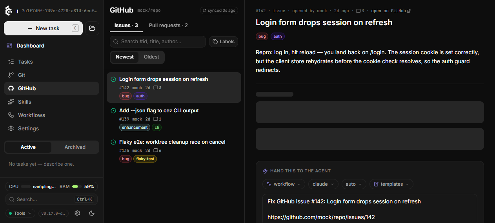
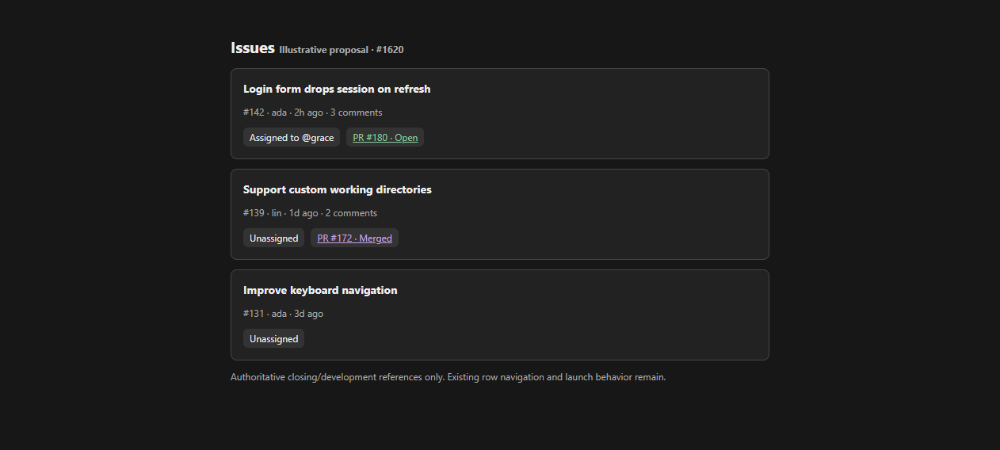

# GitHub issue ownership at a glance

## TLDR

The Issues list will show assignees and authoritative linked pull requests so a user can see existing ownership before starting duplicate work. Today the three GitHub issue discovery paths omit both fields. This is a display-only enhancement for #1620.

## Problem Statement

Issue #1620 requests ownership and linked PR visibility in the list. Its triage comment confirms the open list, text search and numeric lookup lack this data. The issue author needs to distinguish an untouched issue from one somebody already owns or has implemented.

## Proposed Solution

Enrich the existing issue rows using bounded GitHub GraphQL metadata and display compact ownership/status chips. Existing list navigation, launch and filtering behavior stays intact.

## Resolved assumptions (autonomous defaults)

| Question | Chosen answer | Reason |
| --- | --- | --- |
| Which PR links count? | GitHub `closedByPullRequestsReferences`, including manually linked Development PRs and open, merged or closed states. | Authoritative relationship; casual mentions cannot establish coverage. Parent explicitly chose this scope. |
| Filters or bulk actions? | Display only; defer both. | #1621 owns launching changes. |
| Missing or truncated metadata? | Optional fields mean unknown; empty arrays mean a successful empty result. Show a more indicator for capped connections. | Never claim unassigned or no implementation when discovery failed or stopped at a cap. |

## Architecture and API Contracts

Keep the existing chained `/api/v1/github` and `/api/v1/github/search` routes, including project aliases. Add optional `assignees: string[]`, `linkedPrs: { number, title, url, state: 'open' | 'merged' | 'closed', isDraft }[]`, `assigneesTruncated: boolean`, and `linkedPrsTruncated: boolean` on the existing Zod `githubItemSchema`. Infer `ForgeItem` from this contract instead of writing the new shape twice. Existing keys and defaults stay identical. No persistence, migrations, settings, flags or dependencies.

Use one common enrichment helper after issue flattening for all three discovery paths. Batch up to 50 validated numeric issue numbers in one GraphQL request against the already resolved repository and authenticated host. Each issue requests at most 10 assignees and 10 authoritative PR references plus `pageInfo.hasNextPage`. Set `includeClosedPrs: true` so merged references survive; show closed-unmerged PRs as closed, without implying completion. Use `orderByState: true` to prefer active work. Keep the existing 1,000-row list bound and 50-row search bound: at most 20 metadata requests for the maximum list. No per-row subprocess or timeline scan. No body/comment/check hydration in the new tier.

The helper has a five-second subprocess timeout per batch, uses the existing `gh` environment/host handling, validates external JSON through Zod and confines results to requested issue numbers. Failure omits new fields and preserves the usable existing list. Null/inaccessible connections remain unknown. Each batch degrades independently. Legacy clients ignore the additive fields; legacy servers and other forge drivers can omit them. Existing list cache scopes and pagination stay unchanged.

## UI/UX

Reuse the existing issue row, token colors and text sizes. Under the row's normal metadata show `Assigned to @login` or `Unassigned` when known, plus `PR #N · Open`, `Draft`, `Merged` or `Closed` links. Keep PR links as siblings of the row navigation link to avoid nested anchors. Links open GitHub safely with explicit accessible text. Long logins/titles truncate or wrap within the row; all details remain in titles/accessible labels. A capped connection displays a link to the issue for additional entries. Missing fields render no assertion about ownership. PR rows remain unchanged. The row stays keyboard selectable and draggable, including its existing swipe behavior.

Prototype: assets/issue-1620-issue-ownership/mockup.html

Current dry-run screen: 

Illustrative proposal: 

## Research

GitHub's [Issue GraphQL reference](https://docs.github.com/en/graphql/reference/issues#issue) distinguishes closing/development references from timeline cross-references. It provides `includeClosedPrs`, `excludeUserLinked` (default false), `orderByState` and bounded connections. This matches the Development sidebar's authoritative relationship without treating a prose mention as ownership. Reuse that relationship rather than inventing a text classifier or fetching every PR body. The existing cockpit's cursor list and lazy check hydration remain its performance model.

## Edge Cases and Failure Scenarios

- Missing `gh`, auth, remote or network preserves the established unavailable list behavior. Metadata-only permission/version/network failures preserve successful rows with unknown new fields.
- Deleted/null nodes and malformed metadata do not turn the list into an error or a false unassigned claim.
- Both merged and open references can coexist. Closed-unmerged references are explicitly labelled closed.
- A full connection with a successor is marked partial rather than presented as complete; casual mentions never become linked PRs.
- The same data path supports initial/cursor pages, text-search results, and exact-number results, including closed issues.
- Dry-run fixtures include assigned, unassigned, draft/open and merged cases for offline verification. No real account or credentials appear in screenshots.

## Risks and Impact Review

One bounded batched read is added to an ordinary 50-issue fetch. No new background poll, subscription or process is introduced. Metadata may be stale within the existing one-minute cache, and absence is not a guarantee that nobody is working. Rollback removes UI consumption and optional fields without changing saved state. The parent owns the additive compatibility note in `BACKWARD_COMPATIBILITY.md`. No user documentation or shared descriptors are changed outside this task's scope.

## Acceptance Criteria

1. An assigned issue shows its assignee(s); known empty assignees show Unassigned.
2. Authoritative PR links show open/draft/merged/closed status and navigate externally. Casual mentions do not show.
3. Initial list, subsequent cursor pages, text search and exact-number lookup all expose the same optional metadata.
4. Old payloads, other forges and failed metadata queries retain working rows without false ownership assertions.
5. Caps, omitted/null inputs, bounded batching, JSON validation and additive route/contract parity are tested.
6. Keyboard access, long content and narrow viewport are verified in a real browser.

## Implementation Plan

### Phase 1: Contract and discovery

1.1 Add optional Zod fields and derive the forge item type; pin old/new payload and route parity.
1.2 Add bounded shared metadata hydration to list/search/numeric paths with failure and completeness tests.

### Phase 2: Presentation

2.1 Add compact accessible issue metadata, links and representative dry-run fixtures; verify components and unchanged navigation.

### Phase 3: Evidence and handoff

3.1 Run the five configured gate commands, red/green regression, review/autofix and browser QA. Publish an independent implementation PR with `Closes #1620`, spec linkage, validation limits, screenshots and no author QA signoff.

## Design Review

Proceed. Fresh-context scope review found one coherent independently deployable capability and no cohesion defects. Architecture review checked optional contracts, bounded discovery, missing-data semantics and unchanged launch/filter behavior against the existing code. This review did not execute an implementation; browser evidence above shows the baseline and illustrative proposal only.
