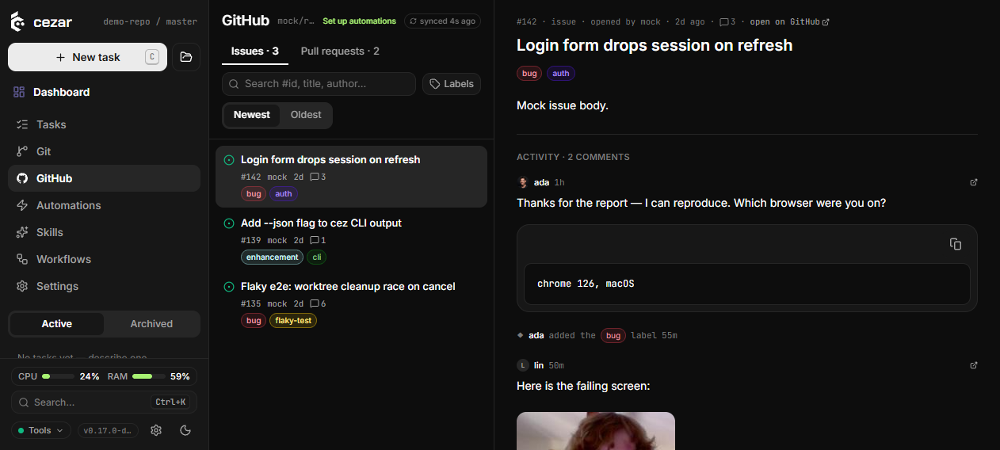
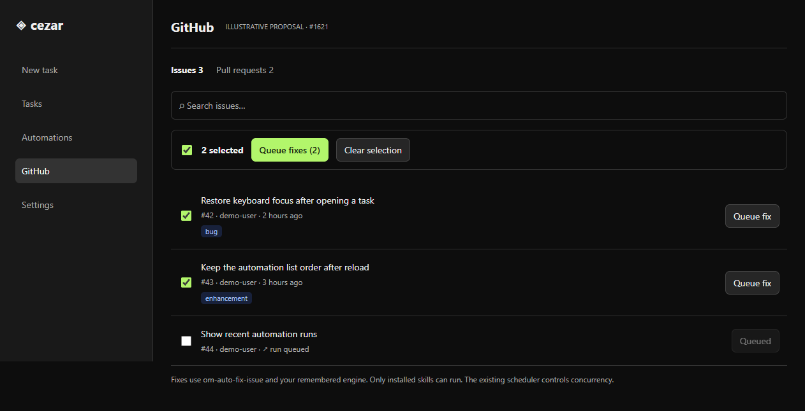
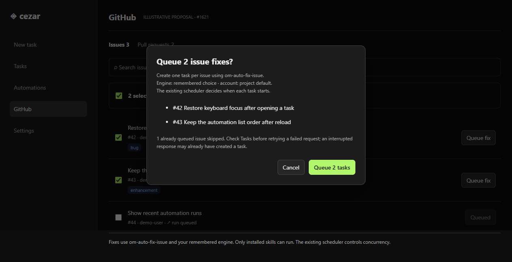

# Queue fixes from the GitHub Issues list (#1621)

## TLDR

People triaging several issues currently open each detail pane to start a fix. Add an issue-row Queue fix control and a selection toolbar that queues one `om-auto-fix-issue` task per selected eligible issue through the existing scheduler.

## Resolved assumptions (autonomous defaults)

| Question | Default | Reason |
|---|---|---|
| Q1: skill/workflow | Run exactly the discovered `om-auto-fix-issue` skill with no remembered workflow or other skills. If unavailable, disable launch with an explanation. | Implements the user's named action without silently running a different chain. |
| Q2: scheduling | Create one ordinary task per issue; existing workspace scheduling decides what runs or queues. | Reuses the load-bearing concurrency/cost mechanism; no parallel queue. |
| Q3: PRs | Issues only, including issue search results; leave PR row behavior alone. | Smallest requested surface. |
| Q4: duplicates/bounds | Skip known queued URLs and pending launches, dedupe selected URLs, require bulk confirmation, at most 20 eligible tasks per batch. | Explicit cost and bounded work without a new persisted queue or API. |
| Q5: scope cohesion | Single-row and selected-row launch share one controller and task builder. | One issue-fix launch capability with single and multiple inputs, not separate workflows. |

These are reversible UI defaults, posted for owner override before merge. No active product rule or default security boundary changes.

## Problem Statement

Issue #1621 requests row-level launch and bulk selection. Current `GithubRow` is a link with an existing mobile swipe launcher; `HandToAgent` alone has a persistent workflow/skill/engine choice. The route already has a per-URL queued map. Existing detail and PR behavior must remain usable.

## Proposed Solution

Use the explicitly requested skill when discovered locally, the remembered engine, existing run creation, and an explicit task-count confirmation for bulk launch. Keep controls outside the row link, preserve navigation/swipe/drag, and keep the scope within issue-list launch.

## Research

[Linear's selection model](https://linear.app/docs/select-issues) separates selecting rows from invoking an action. [GitHub's list filtering](https://docs.github.com/en/issues/tracking-your-work-with-issues/using-issues/filtering-and-searching-issues-and-pull-requests) makes the visible filtered set an explicit user choice. Inference for this cockpit: select only loaded, currently displayed rows, show a numeric count, and do not expand selection by fetching hidden pages. Keyboard ranges and a general command bar are unnecessary for this increment.

## Architecture

- `github.tsx` remains the owner of the remembered engine and per-URL queued map. Add an issue-selection controller and small toolbar/confirmation/row controls in an issue-specific module; preserve memo equality for row controls and existing metadata, link, prefetch, swipe and drag behavior.
- Reuse `useSkills`, `useResolvedEngine`, `engineRunBody`, `githubRunBody`, ordinary `createRun`, existing house Button/Dialog, and the canonical query keys/cache invalidation. Skill presence comes from successful discovery; loading/error is not evidence of availability.
- Extend the web-only `createRun(input, projectScope = queryScope())` helper with an optional explicit project. Existing calls keep the same behavior; captured scope pins every sequential request in a batch. The server/API-client contract and create body schema are unchanged.
- Resolve the engine and create each body before asynchronous work starts. Select one fix skill, not arbitrary remembered workflow/skill state; the engine remains the same remembered runner/model/account choice used by the detail handoff.
- Sequential POSTs bound pressure. Set a synchronous lock before the first POST, disable row/selection/confirm controls while pending, then report counts and per-issue outcomes. Mark successful URLs queued and remove successful selections. Keep failed rows available for an explicit retry after checking Tasks; never retry automatically.
- A project switch cannot redirect the remaining requests. They continue against the original captured project and body snapshot. Do not write returned tasks into the newly selected project's caches; invalidate the original run list/workspace index and notify queued state only in the matching scope.

## Data and API contracts

Selection, lock, confirmation snapshot and result summary are transient React state. No persisted entity, new endpoint, configuration, environment flag or dependency is added. No data-model graph is needed because no persisted relationship changes.

`POST /api/v1/p/:projectId/runs` receives the existing `githubRunBody(issue, null, ['om-auto-fix-issue'], undefined, engineRunBody(resolved))`. Reference composition and skill-chain syntax stay canonical. Existing server validation, provider availability, scheduler caps and error responses remain authoritative. Single/batch results use the existing create response; an issue always creates one task, never a multi-variant launch.

## UI/UX

1. Every issue row exposes an accessible selection checkbox and a small Queue fix button outside the navigation anchor. The quick action starts one eligible fix without opening detail. Missing skill/provider explains why the control is disabled.
2. Above the Issues list, Select displayed issues toggles the currently loaded filtered set. New cursor pages are not implicitly selected. Filter/tab/project changes prune hidden selections. Virtualized rows remain selectable through their underlying displayed data, independent of mounted DOM.
3. When selected, the toolbar shows the count, Clear selection and Queue fixes. The latter opens a house dialog listing the eligible issue numbers/titles, fix skill, remembered engine choice and skipped count. Its primary button states the exact task count; more than 20 eligible issues requires reducing the selection. Cancel launches nothing.
4. While pending, show progress and prevent duplicate submissions. After completion show succeeded/skipped/failed counts and failures without replacing the issue list. Successful rows show the existing queued indication. Reopening details and existing mobile swipe handoff still work.
5. Empty/loading/error/unavailable GitHub states keep their current useful UI. Skill loading/error/missing is distinct from an installed skill; disabled launch explains the cause. Long titles truncate in rows and wrap in confirmation. At 390px, selection/queue controls remain keyboard/touch operable and do not create page overflow. Light/dark use house tokens and no new color values.

Prototype: assets/issue-1621-issue-actions/ (illustrative proposed list and confirmation; current-screen evidence alongside it).

## Edge Cases & Failure Scenarios

| Boundary | Behavior |
|---|---|
| Known queued or currently launching URL | Skip; do not submit again. No hidden server-side duplicate claim is invented. |
| Duplicate row across cursor/search results | One selected URL and one POST. |
| Filter, view or project changes | Prune/reset selection; requests already confirmed stay pinned to original project. |
| One POST fails | Continue other confirmed items; show partial results and preserve failed rows for manual reconciliation. |
| Response lost after server accepted task | Do not automatically retry; explain that Tasks should be checked before manually retrying. Existing server has no durable idempotency key. |
| Skill removed or engine becomes unavailable before confirmation | Revalidate locally and refuse launch with explanation; server still rejects stale/invalid inputs. |
| More than 20 eligible selected | Keep all rows visible/selected, disable submission and request a smaller selection; never silently truncate. |
| Successful task finishes later | This increment preserves existing queued-map semantics; durable cross-tab/reload dedupe belongs to the existing separate queued-indicator work (#1601). |

## Risks & Impact Review

The action launches potentially paid agent work only after an explicit click or count-labelled bulk confirmation. It adds no default background work or entitlement. The ordinary scheduler still enforces caps. Browser state prevents repeat clicks in this view, not concurrent independent clients; durable idempotency and global issue ownership are deliberately outside this UI increment. Undo is cancellation/archive through existing task controls, never deletion of issue or user work.

Compatibility is additive and web-local: no public request/response, stored shape, route, flag, default detail handoff or PR action changes. The list metadata feature (#1620) is independent and must be retained on integration. Shared engine changes (#1700) are consumed through the existing resolver/body builder rather than duplicated.

## Implementation Plan

### Phase 1: Bounded launch and selection

1. Add explicit project scope to the existing web run creator; implement the issue-fix controller with URL dedupe, skill/engine checks, pending lock, bounded sequential requests, scoped cache updates and partial outcome reporting. Test exact bodies, duplicate suppression, failure/retry and project navigation across awaits.
2. Add accessible checkbox/row action, selection toolbar and confirmation using house components. Wire only issue rows across ordinary, searched and virtualized lists; preserve metadata and existing row affordances. Test navigation, hidden selection pruning, cap, missing-skill/error states and PR guards.

### Phase 2: Verification and handoff

3. Prove regression tests fail on original code; run all configured gates, inspect exact-head supported CI and fix code-review findings. Record any local platform limits honestly.
4. Run real-browser QA for quick and multi-row launch, cancel, duplicates, progress/partial error, missing skill, scope isolation, cursor/virtualization, keyboard, narrow/long text, loading and themes. Publish screenshots/reports; leave spec and implementation unassigned/non-draft/review, implementation needs-qa, no author QA approval. Owner review remains required.

## Design validation

Fresh-context scope review approved: single and selected launch are inputs to one operation with shared eligibility, construction and results. The spec was grounded in the current route, skill discovery, canonical task builder and typed create helper. Current-screen and proposed static mockups were rendered with native agent-browser 0.41/Chrome156 and inspected. Mockups illustrate the proposal; they do not prove implemented behavior. No documentation lint command is configured; `git diff --check` is the applicable local documentation check. Runtime validation follows on the independent implementation PR.
