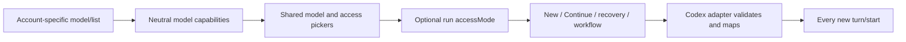

# Independent Codex Daybreak Blue selection (#1700)

## TLDR

Codex users with an eligible account will select an underlying model and an execution access mode independently. The cockpit will offer only modes advertised for that account/model, retain native omission as the default, and carry an explicit selection to every new Codex turn.

## Problem Statement

The current catalog drops `availableAccessPrograms` and the runner sends no turn selection. A Daybreak alias remains a valid model ID; it is not a substitute for independent mode selection.

## Resolved assumptions (autonomous defaults)

| Question | Default | Reason |
| --- | --- | --- |
| Unknown capability metadata | Authorizes no explicit mode | Retains native operation on older CLIs without guessing account access. |
| Additional programs and settings | Standard and Blue only; defer Red and reasoning effort | One independently deliverable capability; #808/#815 own reasoning effort. |
| Account changes | Discover and cache per resolved account | Another login's capability is not evidence of access. |

## Proposed Solution

Extend the existing catalog and engine selection path with optional, backend-neutral access capability and selection fields. Keep Codex wire translation inside the adapter.

## Evidence and alternatives

This extends `.ai/specs/2026-07-21-codex-latest-model-discovery.md`. The old mechanism is load-bearing for visible catalog order, custom/legacy IDs, auto-model behavior, bounded discovery, and old/missing CLI fallback. Preserve all of those.

The [native Codex setup guide](https://learn.chatgpt.com/use-cases/getting-started-with-daybreak-blue#check-access-in-codex) describes turning Daybreak on and then choosing an approved underlying model. This is the appropriate comparison for the cockpit. Hard-coded model lists, inference from a Daybreak name, Responses API fields, and saving a thread UI preference alone cannot satisfy that behavior.

Installed `codex-cli 0.164.0`, generated locally with `app-server generate-ts --experimental`, confirms `Model.availableAccessPrograms.cyber` is caller-specific; `TurnStartParams.cyberAccessProgram` accepts `standard | daybreakBlue | daybreakRed` and omission preserves automatic behavior. `ThreadStartParams.daybreakEnabled` is explicitly only a UI preference. Issue #1700 also records a 0.155.1 CLI that accepts the turn field but advertises no model capability: absence must remain unknown.

## Architecture and Data Model

- Contract defines optional `supportedAccessModes: ('standard' | 'daybreak-blue')[]` on each model and optional `accessMode` on create/run/runner/workflow agent selection. Continue additionally accepts `null` to clear a persisted explicit choice. No migration or user configuration.
- Native default is an absent execution field. Explicit standard and explicit Blue remain different serialized values. Existing aliases/custom IDs are never rewritten or removed. An explicit mode needs a concrete model with advertised support; auto/custom/unknown models continue to work with native omission.
- Model catalog discovery takes optional account context. The cache and client query key include the selected account, and the server resolves the real profile environment with existing profile primitives. Missing accounts or directories do not borrow a different account's eligibility. Ordinary callers that omit the account preserve the existing default-account model list.
- The adapter validates capability metadata defensively. Absent, null, malformed, or unfamiliar metadata grants nothing; valid known entries are mapped to neutral modes, while unrelated model discovery remains usable. Empty arrays mean known with no accepted explicit modes.
- Persist selection in the run store and pass it through new execution, all Continue/restart construction sites, and workflow agent-step resolution. A step's selection overrides the task's; task selection follows only its own backend. A runner switch clears stale selection. Non-Codex adapters receive no explicit Codex mode.
- The Codex adapter validates an explicit mode against `model/list` from its own authenticated App Server before starting a turn, then translates it to `cyberAccessProgram` on every `turn/start`. Omitted mode skips capability validation and sends no new field. New turns include follow-ups, resumed/forked sessions, and context-compaction continuations. `turn/steer` never changes mode in flight. The manager already limits Continue to settled runs; no live-turn mutation surface is added.
- Discovery and validation start no model turn and grant no entitlement. Vendor authorization remains authoritative if access changes after discovery. Unsupported metadata/CLI/model yields an actionable error for explicit requests, never a silent fallback to native.

The selection reuses the existing engine flow; only the adapter knows the vendor wire spelling.

## API Contracts

Existing chained routes and middleware remain authoritative. `GET /api/v1/models` accepts optional `agentProfile` and returns optional per-model `supportedAccessModes`. Old requests and non-Codex responses retain their shape. Create, Continue and Inbox-start bodies accept optional `accessMode`; Continue `null` removes the record's explicit mode. Records, v1/v2 workflow agent fields and workflow-contract twins add optional fields only. Existing schemas and typed-body/contract-parity tests must agree bidirectionally.

## UI/UX

New Task, shared EnginePills (Inbox and GitHub handoff), and follow-up Continue share pure access-mode helpers and one access picker. Label the independent control **Access mode** with **Native default**, **Standard**, and **Daybreak Blue** as applicable. Native default always remains reachable. A mode is offered only when the selected account and at least one discovered model advertise it. Selecting a mode keeps the current model when compatible, otherwise selects the first compatible discovered model. With an explicit mode selected, the model menu contains compatible models only. Returning to native restores auto and all custom/legacy model choices.

Account/runner/catalog changes re-evaluate compatibility. Never silently send a different explicit mode than the one displayed. While a previously selected explicit combination becomes unknown or unavailable, display it with a clear validation message and disable submission until it is changed or native is chosen. This preserves user intent without guessing eligibility. Continue starts from the persisted mode; untouched Continue omits the override, and choosing Native default sends `null`.

Use existing picker radio semantics, focus handling and wrapping. Additional controls are hidden for other backends and, when no capability has been advertised, remain absent unless needed to clear an existing explicit selection. Native model-setting lock also suppresses execution overrides and keeps the native default path.

## Edge Cases & Failure Scenarios

- Old/missing/slow/logged-out CLI: discovery's existing timeout/fallback remains; native execution remains available. Explicit mode fails clearly if the executing CLI cannot advertise support.
- Two eligible models: change either independently while keeping the other selection when compatible.
- Unknown/malformed capability or custom alias: no inferred eligibility; native selection and model ID remain usable.
- Cached capabilities from a former account: isolated by account key; execution validates again on its own process.
- Removed entitlement between pick and turn: preserve vendor rejection and requested-mode context; never retry under another mode.
- Running turn: normal messages steer as before with no mode-change field. Explicit mode changes apply through settled Continue only.
- Existing records/YAML and older clients: absence remains native; no mandatory fields or state migration.

## Risks & Impact Review

Protected surfaces are HTTP contracts, run persistence, workflow YAML and the runner seam (BACKWARD_COMPATIBILITY.md §§2–4,7). All fields are additive and optional. Native defaults, old aliases and non-Codex permission policy stay unchanged. Downgrading can ignore the additive selection, so users needing an explicit mode should finish those runs before downgrading. Rollback is code-only; no credential, account or vendor settings are changed.

No paid/live Daybreak turn is authorized for this unattended implementation. Verification will include generated local protocol, deterministic wire fixtures and actual browser picker interaction. Entitled-account live-turn verification remains a disclosed manual QA requirement.

## Phasing

Three internal checkpoints deliver one feature; do not release an incomplete checkpoint.

## Implementation Plan

### Phase 1: Contract and authenticated capability discovery

1. Add shared neutral schemas/types and optional catalog/run/workflow fields, preserving absence and Continue clear semantics; test old records and schema parity.
2. Retain validated capability metadata, add account-scoped discovery/cache/query support, and cover two eligible models, unknown metadata, old CLI, aliases and account separation.

### Phase 2: Execution selection lifecycle

3. Persist and carry selection through create/steps/graphs/Continue/restart; audit every AgentRunSpec and StartRunInput construction and test the relevant paths plus non-Codex isolation.
4. Validate explicit selection in the Codex adapter and emit the wire field on every new turn; fixture-test omission, standard, Blue, resumed sessions, unsupported combinations and steering.

### Phase 3: Shared selection and release evidence

5. Add pure compatibility helpers and the shared access picker; connect New Task, Inbox/GitHub handoff and Continue, including explicit native clearing and saved-draft compatibility.
6. Prove regression red/green, run configured gates, review/autofix the implementation PR, exercise the actual browser flow, and attach evidence with precise platform/live-turn limits.

## Architectural Review

Proceed with one cohesive extension of model discovery and engine selection. Optional fields preserve the old default, account-specific discovery prevents false eligibility, and adapter-local wire translation preserves the runner seam. Protocol generation confirms the fields but does not prove an entitled account can execute a Blue turn; that remains a human QA limit.
