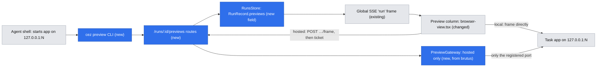
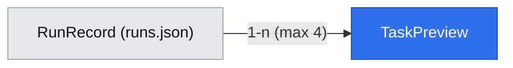

# Task preview apps — a task opens its own app in the Preview, local and hosted

> Slug: `task-preview-apps` · Status: proposed (design only, 2026-10-31) · Issue: #1877
> Gate: **pending owner ratification** (§ Resolved assumptions, Q2) — proposed `CEZ_PREVIEW_APPS=0`
> off switch; hosted framing additionally needs `CEZ_PREVIEW_PORTS`.
> Extends: `2026-10-09-design-mode.md` (the Preview and its different-origin rule),
> `2026-09-10-dispatch.md` and `2026-09-13-automations-from-prompt.md` (the agent CLI transport),
> `2026-10-07-task-workspace.md` §5.2/§7 (the Preview column).
> Prior art: brutus's preview gateway, `origin/brutus:.ai/specs/2026-10-10-preview-gateway.md`
> and `packages/cezar/src/server/preview/gateway.ts` there (not ported to `main`).

## 📝 TLDR

A skill or task can already start a small app — the single-file merge-queue status page in
open-mercato/skills#158 is the motivating case — but nobody sees it unless a person finds the
port and types it into the task's Preview, and a hosted cockpit refuses the address and prints an
`ssh -L` command. This spec proposes `node "$CEZ_BIN" preview open --port N` (plus `list` and
`close`): a preview record on the calling run that the task's Preview picks up live. A local
cockpit frames the app directly, as it would if the user typed the address. A hosted cockpit
frames it through an authenticated **port gateway** on a different origin. Neither path serves
task content on the cockpit's origin. Implementation follows on its own PR.

## 📝 Problem Statement

- **Discovery.** The Preview shows what the user types or what a terminal printed
  (`browser-view.tsx`, design-mode §7b). An app the agent started in its own shell prints to the
  agent's transcript, not to a cockpit terminal, so the Preview never learns about it.
- **Hosted.** On a hosted cockpit (`CEZ_REMOTE=1` or a non-loopback bind), `canPreview` is
  `capabilities.localHandoff`, which is false. A loopback address is refused and replaced with
  `ssh -N -L <port>:localhost:<port> <host>` (`browser-view.tsx` `tunnelCommand`). Someone using a
  VPS cockpit from a phone or a locked-down laptop has no way to see the app.
- **Interactive apps.** Without both pieces, a skill cannot ship a small UI that the user opens
  inside cezar, the way apps work inside ChatGPT. Evidence: #1877 and skills#158 (a skill that
  would show a status page).

## Resolved assumptions (autonomous defaults)

These defaults were written unattended by `om-auto-write-spec`. The owner may change any of them
before implementation. Q2 is a deliberate non-decision: AGENTS.md § Zero config requires the owner
to record it.

| # | Question | Applied default | Why | Confirm? |
|---|---|---|---|---|
| Q1 | How a hosted cockpit gets a separate origin for a proxied app, and how the reverse proxy's auth covers it | **A port pool.** cezar re-serves each framed preview on a port from an operator-named pool (`CEZ_PREVIEW_PORTS`): same hostname and certificate, but a different origin. The front forwards the pool **without** its own auth. The gateway authenticates every request itself with a one-minute single-use ticket that only the authenticated cockpit can mint, exchanged for a per-port `HttpOnly` session cookie. This is brutus's gateway design, narrowed to registered previews. | A port needs no wildcard DNS or wildcard certificate (subdomains do). A sandboxed iframe on a cockpit path is either same-origin (rejected by design-mode §2) or opaque, which breaks cookies, storage and same-origin fetches in every real app, and gets no reliable Basic-Auth behaviour. A login prompt inside a frame cannot be answered, so the front cannot authenticate the pool. | Owner may override. Reversible until Phase 3 ships. |
| Q2 | Default-on, or behind a `CEZ_*` flag | **Proposed, not decided:** (a) **Local**: the CLI, the record and direct framing are on by default, with `CEZ_PREVIEW_APPS=0` as the off switch. This adds no listener and no network path; it only frames a loopback address the user could already type. (b) **Hosted**: the gateway exists only when the operator sets `CEZ_PREVIEW_PORTS`. Unset, a hosted cockpit shows the record with today's `ssh -L` hint. | (a) matches the Design Mode decision (2026-10-17): loopback only, nothing new listening. One difference: the agent opens the preview, not a user click. (b) opens public ports, which AGENTS.md says must be opt-in, and it cannot work without operator wiring anyway. | **⚠ NEEDS OWNER RATIFICATION**, separately for (a) and (b). Phases 1–2 must not ship (a)'s default until the owner records it in AGENTS.md § Zero config, as an owner-approved exception or a "pending owner ratification" entry. Phase 3 likewise must not ship until (b) is recorded. One half does not gate the other. |
| Q3 | Can a preview outlive its run (for example, pinned to the project) | **No.** A preview belongs to the run and is removed by `close`, when the run's session ends (`review`/`done`/`failed`/`cancelled`/archived), at boot recovery, or when the task is deleted. | When a task settles, cezar stops what the agent left running, so a surviving record would be a dead tab. Project-pinned dashboards need a process owner, which overlaps #1608 (the pre-task project preview). | Reversible: add a `pinned` scope later. |
| Q4 | Can the app talk back to the agent (deliver a message) | **Deferred.** No channel from the app to the cockpit in this cut. | Untrusted page content driving the agent needs its own design. The design-mode notes (§7a: user-written, cockpit-drawn, sent on the user's click) are the template for a follow-up. | Reversible. |
| Q5 | Must the port already be listening at `open` | **Yes, with a wait.** The server probes `127.0.0.1:N`, then `[::1]:N`, for up to `--wait` seconds (default 10, max 30). If nothing answers, it refuses with "nothing is listening on port N — start the app first". | An agent gets a synchronous, actionable error instead of an empty tab. This is the dispatch A1 lesson. | Reversible. |
| Q6 | Previews per run | **4.** A fifth gets 409. | Roughly the Preview column's useful tab count. A misbehaving loop cannot flood the strip. | Reversible. |
| Q7 | One spec or two (the agent record versus the hosted gateway) | **One spec, phased.** Phases 1–2 ship the local path on their own. Phase 3 adds the hosted gateway, with its own ratification (Q2b) and its own implementation PR. | The issue's Done-when needs both. The gateway here forwards only registered previews, so it depends on the record. The fresh-context review recommended a split instead, because of the gateway's different risk and operator burden. The owner may split Phase 3 into its own spec without changing the design. | Reversible. |
| Q9 | Must the port belong to a process the calling run started | **No ownership check in this cut.** A run may register any loopback port that is not a refused port. | The agent already has a shell on the host and can read any loopback service directly. Hosted viewers are only people the front already admits, and they can start tasks. A pid/cwd ownership check (through `lsof`/`/proc`) is platform-specific; it is a hardening follow-up, recorded under Risks. | Reversible. |
| Q8 | Do agent-opened tabs persist into saved layouts | **No.** They are derived from the run record on every render and never written to `/runs/:id/layouts`. | The record is the source of truth. A saved copy would outlive `close` and break "Without the command, the Preview behaves exactly as today". | Reversible. |

## 📝 Proposed Solution

1. **Agent CLI** `cez preview open|list|close`, a third client of the existing agent transport
   (`CEZ_API_URL`, `CEZ_PROJECT_ID`, `CEZ_TASK_ID`, `CEZ_BIN`). It mirrors `task-cli.ts`: a thin
   HTTP client with exit 0 on success, 1 when refused, and 2 for a usage error or no cockpit.
2. **A preview record** on the run (`RunRecord.previews`). It travels in the existing global
   SSE `run` frame, so the Preview reacts without polling. There is no new WebSocket topic.
3. **Framing.**
   - **Local:** the Preview frames `http://localhost:<port><path>` directly. This is the existing
     different-origin path (design-mode §2), and Design Mode works on it unchanged.
   - **Hosted:** the Preview asks the run's `frame` route. The route returns a gateway URL with a
     ticket, or a 409 that keeps today's tunnel hint.
4. **Lifecycle tied to the run.** `close`, the end of the run's session, boot recovery and task
   deletion remove the record. Removing the record closes its gateway listener immediately.
   Idleness and LRU also close the listener, and it reopens on the next frame request.

**Alternatives considered.**
- *Same-origin path proxy (`/preview/4173/…`)*: rejected by design-mode §2, because worktree
  content would sit beside the API under the front's ambient login.
- *Sandboxed opaque-origin iframe on a path*: breaks app storage and cookies. Whether the browser
  attaches the front's Basic credential to an opaque origin's requests varies by browser.
- *Per-preview subdomain*: needs wildcard DNS and a wildcard certificate that the user must set
  up. It stays possible later behind the same `frame` route.
- *Reuse the Design Mode mirror for hosted*: it is loopback-only by construction (`parentOrigin`
  must be loopback), and §4 of its spec relies on that.
- *Turn-end marker (`CEZ:PREVIEW=4173`)*: rejected for the same reason dispatch A1 rejected
  markers. A marker gets no synchronous answer, and that is how agents misread refusals.

## 📝 Architecture



Takeaway: only the blue parts are new. Locally the frame path is the one the Preview already uses.
The gateway exists only on a hosted cockpit that names a pool.

Modules (proposed paths):

- `packages/contract/src/preview.ts`: the new schemas sit beside `designProxy*`.
- `packages/cezar/src/preview/preview-cli.ts`: the CLI, routed in `src/index.ts` before the
  cockpit's own parser, like `cez task` and `cez automation`.
- `packages/cezar/src/preview/previews.ts`: open/close/clear, the probe, the port refusals and the
  cap. These are the record rules, used by routes and the engine alike.
- `packages/cezar/src/server/preview/gateway.ts`: ported from brutus and narrowed (§ Security).
  It reuses `allowFramingBy`, the hop-by-hop handling and the WebSocket splice from
  `design-proxy.ts`. Extract the shared pieces into `preview/forward.ts` instead of copying them.
- `packages/cezar/src/preview/prompts.ts`: a short `PREVIEW_PROMPT`.
- `packages/web/src/routes/task-preview/`: derived agent tabs in `browser-view.tsx`, plus a small
  `agent-previews.ts` that maps records to tabs.

**Transport gate.** `agentEnv` (`workflows/run.ts:1623`) publishes `CEZ_API_URL`/`CEZ_BIN` only
behind `dispatchReachable()`. With `CEZ_DISPATCH=0` an agent would get no address for
`cez preview`. Automations already has this gap, which code reading confirms but no run has
exercised: `prepareAutomationsSession` (`run.ts:2722`) composes the automations prompt off the
server's own `CEZ_API_URL` while `agentEnv` withholds it. Phase 1 replaces that gate with one
helper,
`agentCliReachable() = CEZ_API_URL && (dispatch || automations || previewApps)`. Each prompt part
stays gated on its own capability, so an agent is still told only about CLIs that work
(dispatch A2/A8). Every CLI already turns a 409 into "stop and report", so an address without a
capability is harmless.

**Both construction sites.** `PREVIEW_PROMPT` is resolved where `ActiveRun` is built in `execute`
**and** in `runContinuation` (AGENTS.md § "Find every construction site"), as the automations
part already is (automations A6).

**One clearing site.** Clearing on settle goes through one helper called from the store's status
write when a run leaves the live-session set. It does not go into each turn-end handler: the
streaming and non-streaming handlers in `workflows/run.ts` are the known half-fix trap.

## 📝 Data Model

```ts
// packages/contract/src/preview.ts (proposed)
taskPreviewSchema = z.object({
  id: z.string().regex(/^[0-9a-f]{8}$/),     // random, per record
  port: z.number().int().min(1).max(65535),
  path: z.string().startsWith('/').max(2048), // default '/'
  title: z.string().min(1).max(80).optional(),
  openedAt: z.string(),                       // ISO
})
// runRecordSchema gains: previews: z.array(taskPreviewSchema).max(4).optional()
```

- Optional with `.catch(undefined)` semantics in the store's parse, so old `runs.json` files parse
  and a corrupt entry never evicts the run (store rules in AGENTS.md).
- The field rides whatever projection the global SSE `run` frame carries (`RunSummary`). The
  implementer adds it there, conditionally spread so it is absent on the wire when empty (the
  AGENTS.md HTTP API contract rule).
- Nothing about the gateway (pool port, tickets, sessions) is persisted. A restart forgets it,
  and the next frame request rebuilds it.
- No PII. `title` and `path` are agent-supplied text, rendered as text and never as HTML.



## 📝 API Contracts

All routes are project-scoped. They are chained into the runs family (mounted at `/api/v1/…` and
`/api/v1/p/:projectId/…`, per `route-parity.test.ts`), validated as middleware through
`validators.ts`, and inventoried in BACKWARD_COMPATIBILITY.md §2.

| Route | Body | Answers |
|---|---|---|
| `POST /runs/:id/previews` | `{ port, path?, title?, waitMs? (0–30000) }` | `201 { preview }`. Re-opening the same port returns `200 { preview }` with the same `id` and updates `path`/`title`. `404` for an unknown run. `409 { error }` when: the capability is off; the run's session is not live (`running`/`waiting`/monitoring park); the cap is reached; the port is refused (below); or nothing listens after `waitMs`. |
| `GET /runs/:id/previews` | — | `{ previews: TaskPreview[] }` |
| `DELETE /runs/:id/previews/:previewId` | — | `{ ok: true }`. Idempotent: an unknown id also answers `{ ok: true }`. |
| `POST /runs/:id/previews/:previewId/frame` | `{ parentOrigin }` | `{ url }`. Local: `http://localhost:<port><path>`, with no listener opened. Hosted with a pool: `<gateway origin><path>?__cez_ticket=…`. `409 { error }`: hosted with no pool (the cockpit then shows the tunnel hint), pool exhausted, or the app is not answering. |

Every 409 body is `{ error, code }`. `error` is the human line the CLI relays. `code` is a closed
enum the cockpit branches on, never the text: `disabled`, `run-not-live`, `cap-reached`,
`port-refused`, `not-listening`, `no-gateway`, `pool-exhausted`. The field is additive to the
existing `{ error }` shape.

**Port refusals**, under every loopback spelling (`loopbackAliases`):
- cezar's own listen port and the port in `CEZ_API_URL`;
- every pool port;
- any port whose `GET /api/v1/health` answers with cezar's health shape (another cockpit on the
  host). Mirroring a cockpit would expose its API behind a ticket instead of behind the front.

The checks run at `open` **and again at every `frame` request and gateway listener open**,
because a port can be rebound after `open`. A check that passes once is not trusted later.
Any other loopback service the agent can bind or name is in scope by design (Q9).

**`/health`** gains `capabilities.previewApps: boolean` (the CLI and prompt gate). The hosted
framing ability is **not** a capability: the cockpit reads the `frame` route's 409, as brutus §6
decided ("the answer cannot drift from the route's").

**CLI.**

```
cez preview open --port <n> [--path /status] [--title "Merge queue"] [--wait <s>]
cez preview list
cez preview close [<id> | --port <n> | --all]
```

- `open` prints the id and the cockpit page `<CEZ_API_URL>/p/<project>/tasks/<run>/preview`.
- `close` without arguments closes every preview of the run.
- Without `CEZ_API_URL` or `CEZ_TASK_ID`, the CLI exits 2 with `missingCockpitMessage`. A 409 is
  relayed verbatim and exits 1.

**Prompt part** (gated on `previewApps` and the transport). The prompt tells the agent four
things: bind the app to `127.0.0.1` (not `0.0.0.0`); run `open` once it listens; `close` it when
the work no longer needs it; and never print SSH tunnel instructions, because the cockpit owns
that.

## 📝 UI/UX

- **Pickup.** When a run's record gains a preview, the task's Preview column adds a tab for it.
  The tab is labelled with `title`, or `:<port>`, and carries a small "opened by the agent" mark.
  The user's current view is never switched (task-workspace §3.5, explicit actions). The cockpit
  shows one toast per preview id per browser session ("The agent opened *Merge queue* — Show").
  When the Preview card is not open, the strip's Preview card shows a count badge.
- **Tabs.** An agent tab behaves like a typed tab: Back/Forward, Reload, Design Mode (local),
  Open in a new tab. It is never saved into the layout (Q8). Its ✕ calls `DELETE` after a
  one-line confirm ("Close the agent's preview? The app keeps running."), so the user can dismiss
  a preview without killing the process.
- **Record removed** (agent `close`, run settled): the tab disappears. If it was on screen, the
  column shows "The agent closed this preview" with the last address. Locally it also offers
  **Open as a tab**, which turns it into an ordinary typed tab.
- **Hosted.** The tab asks the `frame` route before every load: Reload, a new document, or a
  listener that idled out. The gateway URL is never persisted (brutus §3). On a 409 with no pool,
  the existing `BrowserTunnel` hint renders unchanged, so a VPS user still has the `ssh -L` route.
- **No mockups attached.** This run had no test-env descriptor (`.ai/qa/test-env.json`). The
  surfaces reuse the existing Preview tab strip and tunnel panel; the only visible additions are
  the mark, the badge and the toast.

Prototype: none accepted.

## 📝 Security (the hosted gateway)

Each row is load-bearing and needs a test in `gateway.test.ts` (Phase 3). The rows follow brutus
§4–§5 except where noted.

| Risk | Answer |
|---|---|
| Open proxy | **Narrower than brutus:** a gateway entry is keyed by `previewId`, and its upstream is always loopback at the **registered** port. No address comes from the client. Removing the record closes the entry at once. |
| Reaching a cockpit API | The port refusals above apply at `open` and again at gateway open. A pool port can never be an upstream. |
| Unauthenticated access | The front forwards the pool bare, so the gateway is the only gate, and it **fails closed**. Every request and WebSocket upgrade, of any method (`HEAD`/`OPTIONS` included), needs a valid per-port session. Without one the gateway answers `401` before any upstream connect. Tickets are minted only by `POST …/frame`, which sits behind the front's auth (or on loopback). A ticket is 32 random bytes, single use, lives 60 s, and is bound to `previewId`, the cockpit `Host` and `parentOrigin`. The redeem response strips it with a redirect on every load and sends `Referrer-Policy: no-referrer`, so it never reaches the app or a `Referer`. Failed redemptions are rate-limited per client address. Live upgrades per session are capped. |
| Cookie scope (cookies are per host, not per port) | The cookie name carries the port (`cez_pv_<port>`). Its value is an opaque server-side session id, checked against the listener's own session table, so a cookie tossed by an app on another port carries no authority. Before forwarding, the gateway strips **every** `cez_pv_*` cookie, not only its own, so an app never receives another preview's session. The cookie is `HttpOnly`, `SameSite=Lax`, and `Secure` over https. **Constraint recorded for the future:** a framed app can read and set cookies for the cockpit's hostname, so cockpit credentials must never live in a non-`HttpOnly` host cookie. Today the hosted cockpit has none; nginx Basic-Auth is per origin and is not sent to a pool port. |
| Framing | `allowFramingBy` adds only the cockpit's public origin (`parentOrigin`, checked against the request's own `Host`) to `frame-ancestors`. No other page can frame the gateway. |
| `Host` / DNS rebinding | The gateway accepts only the hostname the ticket was minted for, then rewrites `Host` to the upstream's. |
| CORS/CSRF of the app | `Origin`/`Referer` are rewritten only when they are the gateway's own (as in `design-proxy.ts`). |
| Exposure | Listeners exist only on pool ports and only while a preview is framed. They close on record removal, after 30 idle minutes with no live socket, and at shutdown (`onDispose`). When the pool is full, the gateway first takes the least recently used listener that has **no live socket**. If every listener holds one, it answers `pool-exhausted` instead of cutting off a preview someone is watching. |

**Pool variables.** `CEZ_PREVIEW_PORTS` is a range, a list, or both (`8601-8608,8700`); unset,
there is no gateway. `CEZ_PREVIEW_PUBLIC_PORTS` is optional and names, position for position, the
port a browser reaches each pool port at. It is needed when the front runs on the same host and
cannot bind the same number. Absent, the numbers are the same (brutus §3).

The local path opens no listener, so its exposure equals a user typing the address today.

## 📝 Edge Cases & Failure Scenarios

- **App bound to `0.0.0.0` or to `::1` only.** The probe tries both loopback families. The
  gateway connects to whichever answered.
- **App dies after `open`.** The record stays until close or settle. Locally the frame shows the
  browser's connection error. Hosted, the gateway answers 502: "The app on port N is not answering —
  is it still running?". Reload retries.
- **Absolute self-URLs and pinned HMR ports** (brutus §7). On hosted these hit the viewer's
  machine. This is documented as a limit, not rewritten.
- **https loopback app.** Refused at `open` only if the probe sees TLS. Otherwise it is framed as
  http and fails visibly. Documented.
- **Run paused or parked** (`waiting`, monitoring): previews stay, because the session is alive.
- **Continue after settle.** Previews were cleared at settle, and the agent must `open` again.
  The prompt says so.
- **Dispatched children.** Each child owns its previews, and they appear in the child's Preview,
  not the parent's.
- **Two cockpit tabs on one hosted task.** Each gets its own ticket and session cookie, and they
  share the gateway listener.
- **Pool exhausted.** 409 `pool-exhausted` ("all preview ports are in use"), and the tab shows it
  with Retry. A settled run never holds a listener, because removing its record closed it already.
  An evicted idle listener reopens on its tab's next load.
- **`CEZ_DRY_RUN=1`.** The mock runner never opens previews. Route tests use a real loopback
  listener (the `design-proxy.test.ts` pattern).

## 📝 Risks & Impact Review

- **Protected surfaces** (all additive): four routes (BACKWARD_COMPATIBILITY.md §2 inventory), a
  new `cez preview` CLI, an optional `RunRecord` field, a `/health` capability, and env vars
  `CEZ_PREVIEW_APPS`, `CEZ_PREVIEW_PORTS` and `CEZ_PREVIEW_PUBLIC_PORTS`. These go into
  `.env.example` and the `docs/reference.md` env table in the same commit (AGENTS.md).
- **Default (direction call, not a defect):** Q2. Rollback is the off switch. Removing the feature
  later leaves only an ignored optional field in old `runs.json` files.
- **Changing a working mechanism:** the `agentEnv` gate change (§ Architecture). With every new
  knob at its default, dispatch and automations behave as before, except that `CEZ_API_URL` is now
  also present when dispatch is off. Pin this with a guard test that the dispatch prompt is still
  absent at `CEZ_DISPATCH=0`.
- **Operator burden (hosted):** the pool needs nginx `listen` blocks plus firewall rules. Document
  them in `docs/server-install/ubuntu-vps.md`. Installer wiring is a follow-up, as on brutus.
- **Untested wiring:** brutus recorded that its nginx recipe had never run on a live VPS.
  Phase 3's Done-when requires a real hosted check, not only unit tests.
- **Accepted risk (Q9):** a run can frame any non-refused loopback service, including one it did
  not start, for viewers the front admits. Follow-up hardening: a listener-ownership check (pid or
  cwd under the worktree), or a one-time confirm on the first hosted frame of a port the run did
  not start.

## 📋 Phasing

1. **Phase 1 — agent record and CLI (local, no UI).** It ships alone: `cez preview open` records
   a preview, and the user still opens it by typing the address.
2. **Phase 2 — cockpit pickup (local).** Agent tabs, the badge, the toast, and close from the UI.
   This completes the local Done-when.
3. **Phase 3 — hosted gateway.** The pool, the tickets, the `frame` route's hosted branch, and the
   hosted UI path. This completes the hosted Done-when.
4. **Phase 4 — docs and ratification.** The docs site feature page, env docs, the nginx recipe,
   and the AGENTS.md Zero-config entry recording the owner's Q2 decision.

## 📋 Implementation Plan

**Phase 1**
1. Contract: `taskPreviewSchema`, the request and response schemas, the optional
   `runRecordSchema.previews`, and `capabilities.previewApps`. Test: contract-parity cases.
2. `preview/previews.ts`: open (probe, refusals, cap, idempotent by port), close, and
   `clearRunPreviews`. Test: unit tests against real loopback listeners, including a fake cezar
   `/api/v1/health` that must be refused.
3. Routes chained into the runs family, with middleware validation, the BC §2 inventory, and both
   mounts. Test: `route-parity`, `typed-bodies`, `bc-route-inventory`, and the 409 paths.
4. Clear on leaving the live-session set, at the store's status write, and in boot recovery.
   Test: a run that settles through each terminal path (streaming and non-streaming turn end,
   cancel, failure, archive) ends with no previews. Prove the test fails without the hook
   (AGENTS.md: `git stash push -- <files>`).
5. `agentCliReachable()` in `agentEnv`, plus `PREVIEW_PROMPT` at both `ActiveRun` construction
   sites. Test: a table over dispatch × automations × previewApps (on/off) asserts that
   `CEZ_API_URL` is present exactly when any of them is on, and that each prompt part is present
   exactly when its own capability is on. Also test that a Continue keeps the prompt part.
6. `preview-cli.ts`, routed in `index.ts`. Test: CLI unit tests in the `task-cli` style (fake
   fetch; exit codes 0/1/2).

**Phase 2**
7. `agent-previews.ts`: records to derived tabs, never written to layouts. Test: a layout save
   excludes them.
8. `browser-view.tsx`: render agent tabs, the mark, the removal state, and ✕ calling `DELETE`.
   Test: `browser-view-agent.test.tsx`.
9. The strip badge and the once-per-session toast. Test: when a record arrives while Chat is the
   active view, the active view stays Chat, the badge reads 1, and exactly one toast shows. A
   second SSE frame for the same id shows no second toast.
10. Guard test: a run with no `previews` renders the Preview exactly as today (the existing
    suites stay green).

**Phase 3**
11. Extract `preview/forward.ts` (headers, framing, splice) from `design-proxy.ts`, with no
    behaviour change. Test: `design-proxy.test.ts` unchanged and green.
12. Port `gateway.ts` from brutus, keyed by `previewId`, with the refusals and `cez_pv_*`
    stripping. Test: `gateway.test.ts`, covering every row of § Security, plus the cookie and
    session suites from brutus.
13. The `frame` route's hosted branch, plus closing the gateway entry on record removal. Test: 409
    without a pool; a ticket is single use; DELETE closes the listener.
14. The hosted UI path: ask `frame` before every load, and fall back to `BrowserTunnel` on 409.
    Test: extend `browser-view-hosted.test.tsx`.
15. Env vars in `.env.example` and `docs/reference.md`. Test: `docs:check` passes.

**Phase 4**
16. A docs site feature page and the nginx pool recipe in `docs/server-install/ubuntu-vps.md`.
17. The AGENTS.md § Zero config entry for Q2, as the owner decides. Without that entry the
    defaults in Phase 1 and Phase 3 must not ship.
18. A live check, with the evidence in the implementation PR. Pass criteria:
    - (a) locally, an agent's `open` shows the app tab without a reload;
    - (b) on a VPS behind the documented nginx recipe, the same tab loads through the gateway and
      hot reload works;
    - (c) an anonymous `curl` to the pool port gets `401`;
    - (d) after `close`, the pool port refuses connections;
    - (e) a screenshot of each.

    Phase 3 also carries an integration test that puts a second loopback listener in front of the
    gateway as a stand-in for nginx, forwarding a different port without auth.
