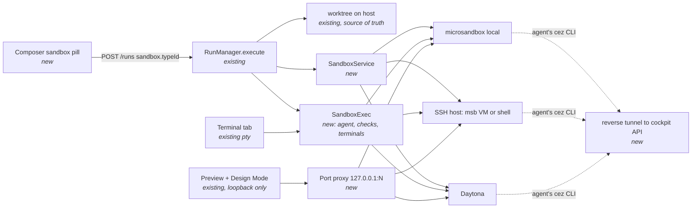

# Sandbox service: run a task in a microsandbox VM, an SSH host or a Daytona sandbox

Status: proposed · 2026-11-03 · FR #1925

> **Related:** #1877, "let tasks and skills open a proxied Preview on a port". Its spec is `2026-10-31-task-preview-apps.md` (spec PR #1878, merged); its implementation is still open. Sandbox Preview in this spec is an **extension** of that work, not a parallel mechanism. See "Preview: built on #1877" below and step 27 (P0) of the Implementation Plan.

## 📝 TLDR

Today every cezar task runs in a git worktree **on the host**. That worktree shares the host's Docker containers, databases, global toolchains and caches. So a task that has to prove something works on a fresh machine cannot be trusted there.

This spec proposes a **Sandbox service**. It is future behavior, not something that exists today:

- **Sandbox accounts**: where machines come from. There are three providers, offering four ways to run:
  - local [microsandbox](https://github.com/superradcompany/microsandbox) microVMs;
  - **SSH hosts**, which run microsandbox remotely or open a plain SSH session;
  - [Daytona](https://www.daytona.io) cloud sandboxes.
- **Sandbox types**: named presets for image, vCPU, memory, disk, network, lifetime and setup script.
- **A per-task picker** in the composer.

When a task runs in a sandbox, everything it touches runs there:

- the agent CLI and the workflow's check steps;
- the task's **Terminal** tabs;
- the apps shown in its **Preview**.

A task's agent can also **start helper sandboxes itself** with `cez sandbox up|exec|cp|port|down`, for particular jobs such as an install matrix across operating systems, reproducing a bug, or running a risky script. It can only use the configured types, and only within limits.

The worktree on the host stays the source of truth, so review, diff and landing are unchanged. The default is **This computer**, so nothing changes until a user picks a sandbox type.

## Resolved assumptions (autonomous defaults)

Rows marked **user** came from the requester on 2026-11-03 and are decided. Every other row is an autonomous default written by `om-auto-write-spec`, and each one is reversible. Rows marked ⚠ block the merge until the owner confirms them.

| # | Question | Applied answer | Why |
|---|---|---|---|
| Q1 | Should the whole agent run inside the sandbox, or stay on the host with its tools proxied in? | **The whole agent CLI runs inside the sandbox.** cezar keeps parsing the agent's stdout on the host. | Both providers' own agent recipes do exactly this (microsandbox `docs/how-to/agents/claude-code.mdx`; Daytona's Claude Code guide). Proxying tools would need a shim for each of the 10 runners. ⚠ NEEDS HUMAN CONFIRMATION |
| Q2 | How do agent credentials reach the sandbox? | **Per agent account, a *sandbox credential*: an API key, a token, or (opt-in) a login done inside the sandbox and kept on a provider-side auth volume. See "Coding agents in a sandbox".** The key or token is injected per run. Where the provider supports it, the injection is host-scoped: microsandbox `secretEnv`, Daytona `secrets`. Over SSH the key is piped on stdin. A host agent home (`~/.claude`, `~/.codex`) is **never** mounted or copied. | Mounting a home would hand the machine every session, history and OAuth refresh token. ⚠ NEEDS HUMAN CONFIRMATION |
| Q3 | Should the feature be on by default, or behind a `CEZ_*` opt-in flag? | **The surface is available by default, but nothing boots, connects or bills until the user acts.** Detection is a local `PATH`/`/dev/kvm` probe. Daytona and SSH hosts are contacted only after an account is added. A sandbox starts only for a task where one was picked. `CEZ_SANDBOXES=0` hides everything. | Same shape as dispatch and automations: the per-task pick is the opt-in. AGENTS.md § Zero config still requires an owner-ratified exception. ⚠ NEEDS HUMAN CONFIRMATION |
| Q4 | One spec or several? | **One spec, delivered in phases.** | Every provider answers the same question, "where does this task execute". Each one is a class behind one seam. |
| Q5 | Are sandbox types per workspace or per project? | **Per workspace** (`~/.cezar/sandboxes.json`), plus a per-project **default type**. | Mirrors agent accounts. |
| Q6 | How long does a sandbox live? (Full state table under Architecture → Lifecycle.) | **One sandbox per run.** It is created at run start and **stopped** when the run parks or reaches review. Continue restarts it. It is **deleted** when the run lands or is archived, or when its worktree is pruned. | Continue keeps the installed toolchain, and a stopped sandbox costs almost nothing. |
| Q7 | Should Terminal and Preview work inside a sandbox? | **Yes, for every provider, including SSH.** | **user** (2026-11-03): "add sandbox terminal support in terminal tab and preview also all integrated", "same way with terminal and preview supported". |
| Q8 | How does Preview reach a port inside a microVM? | **Through a cezar-run port proxy.** Every sandbox port becomes a `127.0.0.1:<ephemeral>` port on the cockpit host. So the Preview's existing local framing and Design Mode (which accepts loopback only) work unchanged. Daytona uses its native preview URL as the proxy's upstream. SSH uses `ssh -O forward -L`. | **user**: "for the preview microsandbox maybe should have additional proxy … make it". |
| Q9 | Should cezar check for microsandbox and explain how to install it? | **Yes.** Detection gives the exact reason, with OS-specific install steps and a **Run in a terminal tab** action. | **user**: "check if microsandbox is installed, if not let user know how to make it given different OS". |
| Q10 | Should SSH be a provider? | **Yes, with two modes per host:** microsandbox microVMs on the host, or a plain SSH session with no isolation. | **user**: "run microsandbox over SSH … configure SSH server as a sandbox provider", "also run tasks in SSH session". |
| Q11 | Can a task's agent start sandboxes itself? | **Yes, through `cez sandbox`** (see "Sandboxes launched from inside a task"). | **user**: "a way to start sandboxes (using configured providers) from inside the task too — not only for the coding but for doing some particular tasks as well". |
| Q14 | Agent software and authorization inside sandboxes? | Per-runner **agent descriptors** (install, pinned version, snapshot, offline install), plus per-agent-account **sandbox credentials** (API key, token, or opt-in in-sandbox login) with a preflight check. | **user**: "remember about authorization and software management in case we're using sandbox for coding agent". |
| Q13 | Should a task always get a new sandbox, or can it reuse one? | **Either.** The composer offers **New from a type** (the default) or **Reuse an existing sandbox**: a paused one, a kept one, or one with no task attached. A **Sandboxes** management view lists every sandbox and can pause, resume and delete it. | **user**: "start the sandboxes on new sandbox or reuse existing one (which could be paused) … a sandbox management view where we can delete the sandboxes". |
| Q12 | What limits apply to sandboxes the agent starts itself? | **At most 3 at once per run.** The agent can use only the types marked *agents may launch*. That flag defaults to **on only for local microsandbox types**. It defaults to **off** for anything remote or billed: SSH microVMs, SSH shells and Daytona. Helpers receive **no agent credentials**, only the type's own env and secrets. The agent never sees account keys and cannot create types. | These are the smallest defaults that still allow a local three-OS test matrix. Starting machines on someone's remote box needs a human's tick, and an unattended helper never holds a model key (review finding). A billed provider needs a human's explicit tick, the same reasoning as the `budget` carve-out in dispatch. All of it is reversible per type. |

## 📝 Problem Statement

The motivating run was an Open Mercato task: *"test all the ways to instantiate and set up Open Mercato described in the README, create a report, and fix warnings and errors at root cause"*. The host already had the project's database and services running in Docker. A setup path that silently reused the host's Postgres passed on the host, but would fail on a new contributor's laptop. The user had to tell the agent to install and drive microsandbox by hand inside its task. That made the agent's job harder, and the evidence could not be reproduced.

Other cases that need a different place to execute:

- **Clean-machine QA**: "does the README work on Ubuntu?", or reproducing an install bug.
- **Untrusted code**: running a contributor's PR.
- **Heavy builds**: they should not compete with the cockpit for host RAM.
- **Hardware the laptop lacks**: an Intel Mac cannot run microsandbox, but a Linux box with KVM on the LAN can. A beefy build server is often already reachable over SSH.

## 📝 Proposed Solution



**Takeaway.** Three things go through the sandbox: process execution (the agent, check steps and terminals), ports (Preview) and the agent's `cez` callback. Each of them goes through **one** `SandboxExec`, **one** port proxy and **one** reverse tunnel. Every cockpit surface above them stays as it is.

### Providers and how the worktree gets there

| Provider | Isolation | How the worktree is attached | Process transport | Ports for Preview | Agent's `cez` CLI to the cockpit |
|---|---|---|---|---|---|
| **microsandbox (local)** | microVM | bind mount, read-write, at `/workspace`; edits are live on the host | SDK `execStream` (TTY for terminals) | port proxy over an exec-stdio **relay** | the relay's reverse channel |
| **microsandbox over SSH** | microVM on the remote host | `git bundle` up, patch and bundle down at each turn end, both over `ssh` stdio | `ssh -tt host msb exec …` | `ssh -L` to the host, then the relay into the guest | `ssh -R` to the host, then the relay into the guest |
| **SSH session** | **none**: a per-task directory, `~/cez-tasks/<id8>` | bundle and patch over `ssh` (as above) | `ssh -tt host …` | `ssh -O forward -L` on the ControlMaster | `ssh -R 127.0.0.1:<p>:127.0.0.1:<cockpit>` |
| **Daytona** | cloud VM | bundle upload with `fs.uploadFile`; patch and bundle download at each turn end | session exec with streamed logs; a PTY for terminals | the proxy's upstream is the signed preview URL (`getSignedPreviewUrl`), so the token never reaches the browser | not in v1; `cez` agent commands are disabled with a reason |

**One connection per SSH host.** Every SSH connection reuses a cezar-owned ControlMaster: `ControlPath ~/.cache/cez/ssh/%C`, `ControlPersist 10m`. Forwards can then be added or removed live with `ssh -O forward|cancel`. That is how Preview attaches a port the app opened after the session started.

**The relay** is a ~150-line Node script that the bootstrap copies into the sandbox. Node is guaranteed there, because the agent CLI needs it. One long-lived `exec` runs it, and it multiplexes TCP streams over that exec's stdio using length-prefixed frames:

- **Forward streams** connect to `127.0.0.1:<guestPort>` *inside* the guest. Dev servers bound to localhost therefore work, and nothing has to listen on `0.0.0.0`.
- **Reverse streams** carry the agent's calls to `CEZ_API_URL` back to the cockpit.

The relay exists because microsandbox publishes ports only at create time (`port(host, guest)`), and a dev server's port is not known then. If microsandbox's own proxy can add forwards to a running sandbox, prefer it. Phase 3, step 28 checks this.

### Alternatives rejected

- **Docker containers**: they share the host kernel and the user's Docker daemon, which is exactly the contamination we are escaping.
- **Proxying only tools (Bash/Edit) into the VM**: needs a shim for every backend, and Codex/OpenCode/Cursor ignore `allowedTools` (#430).
- **Publishing a fixed range of ports at create time**: wastes ports, and the app's port is still unknown.
- **A same-origin path proxy for Preview**: design-mode §2 rejects it.
- **sshfs/NFS mounts for SSH hosts**: a fragile daemon dependency, and git over a network filesystem is slow. A bundle and patch stays inside git's own guarantees.

### Market check

- Both providers' agent recipes run the agent CLI inside the VM and stream its output. That is the model adopted here.
- Both use host-scoped secret substitution, so we use it wherever it exists.
- Running agents on remote dev boxes over SSH is the established pattern behind VS Code Remote-SSH and the devcontainer CLI, and ControlMaster-based forwarding is what they rely on too.

### Preview: built on #1877

#1877 (spec `2026-10-31-task-preview-apps`) defines the parts that sandbox Preview needs:
- **the preview record** `RunRecord.previews`, carried in the global SSE `run` frame;
- **the agent CLI** `cez preview open|list|close --port N`;
- **the `frame` route** (`POST /runs/:id/previews/:previewId/frame`): local framing is direct, and a hosted cockpit gets the authenticated **port gateway** (`CEZ_PREVIEW_PORTS`, single-use tickets);
- **the cockpit pickup**: agent tabs, badge, toast, close from the UI.

This spec reuses all of it and adds only what a sandbox changes:

| #1877 piece | What sandboxes add |
|---|---|
| Preview record (`RunRecord.previews[]`) | Two optional fields, `origin: 'host' \| 'sandbox'` and `sandbox: { name, guestPort }`. `name` is `task` for the task's own sandbox, or the helper's name. For a sandbox origin the record's `port` is the **host loopback port** from `openPort`, so every consumer of `port` (frame route, Design Mode, the health probe) works unchanged. |
| `cez preview open --port N` | Called from inside a sandbox, through the reverse channel, `N` is a **guest** port. The route sees the caller is sandboxed, calls `openPort(N)`, and stores `{ origin: 'sandbox', guestPort: N, port: <hostPort> }`. A new flag, `--sandbox <name> --port N`, lets a host-side agent preview a **helper's** port, so `cez sandbox port` plus `cez preview open` becomes one step. |
| `frame` route, local branch | Unchanged: it frames `http://localhost:<hostPort><path>`. The sandbox port proxy (Q8) is what listens there and rewrites `Host` to `localhost:<guestPort>`. |
| `frame` route, hosted branch (gateway) | Unchanged in mechanism: the gateway's upstream is the loopback host port. **Sandboxes stay local-cockpit only in v1** (writes gated on `localHandoff`), so this path is inert for now. Once the owner allows sandboxes on hosted cockpits, sandbox previews work there with no new code. |
| Detected URLs → Preview | Sandbox terminals' `localhost:N` URLs are mapped through `openPort` and **registered as #1877 preview records** with `origin: 'sandbox'` (source `terminal`). The ports menu in mockup 07 is #1877's agent-tab list, filtered and badged per sandbox. |
| Lifecycle (closed on `close`, run end, boot recovery, idle) | Same rules. A preview whose sandbox stops is marked `unreachable`, not removed. On Continue the sandbox restarts, `openPort` re-binds (possibly a new host port), and the record updates in place over SSE. When the sandbox is removed, its previews are removed. |

**Ordering.** Sandbox Preview needs #1877 Phases 1–2 (record, CLI, local pickup). The hosted gateway (#1877 Phase 3) is independent. If #1877 has not landed when this spec's Phase 3 starts, step 27 (P0) implements #1877 Phases 1–2 first, from **its** spec, on its own PR (`Refs #1877`). This spec never re-specifies those pieces.

### Coding agents in a sandbox: software and authorization

When the *agent itself* runs in a sandbox (Q1), two things have to be right on every provider: the agent CLI has to be present at the right version, and it has to be signed in without the host's agent home leaving the host (Q2).

**Software management.** Each runner has one **agent descriptor** in `sandbox/agents/<runner>.ts`, the only place that knows how to install that agent in a Linux guest. It records:

| Field | Example (claude) |
|---|---|
| `install(version)` | `npm i -g @anthropic-ai/claude-code@<v>` (or the vendor's native installer when the descriptor prefers it) |
| `versionCmd` | `claude --version` |
| `requires` | `node>=20`, `git`, `ripgrep` (bundled) |
| `guestHome` | `/root/.claude`, set through `CLAUDE_CONFIG_DIR` so it never collides between instances |
| `authModes` | `api-key`, `token`, `login` (see below) |
| `authEnv` | `ANTHROPIC_API_KEY` / `CLAUDE_CODE_OAUTH_TOKEN` |
| `endpoints` | `api.anthropic.com`, used for the *Agent API only* network mode |

- **Version pinning.** The guest runs **the same version the host detected** (`backend-detect.ts`). The host stays the one place a user upgrades an agent.
- **Snapshots.** A built snapshot is keyed by `(type, runner, version)`. When the host version changes, the next run with that type rebuilds the snapshot lazily: the first run pays about a minute, and later runs boot from the new snapshot. A **reused** instance (Q13) is upgraded in place before the agent starts. A feed line says "claude 2.1.235 → 2.1.240 upgraded in sandbox".
- **Offline and *Agent API only* networks.** Network `none` or an allow-list would block `npm` itself. So the host fetches the package (`npm pack` into `~/.cache/cez/agent-pkgs/`) and the bootstrap installs it from that copy. The guest needs no registry access, and the descriptor's pinned version stays reproducible.
- **Agent configuration in the guest** is **generated per run** from the run's resolved settings, never copied from the host home. That covers permission mode, `allowedTools`/`bashAllowlist`, model, reasoning effort, MCP servers (rule 3) and the AI-gateway base URL when one is configured (#1730). The gitignored project layer and registry skills arrive as rule 3 describes.
- **Software status is visible**:
  - The type editor shows "claude 2.1.235 ✓ in snapshot, codex — installs on first use".
  - The management view shows each instance's agent versions.
  - A version mismatch on reuse is a warning, never a silent run on the old version.

**Authorization.** A sandbox never sees the host agent home. Each **agent account** (`~/.cezar/agent-accounts.json`, including the discovered default) gains a **sandbox credential**, used whenever a run on that account executes in a sandbox. There are three modes, chosen per agent account:

| Mode | What the user does | What the sandbox receives | Where it is stored |
|---|---|---|---|
| **API key** | Pastes a key (e.g. a scoped Anthropic Console key or an OpenAI project key) | The key, through the strongest injection the provider has (below) | `sealManaged('agent-sandbox', <accountId>)` on the host, never in a file the agent can read |
| **Token** | Runs the vendor's token command once (`claude setup-token`). cezar offers **Run in a terminal tab** on the host and captures the token from the field the user pastes it into | A long-lived token (`CLAUDE_CODE_OAUTH_TOKEN`), so subscription users are covered without a home dir | Sealed, the same as an API key |
| **Login inside the sandbox** (opt-in per agent account, off by default) | Clicks **Log in inside sandbox**. A ⬡ terminal opens in the instance and runs the agent's own login flow (device code or browser URL) | The agent's own credential files, written by the agent itself into `guestHome` | On a per (sandbox account × agent account) **auth volume** that lives with the provider (a microsandbox volume, a remote dir on an SSH host, a Daytona volume), is mounted only into instances of that pairing, and is deleted from the management view |

**Injection, strongest first:**
- **microsandbox `secretEnv`**: host-scoped substitution. The real value never enters the VM and is only swapped in on requests to the descriptor's `endpoints`.
- **Daytona `secrets`**: host-scoped placeholders, used where the org supports them; otherwise env.
- **SSH**: the value is piped on the exec's **stdin** to a small launcher that `exec`s the agent with it in its environment. It is never on a command line, never in a file, and never in `ps` output on the remote host.

**Rules that apply to every mode:**
- The credential reaches **only the agent process**. Check steps, terminals and helpers (Q12) never get it, and the audit log records env *keys* only.
- **Revocation** deletes the sealed value or the auth volume. Running sessions keep what they were started with until their next turn, and the next spawn fails with "No sandbox credential for ‘Klaudiusz’ — add one in Agent accounts".
- **Preflight**: the composer checks the selected agent account × sandbox type pair *before* starting. A missing credential, an agent version that can't install, or *Agent API only* without a known endpoint each shows a warning on the sandbox pill, with a link to the fix. The task is never started just to fail at bootstrap.
- `login` mode puts a long-lived credential on someone else's disk (SSH host, Daytona volume). It is therefore off by default, shows that warning when enabled, and is **refused for `ssh shell` types**, which have no isolation from other users of that host.

### Sandbox management: new or reused, and one place to see them all

**Instances, separate from types.** A *type* is a recipe. An *instance* is a real machine made from it. Each instance has:
- an id, `cez-<id8>` (or a helper's name);
- its type snapshot, account and kind;
- a state: `creating`, `running`, `paused`, `failed` or `removed`. The lifecycle's `stopped` is shown to users as **paused**.
- an **owner**: the run it is attached to, or **none**.

**Ownership rules**
- An instance is attached to **at most one run at a time**.
- When its run lands or is archived, the type's **`onTaskEnd`** decides what happens:
  - `remove` (the default): today's Q6 behavior.
  - `keep-paused`: the instance is detached, paused and listed as **available for reuse**.

  Keep 24 h (rule 8) is the time-boxed form of the same thing.

**Starting a task: new or reuse.** The composer's sandbox picker has two sections:
- **New from type**: today's list of types.
- **Reuse existing**: instances that are paused, kept, or running with no owner. Each shows its type, age, disk use, the task it last served, and "has: postgres 16, node_modules, yarn cache…" (taken from the last task's services and setup).

When a task reuses an instance:
1. The instance is attached to the new run and resumed if paused.
2. **The worktree arrives by sync, not a mount.** microsandbox fixes mounts at create time, so a reused instance takes the bundle-and-patch path, the same one every `syncsWorktree` provider uses. The previous task's `/workspace` is moved to `/workspace.prev-<id8>`, then removed after the first sync succeeds, so the new task never edits the old task's tree.
3. Services are re-checked (compose `up --wait` is idempotent), so state the user *wanted* kept (a seeded DB, warm caches, installed toolchains) survives.
4. Setup scripts do **not** re-run unless the type says `setupOnReuse: true`.

Reuse is refused, with a reason, when:
- the instance is attached elsewhere;
- its type's runner or agent version no longer matches (the user may reuse anyway, and the bootstrap upgrades the agent CLI);
- the account is gone.

`cez sandbox up --reuse <name>` gives helpers the same choice, limited to instances that task's run owns or that are unowned **and** of an agent-launchable type.

**The Sandboxes management view.** A top-level sidebar entry (**Sandboxes**, beside Automations) at `/sandboxes`. It is workspace-wide, like the dashboard, because instances span projects.
- **Table:** name, state (running / paused / failed / kept-until), kind and account, type, project and owner task (links), age, last activity, vCPU/RAM, disk, Daytona cost estimate, and the services it carries.
- **Filters:** state, project, account, "no owner", "orphan" (the provider has it but cezar has no record).
- **Row actions:** **Open shell** (a ⬡ terminal), **Pause** / **Resume**, **Attach to a new task…** (opens the composer pre-set to reuse it), **Save as type…**, **Logs** (audit), **Delete**.
  - Deleting an instance that is attached to a *running* task asks for confirmation and parks that task with "sandbox deleted by user".
  - Deleting a paused task's instance makes that task's Continue go to `failed` → **Retry** (recreate).
- **Bulk actions:** **Delete selected**, **Delete all paused older than…**, **Delete orphans**.
- **Header totals:** reserved RAM/vCPU against the host and each SSH host (rule 2), plus disk used by instances and caches.

**Where instances are recorded.** `cezarHomeDir()/sandbox-instances.json` is a **rebuildable index**, not configuration:
- Each provider tags its instances (microsandbox labels, Daytona `labels`, an SSH marker file `~/cez-tasks/<id8>/.cez-instance.json`) with `{instanceId, typeId, runId, projectId}`.
- Deleting the index rebuilds it from a provider listing on the next boot. Instances seen without a run become **orphans** in the view; they are never auto-deleted unless they also match the sweep rule.

### Sandboxes launched from inside a task (`cez sandbox`)

Running the *whole* task in a sandbox is one use. The other is a task that stays where it is, on the host or in its own sandbox, and **starts helper sandboxes for particular jobs**. Examples:

- the motivating "try every README install path on clean Ubuntu, Debian and Node images in parallel";
- reproducing a bug on a specific OS;
- running a risky script or a heavy data job;
- smoke-testing a built artifact;
- a QA matrix.

This is a fourth client of the agent transport (`CEZ_API_URL`, `CEZ_PROJECT_ID`, `CEZ_TASK_ID`, `CEZ_BIN`), modeled on `dispatch/task-cli.ts`. It is a thin HTTP client with exit code 0 on success, 1 when refused, and 2 for a usage error or no cockpit.

```
cez sandbox types                              types this task may launch (+ why others are not)
cez sandbox up <type> [--name <n>] [--copy-worktree | --mount-worktree] [--copy <path>[:<dest>]]…
                      [--env K=V]… [--port <guest>]…     boot one; prints name, state, boot time
cez sandbox exec <name> [--cwd <dir>] [--timeout <s>] -- <cmd> [args…]
                                               streams stdout/stderr; exits with the command's code
cez sandbox cp <src> <name>:<dst> | <name>:<src> <dst>   copy files in/out (tar over the exec channel)
cez sandbox port <name> <guestPort>            → http://127.0.0.1:<hostPort> (feed to `cez preview open`)
cez sandbox ls | logs <name> | down <name> | down --all
```

**Rules**

- **Only configured types** can be launched, and only those flagged *agents may launch* (Q12). The agent never sees account credentials, and every provider call is made by the cockpit.
- **The sandbox belongs to the run.** It is listed in a **Sandboxes in this task** panel and as a header chip. It follows the run's lifecycle (Q6): stopped while the run parks, removed when it lands or is archived, and removed by `down`. The boot sweep collects orphans.
- **A cap of 3 per run, counted at once.** A fourth `up` is refused (exit 1) with the reason, the same way dispatch refuses a fifth child.
- **`--copy-worktree` vs `--mount-worktree`.** `--copy-worktree` is a snapshot copy: the helper's edits never reach the task's branch, which is the default and the safe choice. `--mount-worktree` gives live read-write access and is local microsandbox only.
- **Nested runs.** A task that itself runs in a sandbox reaches the cockpit through the reverse channel (Phase 3). Its helpers are therefore **siblings on the provider**, never VMs nested inside the VM, so no nested virtualization is needed.
- **The same machinery as the rest of the spec.** Helpers use `SandboxExec`, `openPort` and the relay. In the cockpit, each helper card has **Terminal** (opens a ⬡ tab attached to that helper), **Logs** (every `exec` with its exit code), **Ports** (Preview) and **Stop**.
- **Every route is gated on `capabilities().sandboxes`.** Workflow check steps and skills get the same commands, because they share the agent environment.

### What a sandboxed run needs beyond a VM

Starting a VM is the easy part. These twelve rules make a sandboxed run do real work, and do it the same way on every provider. Rules 1–4 are needed for the motivating case to work at all.

**1. Services inside the sandbox (databases, queues, `docker compose`).** A type declares `services`, which come up after setup and before the agent starts, and are torn down with the sandbox:
- **`compose`** (the default when the repo has `docker-compose.yml`, `compose.yaml` or `.devcontainer`'s `dockerComposeFile`): cezar runs `docker compose -f <file> up -d --wait [<services>]` **inside** the sandbox, in three steps.
  - The image must carry Docker, or cezar's bootstrap installs `docker.io` plus `docker-compose-plugin` on Debian/Ubuntu bases.
  - Docker-in-VM works on microsandbox (a full kernel per VM) and on SSH microVMs. On Daytona it is gated by the type's `kvm`/docker-capable snapshot; otherwise the type editor greys the option out with the reason.
  - SSH *shell* types run compose on the host itself, with the project name `cez-<id8>` so containers never collide, and `down -v` at removal.
- **`script`**: a free-form start command (e.g. `pg_ctlcluster 16 main start`) plus a readiness probe (`tcp:5432` or `http://localhost:8080/health`), each with a timeout.
- Each service's readiness shows as a line in the run feed. The agent's prompt preamble lists the services and ports ("Postgres is running at localhost:5432, user `postgres`"), so the agent never reaches for the host's.
- A service that fails readiness fails the run at `creating`. The service's last 50 log lines are attached, and the sandbox is kept `failed` for **Retry**.

**2. Local resource limits.** A local microVM really reserves host memory.
- `WorkspaceSemaphore` (`workspace/semaphore.ts`) gains a third accountant beside `maxParallel` and `memoryLimitMb`: **sandbox reservations**. Each local or helper sandbox reserves its type's `memoryMiB` and `cpus` from the moment it is created until it is stopped.
- A run (or a `cez sandbox up`) whose reservation would push the reserved total past **host RAM − 4 GiB headroom** (or past `memoryLimitMb` when set), or vCPUs past the host core count, is **queued, not failed**. The queue reason is "waiting for 16 GiB: 2 sandboxes hold 24 GiB of 32 GiB". It starts when a sandbox stops.
- SSH hosts get the same accounting against the probed host totals, kept per account. Daytona is not counted locally; its org limits reject the request instead.
- A stopped sandbox releases its reservation. The parked-run exemption (#347) carries over: Continue on a parked run may resume its sandbox even if that briefly exceeds the cap, the same way a resume may exceed `maxParallel`.

**3. Git push and the agent's setup inside the sandbox.**
- **No push from a sandbox.** The sandbox gets no git credentials and no `gh` token, so commits are local to `/workspace`. Pushing and opening PRs stay where they are today, on the host (`pr.ts`, landing), working from the synced worktree. The git identity (`user.name`/`user.email`) is copied from the host repo's config so commit authorship is unchanged.
- **The agent's setup is copied in, with no secrets.**
  - The worktree already carries tracked instructions (`CLAUDE.md`, `AGENTS.md`, `.claude/`, `.agents/skills`).
  - The **gitignored personal layer** that `agent-config/seed.ts` copies into worktrees comes along: through the mount on microsandbox, or the bundle on SSH and Daytona.
  - **Registry skills** (`skills.ts`) are written into the sandbox's agent skill directory the same way `materializeSkillDir` does for worktrees.
- **MCP servers** from the run's `mcpServers` are classified at launch:
  - *stdio* servers whose command is an npm/uvx package are installed and run **inside** the sandbox.
  - *http/sse* servers on loopback are reached through the reverse channel.
  - Remote http servers are reached directly when the network mode allows.
  - Anything else (a host-only binary) is dropped. A visible line in the feed names it ("MCP server `figma` is host-only and is not available in this sandbox"), so the gap is never silent.

**4. Reuse an existing `.devcontainer` (zero config).** When the repo has `.devcontainer/devcontainer.json` (or `.devcontainer.json`), Settings and the composer offer a **derived type** with no setup:
- `image` (or a build from `build.dockerfile` with `context`) becomes the type's image;
- `features` are installed by the bootstrap;
- `postCreateCommand` and `postStartCommand` become the setup script;
- `forwardPorts` become preview ports;
- `containerEnv` and `remoteEnv` become env;
- `dockerComposeFile` plus `service` become the **services** (rule 1);
- `hostRequirements.cpus` and `.memory` become resources.

Rules for the derived type:
- It is labelled "from .devcontainer", is read-only, and is re-derived when the file changes.
- **Duplicate** turns it into an editable type.
- A repo `Dockerfile` with no devcontainer is offered the same way, as "Build from Dockerfile".
- Building happens inside the sandbox (microsandbox and Daytona both accept a local directory or OCI image; the build runs `docker build` in a builder VM and caches the result as a snapshot keyed by the file hash).

**5. Shared package caches.** A type lists `caches` (defaults derived from the repo's lockfiles):
- `npm` → `~/.npm`
- `yarn` → `~/.cache/yarn` or `.yarn/berry/cache`
- `pnpm` → `~/.local/share/pnpm/store`
- `pip`/`uv` → `~/.cache/pip`, `~/.cache/uv`
- `cargo` → `~/.cargo/registry`
- `go` → `~/go/pkg/mod`

Each cache is a **named volume per account and cache kind**, mounted read-write:
- microsandbox: `Volume.builder("cez-cache-npm").disk()`;
- Daytona: `volumes`;
- SSH: a directory under `~/.cache/cez-remote/caches`.

Caches hold only downloaded packages, never build output, so sharing them between tasks cannot leak one task's code into another. Settings shows each cache's size with a **Clear** button.

**6. Team-shared sandbox types.** A project may commit **`.ai/cezar/sandboxes.json`**. It is added to the committable allowlist beside `workflows/` and `skills/` in `ensureDataGitignore`.
- It holds **types only, never accounts or secrets**.
- Each type names an account **kind** (`microsandbox`, `ssh`, `daytona`), not an account id. It binds to the user's first account of that kind, or the one the user picks.
- Repo types appear in the picker under "This project", marked "shared". Precedence is local-first: a personal type with the same id overrides.
- A repo type can never set `agentLaunch: true` on a remote or billed kind. That stays the personal decision Q12 demands.

**7. Cost and budget for Daytona.**
- cezar estimates spend per sandbox as `vCPU·s × rate + GiB·s × rate + disk GiB·s × rate`. Default rates are shipped in `sandbox/daytona-rates.ts` with their date and source, and the user can override them per account.
- Spend is updated each minute while the sandbox runs (stopped means storage only).
- The estimate is shown in the run header chip ("~$0.42"), in the run's cost line next to model tokens, and on the dashboard's costs page as a separate **Sandboxes** series (`workspace/dashboard-costs.ts`).
- It counts against a dispatched child's `--budget`. The child is parked (not killed) at the cap, as it is for tokens.
- It is labelled **estimate** everywhere. Daytona's own bill is authoritative.

**8. Keep or snapshot a sandbox after a run.**
- **Keep for debugging**: a per-type `keepAfterMinutes` (default 0), or a one-off **Keep 24 h** button on a finished run's sandbox, delays removal after land or archive. The run header shows a countdown and **Open shell**.
- **Snapshot**: **Save as type…** freezes the sandbox (`msb snap create`, Daytona `createSnapshot`) into a new type, e.g. "Open Mercato after failing install". A human (or another task) can then boot the exact machine the agent left.
- Both are human actions in the cockpit. An agent cannot extend its own sandbox's life.

**9. Browser-ready types.** A type option, **Include a browser for QA**, adds Chrome for Testing plus the system libraries (`agent-browser install --with-deps` inside the image) to the bootstrap snapshot. The agent can then run e2e and QA skills inside the sandbox.
- The `.ai/browsers/agent-browser.md` descriptor is honored as is, because its Linux path already handles a root, container-like environment.
- Screenshots and videos land in the worktree (synced) or are pulled with `cez sandbox cp`.

**10. Parallel variants each in their own sandbox.** When the composer's ×N variants run with a sandbox type, **each variant gets its own sandbox**, never a shared one. The variants' results stay independent.
- Admission (rule 2) counts all N up front. If N reservations don't fit, the variants queue together and start together, so they compare fairly.

**11. Exec audit log.** Every process start in a sandbox is appended to `.ai/cezar/runs/<id>.sandbox-audit.ndjson`: agent sessions, check steps, terminal sessions and `cez sandbox exec`.
- Each line records `{ts, sandbox, origin: agent|check|terminal|helper|human, argv (capped), cwd, exit, durationMs}`. Env values are never recorded, only env keys.
- The run's **Logs** view filters it, and it survives the sandbox's removal. It rotates with the run's event file.
- The file is added to `ensureDataGitignore`.

**12. Testing, documentation and telemetry.**
- **Testing.** CI has no KVM.
  - The **mock provider** (`CEZ_DRY_RUN=1`) executes commands as local child processes in a temp dir, with fake boot latency. Every cockpit flow, the e2e smoke and `test:package` therefore run anywhere.
  - SSH is tested against a fake `ssh` on `PATH`. Daytona uses recorded SDK fixtures.
  - A real-provider **opt-in smoke** (`CEZ_SANDBOX_SMOKE=microsandbox|ssh:<alias>|daytona`) is documented, never part of `npm test`, and runs nightly only on a self-hosted runner that has KVM.
- **Docs.** A feature page, `docs/site/content/docs/…/sandboxes.mdx`, covers setup per OS, SSH hosts, Daytona cost, `cez sandbox`, the security model and the "SSH shell is not isolation" warning. The env table gains `CEZ_SANDBOXES` and `CEZ_SANDBOX_SMOKE`, both also in `.env.example`.
- **Telemetry.** Opt-in only, per docs/telemetry.md. It adds closed-set labels:
  - the event `sandbox_run` with `kind ∈ {microsandbox, ssh_vm, ssh_shell, daytona}` and `origin ∈ {task, helper}`;
  - an outcome `∈ {ok, failed_provision, failed_service, cancelled}`;
  - a boot-time bucket.

  It sends no image names, hosts, types or commands. The server-side allowlist is updated in the same PR.

## 📝 Architecture

| Piece | Where | Status |
|---|---|---|
| Lifecycle | `sandbox/service.ts`. The states are `creating → running ⇄ stopped → removed`, plus `failed`, and they apply to the task's sandbox and to helpers alike. **Transitions out of each state:**<br>• `creating`: provider ok → `running`; error → `failed`.<br>• `running`: run parks, reaches review, or the user clicks Stop → `stopped`; run lands or is archived, worktree pruned, or `cez sandbox down` → `removed`; provider lost → `failed`.<br>• `stopped`: Continue or a helper `exec` → `running`; land, archive or prune → `removed`.<br>• `failed`: **Retry** (same type) → `creating`; **Retry on this computer** (task sandbox only); archive → `removed`.<br>The sweep removes only sandboxes whose run is **absent, landed or archived**. It never touches a parked run's sandbox, however old. A `stopped` sandbox that the provider has meanwhile deleted (e.g. Daytona auto-archive) becomes `failed` on Continue, with **Retry**, which recreates it from the type and re-syncs the worktree. | **new** |
| Store | `workspace/sandboxes.ts` → `cezarHomeDir()/sandboxes.json` | **new**, cloned from `workspace/agent-accounts.ts`: loose stored schema, per-entry salvage, atomic `mergeWrite…` at mode 0600, never cached |
| API keys | `sealManaged('sandbox', accountId, key)` / `openManaged` (`workspace/secrets.ts:143`) | existing primitive |
| Provider seam | `sandbox/provider.ts` `SandboxProvider`: `detect()`, `test(account)`, `create(type, ctx)`, `start`, `stop`, `remove`, `exec(cmd, args, {cwd, env, stdin, tty, cols, rows}) → SandboxProcess` (a ChildProcess/IPty-compatible shape), `syncIn`, `syncOut`, `openPort(guestPort) → hostPort`, `closePort`, `reverse(hostPort) → guestPort`, `stats()` | **new** |
| Providers | One folder per provider under `sandbox/providers/`, each registered in `sandbox/registry.ts`. `microsandbox/`: the optional `microsandbox` npm SDK, falling back to the `msb` CLI. `ssh/`: the system `ssh` binary with the user's own config, no SSH library; it holds `transport.ts`, `shell.ts` and `microsandbox.ts` (which composes the transport with the remote `msb`). `daytona/` (Phase 5): the optional `@daytonaio/sdk`. | **new**. A missing package or binary yields `detect() → {available:false, reason, remedy}` and never fails the boot. |
| Install guidance | `sandbox/providers/microsandbox/detect.ts` returns `{ state: 'ready' \| 'missing' \| 'unsupported-host' \| 'kvm-missing' \| 'kvm-denied' \| 'nested-virt-off', os, arch, remedies: [{ label, command, note }] }` | **new**; pure and testable per OS |
| Service | `sandbox/service.ts`: acquire and release, plus a boot sweep of orphaned `cez-*` sandboxes and SSH task directories (mirrors worktree pruning) | **new** |
| Agent spawn | `core/runner-factory.ts` `createRunner(backend, {sandbox})`. `guardWorkingDirectory` already wraps every `startSession`/`run` and sees `spec.cwd`. `AgentRunSpec.sandboxExec` replaces `nodeSpawn` at `disclaimedCommand` call sites. | existing seam, extended |
| Check steps | `workflows/run.ts` `runCheckStep` (~9549) uses the same `sandboxExec` | existing, extended |
| **Terminal** | `server/terminal/sessions.ts` `TerminalSessions.create` takes `target: 'sandbox' \| 'host'`. For `sandbox`, the pty runs the provider's TTY command (`msb exec -t …`, `ssh -tt …`). For Daytona, `SandboxPty` adapts `createPty`/`sendInput`/`resize` to the `pty-module` interface, so scrollback, resize, foreground detection and lifecycle routes are untouched. Project commands (`terminal/commands.ts`) run in the selected target. | existing, extended |
| **Detected URLs** | `terminal/detected-urls.ts`: a URL printed in a sandbox terminal or the agent's output (e.g. `localhost:3000`) refers to the guest. It is mapped through `openPort` and offered to Preview as the proxied loopback URL, and `isListening` probes the proxy. | existing, extended |
| **Preview** | The #1877 preview record (`cez preview open --port N`, spec `2026-10-31-task-preview-apps`) gains `origin: 'sandbox'` (see "Preview: built on #1877"). The Preview frames `http://127.0.0.1:<hostPort>` and rewrites `Host` to `localhost:<guestPort>` upstream, because dev servers check it. WebSocket upgrades are passed through for HMR. Design Mode mirrors the loopback port unchanged. | existing, extended |
| Port proxy | `sandbox/port-proxy.ts`: a loopback-only listener per forwarded port. It closes when idle, when the run stops, and when the preview record goes. | **new** |
| Agent bootstrap | `sandbox/bootstrap.ts` installs git, Node if missing, the relay, and the run's agent CLI **pinned to the host-detected version** (`backend-detect.ts`). It then snapshots the image (`msb snap`, Daytona `createSnapshot`), keyed by `(type, runner, version)`. On SSH-session hosts it installs into `~/.cache/cez-remote/`. | **new** |
| Capability | `capabilities().sandboxes` in `server/capabilities.ts` and `/api/v1/health`. It is off under `CEZ_SANDBOXES=0` and on a hosted cockpit. | **new flag** |

**Runner coverage in v1**

- **Supported:** the stdio CLIs that go through `disclaimedCommand` (claude, pi, cursor, kimi, antigravity), plus Codex app-server over stdio.
- **Not yet supported:**
  - the ACP runners (gemini, copilot, junie);
  - OpenCode's HTTP server, which needs `openPort`.
- In the picker, the unsupported runners show as **disabled with a reason** until Phase 6.

## 📝 Data Model

`~/.cezar/sandboxes.json` is its own file and never a key in `config.json`:

```jsonc
{
  "version": 1,
  "accounts": [
    // local microsandbox is DISCOVERED, never stored (like the default agent account)
    { "id": "acme-eu", "provider": "daytona", "label": "Acme work org",
      "apiUrl": "https://app.daytona.io/api", "target": "eu", "organizationId": null, "addedAt": "…" },
    { "id": "build-box", "provider": "ssh", "label": "build-box",
      "host": "build-box",            // ~/.ssh/config alias or user@host; ssh resolves the rest
      "user": null, "port": null, "identityFile": null,   // optional overrides; null = ssh config / agent
      "modes": ["microsandbox", "shell"], "taskRoot": "~/cez-tasks",
      "hostKey": "SHA256:q8x…Tz4",    // pinned on first Test, after the user confirms the fingerprint
      "addedAt": "…" }
  ],
  "types": [
    { "id": "ubuntu-16g", "label": "Ubuntu · 4 vCPU · 16 GB", "account": "local-microsandbox", "kind": "microsandbox",
      "image": "ubuntu:24.04", "cpus": 4, "memoryMiB": 16384, "diskGiB": 40,
      "network": { "mode": "public" },    // none | agent-api | public | allow-list(+domains/cidrs)
      "idleStopMinutes": 30, "maxLifetimeMinutes": 480, "previewPorts": [3000], "agentLaunch": true,
      "services": { "compose": { "file": "docker-compose.yml", "only": ["postgres", "redis"] },
                    "script": [{ "name": "mailpit", "start": "mailpit &", "ready": "tcp:1025", "timeoutSec": 60 }] },
      "caches": ["yarn"], "browser": false, "keepAfterMinutes": 0, "onTaskEnd": "remove", "setupOnReuse": false,
      "source": null,                    // "devcontainer" | "dockerfile" for derived (read-only) types
      "setupScript": "apt-get update && …", "env": { "NODE_ENV": "development" }, "secrets": ["DATABASE_URL"] },
    { "id": "box-vm", "account": "build-box", "kind": "microsandbox", "image": "ubuntu:24.04", "cpus": 8, "memoryMiB": 32768, "diskGiB": 60 },
    { "id": "box-shell", "account": "build-box", "kind": "shell", "setupScript": "corepack enable" },
    { "id": "cloud-large-eu", "account": "acme-eu", "kind": "daytona", "snapshot": "daytona-large",
      "cpus": 4, "memoryMiB": 8192, "diskGiB": 10, "autoStopMinutes": 15, "autoArchiveMinutes": 1440 }
  ],
  "selections": { "/path/to/open-mercato": "ubuntu-16g" }
}
```

**Per-kind validation.** Each kind accepts only its own fields; a field the kind lacks is rejected, never dropped.

- **`microsandbox`**: image (OCI), cpus, memory, disk (`--root-disk`), network (maps to `NetworkPolicy`), idle (`idleTimeout`), lifetime (`maxDuration`), preview ports.
- **`shell`**: setup script, env, secrets. There are no resources and no network field, because it uses the host as it is. Its type carries a **no isolation** badge everywhere.
- **`daytona`**: `image` **xor** `snapshot`; resources apply to image-based creates only. Auto-stop and auto-archive map to the SDK fields. `network` maps to `networkBlockAll`, `networkAllowList` and `domainAllowList`. cezar owns deletion (Q6).

**`RunRecord.sandbox`** is optional, so old files parse:

```
{ typeId, kind, accountId, sandboxId, state: 'creating'|'running'|'stopped'|'removed'|'failed',
  resources: {cpus, memoryMiB, diskGiB, image}, ports: [{guest, host}], error? }
```

`RunRecord.sandbox` and each helper also carry an optional `costEstimateUsd` (Daytona only) and `keepUntil`. The audit log is a separate NDJSON file (rule 11).

`RunRecord.helperSandboxes` is optional: `[{ name, typeId, kind, sandboxId, state, worktree: 'copy'|'mount'|'none', createdAt, lastExit? }]`. The sandboxes an agent starts with `cez sandbox up` are recorded here. They live in a separate field from `sandbox`, which is where the task itself runs.

The resources are a **snapshot** taken at launch.

**Sensitive data**

- API keys are kept only in the sealed vault. The cockpit shows them only as `••••last4`.
- SSH needs no secret storage: cezar runs the user's own `ssh` with the user's agent and config, and never reads or stores a private key.
- `sandboxes.json` holds no secrets.

## 📝 API Contracts

The schemas live in `packages/contract/src/sandboxes.ts`. Routes are workspace-level (single mount), chained into one family and validated by the middleware trio.

**Every mutating route returns 409 unless `capabilities().sandboxes && localHandoff`.** A sandbox or SSH host runs arbitrary commands with the user's credentials, so this mirrors the agent-config write gate.

| Route | Body → Response |
|---|---|
| `GET /api/v1/workspace/sandboxes` | → `{ providers: [{kind, available, version?, detect: MicrosandboxDetect?}], accounts: [...redacted], types, selections }`. No network calls: account status is the result of the last `test`. |
| `POST /api/v1/workspace/sandboxes/detect` | Re-runs local detection, for the **Check again** button. |
| `POST /api/v1/workspace/sandboxes/accounts` | `{provider:'daytona', label, apiKey, …}` or `{provider:'ssh', label, host, user?, port?, identityFile?, modes, taskRoot?}` → the account |
| `POST /api/v1/workspace/sandboxes/accounts/:id/test` | Daytona: one authenticated call. SSH: `ssh -o BatchMode=yes` probe → `{ ok, hostKey, os, arch, cpus, memGiB, git, kvm, msb, agentClis, forwarding }`. For an **unknown host key**, it returns the fingerprint and requires a second call with `{ trustHostKey: <fingerprint> }`. It never sets `StrictHostKeyChecking=no`. |
| `GET /api/v1/workspace/sandboxes/ssh-hosts` | The `Host` aliases parsed from `~/.ssh/config` (names only), for the host picker. |
| `PATCH` / `DELETE /…/accounts/:id` | Delete is refused with 409 while a type references the account. |
| `POST` / `PATCH` / `DELETE /…/types[/:id]` | Type CRUD |
| `POST /…/types/:id/boot-test` | Boots the type, runs `uname -a && git --version`, then removes it → `{ ok, bootMs, log }` |
| `PUT /…/selection` | `{ repoRoot, typeId \| null }` |
| `POST /api/v1/p/:projectId/runs` (existing) | Adds `sandbox?: { typeId } \| null`. Absent means the project's selection; `null` means "This computer". Same tri-state as `agentProfile`. |
| `POST /api/v1/p/:projectId/runs/:id/sandbox/stop` | Stops the sandbox without failing the run. |
| `POST /api/v1/p/:projectId/runs/:id/sandbox/ports` | `{ guestPort }` → `{ hostPort, url }` (Preview's **Forward another port**). `DELETE …/ports/:guestPort` removes it. |
| `GET` / `POST /api/v1/p/:projectId/runs/:id/sandboxes` | List the run's helper sandboxes, or start one with `{ typeId, name?, worktree: 'copy'\|'mount'\|'none', copy?: [...], env?, ports? }`. Returns 409 with a reason when the type is not agent-launchable, or when the cap or provider limits are reached. |
| `POST …/sandboxes/:name/exec` | `{ cmd, args, cwd?, timeoutSec?, stdin? }` → a streamed NDJSON response: `{stdout}` / `{stderr}` / `{exit}`. Each exec is also appended to the run's events, so it shows in **Logs**. |
| `PUT` / `GET …/sandboxes/:name/files?path=` | tar stream in and out, for `cez sandbox cp` |
| `POST …/sandboxes/:name/ports` · `DELETE …/sandboxes/:name` | Forward a port, or remove the sandbox. |
| `GET /api/v1/p/:projectId/sandboxes/derived` | The types derived from `.devcontainer`/`Dockerfile`, and the repo-shared types from `.ai/cezar/sandboxes.json`, each with its parse errors, if any. |
| `GET` / `DELETE /api/v1/workspace/sandboxes/caches[/:id]` | Cache volumes with their sizes, and **Clear**. |
| `POST …/runs/:id/sandbox/keep` · `POST …/runs/:id/sandbox/snapshot` | `{ minutes }` → `keepUntil`; `{ label }` → a new type. Both are local cockpit only. |
| `GET …/runs/:id/sandbox/audit` | The audit lines, paginated. |
| `GET /api/v1/workspace/sandboxes/instances` | Every instance with its state, owner, usage, disk, cost estimate and services, plus host reservation totals. Filters: `state`, `projectId`, `account`, `owner=none`, `orphan`. |
| `POST …/instances/:id/pause` · `…/resume` · `DELETE …/instances/:id` | Lifecycle actions. Deleting an attached instance needs `{ confirm: true }` and parks the owner run. |
| `POST …/instances/bulk-delete` | `{ ids } \| { pausedOlderThanDays } \| { orphans: true }` → `{ deleted, failed: [{ id, error }] }` |
| `POST /api/v1/p/:projectId/runs` (sandbox field) | `sandbox` also accepts `{ reuse: <instanceId> }`. A 409 explains why reuse is refused. |
| `PUT` / `DELETE /api/v1/workspace/agent-profiles/:id/sandbox-credential` | `{ mode: 'api-key'\|'token', value }` or `{ mode: 'login', allow: true }` → `{ mode, last4?, updatedAt }`. The value is never returned. Same local-only 409 gate as agent accounts. |
| `POST /api/v1/p/:projectId/sandboxes/preflight` | `{ runner, agentProfile?, sandbox }` → `{ ok, issues: [{ code: 'no-credential'\|'agent-install'\|'endpoint-unknown'\|'reuse-busy'\|'resources', message, fix? }] }`. Read-only and cheap; the composer calls it on change. |
| `POST …/instances/:id/login` | Opens a ⬡ terminal running the agent's login flow against the pairing's auth volume (`login` mode only). |
| Terminal create (existing) | Adds `target?: 'sandbox' \| 'host'`. The default is `sandbox` when the run has one. |

Every new route goes into the BACKWARD_COMPATIBILITY.md §2 inventory, and the contract-parity tests cover both directions. `.env.example` and `docs/reference.md` gain `CEZ_SANDBOXES`.

## 📝 UI/UX

**Current state**, captured from a dry-run cockpit:

| Agent accounts today | Composer today |
|---|---|
|  |  |

**Proposed.** These are illustrative static mockups, not an accepted prototype. The HTML sources sit beside them in `assets/sandbox-service/`.

1. **Settings → Sandboxes** is a global section, registered after *Agent accounts*.
   - It lists the accounts, each with a status pill and a **Test** button: discovered microsandbox, Daytona, and the SSH host with its capabilities.
   - It lists the sandbox types with a summary line, a "default for &lt;project&gt;" badge, and a **no isolation** badge on SSH shells.
   - 
2. **microsandbox not installed: setup guidance.** The detected OS tab is pre-selected. Each tab gives the exact remedy:
   - **macOS Apple Silicon**: `brew install superradcompany/tap/microsandbox` when Homebrew is found, otherwise `curl -fsSL https://install.microsandbox.dev | sh`.
   - **Linux**: check `/dev/kvm`. If it is missing, enable virtualization in the BIOS. If it is denied, run `sudo usermod -aG kvm $USER` and log in again. Then install.
   - **Windows**: enable Windows Hypervisor Platform (`Enable-WindowsOptionalFeature -Online -FeatureName HypervisorPlatform`), reboot, then install.
   - **Intel Mac, or a VM without nested virtualization**: unsupported. The page points to *SSH host* or *Daytona*.
   - **Run in a terminal tab** opens a host terminal with the command typed in. The user presses Enter; cezar never installs silently. **Check again** re-runs detection.
   - 
3. **Add account: Daytona.** Fields: name, API key, region, optional org ID, API URL. **Add account** is enabled only after **Test connection** succeeds.
   - 
4. **Add account: SSH host.**
   - The host field offers aliases from `~/.ssh/config`. User, port and identity default from that config.
   - The user chooses which modes the host offers: microVMs, plain session, or both.
   - The test result lists:
     - the host-key fingerprint, which the user confirms the first time;
     - OS, CPUs and RAM;
     - KVM and microsandbox, with the same remedies as item 2 when missing, run on the remote host;
     - whether forwarding is allowed;
     - which agent CLIs are present.
   - 
5. **Sandbox type editor.**
   - It shows only the fields that the chosen account's kind supports.
   - Sliders are capped by host cores and RAM, by the SSH host's probe, or by the error from a failed Daytona create; tier limits are never hard-coded.
   - Network is a segmented control.
   - It also has a setup script, env, workspace secrets and preview ports.
   - **Boot a test sandbox** runs a disposable instance.
   - 
6. **Composer pill** (`PickerPill`, in the HOW group).
   - The options are *This computer* plus the types, grouped by account. Daytona types are tagged `billed`; SSH shells are tagged `no isolation`.
   - Picking a sandbox **locks Worktree on**.
   - Runners that are not supported show the sandbox options disabled, with a reason.
   - 
7. **Run header chip and popover** (`run-header.tsx` `MetaRow`).
   - The chip shows provider · type · live state.
   - The popover shows: id, image and agent version, resources, workspace mapping, live usage, stop policy, and **Open shell** / **Stop sandbox** / **Logs**.
   - Lifecycle lines appear in the feed as `system` UiEvents.
   - 
8. **Terminal tab.**
   - For a sandboxed run, new tabs open **inside the sandbox**, marked ⬡. *On this computer* stays one click away in the **＋** menu. For SSH and Daytona that menu warns that the host worktree only updates at turn end.
   - Project commands from `package.json` and the `Makefile` run in the chosen target.
   - A URL a terminal prints is shown as forwarded to Preview.
   - 
9. **Preview.**
   - The URL bar shows the guest address (`localhost:3000`) with a **⬡ sandbox :3000** badge, plus "via 127.0.0.1:N".
   - The ports menu lists ports found in terminal output, ports the agent opened with `cez preview open`, and a **Forward another sandbox port…** entry.
   - Design Mode works unchanged, because the framed origin is loopback.
   - 

10. **Sandboxes launched from inside a task.**
    - The transcript shows the agent's `cez sandbox` calls.
    - A **Sandboxes in this task** panel shows each helper with its type, state and last exit code, plus Terminal, Logs, Ports and Stop. A header chip shows the count.
    - The type editor gains an **Agents may launch this type** checkbox. It defaults per Q12.
    - 

**Other ways to choose a sandbox.** Automations and `cez task create` take the same `sandbox` field (`--sandbox <typeId|none>`). A dispatched child inherits its parent's sandbox type unless the dispatch overrides it.

**Accessibility.** The picker reuses `PickerPill`'s radio-menu semantics. Status pills always pair color with text. Terminal tab badges have text labels for screen readers ("sandbox", "host").

## 📝 Edge Cases & Failure Scenarios

| Scenario | What the user sees |
|---|---|
| microsandbox missing, or the host cannot run it | The setup card (UI 2) explains the reason with the OS-specific remedy. Its types are disabled in the picker with "microsandbox is not installed". Nothing else changes. |
| `/dev/kvm` exists but is not readable (Linux) | State `kvm-denied`, with the remedy `usermod -aG kvm $USER` and a re-login hint. |
| SSH host key changed | The test and every run fail closed with "Host key for build-box changed (was SHA256:…, now SHA256:…)". cezar never auto-accepts. The user re-confirms the new key in Settings. |
| SSH agent locked, or the key needs a passphrase | `BatchMode=yes` fails fast with "ssh needs a passphrase or an unlocked agent for build-box". cezar never prompts inside a run. |
| SSH host goes away mid-run | The ControlMaster drops and exec reports EOF. The run parks with "Lost connection to build-box". Continue reconnects. The host worktree keeps the last synced turn, and unsynced in-turn edits stay on the host in `~/cez-tasks/<id8>` until the next sync or sweep. |
| `AllowTcpForwarding no` on the SSH host | The test reports "forwarding disabled". Preview falls back to the relay over the exec channel. If the agent's `cez` CLI cannot get a reverse tunnel, it is disabled with a reason. |
| Daytona key revoked (401) | The account pill shows "Key rejected". A run fails at `creating` with a one-line error, and the worktree is kept. |
| Requested resources exceed what the host or org allows | Provisioning fails before the agent starts. The provider's message is shown, trimmed. The run ends `failed` with **Retry on this computer**. |
| The image has no Node or npm for the agent CLI | The bootstrap installs a static Node into `/opt/cez-node`. If that fails, the error names the image and suggests `node:24-bookworm`. |
| The agent has a subscription login (OAuth) and no API key | Use **Token** mode (`claude setup-token`) or the opt-in **Login inside the sandbox** mode. Until one is set up, preflight shows "claude · Klaudiusz has no sandbox credential" on the pill, with a link. Host home dirs are never mounted (Q2). |
| The dev server binds `0.0.0.0` or `127.0.0.1` | Both work, because the relay connects to `127.0.0.1` inside the guest. |
| The dev server rejects an unknown `Host` | The proxy sends `Host: localhost:<guestPort>`, so Vite and Next accept it. |
| An HMR websocket | The proxy passes the upgrade through. Covered by a test. |
| The port proxy's host port is taken, or ephemeral ports run out | The next free ephemeral port is used. After 3 failures, Preview shows "could not forward :3000". |
| The cezar process dies | The boot sweep reattaches sandboxes whose runs are `running`, through restart recovery. Orphans are removed per the lifecycle rule: no run, or the run landed or was archived. A parked run's sandbox is never swept. SSH task directories follow the same rule. Port proxies are rebuilt on demand. |
| A sync patch fails to apply (SSH or Daytona) | The run parks. The patch is saved to `.ai/cezar/tmp/<id>/sandbox.patch` and an error is shown. Host edits are already blocked during a turn by the agent lease. |
| Network `none` | The agent cannot reach its model, so the editor offers *Agent API only*: an allow-list derived from the runner plus the git remote. |
| An agent calls `cez sandbox up` for a type it may not launch, or past the cap | Exit 1. The reason names the setting a human can change ("cloud-large-eu is billed; tick *Agents may launch* in Settings → Sandboxes"). Nothing boots. |
| An agent forgets `cez sandbox down` | Its helpers are stopped when the run parks and removed when it lands or is archived. A max-lifetime from the type applies too. |
| A compose service never becomes ready | The run fails at `creating` with the service name and its last 50 log lines. The sandbox stays `failed`, with **Retry** and **Open shell** to debug. |
| The image cannot run Docker (no kernel support, Daytona without a docker-capable snapshot) | The type editor disables `compose` with the reason. A repo type that asks for it is shown as "needs Docker; not available on this account". |
| Host memory is full of sandboxes | New sandboxed runs and `cez sandbox up` queue with the exact reason (rule 2). A helper `up` waits up to `--timeout` (default 10 min), then exits 1. |
| A `.devcontainer` uses features or settings cezar does not support | The derived type lists the ignored keys ("`customizations.vscode` ignored; feature `ghcr.io/x/y` failed to install"). The run still starts unless the image itself fails to build. |
| A host-only MCP server | Dropped, with a visible feed line naming it (rule 3). |
| A cache volume grows without limit | Settings shows its size. When a cache passes 20 GiB, the oldest packages are pruned in the background (the package manager's own `cache clean --older-than` where it exists, otherwise **Clear** is suggested). |
| The Daytona rate table is out of date | Costs are labelled "estimate (rates from 2026-11-03)". The user can override the rates per account. |
| Reusing an instance whose `/workspace` holds uncommitted work from its last task | That task already landed or was archived (otherwise the instance would still be attached). Its tree is moved to `/workspace.prev-<id8>` and removed after the new task's first sync. **Keep previous workspace** in the reuse dialog skips that removal. |
| Two tasks try to reuse the same instance at once | Attaching is a compare-and-set on the instance record: the second gets a 409 ("now attached to ‘Fix flaky…’"), and the composer falls back to the picker. |
| The provider deleted an instance behind cezar's back | The next listing marks it `removed`, with a "deleted outside cezar" note. Its owner's Continue goes to `failed` → **Retry**. |
| The host upgraded the agent CLI since the snapshot was built | The next run rebuilds the snapshot (the feed says so, and it takes about a minute once). A reused instance upgrades in place. A failed install fails the run at `creating` with the installer's last lines. |
| The sandbox credential expired or was revoked mid-task | The agent's auth error is surfaced as is. The run parks with "Sandbox credential for ‘Klaudiusz’ was rejected — update it in Agent accounts". Continue retries with the new value. |
| A type is deleted while a run uses it | Running runs keep their snapshot. A project selection that pointed at it falls back to "This computer" with a toast. |

## 📝 Risks & Impact Review

**Contract and state**

- `RunRecord.sandbox`, `createRunInput.sandbox`, terminal `target` and `capabilities.sandboxes` are all optional and additive.
- `sandboxes.json` is a new file; deleting it means zero config.

**Security**

- Writes are local-cockpit only.
- Keys are sealed, and host-scoped secret substitution is used where it exists.
- No agent home is ever mounted.
- SSH host keys are pinned on first use with explicit confirmation, and runs use `BatchMode`.
- The port proxy and reverse tunnel bind **loopback only**.
- SSH sessions are **not isolation**: the badge says so, and the docs must say it plainly.

**Cost**

- Daytona bills by usage. Mitigations: the `billed` tag, auto-stop on park, delete on land or archive, and the sweep.
- Spend is not shown in v1; no balance API has been verified.

**Rollback.** `CEZ_SANDBOXES=0` hides the surface. Existing records keep a read-only chip.

**Dependencies**

- `microsandbox` and `@daytonaio/sdk` are **optional** and loaded with dynamic `import()`. The tarball must install and boot without them (`test:package`).
- SSH needs the system `ssh` binary only.
- The Daytona OSS repo was archived in 2026-06 (the SDK lives in `daytona/clients`). Pin the version range behind the seam.

## 📋 Phasing

The requester's ordering (2026-11-03): **the first phases deliver local microsandbox, microsandbox over SSH and direct SSH runs, built on a provider abstraction that later providers (Daytona first) plug into as one class each.** Daytona and every billed or cloud concern move to the end.

1. **Phase 1: provider abstraction and foundation.**
   - The `SandboxProvider` interface, a provider **registry**, and a reusable **provider conformance suite** that any future provider must pass.
   - The store, Settings → Sandboxes, microsandbox detection with OS remedies, SSH accounts with host-key pinning, types, derived and repo-shared types, the mock provider, and boot-test.
   - The Daytona *schema* exists, but its account dialog stays hidden until Phase 5. Tasks are unaffected.
2. **Phase 2: run a task. Local microsandbox, microsandbox over SSH, direct SSH. Includes sandbox management.**
   - The task-run machinery: picker, `SandboxExec` for the agent and check steps, Terminal target, run header, lifecycle and sweep, services, admission, agent setup copied in with no push, caches, variants, audit, keep and snapshot.
   - Also in this phase: the instance index, **new-or-reuse** in the composer, and the **Sandboxes management view** (list, pause and resume, delete, bulk delete, orphans).
   - All of it is delivered for **all three kinds together**. That proves the abstraction against a mount-based provider (local) and a sync-based one (SSH) before any cloud provider exists.
3. **Phase 3: Preview and the agent channel, for all three kinds.**
   - Requires #1877 Phases 1–2 (step 27, P0).
   - Contents: the port proxy and relay, `ssh -L`/`-R` forwarding, Preview and Design Mode for sandbox ports, detected-URL mapping, **Forward another port**, browser-ready types, and the reverse channel for the agent's `cez` CLI.
4. **Phase 4: `cez sandbox` for agents.** Helper sandboxes started from inside any task on the Phase 2 kinds: the cap, the per-type flag (local on by default; SSH needs a human's tick), the panel, and exec, cp and port.
5. **Phase 5: Daytona, the first added provider.**
   - It plugs into the Phase 1 seam: one class plus account fields. It must pass the conformance suite without changing the service, the runner hook, Terminal or Preview code. **That is the test of the abstraction.**
   - Also in this phase: cost estimation and budget, plus the signed-preview upstream.
6. **Phase 6: remaining runners and orchestration.** ACP and OpenCode transports, automations and `cez task create --sandbox`, dispatch inheritance, telemetry, and the full docs page.

**Rule coverage.**
- **Phase 1:** rule 4 (derived types), rule 6 (repo-shared types), and rule 12 (mock provider, docs skeleton).
- **Phase 2:** rules 1–3, 5, 8 (keep and snapshot for microsandbox, plus keep for SSH), 10 and 11, for all three kinds.
- **Phase 3:** rule 9.
- **Phase 5:** rule 7, and rule 8 for Daytona.
- **Phase 6:** the rest of rule 12.

## 📋 Implementation Plan

**Phase 1: provider abstraction and foundation**
1. `packages/contract/src/sandboxes.ts`: schemas for accounts and types. **Discriminated unions keyed on `provider` and `kind`**, so adding a provider means adding union members, not editing shared fields. Also the detect result, listing and selection. Re-export them from the api-client.
2. `sandbox/provider.ts` defines the `SandboxProvider` interface and capability flags (`mountsWorktree`, `syncsWorktree`, `tty`, `portForward: 'relay'|'native'|'ssh'`, `reverse`, `snapshots`, `docker`, `billed`). `sandbox/registry.ts` maps a provider id to `{ factory, accountSchema, typeSchema, detect, uiDescriptor }`. The service, the runner hook, Terminal and Preview **only ever branch on capability flags, never on provider ids**. A lint-style test greps for `provider === '` outside `sandbox/providers/`.
3. `sandbox/conformance.ts` is a provider-agnostic test suite: create, exec with streamed output and exit code, TTY exec, sync in and out (or mount), `openPort`, `reverse`, stop and start, remove, orphan listing. The mock provider passes it in Phase 1. Each real provider runs it against its fake (fake `ssh`, recorded SDK fixtures) in `npm test`, and against the real thing under `CEZ_SANDBOX_SMOKE`.
4. `workspace/sandboxes.ts` and `sandboxesPath()`. Unit tests: salvage, atomic write, and an absent file meaning defaults.
5. `sandbox/providers/microsandbox/detect.ts`: probe `PATH`, `~/.microsandbox/bin/msb`, the SDK package, `/dev/kvm` (exists and readable), the OS and arch, and Homebrew. A table-driven test covers each state and OS remedy. Add `CEZ_SANDBOXES` and `CEZ_SANDBOX_SMOKE` to `.env.example` and the reference docs.
6. `sandbox/providers/ssh/probe.ts`: `BatchMode`, a one-shot remote probe (OS, CPU, RAM, git, `/dev/kvm`, `msb`, agent CLIs, forwarding allowed), and host-key fingerprint capture and pinning. Tests use a fake `ssh` on `PATH`.
7. The workspace route family (list, detect, accounts, test, ssh-hosts, types, selection), with parity, typed-bodies and inventory tests.
8. Settings → Sandboxes:
   - the accounts list and the setup-guidance card with OS tabs and **Run in a terminal tab**;
   - the SSH dialog, plus the remote setup guidance from the remote probe;
   - the type editor, driven by the registry's `uiDescriptor` so a new provider brings its own fields.

   Component tests cover: provider absent, each detect state, 409 when not local, and the unknown-host-key confirm flow.
9. The `.devcontainer`/`Dockerfile` derivation (`sandbox/devcontainer.ts`, a pure parser with ignored-key reporting). Repo types from `.ai/cezar/sandboxes.json`, with the gitignore allowlist entry and a local-first precedence test.
10. The mock provider for `CEZ_DRY_RUN=1` (passes the conformance suite), the `boot-test` route and button, and a docs page skeleton.

**Phase 2: run a task (local microsandbox, microsandbox over SSH, direct SSH)**
11. `createRunInput.sandbox` and `RunRecord.sandbox`, with a tri-state resolution helper.
12. `sandbox/service.ts`: acquire and release, the lifecycle state machine, and the boot sweep, with a test per transition (Architecture → Lifecycle).
13. `AgentRunSpec.sandboxExec`, consumed by `disclaimedCommand` callers and `runCheckStep`. It is populated in **both** `execute` and `runContinuation` through one helper, with a Continue regression test (AGENTS.md § construction sites).
14. `sandbox/bootstrap.ts`: the pinned agent CLI, Node if missing, the relay script, and the snapshot cache (microVM kinds) or `~/.cache/cez-remote` (SSH shell).
15. **The local microsandbox provider** (`providers/microsandbox/`): the SDK with a CLI fallback, worktree bind mount, `execStream`, TTY exec. It must pass conformance.
16. **The SSH transport** (`providers/ssh/transport.ts`): the ControlMaster manager (`~/.cache/cez/ssh/%C`, `-O check|forward|cancel|exit`), closed at shutdown, plus **worktree sync**: `git bundle` up at start, then patch and bundle down at each turn end, with the agent lease blocking host edits.
17. **The direct SSH provider** (`providers/ssh/shell.ts`): the task directory `~/cez-tasks/<id8>`, exec over `ssh -tt`, setup script, compose project `cez-<id8>`, and removal. It must pass conformance against the fake `ssh`.
18. **The microsandbox-over-SSH provider** (`providers/ssh/microsandbox.ts`): composes 16 with the remote `msb` CLI. It must pass conformance.
19. Terminal `target`: the pty runs the provider's TTY command (`msb exec -t`, `ssh -tt`, `ssh -tt host msb exec -t`). Add the ⬡ tab badge, the **＋** menu with a "host worktree updates at turn end" note for sync providers, and project commands in the target.
20. Composer pill (grouped by account), worktree lock, run-header chip and popover, and `system` events. Add a dry-run e2e smoke test.
21. Services: compose and script, readiness probes, the prompt preamble, and service logs on failure. SSH shell runs compose on the host with project isolation.
22. `WorkspaceSemaphore` sandbox reservations: local plus per-SSH-account totals, queue reasons, the #347 resume exemption, and N-variant group admission. Each path is unit-tested.
22a. Agent descriptors (`sandbox/agents/*.ts`) for the Phase 2 runners: install, version, guest home, auth env and endpoints. Also host-side package caching for offline install, snapshot keys with lazy rebuild on a version change, and in-place upgrade on reuse.
22b. Sandbox credentials on agent accounts: contract fields, `sealManaged('agent-sandbox', id)`, the API key and token modes with a **Run in a terminal tab** helper, injection per provider capability (`secretEnv` / stdin launcher), and a preflight route plus a pill warning. Tests: the credential never appears in check steps, terminal or helper env, or the audit log; revocation fails the next spawn with the human message.
22c. The opt-in in-sandbox **login** mode: per-pairing auth volumes, the **Log in inside sandbox** terminal action, refusal for SSH shells, and deletion from the management view.
23. No-push policy with the host git identity copied in; personal agent config and registry skills copied in; MCP classification with feed lines for dropped servers. The empty-registry and absent-file cases are pinned.
24. Cache volumes (microsandbox volumes, an SSH cache dir), with Settings sizes and **Clear**.
25. The audit NDJSON, the Logs filter, and the `ensureDataGitignore` entry (`data-gitignore.test.ts`).
26. **Keep 24 h** for every kind; **Save as type…** for the microVM kinds.
26a. The instance index (`sandbox/instances.ts`, `sandbox-instances.json`, rebuilt from provider labels and marker files), with ownership compare-and-set, `onTaskEnd`, and orphan detection. Tests cover rebuilding from a deleted index and concurrent reuse.
26b. Reuse: `sandbox: { reuse }` on run create, sync-mode attach, `/workspace.prev-<id8>` rotation, the services re-check, `setupOnReuse`, the refusal reasons, and `cez sandbox up --reuse`.
26c. The **Sandboxes** management view (`/sandboxes`, sidebar entry): table, filters, row and bulk actions, and the reservation and disk header. Component tests cover each action and the confirm-and-park path.

**Phase 3: Preview and the agent channel**
27. **P0, prerequisite #1877.** If `RunRecord.previews`, `cez preview open|list|close` and the local Preview pickup are not on `main` yet, implement #1877 Phases 1–2 from `.ai/specs/2026-10-31-task-preview-apps.md` on its own PR (`om-auto-implement-spec .ai/specs/2026-10-31-task-preview-apps.md`, `Refs #1877`). Its hosted gateway (Phase 3) is not required here.
28. Spike: can microsandbox's native proxy add forwards to a running VM? If it can, the local provider declares `portForward: 'native'`, and the relay is used for reverse only.
29. `sandbox/relay.js` (guest) and `sandbox/port-proxy.ts` (host): a framed multiplexer, `Host` rewrite and WebSocket upgrades. Tests use an in-process fake exec.
30. `openPort` and `reverse` per provider:
    - local: the relay;
    - SSH shell: `ssh -O forward -L` and `-R`;
    - SSH microsandbox: `-L`/`-R` to the host, then the relay into the guest.

    All three are covered by the conformance suite.
31. Extend the #1877 preview record with `origin` and `sandbox: {name, guestPort}` (optional, contract-parity tested).
    - `cez preview open` resolves a sandboxed caller's guest port through `openPort`, and `--sandbox <name>` covers helpers.
    - Detected sandbox URLs register as preview records (source `terminal`).
    - A preview becomes `unreachable` when its sandbox stops, and re-binds on Continue.
    - Add the ports menu and **Forward another port**.
32. The reverse channel for `CEZ_API_URL`: `cez task`, `cez preview` and `cez automation` work from inside every Phase 2 kind.
33. Browser-ready types: Chrome for Testing in the bootstrap snapshot, with an agent-browser smoke against the mock provider.

**Phase 4: `cez sandbox` for agents**
34. Contract and routes for `/runs/:id/sandboxes` (list, up, exec as streamed NDJSON, files, ports, down), with the cap and `agentLaunch` checks enforced on the server. Add `RunRecord.helperSandboxes`.
35. `sandbox/sandbox-cli.ts` (`cez sandbox types|up|exec|cp|port|ls|logs|down`), wired into the `cez` entry point beside `task`, with exit codes 0, 1 and 2, and tests in the style of `dispatch/task-cli.test.ts`.
36. Helper lifecycle tied to run states, plus sweep coverage. A Continue regression test checks the helpers stay reachable.
37. The **Sandboxes in this task** panel, the header count, Terminal attach to a helper, and the type-editor checkbox.
38. Mention `cez sandbox` in the agent's task-order preamble when it is enabled and at least one type is agent-launchable.

**Phase 5: Daytona, the first added provider**
39. `sandbox/providers/daytona/`: create, start, stop and delete; session exec with streamed logs; `SandboxPty`; bundle and patch sync (reusing the SSH sync helper through the `syncsWorktree` capability); the signed-preview port upstream. It must pass conformance against recorded SDK fixtures, **with no change outside `providers/daytona/` except one registry line and its contract union members**. Review rejects any other diff as a leak in the abstraction.
40. The Daytona account dialog, type fields and `billed` tag, all from its `uiDescriptor`.
41. Cost estimation: the rate table with its date and source, per-account overrides, the per-minute meter, the header chip, the run cost line, the dashboard Sandboxes series, and dispatch `--budget` integration. Tests use a fake clock.
42. Keep and **Save as type…** (`createSnapshot`) for Daytona.

**Phase 6: remaining runners and orchestration**
43. `sandboxExec` for the ACP transports and OpenCode (through `openPort`).
44. The `sandbox` field in automations, `cez task create --sandbox`, and dispatch inheritance.
45. Opt-in telemetry labels plus the server allowlist, and the full docs page.

## 🔍 Review notes

- **Scope (reviewer finding, kept open for the owner).** A fresh-context scope review recommended splitting this into five specs: the foundation with local microsandbox, SSH, Daytona, `cez sandbox` helpers, and runner/orchestration coverage. Their risk classes differ.
  - **This draft keeps one document**, because the requester asked for one integrated design. All five share one seam (`SandboxExec`, `openPort`, `reverse`, lifecycle) that would otherwise be specified five times.
  - **Each phase ships as its own implementation PR** with its own review.
  - If the owner prefers separate specs, the phases split cleanly along those lines without redesign.

- **Scope cohesion:** one capability, choosing where a task executes. The providers and the Terminal/Preview integration all go through one seam (`SandboxExec`, `openPort`, `reverse`), so splitting them would duplicate that seam's design across specs.
- **Canonical mechanisms reused:**
  - the agent-accounts store pattern;
  - `sealManaged`;
  - `PickerPill`;
  - chained route families;
  - `capabilities()`;
  - restart recovery;
  - the existing pty sessions;
  - detected URLs;
  - the preview record (`2026-10-31-task-preview-apps`);
  - the Design Mode loopback mirror.
- **Not verified:**
  - whether microsandbox's native proxy can add forwards to a running VM (Phase 3, step 28);
  - the microsandbox install path on Windows;
  - Daytona pricing and live tier limits;
  - relay throughput under heavy HMR traffic.

  The mockups are illustrative static pages and do not show real behavior.
