# Sandbox service: run a task in a microsandbox VM, an SSH host or a Daytona sandbox

Status: proposed · 2026-11-03 · FR #1925

## 📝 TLDR

Today every cezar task runs in a git worktree **on the host**. That worktree shares the host's Docker containers, databases, global toolchains and caches. So a task that has to prove something works on a fresh machine cannot be trusted there.

This spec proposes a **Sandbox service**. It is future behavior, not something that exists today:

- **Sandbox accounts**: where machines come from. There are three providers, offering four ways to run:
  - local [microsandbox](https://github.com/superradcompany/microsandbox) microVMs;
  - **SSH hosts**, which run microsandbox remotely or open a plain SSH session;
  - [Daytona](https://www.daytona.io) cloud sandboxes.
- **Sandbox types**: named presets for image, vCPU, memory, disk, network, lifetime and setup script.
- **A per-task picker** in the composer.

When a task runs in a sandbox, everything it touches runs there:

- the agent CLI and the workflow's check steps;
- the task's **Terminal** tabs;
- the apps shown in its **Preview**.

A task's agent can also **start helper sandboxes itself** with `cez sandbox up|exec|cp|port|down`, for particular jobs such as an install matrix across operating systems, reproducing a bug, or running a risky script. It can only use the configured types, and only within limits.

The worktree on the host stays the source of truth, so review, diff and landing are unchanged. The default is **This computer**, so nothing changes until a user picks a sandbox type.

## Resolved assumptions (autonomous defaults)

Rows marked **user** came from the requester on 2026-11-03 and are decided. Every other row is an autonomous default written by `om-auto-write-spec`, and each one is reversible. Rows marked ⚠ block the merge until the owner confirms them.

| # | Question | Applied answer | Why |
|---|---|---|---|
| Q1 | Should the whole agent run inside the sandbox, or stay on the host with its tools proxied in? | **The whole agent CLI runs inside the sandbox.** cezar keeps parsing the agent's stdout on the host. | Both providers' own agent recipes do exactly this (microsandbox `docs/how-to/agents/claude-code.mdx`; Daytona's Claude Code guide). Proxying tools would need a shim for each of the 10 runners. ⚠ NEEDS HUMAN CONFIRMATION |
| Q2 | How do agent credentials reach the sandbox? | **Only the selected agent account's API key or token, injected per run.** Where the provider supports it, the injection is host-scoped: microsandbox `secretEnv`, Daytona `secrets`. Over SSH the key is piped on stdin. A host agent home (`~/.claude`, `~/.codex`) is **never** mounted or copied. | Mounting a home would hand the machine every session, history and OAuth refresh token. ⚠ NEEDS HUMAN CONFIRMATION |
| Q3 | Should the feature be on by default, or behind a `CEZ_*` opt-in flag? | **The surface is available by default, but nothing boots, connects or bills until the user acts.** Detection is a local `PATH`/`/dev/kvm` probe. Daytona and SSH hosts are contacted only after an account is added. A sandbox starts only for a task where one was picked. `CEZ_SANDBOXES=0` hides everything. | Same shape as dispatch and automations: the per-task pick is the opt-in. AGENTS.md § Zero config still requires an owner-ratified exception. ⚠ NEEDS HUMAN CONFIRMATION |
| Q4 | One spec or several? | **One spec, delivered in phases.** | Every provider answers the same question, "where does this task execute". Each one is a class behind one seam. |
| Q5 | Are sandbox types per workspace or per project? | **Per workspace** (`~/.cezar/sandboxes.json`), plus a per-project **default type**. | Mirrors agent accounts. |
| Q6 | How long does a sandbox live? (Full state table under Architecture → Lifecycle.) | **One sandbox per run.** It is created at run start and **stopped** when the run parks or reaches review. Continue restarts it. It is **deleted** when the run lands or is archived, or when its worktree is pruned. | Continue keeps the installed toolchain, and a stopped sandbox costs almost nothing. |
| Q7 | Should Terminal and Preview work inside a sandbox? | **Yes, for every provider, including SSH.** | **user** (2026-11-03): "add sandbox terminal support in terminal tab and preview also all integrated", "same way with terminal and preview supported". |
| Q8 | How does Preview reach a port inside a microVM? | **Through a cezar-run port proxy.** Every sandbox port becomes a `127.0.0.1:<ephemeral>` port on the cockpit host. So the Preview's existing local framing and Design Mode (which accepts loopback only) work unchanged. Daytona uses its native preview URL as the proxy's upstream. SSH uses `ssh -O forward -L`. | **user**: "for the preview microsandbox maybe should have additional proxy … make it". |
| Q9 | Should cezar check for microsandbox and explain how to install it? | **Yes.** Detection gives the exact reason, with OS-specific install steps and a **Run in a terminal tab** action. | **user**: "check if microsandbox is installed, if not let user know how to make it given different OS". |
| Q10 | Should SSH be a provider? | **Yes, with two modes per host:** microsandbox microVMs on the host, or a plain SSH session with no isolation. | **user**: "run microsandbox over SSH … configure SSH server as a sandbox provider", "also run tasks in SSH session". |
| Q11 | Can a task's agent start sandboxes itself? | **Yes, through `cez sandbox`** (see "Sandboxes launched from inside a task"). | **user**: "a way to start sandboxes (using configured providers) from inside the task too — not only for the coding but for doing some particular tasks as well". |
| Q12 | What limits apply to sandboxes the agent starts itself? | **At most 3 at once per run.** The agent can use only the types marked *agents may launch*. That flag defaults to **on only for local microsandbox types**. It defaults to **off** for anything remote or billed: SSH microVMs, SSH shells and Daytona. Helpers receive **no agent credentials**, only the type's own env and secrets. The agent never sees account keys and cannot create types. | These are the smallest defaults that still allow a local three-OS test matrix. Starting machines on someone's remote box needs a human's tick, and an unattended helper never holds a model key (review finding). A billed provider needs a human's explicit tick, the same reasoning as the `budget` carve-out in dispatch. All of it is reversible per type. |

## 📝 Problem Statement

The motivating run was an Open Mercato task: *"test all the ways to instantiate and set up Open Mercato described in the README, create a report, and fix warnings and errors at root cause"*. The host already had the project's database and services running in Docker. A setup path that silently reused the host's Postgres passed on the host, but would fail on a new contributor's laptop. The user had to tell the agent to install and drive microsandbox by hand inside its task. That made the agent's job harder, and the evidence could not be reproduced.

Other cases that need a different place to execute:

- **Clean-machine QA**: "does the README work on Ubuntu?", or reproducing an install bug.
- **Untrusted code**: running a contributor's PR.
- **Heavy builds**: they should not compete with the cockpit for host RAM.
- **Hardware the laptop lacks**: an Intel Mac cannot run microsandbox, but a Linux box with KVM on the LAN can. A beefy build server is often already reachable over SSH.

## 📝 Proposed Solution

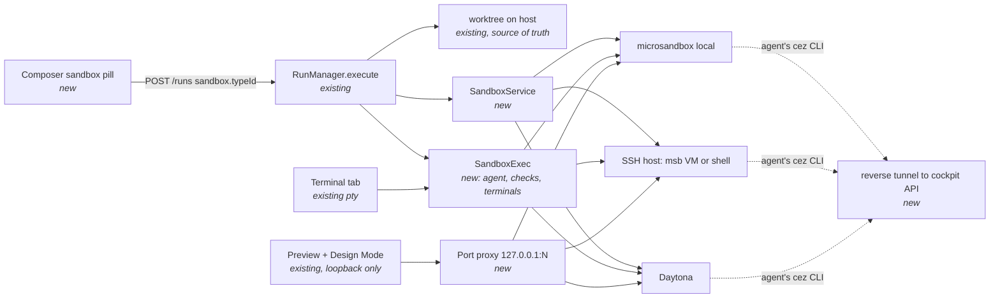

**Takeaway.** Three things go through the sandbox: process execution (the agent, check steps and terminals), ports (Preview) and the agent's `cez` callback. Each of them goes through **one** `SandboxExec`, **one** port proxy and **one** reverse tunnel. Every cockpit surface above them stays as it is.

### Providers and how the worktree gets there

| Provider | Isolation | How the worktree is attached | Process transport | Ports for Preview | Agent's `cez` CLI to the cockpit |
|---|---|---|---|---|---|
| **microsandbox (local)** | microVM | bind mount, read-write, at `/workspace`; edits are live on the host | SDK `execStream` (TTY for terminals) | port proxy over an exec-stdio **relay** | the relay's reverse channel |
| **microsandbox over SSH** | microVM on the remote host | `git bundle` up, patch and bundle down at each turn end, both over `ssh` stdio | `ssh -tt host msb exec …` | `ssh -L` to the host, then the relay into the guest | `ssh -R` to the host, then the relay into the guest |
| **SSH session** | **none**: a per-task directory, `~/cez-tasks/<id8>` | bundle and patch over `ssh` (as above) | `ssh -tt host …` | `ssh -O forward -L` on the ControlMaster | `ssh -R 127.0.0.1:<p>:127.0.0.1:<cockpit>` |
| **Daytona** | cloud VM | bundle upload with `fs.uploadFile`; patch and bundle download at each turn end | session exec with streamed logs; a PTY for terminals | the proxy's upstream is the signed preview URL (`getSignedPreviewUrl`), so the token never reaches the browser | not in v1; `cez` agent commands are disabled with a reason |

**One connection per SSH host.** Every SSH connection reuses a cezar-owned ControlMaster: `ControlPath ~/.cache/cez/ssh/%C`, `ControlPersist 10m`. Forwards can then be added or removed live with `ssh -O forward|cancel`. That is how Preview attaches a port the app opened after the session started.

**The relay** is a ~150-line Node script that the bootstrap copies into the sandbox. Node is guaranteed there, because the agent CLI needs it. One long-lived `exec` runs it, and it multiplexes TCP streams over that exec's stdio using length-prefixed frames:

- **Forward streams** connect to `127.0.0.1:<guestPort>` *inside* the guest. Dev servers bound to localhost therefore work, and nothing has to listen on `0.0.0.0`.
- **Reverse streams** carry the agent's calls to `CEZ_API_URL` back to the cockpit.

The relay exists because microsandbox publishes ports only at create time (`port(host, guest)`), and a dev server's port is not known then. If microsandbox's own proxy can add forwards to a running sandbox, prefer it. Phase 3, step 1 checks this.

### Alternatives rejected

- **Docker containers**: they share the host kernel and the user's Docker daemon, which is exactly the contamination we are escaping.
- **Proxying only tools (Bash/Edit) into the VM**: needs a shim for every backend, and Codex/OpenCode/Cursor ignore `allowedTools` (#430).
- **Publishing a fixed range of ports at create time**: wastes ports, and the app's port is still unknown.
- **A same-origin path proxy for Preview**: design-mode §2 rejects it.
- **sshfs/NFS mounts for SSH hosts**: a fragile daemon dependency, and git over a network filesystem is slow. A bundle and patch stays inside git's own guarantees.

### Market check

- Both providers' agent recipes run the agent CLI inside the VM and stream its output. That is the model adopted here.
- Both use host-scoped secret substitution, so we use it wherever it exists.
- Running agents on remote dev boxes over SSH is the established pattern behind VS Code Remote-SSH and the devcontainer CLI, and ControlMaster-based forwarding is what they rely on too.

### Sandboxes launched from inside a task (`cez sandbox`)

Running the *whole* task in a sandbox is one use. The other is a task that stays where it is, on the host or in its own sandbox, and **starts helper sandboxes for particular jobs**. Examples:

- the motivating "try every README install path on clean Ubuntu, Debian and Node images in parallel";
- reproducing a bug on a specific OS;
- running a risky script or a heavy data job;
- smoke-testing a built artifact;
- a QA matrix.

This is a fourth client of the agent transport (`CEZ_API_URL`, `CEZ_PROJECT_ID`, `CEZ_TASK_ID`, `CEZ_BIN`), modeled on `dispatch/task-cli.ts`. It is a thin HTTP client with exit code 0 on success, 1 when refused, and 2 for a usage error or no cockpit.

```
cez sandbox types                              types this task may launch (+ why others are not)
cez sandbox up <type> [--name <n>] [--copy-worktree | --mount-worktree] [--copy <path>[:<dest>]]…
                      [--env K=V]… [--port <guest>]…     boot one; prints name, state, boot time
cez sandbox exec <name> [--cwd <dir>] [--timeout <s>] -- <cmd> [args…]
                                               streams stdout/stderr; exits with the command's code
cez sandbox cp <src> <name>:<dst> | <name>:<src> <dst>   copy files in/out (tar over the exec channel)
cez sandbox port <name> <guestPort>            → http://127.0.0.1:<hostPort> (feed to `cez preview open`)
cez sandbox ls | logs <name> | down <name> | down --all
```

**Rules**

- **Only configured types** can be launched, and only those flagged *agents may launch* (Q12). The agent never sees account credentials, and every provider call is made by the cockpit.
- **The sandbox belongs to the run.** It is listed in a **Sandboxes in this task** panel and as a header chip. It follows the run's lifecycle (Q6): stopped while the run parks, removed when it lands or is archived, and removed by `down`. The boot sweep collects orphans.
- **A cap of 3 per run, counted at once.** A fourth `up` is refused (exit 1) with the reason, the same way dispatch refuses a fifth child.
- **`--copy-worktree` vs `--mount-worktree`.** `--copy-worktree` is a snapshot copy: the helper's edits never reach the task's branch, which is the default and the safe choice. `--mount-worktree` gives live read-write access and is local microsandbox only.
- **Nested runs.** A task that itself runs in a sandbox reaches the cockpit through the reverse channel (Phase 3). Its helpers are therefore **siblings on the provider**, never VMs nested inside the VM, so no nested virtualization is needed.
- **The same machinery as the rest of the spec.** Helpers use `SandboxExec`, `openPort` and the relay. In the cockpit, each helper card has **Terminal** (opens a ⬡ tab attached to that helper), **Logs** (every `exec` with its exit code), **Ports** (Preview) and **Stop**.
- **Every route is gated on `capabilities().sandboxes`.** Workflow check steps and skills get the same commands, because they share the agent environment.

## 📝 Architecture

| Piece | Where | Status |
|---|---|---|
| Lifecycle | `sandbox/service.ts`. The states are `creating → running ⇄ stopped → removed`, plus `failed`, and they apply to the task's sandbox and to helpers alike. **Transitions out of each state:**<br>• `creating`: provider ok → `running`; error → `failed`.<br>• `running`: run parks, reaches review, or the user clicks Stop → `stopped`; run lands or is archived, worktree pruned, or `cez sandbox down` → `removed`; provider lost → `failed`.<br>• `stopped`: Continue or a helper `exec` → `running`; land, archive or prune → `removed`.<br>• `failed`: **Retry** (same type) → `creating`; **Retry on this computer** (task sandbox only); archive → `removed`.<br>The sweep removes only sandboxes whose run is **absent, landed or archived**. It never touches a parked run's sandbox, however old. A `stopped` sandbox that the provider has meanwhile deleted (e.g. Daytona auto-archive) becomes `failed` on Continue, with **Retry**, which recreates it from the type and re-syncs the worktree. | **new** |
| Store | `workspace/sandboxes.ts` → `cezarHomeDir()/sandboxes.json` | **new**, cloned from `workspace/agent-accounts.ts`: loose stored schema, per-entry salvage, atomic `mergeWrite…` at mode 0600, never cached |
| API keys | `sealManaged('sandbox', accountId, key)` / `openManaged` (`workspace/secrets.ts:143`) | existing primitive |
| Provider seam | `sandbox/provider.ts` `SandboxProvider`: `detect()`, `test(account)`, `create(type, ctx)`, `start`, `stop`, `remove`, `exec(cmd, args, {cwd, env, stdin, tty, cols, rows}) → SandboxProcess` (a ChildProcess/IPty-compatible shape), `syncIn`, `syncOut`, `openPort(guestPort) → hostPort`, `closePort`, `reverse(hostPort) → guestPort`, `stats()` | **new** |
| Providers | `sandbox/microsandbox.ts`: optional `microsandbox` npm SDK, falling back to the `msb` CLI. `sandbox/ssh.ts`: the system `ssh` binary with the user's own config; no SSH library dependency. `sandbox/ssh-microsandbox.ts`: composes the two. `sandbox/daytona.ts`: optional `@daytonaio/sdk`. | **new**. A missing package or binary yields `detect() → {available:false, reason, remedy}` and never fails the boot. |
| Install guidance | `sandbox/microsandbox-detect.ts` returns `{ state: 'ready' \| 'missing' \| 'unsupported-host' \| 'kvm-missing' \| 'kvm-denied' \| 'nested-virt-off', os, arch, remedies: [{ label, command, note }] }` | **new**; pure and testable per OS |
| Service | `sandbox/service.ts`: acquire and release, plus a boot sweep of orphaned `cez-*` sandboxes and SSH task directories (mirrors worktree pruning) | **new** |
| Agent spawn | `core/runner-factory.ts` `createRunner(backend, {sandbox})`. `guardWorkingDirectory` already wraps every `startSession`/`run` and sees `spec.cwd`. `AgentRunSpec.sandboxExec` replaces `nodeSpawn` at `disclaimedCommand` call sites. | existing seam, extended |
| Check steps | `workflows/run.ts` `runCheckStep` (~9549) uses the same `sandboxExec` | existing, extended |
| **Terminal** | `server/terminal/sessions.ts` `TerminalSessions.create` takes `target: 'sandbox' \| 'host'`. For `sandbox`, the pty runs the provider's TTY command (`msb exec -t …`, `ssh -tt …`). For Daytona, `SandboxPty` adapts `createPty`/`sendInput`/`resize` to the `pty-module` interface, so scrollback, resize, foreground detection and lifecycle routes are untouched. Project commands (`terminal/commands.ts`) run in the selected target. | existing, extended |
| **Detected URLs** | `terminal/detected-urls.ts`: a URL printed in a sandbox terminal or the agent's output (e.g. `localhost:3000`) refers to the guest. It is mapped through `openPort` and offered to Preview as the proxied loopback URL, and `isListening` probes the proxy. | existing, extended |
| **Preview** | The `cez preview open --port N` record (spec `2026-10-31-task-preview-apps`) gains `origin: 'sandbox'`. The Preview frames `http://127.0.0.1:<hostPort>` and rewrites `Host` to `localhost:<guestPort>` upstream, because dev servers check it. WebSocket upgrades are passed through for HMR. Design Mode mirrors the loopback port unchanged. | existing, extended |
| Port proxy | `sandbox/port-proxy.ts`: a loopback-only listener per forwarded port. It closes when idle, when the run stops, and when the preview record goes. | **new** |
| Agent bootstrap | `sandbox/bootstrap.ts` installs git, Node if missing, the relay, and the run's agent CLI **pinned to the host-detected version** (`backend-detect.ts`). It then snapshots the image (`msb snap`, Daytona `createSnapshot`), keyed by `(type, runner, version)`. On SSH-session hosts it installs into `~/.cache/cez-remote/`. | **new** |
| Capability | `capabilities().sandboxes` in `server/capabilities.ts` and `/api/v1/health`. It is off under `CEZ_SANDBOXES=0` and on a hosted cockpit. | **new flag** |

**Runner coverage in v1**

- **Supported:** the stdio CLIs that go through `disclaimedCommand` (claude, pi, cursor, kimi, antigravity), plus Codex app-server over stdio.
- **Not yet supported:**
  - the ACP runners (gemini, copilot, junie);
  - OpenCode's HTTP server, which needs `openPort`.
- In the picker, the unsupported runners show as **disabled with a reason** until Phase 6.

## 📝 Data Model

`~/.cezar/sandboxes.json` is its own file and never a key in `config.json`:

```jsonc
{
  "version": 1,
  "accounts": [
    // local microsandbox is DISCOVERED, never stored (like the default agent account)
    { "id": "acme-eu", "provider": "daytona", "label": "Acme work org",
      "apiUrl": "https://app.daytona.io/api", "target": "eu", "organizationId": null, "addedAt": "…" },
    { "id": "build-box", "provider": "ssh", "label": "build-box",
      "host": "build-box",            // ~/.ssh/config alias or user@host; ssh resolves the rest
      "user": null, "port": null, "identityFile": null,   // optional overrides; null = ssh config / agent
      "modes": ["microsandbox", "shell"], "taskRoot": "~/cez-tasks",
      "hostKey": "SHA256:q8x…Tz4",    // pinned on first Test, after the user confirms the fingerprint
      "addedAt": "…" }
  ],
  "types": [
    { "id": "ubuntu-16g", "label": "Ubuntu · 4 vCPU · 16 GB", "account": "local-microsandbox", "kind": "microsandbox",
      "image": "ubuntu:24.04", "cpus": 4, "memoryMiB": 16384, "diskGiB": 40,
      "network": { "mode": "public" },    // none | agent-api | public | allow-list(+domains/cidrs)
      "idleStopMinutes": 30, "maxLifetimeMinutes": 480, "previewPorts": [3000], "agentLaunch": true,
      "setupScript": "apt-get update && …", "env": { "NODE_ENV": "development" }, "secrets": ["DATABASE_URL"] },
    { "id": "box-vm", "account": "build-box", "kind": "microsandbox", "image": "ubuntu:24.04", "cpus": 8, "memoryMiB": 32768, "diskGiB": 60 },
    { "id": "box-shell", "account": "build-box", "kind": "shell", "setupScript": "corepack enable" },
    { "id": "cloud-large-eu", "account": "acme-eu", "kind": "daytona", "snapshot": "daytona-large",
      "cpus": 4, "memoryMiB": 8192, "diskGiB": 10, "autoStopMinutes": 15, "autoArchiveMinutes": 1440 }
  ],
  "selections": { "/path/to/open-mercato": "ubuntu-16g" }
}
```

**Per-kind validation.** Each kind accepts only its own fields; a field the kind lacks is rejected, never dropped.

- **`microsandbox`**: image (OCI), cpus, memory, disk (`--root-disk`), network (maps to `NetworkPolicy`), idle (`idleTimeout`), lifetime (`maxDuration`), preview ports.
- **`shell`**: setup script, env, secrets. There are no resources and no network field, because it uses the host as it is. Its type carries a **no isolation** badge everywhere.
- **`daytona`**: `image` **xor** `snapshot`; resources apply to image-based creates only. Auto-stop and auto-archive map to the SDK fields. `network` maps to `networkBlockAll`, `networkAllowList` and `domainAllowList`. cezar owns deletion (Q6).

**`RunRecord.sandbox`** is optional, so old files parse:

```
{ typeId, kind, accountId, sandboxId, state: 'creating'|'running'|'stopped'|'removed'|'failed',
  resources: {cpus, memoryMiB, diskGiB, image}, ports: [{guest, host}], error? }
```

`RunRecord.helperSandboxes` is optional: `[{ name, typeId, kind, sandboxId, state, worktree: 'copy'|'mount'|'none', createdAt, lastExit? }]`. The sandboxes an agent starts with `cez sandbox up` are recorded here. They live in a separate field from `sandbox`, which is where the task itself runs.

The resources are a **snapshot** taken at launch.

**Sensitive data**

- API keys are kept only in the sealed vault. The cockpit shows them only as `••••last4`.
- SSH needs no secret storage: cezar runs the user's own `ssh` with the user's agent and config, and never reads or stores a private key.
- `sandboxes.json` holds no secrets.

## 📝 API Contracts

The schemas live in `packages/contract/src/sandboxes.ts`. Routes are workspace-level (single mount), chained into one family and validated by the middleware trio.

**Every mutating route returns 409 unless `capabilities().sandboxes && localHandoff`.** A sandbox or SSH host runs arbitrary commands with the user's credentials, so this mirrors the agent-config write gate.

| Route | Body → Response |
|---|---|
| `GET /api/v1/workspace/sandboxes` | → `{ providers: [{kind, available, version?, detect: MicrosandboxDetect?}], accounts: [...redacted], types, selections }`. No network calls: account status is the result of the last `test`. |
| `POST /api/v1/workspace/sandboxes/detect` | Re-runs local detection, for the **Check again** button. |
| `POST /api/v1/workspace/sandboxes/accounts` | `{provider:'daytona', label, apiKey, …}` or `{provider:'ssh', label, host, user?, port?, identityFile?, modes, taskRoot?}` → the account |
| `POST /api/v1/workspace/sandboxes/accounts/:id/test` | Daytona: one authenticated call. SSH: `ssh -o BatchMode=yes` probe → `{ ok, hostKey, os, arch, cpus, memGiB, git, kvm, msb, agentClis, forwarding }`. For an **unknown host key**, it returns the fingerprint and requires a second call with `{ trustHostKey: <fingerprint> }`. It never sets `StrictHostKeyChecking=no`. |
| `GET /api/v1/workspace/sandboxes/ssh-hosts` | The `Host` aliases parsed from `~/.ssh/config` (names only), for the host picker. |
| `PATCH` / `DELETE /…/accounts/:id` | Delete is refused with 409 while a type references the account. |
| `POST` / `PATCH` / `DELETE /…/types[/:id]` | Type CRUD |
| `POST /…/types/:id/boot-test` | Boots the type, runs `uname -a && git --version`, then removes it → `{ ok, bootMs, log }` |
| `PUT /…/selection` | `{ repoRoot, typeId \| null }` |
| `POST /api/v1/p/:projectId/runs` (existing) | Adds `sandbox?: { typeId } \| null`. Absent means the project's selection; `null` means "This computer". Same tri-state as `agentProfile`. |
| `POST /api/v1/p/:projectId/runs/:id/sandbox/stop` | Stops the sandbox without failing the run. |
| `POST /api/v1/p/:projectId/runs/:id/sandbox/ports` | `{ guestPort }` → `{ hostPort, url }` (Preview's **Forward another port**). `DELETE …/ports/:guestPort` removes it. |
| `GET` / `POST /api/v1/p/:projectId/runs/:id/sandboxes` | List the run's helper sandboxes, or start one with `{ typeId, name?, worktree: 'copy'\|'mount'\|'none', copy?: [...], env?, ports? }`. Returns 409 with a reason when the type is not agent-launchable, or when the cap or provider limits are reached. |
| `POST …/sandboxes/:name/exec` | `{ cmd, args, cwd?, timeoutSec?, stdin? }` → a streamed NDJSON response: `{stdout}` / `{stderr}` / `{exit}`. Each exec is also appended to the run's events, so it shows in **Logs**. |
| `PUT` / `GET …/sandboxes/:name/files?path=` | tar stream in and out, for `cez sandbox cp` |
| `POST …/sandboxes/:name/ports` · `DELETE …/sandboxes/:name` | Forward a port, or remove the sandbox. |
| Terminal create (existing) | Adds `target?: 'sandbox' \| 'host'`. The default is `sandbox` when the run has one. |

Every new route goes into the BACKWARD_COMPATIBILITY.md §2 inventory, and the contract-parity tests cover both directions. `.env.example` and `docs/reference.md` gain `CEZ_SANDBOXES`.

## 📝 UI/UX

**Current state**, captured from a dry-run cockpit:

| Agent accounts today | Composer today |
|---|---|
| 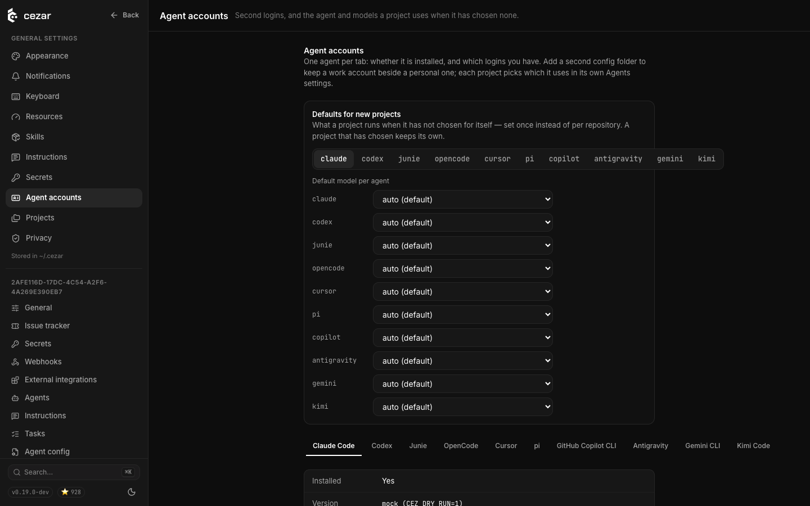 | 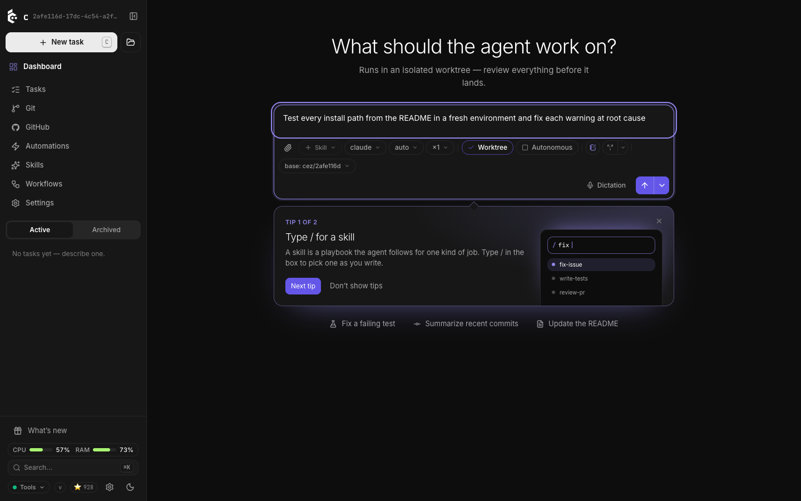 |

**Proposed.** These are illustrative static mockups, not an accepted prototype. The HTML sources sit beside them in `assets/sandbox-service/`.

1. **Settings → Sandboxes** is a global section, registered after *Agent accounts*.
   - It lists the accounts, each with a status pill and a **Test** button: discovered microsandbox, Daytona, and the SSH host with its capabilities.
   - It lists the sandbox types with a summary line, a "default for &lt;project&gt;" badge, and a **no isolation** badge on SSH shells.
   - 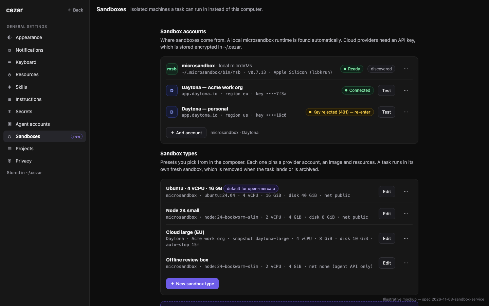
2. **microsandbox not installed: setup guidance.** The detected OS tab is pre-selected. Each tab gives the exact remedy:
   - **macOS Apple Silicon**: `brew install superradcompany/tap/microsandbox` when Homebrew is found, otherwise `curl -fsSL https://install.microsandbox.dev | sh`.
   - **Linux**: check `/dev/kvm`. If it is missing, enable virtualization in the BIOS. If it is denied, run `sudo usermod -aG kvm $USER` and log in again. Then install.
   - **Windows**: enable Windows Hypervisor Platform (`Enable-WindowsOptionalFeature -Online -FeatureName HypervisorPlatform`), reboot, then install.
   - **Intel Mac, or a VM without nested virtualization**: unsupported. The page points to *SSH host* or *Daytona*.
   - **Run in a terminal tab** opens a host terminal with the command typed in. The user presses Enter; cezar never installs silently. **Check again** re-runs detection.
   - 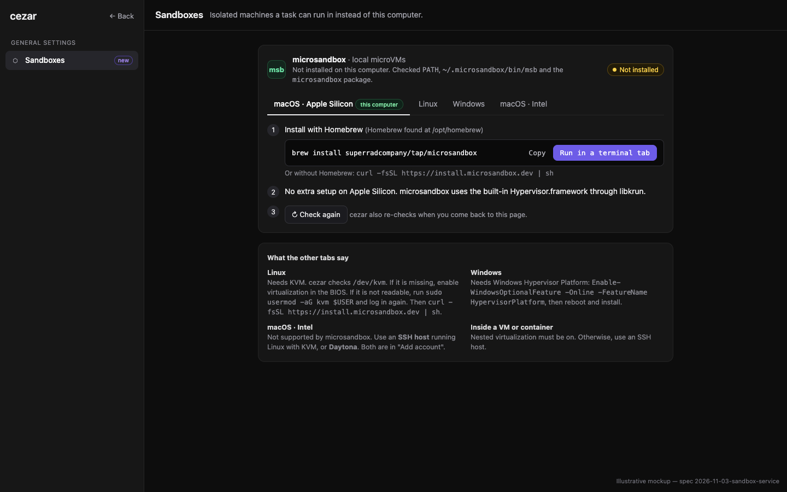
3. **Add account: Daytona.** Fields: name, API key, region, optional org ID, API URL. **Add account** is enabled only after **Test connection** succeeds.
   - 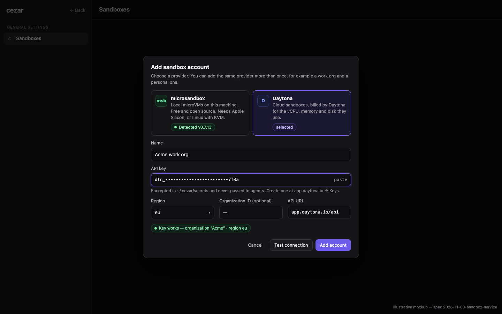
4. **Add account: SSH host.**
   - The host field offers aliases from `~/.ssh/config`. User, port and identity default from that config.
   - The user chooses which modes the host offers: microVMs, plain session, or both.
   - The test result lists:
     - the host-key fingerprint, which the user confirms the first time;
     - OS, CPUs and RAM;
     - KVM and microsandbox, with the same remedies as item 2 when missing, run on the remote host;
     - whether forwarding is allowed;
     - which agent CLIs are present.
   - 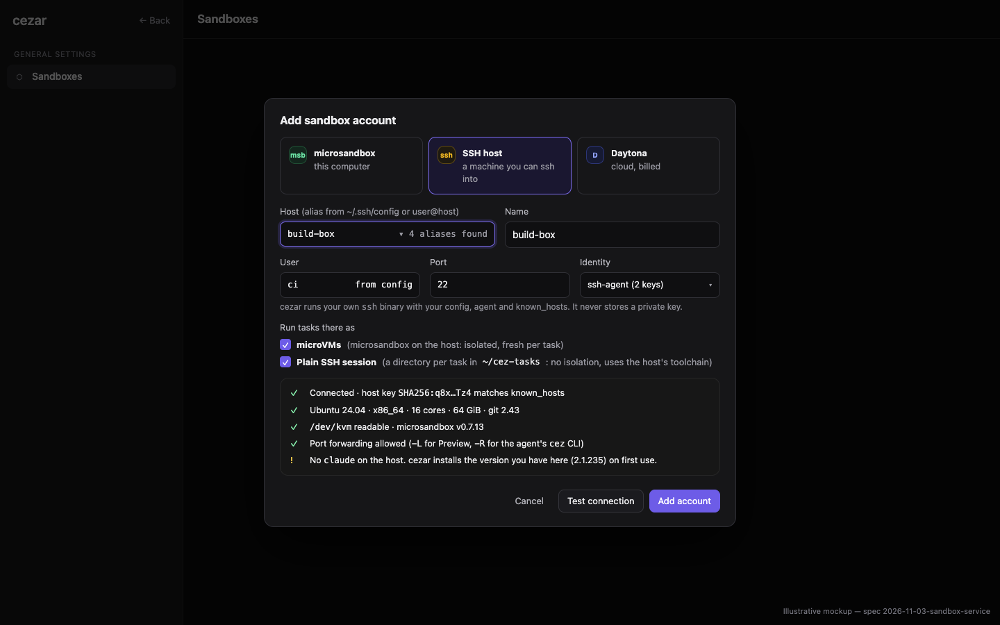
5. **Sandbox type editor.**
   - It shows only the fields that the chosen account's kind supports.
   - Sliders are capped by host cores and RAM, by the SSH host's probe, or by the error from a failed Daytona create; tier limits are never hard-coded.
   - Network is a segmented control.
   - It also has a setup script, env, workspace secrets and preview ports.
   - **Boot a test sandbox** runs a disposable instance.
   - 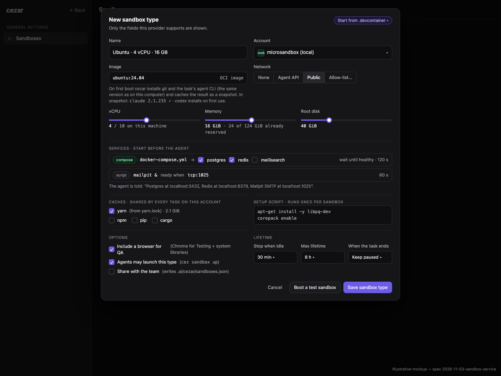
6. **Composer pill** (`PickerPill`, in the HOW group).
   - The options are *This computer* plus the types, grouped by account. Daytona types are tagged `billed`; SSH shells are tagged `no isolation`.
   - Picking a sandbox **locks Worktree on**.
   - Runners that are not supported show the sandbox options disabled, with a reason.
   - 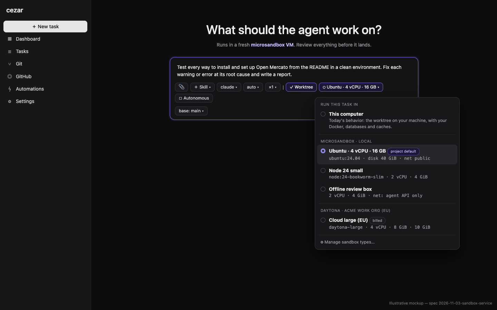
7. **Run header chip and popover** (`run-header.tsx` `MetaRow`).
   - The chip shows provider · type · live state.
   - The popover shows: id, image and agent version, resources, workspace mapping, live usage, stop policy, and **Open shell** / **Stop sandbox** / **Logs**.
   - Lifecycle lines appear in the feed as `system` UiEvents.
   - 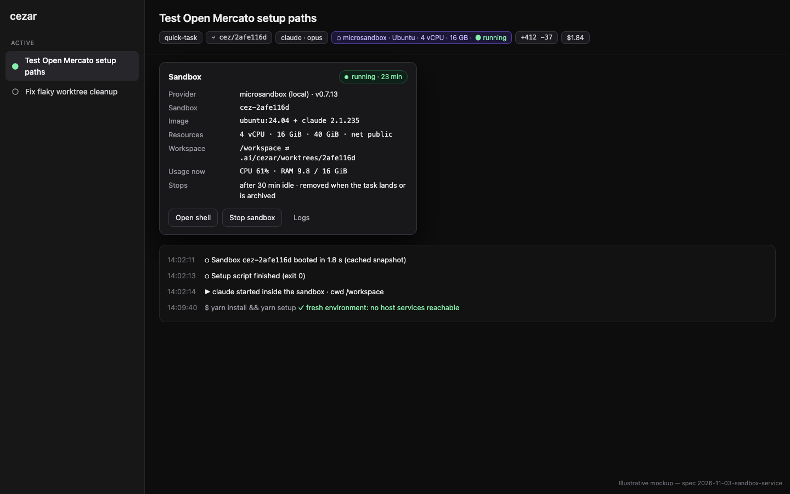
8. **Terminal tab.**
   - For a sandboxed run, new tabs open **inside the sandbox**, marked ⬡. *On this computer* stays one click away in the **＋** menu. For SSH and Daytona that menu warns that the host worktree only updates at turn end.
   - Project commands from `package.json` and the `Makefile` run in the chosen target.
   - A URL a terminal prints is shown as forwarded to Preview.
   - 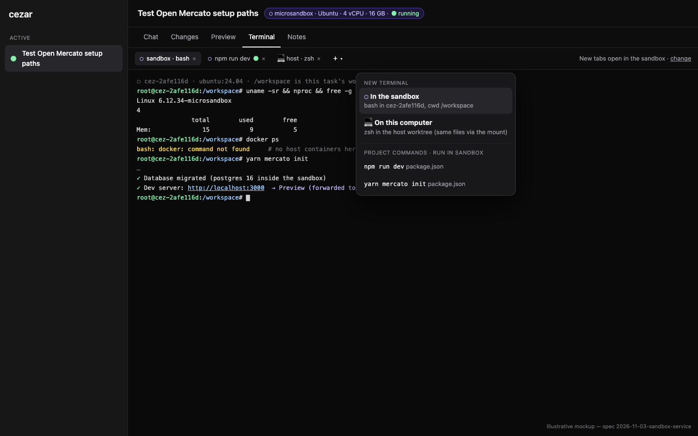
9. **Preview.**
   - The URL bar shows the guest address (`localhost:3000`) with a **⬡ sandbox :3000** badge, plus "via 127.0.0.1:N".
   - The ports menu lists ports found in terminal output, ports the agent opened with `cez preview open`, and a **Forward another sandbox port…** entry.
   - Design Mode works unchanged, because the framed origin is loopback.
   - 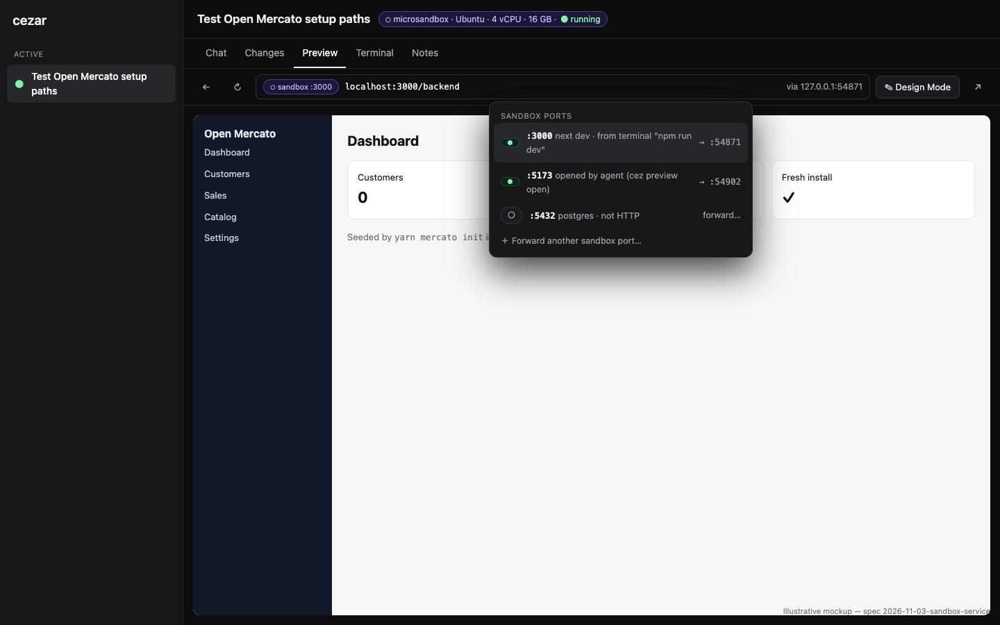

10. **Sandboxes launched from inside a task.**
    - The transcript shows the agent's `cez sandbox` calls.
    - A **Sandboxes in this task** panel shows each helper with its type, state and last exit code, plus Terminal, Logs, Ports and Stop. A header chip shows the count.
    - The type editor gains an **Agents may launch this type** checkbox. It defaults per Q12.
    - 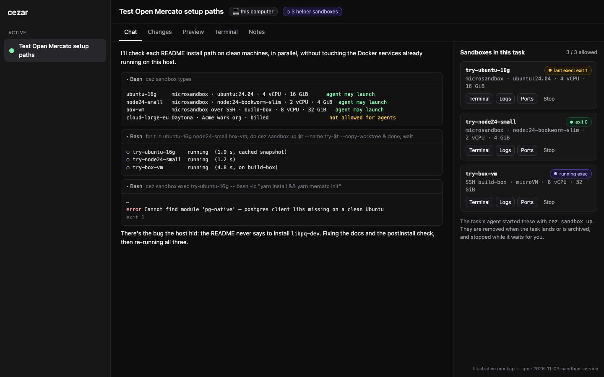

**Other ways to choose a sandbox.** Automations and `cez task create` take the same `sandbox` field (`--sandbox <typeId|none>`). A dispatched child inherits its parent's sandbox type unless the dispatch overrides it.

**Accessibility.** The picker reuses `PickerPill`'s radio-menu semantics. Status pills always pair color with text. Terminal tab badges have text labels for screen readers ("sandbox", "host").

## 📝 Edge Cases & Failure Scenarios

| Scenario | What the user sees |
|---|---|
| microsandbox missing, or the host cannot run it | The setup card (UI 2) explains the reason with the OS-specific remedy. Its types are disabled in the picker with "microsandbox is not installed". Nothing else changes. |
| `/dev/kvm` exists but is not readable (Linux) | State `kvm-denied`, with the remedy `usermod -aG kvm $USER` and a re-login hint. |
| SSH host key changed | The test and every run fail closed with "Host key for build-box changed (was SHA256:…, now SHA256:…)". cezar never auto-accepts. The user re-confirms the new key in Settings. |
| SSH agent locked, or the key needs a passphrase | `BatchMode=yes` fails fast with "ssh needs a passphrase or an unlocked agent for build-box". cezar never prompts inside a run. |
| SSH host goes away mid-run | The ControlMaster drops and exec reports EOF. The run parks with "Lost connection to build-box". Continue reconnects. The host worktree keeps the last synced turn, and unsynced in-turn edits stay on the host in `~/cez-tasks/<id8>` until the next sync or sweep. |
| `AllowTcpForwarding no` on the SSH host | The test reports "forwarding disabled". Preview falls back to the relay over the exec channel. If the agent's `cez` CLI cannot get a reverse tunnel, it is disabled with a reason. |
| Daytona key revoked (401) | The account pill shows "Key rejected". A run fails at `creating` with a one-line error, and the worktree is kept. |
| Requested resources exceed what the host or org allows | Provisioning fails before the agent starts. The provider's message is shown, trimmed. The run ends `failed` with **Retry on this computer**. |
| The image has no Node or npm for the agent CLI | The bootstrap installs a static Node into `/opt/cez-node`. If that fails, the error names the image and suggests `node:24-bookworm`. |
| The agent has a subscription login (OAuth) and no API key | cezar passes a long-lived token where the backend has one (`CLAUDE_CODE_OAUTH_TOKEN`). Otherwise the picker disables sandboxes for that account with "needs an API key or token login" (Q2). |
| The dev server binds `0.0.0.0` or `127.0.0.1` | Both work, because the relay connects to `127.0.0.1` inside the guest. |
| The dev server rejects an unknown `Host` | The proxy sends `Host: localhost:<guestPort>`, so Vite and Next accept it. |
| An HMR websocket | The proxy passes the upgrade through. Covered by a test. |
| The port proxy's host port is taken, or ephemeral ports run out | The next free ephemeral port is used. After 3 failures, Preview shows "could not forward :3000". |
| The cezar process dies | The boot sweep reattaches sandboxes whose runs are `running`, through restart recovery. Orphans are removed per the lifecycle rule: no run, or the run landed or was archived. A parked run's sandbox is never swept. SSH task directories follow the same rule. Port proxies are rebuilt on demand. |
| A sync patch fails to apply (SSH or Daytona) | The run parks. The patch is saved to `.ai/cezar/tmp/<id>/sandbox.patch` and an error is shown. Host edits are already blocked during a turn by the agent lease. |
| Network `none` | The agent cannot reach its model, so the editor offers *Agent API only*: an allow-list derived from the runner plus the git remote. |
| An agent calls `cez sandbox up` for a type it may not launch, or past the cap | Exit 1. The reason names the setting a human can change ("cloud-large-eu is billed; tick *Agents may launch* in Settings → Sandboxes"). Nothing boots. |
| An agent forgets `cez sandbox down` | Its helpers are stopped when the run parks and removed when it lands or is archived. A max-lifetime from the type applies too. |
| A type is deleted while a run uses it | Running runs keep their snapshot. A project selection that pointed at it falls back to "This computer" with a toast. |

## 📝 Risks & Impact Review

**Contract and state**

- `RunRecord.sandbox`, `createRunInput.sandbox`, terminal `target` and `capabilities.sandboxes` are all optional and additive.
- `sandboxes.json` is a new file; deleting it means zero config.

**Security**

- Writes are local-cockpit only.
- Keys are sealed, and host-scoped secret substitution is used where it exists.
- No agent home is ever mounted.
- SSH host keys are pinned on first use with explicit confirmation, and runs use `BatchMode`.
- The port proxy and reverse tunnel bind **loopback only**.
- SSH sessions are **not isolation**: the badge says so, and the docs must say it plainly.

**Cost**

- Daytona bills by usage. Mitigations: the `billed` tag, auto-stop on park, delete on land or archive, and the sweep.
- Spend is not shown in v1; no balance API has been verified.

**Rollback.** `CEZ_SANDBOXES=0` hides the surface. Existing records keep a read-only chip.

**Dependencies**

- `microsandbox` and `@daytonaio/sdk` are **optional** and loaded with dynamic `import()`. The tarball must install and boot without them (`test:package`).
- SSH needs the system `ssh` binary only.
- The Daytona OSS repo was archived in 2026-06 (the SDK lives in `daytona/clients`). Pin the version range behind the seam.

## 📋 Phasing

1. **Phase 1: store, settings, detection.** Accounts (microsandbox detected, SSH, Daytona-ready schema), types, the install guidance with OS remedies, SSH test with host-key pinning, and boot-test. Tasks are unaffected.
2. **Phase 2: run in a local microsandbox.** Picker, `SandboxExec` for the agent and check steps, Terminal tab target, run header, lifecycle and sweep.
3. **Phase 3: port proxy and relay.** Preview and Design Mode for sandbox ports, detected-URL mapping, **Forward another port**, and the agent's `cez` reverse channel.
4. **Phase 4: SSH.** SSH sessions and microsandbox over SSH. ControlMaster, bundle and patch sync, `-L`/`-R` forwarding, plus terminal and Preview parity.
5. **Phase 5: `cez sandbox` for agents.** Helper sandboxes started from inside any task, with the cap, the per-type flag, the panel, and exec, cp and port commands.
   - It needs Phases 1–3 for local microsandbox helpers launched by a task running on the host.
   - Calling `cez` from a task that itself runs in a sandbox needs that provider's reverse channel: Phase 3 for local, Phase 4 for SSH, and none for Daytona in v1.
   - SSH and Daytona types become launchable when their phases land and a human ticks the flag.
6. **Phase 6: Daytona and the remaining runners.** Daytona provider (session exec, PTY terminals, signed-preview upstream), ACP and OpenCode transports, automations and `cez task create --sandbox`, dispatch inheritance.

## 📋 Implementation Plan

**Phase 1**
1. `packages/contract/src/sandboxes.ts`: schemas for accounts (per provider), types (per kind), the detect result, listing and selection. Re-export them from the api-client.
2. `workspace/sandboxes.ts` and `sandboxesPath()`. Unit tests: salvage, atomic write, and an absent file meaning defaults.
3. `sandbox/microsandbox-detect.ts`: probe `PATH`, `~/.microsandbox/bin/msb`, the SDK package, `/dev/kvm` (exists and readable), the OS and arch, and Homebrew. A table-driven test for each state and OS remedy. `CEZ_DRY_RUN` uses a mock provider. Add `CEZ_SANDBOXES` to `.env.example` and the reference docs.
4. `sandbox/ssh.ts` test probe: `BatchMode`, a one-shot remote probe script, and host-key fingerprint capture and pinning. Tests use a fake `ssh` on `PATH`.
5. The workspace route family (list, detect, accounts, test, ssh-hosts, types, selection), with parity, typed-bodies and inventory tests.
6. Settings → Sandboxes: the accounts list, setup-guidance card with OS tabs and **Run in a terminal tab**, the Daytona and SSH dialogs, and the type editor. Component tests cover: provider absent, each detect state, 409 when not local, and the unknown-host-key confirm flow.
7. The `boot-test` route and button.

**Phase 2**
8. `createRunInput.sandbox` and `RunRecord.sandbox`, with a tri-state resolution helper.
9. `sandbox/service.ts` acquire/release and the boot sweep, with a lifecycle test per run state (Q6).
10. `AgentRunSpec.sandboxExec`, consumed by `disclaimedCommand` callers and `runCheckStep`. It is populated in **both** `execute` and `runContinuation` through one helper, with a Continue regression test (AGENTS.md § construction sites).
11. `sandbox/bootstrap.ts`: the pinned agent CLI, the relay script, and the snapshot cache.
12. Terminal `target`: the pty runs the provider's TTY command. Add the ⬡ tab badge, the **＋** menu, and project commands in the target.
13. Composer pill, worktree lock, run-header chip and popover, and `system` events. Add a dry-run e2e smoke test.

**Phase 3**
14. Spike: can microsandbox's native proxy add forwards to a running VM? If it can, use it for `openPort` and keep the relay for reverse only.
15. `sandbox/relay.js` (guest) and `sandbox/port-proxy.ts` (host): a framed multiplexer, `Host` rewrite and WebSocket upgrades. Tests use an in-process fake exec.
16. Map detected URLs through `openPort`, and add `origin: 'sandbox'` to the preview record. Add the ports menu and **Forward another port** route.
17. A reverse channel for `CEZ_API_URL`: `cez task`, `cez preview` and `cez automation` work from inside the sandbox.

**Phase 4**
18. The ControlMaster manager (`~/.cache/cez/ssh/%C`, `-O check|forward|cancel|exit`), closed at shutdown.
19. The SSH shell provider: task directory, bundle sync up, patch and bundle sync down at each turn end, and exec over `ssh -tt`. Golden tests against the fake `ssh`.
20. The SSH microsandbox provider: compose 18, 19 and the microsandbox CLI remotely, with the setup guidance run against the remote probe.
21. Terminal and Preview parity over SSH (`-L`, `-R`, the relay through `ssh`).

**Phase 5**
22. Contract and routes for `/runs/:id/sandboxes` (list, up, exec as streamed NDJSON, files, ports, down), with the cap and `agentLaunch` checks enforced on the server. Add `RunRecord.helperSandboxes`.
23. `sandbox/sandbox-cli.ts` (`cez sandbox types|up|exec|cp|port|ls|logs|down`), wired into the `cez` entry point beside `task`, with exit codes 0, 1 and 2, and unit tests in the style of `dispatch/task-cli.test.ts`.
24. Helper lifecycle tied to run states, plus sweep coverage. A regression test checks that a Continue keeps the helpers reachable.
25. The **Sandboxes in this task** panel, the header count, Terminal attach to a helper, and the type-editor checkbox.
26. Mention `cez sandbox` in the agent's task-order preamble when `capabilities().sandboxes` is on and at least one type is agent-launchable, the same way the dispatch instructions are added.

**Phase 6**
27. `sandbox/daytona.ts`: create, start, stop and delete; session exec with streamed logs; `SandboxPty`; the signed-preview proxy upstream; bundle and patch sync. Golden-fixture tests over recorded SDK responses.
28. `sandboxExec` for the ACP transports and OpenCode (through `openPort`).
29. The `sandbox` field in automations, `cez task create --sandbox`, and dispatch inheritance.

## 🔍 Review notes

- **Scope (reviewer finding, kept open for the owner).** A fresh-context scope review recommended splitting this into five specs: the foundation with local microsandbox, SSH, Daytona, `cez sandbox` helpers, and runner/orchestration coverage. Their risk classes differ.
  - **This draft keeps one document**, because the requester asked for one integrated design. All five share one seam (`SandboxExec`, `openPort`, `reverse`, lifecycle) that would otherwise be specified five times.
  - **Each phase ships as its own implementation PR** with its own review.
  - If the owner prefers separate specs, the phases split cleanly along those lines without redesign.

- **Scope cohesion:** one capability, choosing where a task executes. The providers and the Terminal/Preview integration all go through one seam (`SandboxExec`, `openPort`, `reverse`), so splitting them would duplicate that seam's design across specs.
- **Canonical mechanisms reused:**
  - the agent-accounts store pattern;
  - `sealManaged`;
  - `PickerPill`;
  - chained route families;
  - `capabilities()`;
  - restart recovery;
  - the existing pty sessions;
  - detected URLs;
  - the preview record (`2026-10-31-task-preview-apps`);
  - the Design Mode loopback mirror.
- **Not verified:**
  - whether microsandbox's native proxy can add forwards to a running VM (Phase 3, step 14);
  - the microsandbox install path on Windows;
  - Daytona pricing and live tier limits;
  - relay throughput under heavy HMR traffic.

  The mockups are illustrative static pages and do not show real behavior.
