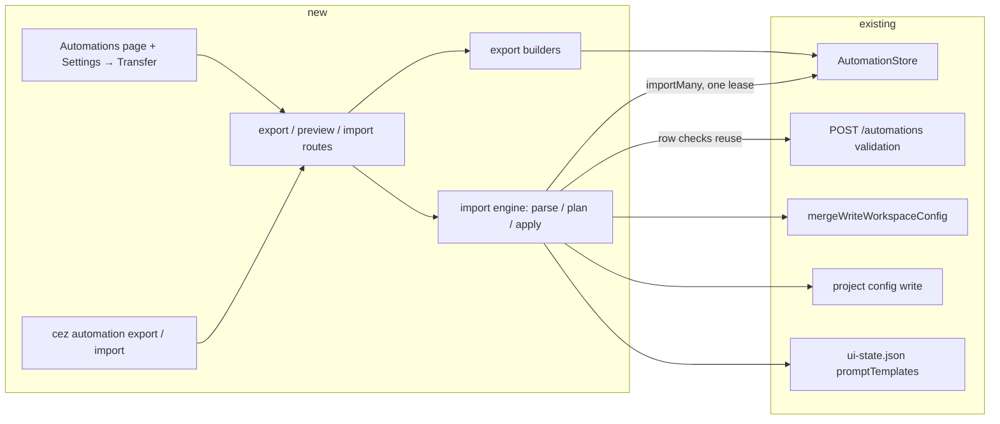

# Export and import automations, and the whole cezar configuration

Issue: #1942 · Status: proposed (design only) · Related specs: `2026-09-14-automations-redesign`,
`2026-10-13-unified-settings`, `2026-10-10-project-secrets-vault-options`, `2026-07-20-multi-project-workspace`

## 📝 TLDR

People who run more than one cezar (laptop + desktop, personal + team machine, a fresh install)
rebuild every automation and setting by hand on each one. This spec proposes (1) a versioned JSON
**automations file** exported from and imported into a project's Automations page and
`cez automation export|import`, and (2) a **configuration bundle** in global Settings carrying the
portable part of the workspace and per-project configuration. Every import is preview-first, never
overwrites silently, writes atomically, lands automations paused with new ids, and carries no
secret values, tracker credentials or machine paths.

## Resolved assumptions (autonomous defaults)

Written by an unattended `om-auto-write-spec` run. Each default is reversible before merge.

| # | Question | Applied default | Why |
|---|----------|-----------------|-----|
| Q1 | Are secret values exportable? | **No — never.** Bundles list secret *names* (and audiences) only; import shows them as "re-enter after import" and writes nothing to the secret store. No passphrase-encrypted mode in v1. | Smallest blast radius; a file that moves "however the user chooses" must never be a credential. Adding an encrypted mode later is additive; taking a leak back is not. |
| Q2 | Tracker connections? | **Excluded.** `~/.cezar/tracker-connections/` is encrypted per machine. The bundle records only *which* provider a project was connected to, as a reminder. | Cannot be copied as-is; re-encrypting would mean exporting plaintext tokens. |
| Q3 | Is the project registry portable? | **No.** `projects[]` (absolute roots), `browseRoot`, `projectsDir` and every other path are excluded. Per-project sections are keyed by the project's **normalized git remote URL** (plus its display name), and import maps them onto projects already registered on the target — it never registers, clones or creates a project. | Absolute paths only mean something on the machine that wrote them. |
| Q4 | Automations on import | **Always paused, no runtime state** (cursors, baselines, receipts, leases, logs, `deferredStart`); every *created* row gets a new id. The one exception is an explicit **Replace**, which keeps the existing row's id but still lands it paused with reset state. Enabling stays an explicit user action. | Same rule as `cez automation create`; and an imported poll must never launch a backlog (AGENTS.md automations exception). |
| Q5 | Merge or replace? | **Merge, preview-first.** Every change is listed before anything is written; collisions get an explicit per-item choice (automations: skip / rename / replace; config keys: keep / take imported). The default choice is always the non-destructive one (skip / keep). | "Never overwrites silently" from the issue's Done-when. |
| Q6 | Per-section selection? | **Yes, coarse.** The bundle import lets the user tick sections (workspace settings, each project's config, each project's automations, prompt templates). Sections that carry shell commands start **unticked**. | Cheap to add once a preview exists; command-bearing config must be an explicit opt-in. |
| Q7 | Cross-project automation import? | **Yes** — an automations file is project-agnostic; it can be imported into any project. Rows whose trigger cannot be validated on the target (a tracker status id that does not exist there, an agent account not on this machine) are reported per row and cannot be applied until fixed or skipped. | Falls out of the design for free; validation reuses the create route's own checks. |
| Q8 | One spec or two? | **One spec, two independently shippable phases**: Phase 1 automations file, Phase 2 configuration bundle (which reuses Phase 1's import engine for its automations sections). | They share the preview/collision/atomic-write engine; split if a reviewer prefers. |
| Q9 | Other candidates from the issue (agent accounts, `agent-fallback.json`, webhooks, workflows/skills) | **Excluded in v1.** Accounts are `configDir` paths whose credentials live in those dirs; fallback chains name account ids; webhook receiver URLs (Slack/Discord) are credentials; `.ai/cezar/workflows/` and `skills/` are committable and travel with the repository through git. | Each is either machine-bound, a credential, or already portable. Revisit individually. |
| Q10 | Telemetry consent, `cezarId`, update channel | **Excluded.** | Consent is per machine and must never be granted by a file (AGENTS.md § Telemetry); `cezarId` is an install identity. |

## 📝 Problem Statement

- The Automations page has **New automation** and nothing else (screenshot on #1942). The only
  scripted route is `cez automation create --file` one definition at a time, and a definition
  copied out of `<dataDir>/automations.json` carries `id`, `revision`, timestamps and possibly a
  `deferredStart` that `create` must not receive.
- Settings has 20 sections across project and global scope (`routes/settings/registry.tsx`) and no
  way to move any of them. A second machine is configured by clicking through all of them again.
- The raw files are not a safe substitute: `~/.cezar/config.json` mixes portable preferences with
  the project registry, telemetry consent and an install id; secrets and tracker connections are
  ciphertext under a per-home key.

## 📝 Proposed Solution

Two file formats and one import engine.

1. **Automations file** (`cezar-automations`, version 1): an array of *portable automation
   definitions* — the editable subset that `POST /automations` already accepts
   (`automationEditableSchema`): `name`, `description`, `kind`, `events`, `intervalSeconds`,
   `filters`, `trackerTrigger`, `schedule`/`schedules`, `task`. Everything else (`id`, `revision`,
   `enabled`, `createdAt`, `updatedAt`, `deferredStart`, unknown passthrough keys) is stripped on
   export and refused on import.
2. **Configuration bundle** (`cezar-config-bundle`, version 1): portable workspace settings, plus
   one section per selected project with its portable `.ai/cezar/config.json` keys, its prompt
   templates, its automations (an embedded automations file), and *reminders* (secret names,
   tracker provider) that import displays but never writes.
3. **Import engine**: `parse → plan → (user resolves) → apply`. `plan` is pure and returns a
   preview with a `planDigest`; `apply` re-parses and re-validates everything server-side,
   recomputes the plan, refuses with 409 when the digest differs, and writes each target file once,
   atomically. `planDigest` is a SHA-256 over the canonical JSON of (the parsed file, the
   resolutions, and a fingerprint of the target: each touched file's revision/mtime+size and, for
   automations, the `id → revision` map). It detects both "the file changed" and "the target
   changed"; it is not an authorization token and needs no HMAC — the server never trusts it for
   anything but staleness.

**Alternatives considered.**
- *Copy the raw files.* Loses the guarantees above (secrets, paths, consent, runtime state).
- *Passphrase-encrypted bundle including secrets.* Real value, but it is a new crypto surface
  (KDF choice, parameters, UX for a lost passphrase) and a credential at rest in a user-moved file.
  Deferred; additive later as `secrets: { encrypted: … }`.
- *Live sync between instances.* A non-goal in #1942.
- *Reuse `POST /automations` N times from the client.* No atomicity, no single preview, and a
  half-imported list on the first validation error — the opposite of "writes nothing".

**Market reference.** n8n exports workflows as JSON with credentials replaced by references and
imports them **inactive** — the same rule as Q1/Q4. VS Code settings profiles export a
section-selectable bundle and import with a preview — Q6. Grafana dashboard import detects a UID
collision and asks overwrite-or-rename — Q5. What we skip: n8n's credential re-linking UI (we have
no credential references inside automations), Grafana's datasource remapping (only tracker status
ids need it, handled by per-row validation).

## 📝 Architecture



Takeaway: everything new sits in one module pair (`packages/cezar/src/transfer/`:
`automations-file.ts`, `config-bundle.ts`, `import-engine.ts`) and writes only through mechanisms
that exist today; the store gains one method.

- **`AutomationStore.importMany(defs)`** — new. Validates every definition with
  `automationDefinitionSchema`, allocates fresh ids (never reusing a tombstoned one), and publishes
  all rows plus their initial paused state in **one** `persistDefinitions()` under one mutation
  lease. "Replace" resolutions update the existing row in place under the same lease (revision
  bumped, `enabled: false`, its runtime state reset as `update` does today). Either everything is
  written or nothing. Replace is the one destructive action: it pauses an automation that may be
  running today, so the dialog shows "replaces and pauses <name>" on that row and the confirm
  button counts replacements separately.
- **Row validation** reuses, without copying, the checks `POST /automations` runs:
  `automationKindIssue`, `trackerTriggerIssue` (target project's tracker), `oncePassedIssue`,
  `validateAutomationPrompt`, `automationAccountIssue`. They move from `server.ts` into a shared
  `automations/validate-input.ts` so both the route and the engine call one function.
- **Workspace config** writes go through `mergeWriteWorkspaceConfig` (read-modify-write, atomic,
  `.bak` snapshot) — one call per import.
- **Project config** writes go through the same atomic tmp/rename writer the project-config
  settings routes use, one write per project.
- **Gates.** Automation export/import routes chain into the existing automations family and are
  therefore behind `requireAutomations` (`CEZ_AUTOMATIONS=0`). The bundle routes are workspace-level;
  with automations off they omit the automations sections on export and report them as
  "automations are off on this cockpit" on import. **Bundle import is a local-machine capability**
  (409 when `capabilities().localHandoff` is false), the same rule as agent-config writes, because
  a bundle can carry `requiredChecks` commands. Export is available in both modes. On the
  project-scoped automations import, rows carrying check steps (`task.steps[].command`) are
  refused when `localHandoff` is false and, locally, need an explicit per-row acknowledgement
  (`resolutions[i].acceptCommands: true`) — a badge alone is not consent.

## 📝 Data Model

No new persisted state. Two transport formats, defined as zod schemas in `packages/contract`.

**Automations file**

```jsonc
{
  "format": "cezar-automations",
  "version": 1,
  "exportedAt": "2026-11-04T12:00:00.000Z",
  "cezarVersion": "0.14.0",
  "automations": [ /* portableAutomationSchema = automationEditableSchema minus `enabled` */ ]
}
```

**Configuration bundle**

```jsonc
{
  "format": "cezar-config-bundle",
  "version": 1,
  "exportedAt": "…", "cezarVersion": "…",
  "workspace": {            // allowlist from workspaceConfigSchema
    "resources": {…}, "composerDefaults": {…}, "agentDefaults": {…},
    "disabledProviders": {…}, "systemPrompt": "…", "modelsLocked": true,
    "orgSkillsRepos": […], "skillsAutoUpdate": true
  },
  "projects": [{
    "name": "cezar",
    "remote": "github.com/open-mercato/cezar",   // normalized, credentials stripped
    "config": { /* allowlist from the project config schema */ },
    "promptTemplates": [ … ],                      // ui-state.json key
    "automations": { /* an automations file */ },
    "reminders": { "secretNames": ["SENTRY_TOKEN"], "tracker": "jira" }
  }],
  "reminders": { "workspaceSecretNames": ["OPENAI_API_KEY"] }
}
```

- **Allowlists, not denylists.** Each section is built from an explicit key list kept beside the
  owning schema, so a key added to a config schema later is *not* exported until someone decides it
  is portable. A unit test asserts every schema key is classified (exported or excluded with a
  reason), so the decision cannot be skipped.
- Excluded workspace keys: `projects`, `browseRoot`, `projectsDir`, `telemetry`, `cezarId`,
  `lastActiveOn`, `schemaVersion`, `updateChannel`, `branding`.
- The project config schema is `packages/cezar/src/config.ts`; the workspace one is
  `packages/cezar/src/workspace/config.ts`.
- Excluded project keys: any path, `skillsRepos` auth fields if present, and the worktree
  lifecycle hooks (`worktree-lifecycle/config.ts` is "local configuration only" by design).
  `requiredChecks` IS exported but its section is flagged `runsCommands` (Q6).
- **Sensitive data.** No secret value, token, `configDir`, webhook URL or absolute path enters a
  file. The remote URL is normalized (`host/owner/repo`) so an embedded `https://user:token@…` can
  never leak. Free-text fields (prompts, system prompts, `requiredChecks`) travel as the user
  wrote them, so export runs the existing credential-redaction patterns over them and **warns per
  field** (it does not rewrite user text); a test pins that a planted token-shaped string is
  flagged.
- **Versioning.** Import accepts `version <= 1`; a higher version, another `format`, or a request
  body over 5 MB (enforced as body-limit middleware on the import routes) is rejected before
  planning. Unknown keys inside a known version are rejected (`.strict()`), so a partially
  understood file writes nothing. A future v2 adds keys under a new version number; the v1 schema
  never widens.

## 📝 API Contracts

All under `/api/v1`, schemas in `packages/contract/src/transfer.ts`, validated as route
middleware (`jsonZodValidator`/`queryZodValidator`), chained into their family builders, and
inventoried in `BACKWARD_COMPATIBILITY.md` §2.

Project-scoped (automations family, also under `/api/v1/p/:projectId/…`):

| Route | Request | Response |
|-------|---------|----------|
| `GET /automations/export?ids=a,b` | `ids` optional (all when absent) | `200` automations file, `Content-Disposition: attachment; filename="cezar-automations-<project>-<date>.json"` |
| `POST /automations/import/preview` | `{ file, resolutions? }` | `200 { rows: [{ index, name, action: 'create'|'skip'|'rename'|'replace', target?: id, newName?, collision?: { id, name }, issues: string[], runsCommands: boolean }], planDigest }` · `400 { error }` for an invalid/newer file |
| `POST /automations/import` | `{ file, resolutions, planDigest }` | `201 { created: id[], replaced: id[], skipped: number }` · `409 { error }` when the digest no longer matches or a row still has issues · `400` invalid file |

`resolutions` is `{ [index]: { action: 'skip'|'rename'|'replace', newName?, acceptCommands? } }`.
Collision is by **name**, checked against the target project *and* against the other rows of the
same file, and re-checked after a rename (the default rename appends " (imported)", then
" (imported 2)", …, until unique). A row with no collision defaults to `create`; a collision with
no resolution defaults to `skip`; `replace` is only valid against an existing target row.

Workspace-level (single-mount, not scope-prefixed):

| Route | Request | Response |
|-------|---------|----------|
| `GET /workspace/config-bundle?projects=id,id` | projects optional (all registered, present roots) | `200` bundle as attachment |
| `POST /workspace/config-bundle/preview` | `{ bundle, selection?, mapping?, resolutions? }` | `200 { sections: [{ id, kind, targetProjectId?, changes: [{ key, from, to }], automations?: <rows as above>, runsCommands, reminders }], unmatchedProjects: [{ name, remote }], planDigest }` |
| `POST /workspace/config-bundle/import` | same + `planDigest` | `200 { applied: sectionId[] }` · `409` digest mismatch, or `!localHandoff` |

`mapping` lets the user point an unmatched bundle project at a registered project (or skip it).
Auto-matching happens only when exactly one registered project has the same normalized remote;
zero or several matches (two clones, no remote) leave the section unmatched until the user maps it.

CLI (`packages/cezar/src/automations/automation-cli.ts`, through the HTTP API like its siblings):

```
cez automation export [<id>…] [--out <file>]          # stdout when no --out
cez automation import <file> [--on-conflict skip|rename|replace] [--apply]
```

`import` without `--apply` prints the preview and writes nothing — the same preview-then-execute
shape as `cez automation check [--execute]`. `--on-conflict` defaults to `skip`. Both verbs extend
the `cezar automation <…>` list in `BACKWARD_COMPATIBILITY.md` §1. A whole-config CLI is deferred.

## 📝 UI/UX

- **Automations page.** Beside **New automation**: an **Export** button (exports the selected
  rows, or all when none are selected) and an **Import** button that opens a dialog: pick a file →
  preview table (name, kind, trigger summary, action chip, issues) → per-row action select on
  collisions (Skip / Rename to "<name> (imported)" / Replace) → **Import N automations (paused)**.
  Rows with issues are disabled with the reason inline; a ⚠ "runs shell commands" badge marks
  rows with check steps. The confirm button states the count and that every row lands paused.
- **Global Settings → Transfer** (new global-scope section in `registry.tsx`, rendered in the
  unified settings shell): *Export* — tick projects, see the excluded list ("not included: secret
  values, tracker connections, agent accounts, webhooks, paths"), download. *Import* — pick a file
  → per-section checklist with a key-level diff (from → to) → map unmatched projects → a
  "re-enter these secrets" reminder list → **Apply selected**. Sections marked runs-commands start
  unticked. On a hosted cockpit the Import half is replaced by the reason it is local-only.
- Empty, invalid and newer-version files show one inline error and no preview. Keyboard: the
  dialog is a shadcn `Dialog` with a focus-trapped table; every action select is reachable by Tab.

No mockups attached: the current Automations list is captured on #1942; proposed screens are
described here and are a candidate for `om-ux-design` before Phase 1 UI work.

## 📝 Edge Cases & Failure Scenarios

| Case | Behavior |
|------|----------|
| File is not JSON, wrong `format`, `version` > 1, unknown key, > 5 MB | `400` with one message ("this file was written by a newer cezar (version 2); update cezar to import it"); nothing written. |
| Target changed between preview and apply (another tab created a same-named automation) | Digest mismatch → `409 "the project changed since the preview — review again"`. |
| Tracker automation whose status id does not exist on the target tracker, or no tracker connected | Row issue from `trackerTriggerIssue`; cannot be applied until skipped. |
| `task.agentProfile` names an account not on this machine | Row issue from `automationAccountIssue`; the preview offers "use the default account" as a resolution that clears the field. |
| `task.workflow` names a workflow missing on the target | Row issue; same check the create route performs. |
| One-time schedule already in the past | Accepted (it lands paused, which `oncePassedIssue` allows); flagged as "past — will not fire until rescheduled". |
| Replace of an automation that is mid-launch (holds its poll lease) | `importMany` waits for the mutation lease like `update` does; the replaced row lands paused. |
| A tombstoned id | Never reused — ids are always freshly allocated. |
| Disk full / write failure mid-apply | Atomic **per file** (tmp+rename). Across files the bundle apply captures a pre-image of every file it will touch before the first write; on a failure it restores the pre-images already overwritten (and deletes created automations through the store) and reports `500 { error, restored: true|false }`. If a restore itself fails the response names the files left changed — this is the one case the "writes nothing" guarantee cannot make absolute, and it is stated in the UI error. |
| Bundle project matches no registered project | Listed in `unmatchedProjects`; skipped unless mapped. |
| Automations off (`CEZ_AUTOMATIONS=0`) | Automation routes 409 as today; bundle omits / reports the section. |

## 📝 Risks & Impact Review

- **Contracts.** Two new file formats become a compatibility surface: a v1 file must stay
  importable forever. That is why the formats are allowlisted and `.strict()` — the cost of a later
  additive key is a version bump the importer already handles.
- **Shared validation move.** Extracting the create-route checks into `validate-input.ts` touches
  `server.ts`; behavior is unchanged and covered by the existing automations route tests.
- **Commands in config.** `requiredChecks` and automation check steps execute shell commands. They
  are imported only behind an unticked-by-default section / a visible badge, never on a hosted
  cockpit, and automations stay paused.
- **Rollback.** An import is undone by deleting the created automations (listed in the response)
  and, for workspace settings, by the existing `config.json.bak` snapshot. The spec does not add an
  "undo import" button.

- **Env contract.** No new `CEZ_*` variable; existing gates (`CEZ_AUTOMATIONS`, local vs hosted)
  apply. No new state file, so `ensureDataGitignore` is unchanged.

## 📋 Phasing

- **Phase 1 — automations file** (independently shippable): contract schemas, export, preview,
  import, `importMany`, CLI verbs, Automations page buttons and dialog.
- **Phase 2 — configuration bundle**: allowlists, bundle export/preview/import routes, Settings →
  Transfer section; reuses Phase 1's engine for automations sections.

## 📋 Implementation Plan

### Phase 1
1. Add `packages/contract/src/transfer.ts`: `portableAutomationSchema`, `automationsFileSchema`,
   preview/import request and response schemas. Unit tests: strict rejection, version gate.
2. Extract the create-route checks into `automations/validate-input.ts`; route calls it. Existing
   route tests stay green.
3. `transfer/automations-file.ts`: `exportAutomations(store, ids)` (strips runtime keys) and
   `planAutomationImport(file, target, resolutions)` → rows + `planDigest`. Unit tests: round trip
   (export A → plan on empty B = all `create`), name collisions × each action, invalid rows.
4. `AutomationStore.importMany` (one lease, one persist, all paused, fresh ids, replace resets
   state). Tests: atomic failure writes nothing; tombstoned ids skipped; no runtime state copied;
   in-file duplicate names and rename re-collision; command rows refused without
   `acceptCommands` and on a non-`localHandoff` cockpit.
5. Chain `GET /automations/export`, `POST /automations/import/preview`, `POST /automations/import`
   into the automations family; BC §2 inventory; contract-parity and typed-bodies tests.
6. CLI `export` / `import [--apply] [--on-conflict]`; BC §1; CLI tests incl. preview-writes-nothing.
7. Cockpit: Export / Import buttons and dialog on the Automations page; component tests for the
   preview table, collision resolution and error states. Docs page update under `docs/site`.

### Phase 2
8. Allowlists beside `workspaceConfigSchema` and the project config schema, with the
   every-key-classified test; remote URL normalizer with a credential-stripping test.
9. `transfer/config-bundle.ts`: build bundle (reminders from secret metadata and tracker
   connection presence — names only); secrets-exclusion test asserts no ciphertext, value or token
   appears in a bundle built from a populated fixture home.
10. Bundle planner: project matching by remote, mapping, per-section key diffs, embedded automation
    rows, `runsCommands` flags, `planDigest`.
11. Apply: pre-image capture, per-project config + `promptTemplates` + `importMany`, workspace
    config last through `mergeWriteWorkspaceConfig`, restore on failure; `localHandoff` gate;
    failure-mid-apply test asserting the pre-images are restored.
12. Workspace routes (export / preview / import) with contract-parity, BC §2 inventory.
13. Settings → Transfer section in `registry.tsx` + shell; component tests; docs page.
