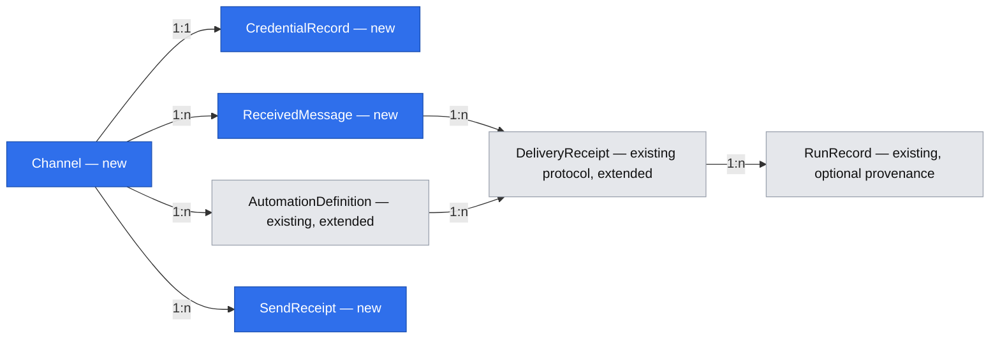

# Communication channels — Send, Receive, Duplex

## 📝 TLDR

Proposed behavior for [#1949](https://github.com/open-mercato/cezar/issues/1949): project-owned communication channels in Settings let users send notifications, receive messages into enabled automations, and give agents controlled communication tools. Initial integrations target Gmail and Resend; local polling avoids requiring an internet-facing cockpit. This PR is design only; sensitive defaults below require pat-lewczuk's review before implementation.

## Resolved assumptions (autonomous defaults)

| Id | Question | Proposed answer and reason | Confirmation |
|---|---|---|---|
| Q1 | Split independent capabilities? | Split into four independently deployable specifications: channel/send foundation, receive automations, agent communication, and Gmail provider integration. This document owns only shared boundaries and the handoff roadmap. | ⚠ NEEDS HUMAN CONFIRMATION: approve the proposed shared boundaries; implementation must use separate delivery specifications. |
| Q2 | Project or workspace ownership? | Project-owned, identified by canonical project root; reuse the isolation pattern of existing webhook receivers and automation stores. No cross-project discovery or inherited credentials. | ⚠ NEEDS HUMAN CONFIRMATION |
| Q3 | Providers and transport? | Resend Send and Receive first, with Resend Inbox treated as a distinct adapter rather than assuming its endpoints match Receiving. Gmail Send/Receive/Duplex follows an OAuth setup spike. Outbound polling only; no public listener, tunnel, Pub/Sub subscription, or cezar-hosted relay. | ⚠ NEEDS HUMAN CONFIRMATION: Gmail credential provisioning and Resend Inbox API mapping must be demonstrated. |
| Q4 | Agent authority? | Default agent access off per channel; operator grants task-scoped read and/or send authority, constrained to explicit recipients. Incoming mail never changes those grants. Existing unrestricted same-user shell is not a security sandbox. | ⚠ NEEDS HUMAN CONFIRMATION |
| Q5 | Sensitive data and attachments? | Text-only intake capped at 64 KiB after decoding, no automatic attachment download, raw HTML rendering or link fetch. Encrypt retained inbox payloads; delete after 7 days, retaining opaque dedupe identifiers for 30 days. Run transcripts have their own existing retention and may contain submitted excerpts. | ⚠ NEEDS HUMAN CONFIRMATION: approve disclosure and retention before enabling security-report intake. |

These are proposals, not ratified owner decisions. The PR remains draft until every flagged row is confirmed or revised.

## 📝 Problem Statement

The reporter wants reusable integrations rather than provider credentials/configuration inside individual agent prompts, and wants incoming reports to launch analysis and dispatch work. Existing [outbound webhooks](2026-10-12-outbound-webhooks.md) cover task lifecycle notifications but explicitly exclude inbound messages and agent communication. Existing [automations](2026-09-14-automations-redesign.md) already launch ordinary bounded tasks; they are the execution mechanism to extend. This request does not establish an active security defect.

Non-goals: mailbox client, marketing campaigns, arbitrary provider plugins, cezar-hosted accounts/relay, mandatory public hosting, automatic report attachment execution, remote approvals, automatic merge/deploy, replacing existing receivers, or modifying external mailbox read/delete state. Creating channels is local state only; connecting/testing/enabling is explicit network consent. A provider account remains an optional integration dependency, never a boot requirement.

## 📝 Research and provider boundaries

Checked 2026-11-05 against primary documentation:

- [Gmail API reference](https://developers.google.com/workspace/gmail/api/reference/rest) provides message list/get/send. [Synchronization guidance](https://developers.google.com/workspace/gmail/api/guides/sync) distinguishes initial and incremental synchronization, and requires recovery when a history identifier expires. Use polling and opaque message IDs; neither unread state nor a date alone is a durable delivery cursor.
- [Gmail scope guidance](https://developers.google.com/workspace/gmail/api/auth/scopes) requires narrowly scoped OAuth grants. Send requests only send scope; Receive needs read scope; Duplex needs both. A usable local OAuth client/consent setup is still a release gate: no bundled client secret, invented OAuth broker, or claim that every Gmail account works without setup. Settings must explain grant/verification limitations and credential expiry.
- Resend documents [sending](https://resend.com/docs/api-reference/emails/send-email), [received listing](https://resend.com/docs/api-reference/emails/list-received-emails), and [received message retrieval](https://resend.com/docs/api-reference/emails/retrieve-received-email). This supports a polling candidate; prove page ordering/cursor traversal under concurrent arrivals in adapter tests before launch.
- [Resend Inboxes](https://resend.com/docs/api-reference/inboxes/create-inbox) is a separately named API family with threads and replies. Do not silently substitute account-wide Receiving for an Inbox connection. The adapter spike must demonstrate inbox identity, bounded thread-email enumeration, stable IDs and account entitlements. No creating paid inbox resources as a side effect of connection testing.
- The open-source [n8n Gmail Trigger](https://docs.n8n.io/integrations/builtin/trigger-nodes/n8n-nodes-base.gmailtrigger/) separates connection, polling, filters and a bounded email count. Adopt explicit filters and visible backlog; skip its general workflow-builder complexity and avoid unread-only semantics that make opening mail change delivery eligibility.

No live provider account was connected or mail sent during design. Capability matrix is validated by adapter, not inferred from a provider brand: `resend-send` supports Send, `resend-receiving` Receive, `resend-inbox` Receive initially (Duplex only after reply proof), and `gmail` all three after grant verification. Unsupported combinations are rejected; a Duplex channel is one identity authorized for both directions, not two unrelated accounts spliced together.

## 📝 Architecture

Add `packages/cezar/src/communication/` for provider adapters, bounded channel storage, ingestion and sending. A provider seam exposes `capabilities`, `testConnection`, `listReceived`, `getReceived`, and `send` where supported; provider types do not escape it. Network targets are fixed provider HTTPS hosts, never arbitrary agent-supplied URLs. Calls have timeouts, response-size bounds, cancellation, and redacted errors.

Reuse `AutomationCoordinator` root identity and `runEventPollCycle` in `packages/cezar/src/automations/event-poll-cycle.ts` for lease ownership, revision checks, backoff and checkpoints. Add `kind: communication` with `communicationTrigger: {channelId, event: message.received, filters}` to contract and storage schemas. Extend the existing scheduler's provider dispatch rather than creating another timer loop. Only enabled receive automations demand polling; one channel ingress owner serves all subscribing automations. Disable/disconnect/project removal aborts poll work and rechecks channel revision immediately before launch.

Store provider ingestion cursors separately from per-automation delivery receipts. A candidate discovered once can match multiple automations; advancing one automation cannot consume another's event. Preview uses the same bounded candidates without committing cursor, receipt or mailbox changes. The first enable captures a no-backfill baseline. Credential changes/channel edits create a new revision and rebaseline; normal restart resumes committed cursors. Invalid/expired cursors cause visible rebaseline, never silent historical dispatch.

Reuse ordinary launch machinery in `automations/task-template.ts`, with new communication placeholder validation and optional `automationCommunication` run provenance; never weaken the existing required GitHub URL field. Provenance includes channel ID, automation revision, opaque message ID and receipt ID, never raw credentials or full body. Dispatch retains existing max-subtask/budget/review gates. A received message is labelled untrusted source material and cannot choose the workflow, tools, recipient policy, or dispatch budget.

## 📝 Data Model

All shapes are Zod-defined; wire shapes live in `packages/contract`, storage schemas preserve unknown keys and salvage bad entries independently.

- **Channel**: UUID, project-root binding, provider, display name, direction, disabled-by-default state, revision, verified capability set, nonsecret mailbox/inbox ID, recipient policy, agent-access policy, health summary. A connection test verifies scope and mailbox identity without sending or mutating mailbox state.
- **CredentialRecord**: encrypted provider API key or OAuth token bundle, root/channel/revision binding, with no plaintext in channel JSON or environment. Extend `SecretStore.sealManaged/openManaged` ownership namespaces after examining its existing allowed scopes; reuse the managed-record atomic-write/key-loss conventions of `server/tracker/connections.ts`, not its tracker-specific envelope. Only the adapter decrypts credentials. Read-only home/keychain failure disables that connection with one actionable warning; cockpit boot succeeds.
- **ReceivedMessage**: channel ID, provider ID, received time, bounded decoded text and header metadata, attachment count (no downloaded files), truncation flag and expiry. Sensitive payloads are encrypted managed records outside the repository, under `cezarHomeDir()/communication/`; metadata in project state uses opaque references. Encryption does not prevent same-OS-user access or transcript disclosure.
- **IngressState**: channel revision, provider cursor/pagination continuation, baseline, committed event IDs and backoff. Write atomically under a root/channel lease before acknowledging progress. Bounded paging resumes on the next scheduler turn rather than exhausting memory or skipping a saturated page.
- **DeliveryReceipt**: automation/revision + channel/provider-message ID uniqueness, planned run IDs, launch outcome. Keep the existing durable-before-launch receipt protocol; uncertain launch becomes attention-required, never an automatic second task.
- **SendReceipt**: caller/task + idempotency key, hash of canonical body/recipients/channel revision, state, provider ID when known, timestamps. Same key/different payload is 409; ambiguous sends require operator reconciliation. Provider idempotency is used when documented but does not imply universal exactly-once sending.

Channels provide shared ingress; each automation retains its own dispatch receipt.

## 📝 API Contracts and agent tools

New chained project route family under `/api/v1/p/:projectId/communication-channels`: list/create, `/:id` read/update/delete with revision conflicts, `/:id/test`, `/:id/messages` bounded metadata, `/:id/messages/:messageId` authorized text access, and `/:id/send` idempotent send request. Define input, params, queries, success/error responses first in a new contract module; use validator middleware and bilateral contract-parity/typed-body checks. Channel responses expose `credentialConfigured` and masked account identity only; never tokens. Existing origin/Host guards and hosted credentials remain in force.

Create takes provider/direction/display name and credential write-only input; update carries expected revision. Send takes permitted recipients, subject, plain text, optional provider-supported reply reference and required idempotency key; response contains receipt ID, state (`pending`, `sent`, `failed`, `uncertain`) and optional provider ID. `409` covers stale revision, disabled/incompatible channel and key/payload conflict; `403` denies agent grant/recipient policy; malformed input is `400`. A test send is a separate explicit action with the same receipt/policy path, not a hidden connection-test side effect.

Agent integration uses an engine-issued, short-lived task/project-scoped capability for list/read/send through the service. Do not hand provider keys to backends or add them to `process.env`. Enforce policy server-side on every operation, including channel disable and grant revocation. Use the repository's backend-neutral tool/CLI seam after inventorying it; adapters may not become per-backend implementations. This capability limits service-mediated operations; unrestricted Bash and same-user APIs/files retain the limits documented by outbound webhooks. Do not market this as tenant isolation.

Notifications select a Send/Duplex channel and explicit recipients, reusing lifecycle observations through an adapter instead of changing existing receiver delivery IDs/state. Do not auto-enroll existing webhook destinations. Agent sends and notification sends share policy/receipts; display the actor and task separately.

## 📝 UI/UX

Project Settings → Communication channels lists provider, account, direction, disabled/connected/backoff state and last activity. Add opens provider selection, capability-aware direction, credential setup, permitted recipients and explicit agent-access controls. Saving remains disabled until Test connection succeeds; activation is separate. Receive explains baseline/no-backfill, encryption, report excerpt disclosure and attachment exclusion. Duplex displays both grants.

Automations offers Message received only for verified Receive/Duplex channels. Filters include exact sender/recipient and subject substring; sender matching routes messages but is not identity authentication. Preview shows escaped bounded metadata and a count, never launches a task. Enable requires a preview of the current filter. Logs link opaque message provenance and task receipts. Settings delete offers pause dependent automations and delete retained payloads; it does not delete provider mail or cancel already-started tasks. Existing runs retain provenance marked channel removed.

Screens are proposals, with no accepted prototype. Current-app capture and mockups unavailable: the configured test-env successfully built and started the demo server, but its browser descriptor reported `installed: false` and `live browser launch failed after autonomous install`. This text-only design does not claim browser validation.

## 📝 Edge Cases & Failure Scenarios

- Start/restart: only explicit enabled demand arms polling. No credentials/channels means no requests or startup delay. A missing dependency, lost key, malformed channel or read-only state disables the affected integration only.
- Timeout, 429 or 5xx: bounded exponential backoff with provider Retry-After, visible health, scheduled next attempt. Authentication failure stops that channel until reconnect. No state remains parked without retry, explicit reconnect, disable or deletion exit.
- Disable/delete races: revision/lease checked after fetch and before receipt/send/launch; revoke grants immediately. A provider send already accepted may complete; show its receipt. Re-enabling does not replay missed mail implicitly.
- Repeated provider IDs and concurrent arrivals: stable dedupe and resumable pages; do not move the cursor past an unpersisted candidate. Bound 50 candidates and 5 pages per cycle, then resume. Dedupe retention exceeds the 7-day eligible replay window; older messages never become new merely because a key expired.
- Self-mail, bounces and vacation responders: suppress recorded outbound message IDs and recognized auto-submitted messages by default; one automation execution per source-message receipt. No automatic reply is added by intake. Per-channel hourly intake/send ceilings default to 100/20 and surface attention when reached; operator review needed to raise them.
- Malicious HTML/attachments/report text: escape UI text; never load remote content, execute attachments or follow instructions. Text extraction limits apply before prompt construction; truncate visibly. Excerpts entering run transcripts are disclosed and follow existing run retention.
- Credentials rotate or account changes: pause and re-test, revoke task grants, rebaseline explicitly. No copying credential state into git worktrees, exports or child projects.

## 📝 Risks & Impact Review

Main risks are sensitive reports entering transcripts, unauthorized external sends, mailbox scope inflation, duplicate costly tasks and compatibility with old state writers. This design adds no network traffic until explicit connection/test/activation. A new `CEZ_COMMUNICATION_CHANNELS=1` opt-in, off by default, is proposed to satisfy AGENTS.md's network widening rule; add `.env.example` and `docs/reference.md` in its implementation commit. This is a new optional capability, not an off-by-default replacement for existing working notifications.

Preserve existing API shapes, automation defaults, receipts and webhook behavior. Add optional run provenance instead of changing old discriminants. Older cezar versions may drop unsupported communication automation rows on their next store write: pause/export definitions before downgrade; document that rollback limit before release. Encrypted credential namespaces and metadata formats require versioned markers preventing older writers from recreating plaintext. No blanket migration of existing connections.

## 🔍 Architectural Review

Verdict: coherent shared-boundary proposal, **not implementation-ready until Q1–Q5 are reviewed**. No runtime behavior was tested. Required adapter spikes must establish Gmail OAuth provisioning and Resend Inbox versus Receiving semantics before provider promises become acceptance criteria. Fresh-context scope review required a definite split, separate Gmail expansion, and an explicit umbrella implementation prohibition; those corrections are incorporated. Detailed delivery specs are mandatory. The review is recorded on the PR; provider documentation and repository seams were read, but no credentials or live mail tested.

## 📋 Phasing

1. Channel/send foundation, credentials and Resend notifications; usable without inbound intake.
2. Receive adapters and message-triggered automations; usable without agent-initiated communication.
3. Agent communication grants and tools using existing channels.
4. Gmail provider expansion after its OAuth setup spike; independent of agent tools.

This is an umbrella boundary specification, **not an executable implementation specification**. Do not invoke an implementation skill on this file to build all capabilities. Author and review four delivery specs before implementing each capability. Lifecycle notification routing is explicitly part of the send-foundation delivery spec, with its own verification step; channel sending must work before that integration.

## 📋 Implementation Plan

The following is a handoff roadmap for the four delivery-spec authors. It is not approval to implement the bundle; each delivery spec must supply its own acceptance criteria, detailed API schemas, and testable steps.

### Phase 0 — review and provider proof
1. Obtain pat-lewczuk review of Q1–Q5; author separate delivery specs for the four capabilities. Preserve this shared boundary design and link all implementation issues.
2. Demonstrate Resend Receiving pagination and Inbox thread-email mapping with recorded fixtures; verify OAuth grant provisioning for Gmail locally and hosted. Fail unavailable directions clearly; no implementation release depends on undocumented APIs.

### Phase 1 — channel/send foundation
1. Add contract/storage schemas, encrypted managed namespace and channel root ownership; prove legacy state round trips and key-loss/read-only degradation.
2. Add bounded Resend send adapter, idempotent receipts and uncertainty handling; use fake provider responses, including timeout-after-acceptance and concurrent requests.
3. Add chained routes/validation and Settings flow; prove contract parity, typed bodies, origin protection, cross-project refusal and explicit test-send consent.
4. Integrate selected lifecycle notifications without changing old receivers; prove existing zero-config/default webhook scenarios remain green.

### Phase 2 — intake and automations
1. Add bounded ingestion and encrypted payload retention with cursor/baseline/lease tests; prove restart, saturated pages, duplicate IDs, expiry and corruption behavior.
2. Extend automation kind, scheduler provider routing, templates and optional run provenance; prove preview cannot launch/mutate, disable races cannot dispatch, and ambiguous launch does not retry.
3. Add Receive/Duplex selector, preview, enable and log UX; exercise the security-report flow with malicious instructions, oversized bodies and attachments. Verify dispatch budgets/subtask ceilings remain enforced.

### Phase 3 — agent tools
1. Add task-scoped service capability and backend-neutral discover/read/send tools. Prove default denial, recipient checks, project binding, grant expiry/revocation and no raw credential leakage across every runner construction/continuation path.
2. Verify tools work with existing Resend channel adapters without Gmail or a provider-specific runner path.

### Phase 4 — Gmail provider expansion
1. Add Gmail OAuth connection and scope-aware adapters after Phase 0 proof; test invalid grant, history expiry, reconnect, no-backfill and Duplex scope downgrade.
2. Verify Gmail notifications/intake work without enabling agent communication.
3. For each implementation delivery, verify restart/downgrade documentation, env contract docs, package artifact inclusion, full configured validation gate and browser QA for implemented UI. Publish no runtime change through this design PR.
