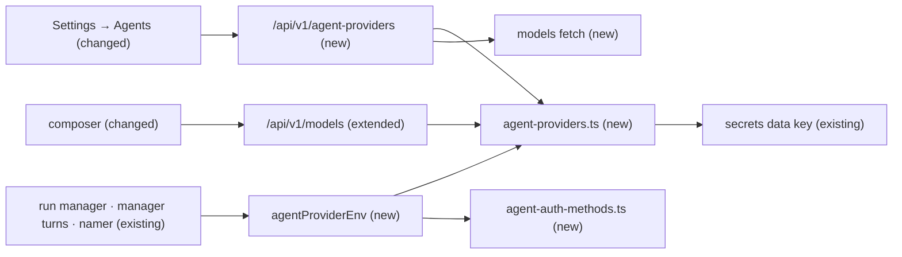
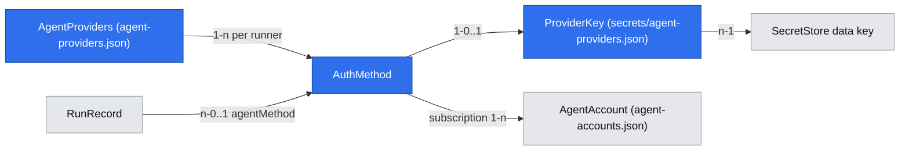

# Per-agent provider configuration

Status: draft, gate answered and scope-reviewed 2026-11-27 · Date: 2026-11-27
Extends: .ai/specs/2026-07-29-agent-profiles.md
Extends: .ai/specs/2026-11-24-add-account-in-cockpit.md
Extends: .ai/specs/2026-11-25-agent-cli-install-and-update.md
Supersedes: .ai/specs/2026-07-22-provider-authentication.md — sections: Non-goals (the "cezar does not read … provider tokens" line, for keys the user types into cezar only)
Supersedes: .ai/specs/2026-10-10-project-secrets-vault-options.md — sections: "no agent audience" (one dedicated agent-provider scope is added; workspace and project secrets still never reach agents)

Proposal (not accepted yet): the clickable mockups in `.ai/specs/assets/2026-11-27-per-agent-provider-configuration/`.
Open `index.html` there; `settings.html`, `project-agents.html` and `composer.html` are the three screens, and
`README.md` is their context record. They are low-fi simulations with fake data.

## 📝 TLDR

Proposed, not built. Today Settings → Agents shows whether each agent CLI is installed and signed in, but
nobody can say which provider an agent runs on: an API key works only if it already sits in the host
environment, and running Claude Code through OpenRouter or a company gateway means hand-set env vars. This
spec makes the provider a first-class, per-agent choice. Single-backend agents (Claude, Codex and the other
one-backend CLIs) run on **one auth method at a time**. Multi-provider agents (pi, OpenCode, OMP) take
**any combination**, and each connected method adds its models. cezar stores the keys the user types,
encrypted, and injects them only into the run that uses them. The composer's model menu ends with
**Manage providers**, and an agent with no usable method shows **Configure providers** in place of the
model chip.

## 📝 Owner decisions (gate, 2026-11-27)

| Q | Decision |
| --- | --- |
| Q1 Who holds keys | cezar, encrypted under the existing secrets data key, injected per run. |
| Q2 Where the choice lives | Workspace-wide only. A project overrides the account and the model, never the auth method. |
| Q3 Which agents | All agents. Each lists only the methods its CLI can really use (§ Agent capability table). |
| Q4 OpenCode | Any combination, with the same four methods as pi. |
| Q5 Accounts card | Second logins fold into the subscription row's account menu. The standalone Accounts card goes. |
| Q6 Custom endpoint | The user gives one base URL. Each agent appends its own path: Claude speaks Anthropic, every other agent speaks OpenAI. A custom provider and OpenRouter must answer a models endpoint, which fills the model list. |
| Q7 Remote entry | Local cockpit only. Hosted cockpits and paired phones read status and never write a key. |
| Q8 Split | One spec, three phases. |

## 📝 Problem Statement

- An API key reaches an agent only through the host environment (`MULTI_PROVIDER_PREFIXES` and the per-backend
  allowlists in `packages/cezar/src/core/agent-env.ts`). Nothing in the cockpit shows it, sets it or removes it.
- The workspace secrets store deliberately has no agent audience (`packages/cezar/src/workspace/secrets.ts`),
  because a key exported into the host env once switched Claude Code and Codex to API billing without the user
  noticing. So today there is no safe place for an agent key at all.
- Claude Code and Codex can run against OpenRouter or a gateway, but cezar cannot express "this agent runs on
  that endpoint", and a hand-set `ANTHROPIC_BASE_URL` silently applies to every task.
- The composer offers a model list per runner from `GET /api/v1/models`, with no notion of which method serves a
  model. An agent with no usable method fails only after the run starts.
- Defaults, accounts, versions and provider status sit in four separate cards, so "what does Claude run on" has
  no single answer on screen.

## 📝 Prior spec drift

- `2026-07-22-provider-authentication.md` § Goals says provider cards live in Settings → Agents. The code moved
  them into the Accounts card's per-agent rows (`packages/web/src/routes/settings/accounts-section.tsx`,
  `InstalledAgentRow`) and kept `provider-settings.tsx` for the status pane. This spec designs against the code.

## 📝 Research

- **Cline and Roo Code** pick one "API provider" per profile, with a base URL field for OpenAI-compatible
  endpoints and a model list fetched from `/models`. Their weak spot is that the provider is global to the
  editor. cezar keeps the choice global too (Q2) but per agent, which is what lets Claude and Codex differ.
- **OpenCode** treats providers as additive and lists models by provider (`provider/model`). That is the
  any-combination mode, and its model ids already carry the provider.
- **LiteLLM and OpenRouter** standardize on `GET {base}/v1/models` returning `{ data: [{ id, … }] }`.
  Anthropic's `GET /v1/models` has the same `data[].id` shape. One fetcher serves both.
- **What we skip:** per-model pricing tables, routing rules and fallback between methods inside one agent. The
  existing Automatic fallback already moves a task between agents.

## 📝 Proposed Solution

1. **An auth-method model per agent.** Each runner has a mode (`one` or `any`) and a list of methods it supports,
   drawn from four kinds: `subscription` (the vendor's own login, vendor-owned), `openrouter`, `custom` (a base URL
   plus key) and `apiKey` (the vendor's own key, for CLIs that take one). The list is vendor knowledge and lives in
   one table on the server.
2. **cezar-held keys.** Keys the user types are encrypted with the secrets data key in a dedicated store file and
   are write-only over the API. A run reads them only for the method that run uses.
3. **Run injection through one helper.** Every place that builds an agent's child env asks one function for the
   method's env and launch overrides. A run on a subscription gets none, and cezar strips any host key for that
   vendor, so a subscription run can never bill an API key.
4. **One base URL, agent-specific paths.** The user enters a root such as `https://openrouter.ai/api`. Claude gets
   it as `ANTHROPIC_BASE_URL`. Every other agent gets `{base}/v1` as an OpenAI-compatible endpoint. The server
   fetches `{base}/v1/models` to list models, and a method that cannot answer is not usable.
5. **The UI from the mockups.** Workspace → Agents becomes Global instructions, one Agents card with a row per
   agent, and Skill repositories. Project → Agents keeps Default agent, Default models and Automatic fallback,
   and shows each agent's method. The composer adds the method to each model's "via …" line, a Manage providers
   footer, and Configure providers for an agent with no usable method.

**Alternatives considered.** Writing keys into each CLI's own config (pi's auth file, Codex `config.toml`) was
rejected at Q1: it scatters secrets over several formats cezar does not own, and a key there applies to the
user's own terminal sessions too. Detection only was rejected because it leaves the original problem.

## 📝 Agent capability table

Vendor facts below are the design's working assumptions. Step 1.1 verifies each against the shipped CLI and
records the result here, the way `2026-07-29-agent-profiles.md` records its verified facts. A method that fails
verification is dropped from that agent's list, and the agent still works on what remains.

| Runner | Mode | Methods | How a cezar-held method is applied |
| --- | --- | --- | --- |
| claude | one | subscription (+ accounts), openrouter, custom | `ANTHROPIC_BASE_URL={base}`, `ANTHROPIC_AUTH_TOKEN={key}`, `ANTHROPIC_API_KEY` emptied; model by `--model` |
| codex | one | subscription (+ accounts), openrouter, custom | app-server `thread/start` config overrides: a `model_providers.cezar` entry with `base_url={base}/v1`, `env_key`, `wire_api`; `model_provider=cezar` |
| pi | any | Claude subscription, ChatGPT subscription (both via pi's own login), openrouter, custom | `OPENROUTER_API_KEY` for openrouter; custom through pi's OpenAI-compatible provider override (verify) |
| opencode | any | Anthropic subscription, ChatGPT subscription (OpenCode's own auth), openrouter, custom | `OPENROUTER_API_KEY`; custom as an `@ai-sdk/openai-compatible` provider in inline config (`OPENCODE_CONFIG_CONTENT`, verify) |
| omp | any | as pi | as pi (omp is a pi fork; verify) |
| kimi | one | subscription, openrouter, custom | OpenAI-compatible base URL override (verify) |
| gemini | one | subscription, apiKey (`GEMINI_API_KEY`) | Gemini speaks its own API, so no OpenAI endpoint |
| cursor | one | subscription, apiKey (`CURSOR_API_KEY`) | no custom endpoint |
| copilot, junie, antigravity | one | subscription | no key or endpoint support known |

An agent with a single method renders a single row and no radio. That is how "all agents" stays honest without
inventing support a CLI does not have.

## 📝 Delta

### Capability: agent-providers

#### ADDED Requirement: One auth method at a time
The system SHALL run a one-mode agent on exactly the method selected for it, and SHALL keep the other connected
methods signed in but unused.

##### Scenario: Switching Claude to OpenRouter
- WHEN Claude has its subscription and an OpenRouter key connected, and the user selects OpenRouter
- THEN the next Claude run gets `ANTHROPIC_BASE_URL` and the OpenRouter key, and the subscription stays signed in

##### Scenario: Removing the active method
- WHEN the user removes the key of Claude's active method
- THEN Claude shows "no credential" and no method is selected until the user picks one

#### ADDED Requirement: Detected logins count without setup
The system SHALL treat a vendor login that provider status already reports as connected, and a vendor key already
present in the host environment, as usable methods of that agent, without the user configuring anything.

##### Scenario: Zero-config Claude
- WHEN Claude is signed in on the host and the user never opened Settings → Agents
- THEN Claude's subscription row shows as active, the composer offers Claude's models, and Start is enabled

##### Scenario: Host key only
- WHEN pi has no login but `OPENROUTER_API_KEY` is set in the host environment
- THEN pi shows a read-only "OpenRouter · from host environment" row as connected, and runs behave as today

#### ADDED Requirement: Any combination of methods
The system SHALL let an any-mode agent use every connected method, and SHALL offer the union of their models,
each model tagged with the method that serves it.

##### Scenario: pi with a subscription and OpenRouter
- WHEN pi has the Claude subscription and an OpenRouter key connected
- THEN pi's model list shows both groups, and a run on an OpenRouter model receives only the OpenRouter key

#### ADDED Requirement: Subscription runs never carry an API key
The system SHALL start a run whose method is a subscription with no cezar-held key and with that vendor's host
API-key and base-URL variables removed.

##### Scenario: Host key present, subscription selected
- WHEN `ANTHROPIC_API_KEY` is set in the host environment and Claude's active method is its subscription
- THEN the Claude child process has no `ANTHROPIC_API_KEY`, `ANTHROPIC_AUTH_TOKEN` or `ANTHROPIC_BASE_URL`

##### Scenario: Nothing configured
- WHEN the user has never configured a method for an agent
- THEN that agent's child env is built exactly as before this change

#### ADDED Requirement: Keys are write-only and encrypted
The system SHALL store a typed key encrypted at rest and SHALL never return it over the API, only its last four
characters.

##### Scenario: Reading a saved key
- WHEN the cockpit reads the agent-providers state after a key was saved
- THEN the response carries `keyHint: "…9662"` and no key value

#### ADDED Requirement: Models come from the endpoint
The system SHALL list an openrouter or custom method's models from `GET {base}/v1/models`, and SHALL mark the
method unusable when that request fails.

##### Scenario: A default model is no longer offered
- WHEN a refresh drops the model that is an agent's default
- THEN the composer preselects `auto` and the agent's row shows "no longer offered" next to the default

##### Scenario: Custom endpoint unreachable
- WHEN a custom provider's models request times out
- THEN the row shows the error and "Retry", the method offers no models, and runs cannot select it

#### ADDED Requirement: A locked key store stops only the runs that need it
The system SHALL park a run whose method needs a cezar-held key when the key store cannot be read, and SHALL start
subscription runs normally.

##### Scenario: Keychain locked
- WHEN the OS keychain is locked and a task starts on Claude via OpenRouter
- THEN the task parks with the keychain message, while a task on Claude's subscription starts

#### ADDED Requirement: Writes are local only
The system SHALL refuse every write to auth methods and keys when the cockpit is not local, and SHALL still
answer reads.

##### Scenario: Paired phone adds a key
- WHEN a paired phone sends a key write
- THEN the server answers 409 and stores nothing

### Capability: settings-agents

#### MODIFIED Requirement: Defaults for new projects
The system SHALL set the default agent for new projects with the star on that agent's row, and SHALL set each
agent's default model inside that agent's row, offering only models its connected methods serve plus `auto`.

##### Scenario: Starring Codex
- WHEN the user clicks the star on Codex
- THEN new projects start with Codex, and the star moves from the previous default

Frozen by: `packages/web/src/routes/settings/accounts-defaults.test.tsx`

#### REMOVED Requirement: Standalone Accounts card
Reason: second logins move into the subscription row's account menu, which lists the logins, picks the one new
projects use and opens the existing add-account dialog from "Add another account".
Frozen by: `packages/web/src/routes/settings/accounts-section.test.tsx`

### Capability: project-agents

#### ADDED Requirement: Project settings show each agent's method
The system SHALL show, for each agent on a project's Agents page, the method it runs on with a link to that
agent's row in Workspace → Agents, and SHALL disable agents without a usable method in the default-agent and
fallback pickers. A project still overrides the account and the model, never the method.

##### Scenario: Codex has no method
- WHEN Codex has no usable method and the user opens the project's Default agent picker
- THEN Codex is listed as disabled with "no provider", and its Default models row reads "No provider · Configure providers"

### Capability: composer-model-picker

#### MODIFIED Requirement: Agents without a usable provider
The system SHALL keep an agent with no usable method selectable in the runner picker, SHALL replace its model
chip with a "Configure providers" chip that opens that agent's row in Settings → Agents, and SHALL disable Start
for it.

##### Scenario: Codex has no method
- WHEN the user picks Codex and Codex has no usable method
- THEN the model chip reads "Configure providers", Start is disabled, and the chip links to `#agent-codex`

Frozen by: `packages/web/src/routes/new-task.test.tsx` (a characterization case added in Step 3.1)

#### ADDED Requirement: Models show their method
The system SHALL show under each model the method that serves it ("via OpenRouter"), group models by method for
any-mode agents, and end the menu with "Manage providers".

##### Scenario: pi's model menu
- WHEN the user opens pi's model menu
- THEN models appear under "Claude subscription" and "OpenRouter" headings, and the last item is Manage providers

## 📝 Architecture

- **Vendor knowledge**, new: `packages/cezar/src/core/agent-auth-methods.ts`. The capability table above as code:
  per runner its mode, method kinds, and an `apply(method, key)` that returns `{ env, unsetEnv, overrides }`. It sits
  beside `agent-profiles.ts` and `agent-config/catalog.ts`, the other two single homes of vendor facts.
- **State**, new: `packages/cezar/src/workspace/agent-providers.ts` owns the metadata file and calls the secrets
  module for key ciphertext (§ Data Model). Writes follow `mergeWriteWorkspaceConfig` discipline: read-modify-write,
  atomic tmp/rename, `0600`, cross-process lock, `assertCezarHomeWriteIsSandboxed`.
- **Run injection**, one helper `agentProviderEnv(runner, selection)` called wherever a child env is built:
  `execute` and `runContinuation` in the run manager, manager turns, and the check-step namer model call. AGENTS.md
  § "Find every construction site" applies: grep `buildChildEnv(` and `ActiveRun` and route each through the helper
  in the same commit. `buildChildEnv` learns an `unset` list so a subscription run can drop host vendor keys.
- **Model fetch**, server-side only: the key never reaches the browser, and the cockpit's CSP would block the
  request anyway. Ten-second timeout, 2 MB cap, no redirect to another origin, results cached in the metadata file.
- **Codex** gets its provider through `thread/start` config overrides, which `codex-app-server-runner.ts` already
  passes (`config: {…}` at the `overrides` site), so no `config.toml` is written.
- **Not touched:** vendor logins stay vendor-owned (provider-authentication, agent-profiles). `GET /providers/status`
  keeps answering "is the CLI signed in"; the new state answers "which method does cezar run it on".



The takeaway: the UI and the runs meet only at the store, and the vendor table is the one place that knows how a
method becomes env vars or Codex overrides.

## 📝 Data Model

**`~/.cezar/agent-providers.json`** (new, its own file like `agent-accounts.json`, so an older cezar cannot drop it):

```ts
{
  version: 1,
  agents: {
    [runner]: {
      active?: string,                       // one-mode only: the selected method id; absent = none
      methods: {
        [methodId]: {                        // 'subscription' | 'openrouter' | 'custom' | 'apiKey'
          kind, label?: string,
          baseUrl?: string,                  // openrouter is fixed to https://openrouter.ai/api
          keyHint?: string,                  // '…9662'; the key itself is in the secrets file
          models?: { fetchedAt: string, ids: { id: string, label?: string, contextLength?: number }[], error?: string },
          addedAt: string,
        }
      }
    }
  }
}
```

- Every field is optional with `.catch`, `.passthrough()` at every level, and per-agent salvage, like the workspace
  config. A corrupt file reads as "nothing configured", which is today's behavior.
- **Key ciphertext** lives in `~/.cezar/secrets/agent-providers.json`, a new scope holder of the existing
  `SecretStore` encrypted with the same data key (keychain or `0600` key file). It is addressed `<runner>/<methodId>`
  and is never listed on the Secrets page. Its only reader is `agentProviderEnv`.
- **Subscription methods** store no key: their state is the vendor's login, and their accounts stay in
  `agent-accounts.json`.
- **`RunRecord.agentMethod?: string`** (new, optional): the method a run started on, so Continue and restart
  recovery replay the same method. Old records parse unchanged.
- **Model option `via?: { methodId, label }`** (new, optional) on `runnerModelOptionSchema`.



## 📝 API Contracts

All workspace-level (single mount, not under `/p/:projectId`), chained into one new family builder, validated as
middleware with the `validators.ts` trio, schemas in `packages/contract/src/agent-providers.ts`.

| Route | Body | Answer |
| --- | --- | --- |
| `GET /api/v1/agent-providers` | — | `{ editable, agents: [{ runner, mode, active?, methods: [{ id, kind, label, state: 'connected'│'disconnected'│'error', keyHint?, baseUrl?, modelCount?, error? }] }] }` |
| `PUT /api/v1/agent-providers/:runner/active` | `{ methodId: string │ null }` | the agent's entry; 400 for a method the runner does not support |
| `PUT /api/v1/agent-providers/:runner/methods/:methodId` | `{ kind, label?, baseUrl?, apiKey? }` | the method without its key; fetches models before answering |
| `DELETE /api/v1/agent-providers/:runner/methods/:methodId` | — | 204; clears `active` when it pointed here |
| `POST /api/v1/agent-providers/:runner/methods/:methodId/models` | — | the refreshed model list or `{ error }` |

- Every write answers 409 when `capabilities().localHandoff` is false (Q7), the same gate as agent-config writes.
- `apiKey` is write-only: absent on reads, absent from logs, redacted by `secret-redaction.ts`. An empty `apiKey`
  on PUT keeps the stored key.
- `baseUrl` must be `https:`, or `http:` to a loopback host. Credentials in the URL are rejected.
- `GET /api/v1/models?runner=…` (existing) adds `via` on each model and lists method-served models for every runner
  with a connected openrouter or custom method, including pi, OpenCode and OMP. The change is additive.
- `POST /runs` (existing) accepts an optional `agentMethod`. Absent means the agent's active method in one mode,
  or the method that serves the chosen model in any mode.
- New routes go into `BACKWARD_COMPATIBILITY.md` § 2 and the route inventory test, and `contract-parity*` covers them.

## 📝 UI/UX

Proposal: the mockups listed at the top. Not accepted yet.

- **Workspace → Agents** has three cards: Global instructions (unchanged), Agents, and Skill repositories
  (unchanged). The Agents card header has the installed count and "Show N not installed". Each agent row has a
  chevron, name, version badge, status dot and text, mode pill and the default-agent star.
- **An open agent row** shows Auth methods (radio rows in one mode; connected rows highlighted in any mode), the
  Default model, and a footer with the version, an Update link when one exists, and "Config files and MCP" linking
  to Agent config filtered to that agent.
- **Rows by kind.** A subscription row shows the account menu (logins, "Account new projects use", "Add another
  account") and Sign out, or "Get a plan" and Sign in. An openrouter or apiKey row shows the key hint, replace and
  remove, or "Get a key" and add. A custom row opens an inline form for name, base URL and key, and shows the
  fetched model count once saved.
- **Not installed** rows show the install command and Install, which uses the agent-cli-install flow.
- **Project → Agents** keeps its three cards. Under each agent name a line reads "via {method} · Manage providers",
  or "No provider · Configure providers" in amber. Agents without a usable method are disabled in the default-agent
  and fallback pickers.
- **Composer** as in the Delta. The deep link is `/settings/global/agents#agent-{runner}`, which opens and
  highlights that row.
- **Hosted or phone cockpit** sees every row read-only, with a note that keys and methods are set on the host.
- **Accessibility:** one-mode rows are a `radiogroup`, the account menu is a `menu` with `menuitemradio` items, every
  icon button has a label naming the method and agent, and status is never colour alone.

## 📝 Edge Cases & Failure Scenarios

- **Models endpoint fails** on save: the method is saved with `error`, shows "Retry", and cannot be selected.
  On a later failure the last good list stays, marked stale.
- **A model disappears** from the provider's list while it is an agent or project default: the composer falls back
  to `auto` and the settings row shows "no longer offered".
- **Claude on OpenRouter with a non-Anthropic model**: Claude Code depends on Anthropic tool-use semantics, so the
  Claude model list shows `anthropic/*` models first and labels the rest "may not support tools". It does not hide
  them. A unit test on the list ordering covers it; tool behavior on other models stays untested.
- **Method removed while a task is parked**: Continue reads `agentMethod`, finds it gone, and parks with "This
  task's provider was removed. Pick another in Settings → Agents." It never silently falls back to a subscription.
- **Keychain locked**: key reads throw. Runs on cezar-held methods park with the keychain message, and subscription
  runs are unaffected.
- **Older cezar after downgrade** ignores both new files, and agents run exactly as before.
- **`CEZ_DRY_RUN=1`**: no models fetch (a fixed fake list) and no keys read. The mock CLI receives the env shape.
- **The agent can read its own env.** A key injected for a run is visible to that agent's tools, as a
  subscription token in its config folder already is. The key is scoped to the run that needs it and never sits in
  the host env.

## 📝 Risks & Impact Review

- **Product direction, owner-approved (Q1):** cezar now holds agent API keys. This reverses two recorded
  decisions, both annotated as superseded. The billing guard is the subscription-run strip rule.
- **Zero config:** nothing changes until the user adds a method. No new `CEZ_*` flag is needed: the network
  widening, the models fetch, happens only on a user's click or save to a URL the user typed. `.env.example` is
  untouched.
- **Hard to reverse:** the store format and the `/agent-providers` routes are new public surfaces. Rollback is
  deleting `agent-providers.json` and its secrets scope, after which runs behave as today.
- **Construction-site risk:** missing one env-building site would make a Continue or a manager turn run on the wrong
  method. Step 1.5 pins every site with a test.
- **Scope:** three phases, each shippable. A fresh-context scope review on 2026-11-27 found one capability: keys,
  endpoints, the accounts fold and all-agent coverage each need the method store and run injection to mean anything.

## 📋 Phasing

- **Phase 1, Workspace → Agents:** the store, the API, run injection with Continue and restart replay, the models
  list extension, and the new settings page. Shippable alone: users configure methods, runs use them, and the
  composer's existing model chip already lists method-served models.
- **Phase 2, Project → Agents:** method lines, disabled pickers for agents without a method, Inherit labels.
- **Phase 3, Composer:** "via" lines, grouping, Manage providers, Configure providers.

## 📋 Implementation Plan

### Phase 1 — Workspace → Agents

1. **Verify vendor facts.** For each runner in the capability table, confirm how a base URL, key and model reach the
   shipped CLI. Record the result in this spec's table. Drop the unverifiable methods.
2. **Contract.** Add `packages/contract/src/agent-providers.ts` with the schemas, the optional `via` on model options
   and `agentMethod` on the run start body and `RunRecord`. Typecheck passes.
3. **Store.** `workspace/agent-providers.ts` plus the new secrets scope, with tests for salvage, atomic write,
   `0600`, the sandbox guard, write-only keys and a corrupt-file read.
4. **Vendor table.** `core/agent-auth-methods.ts` with an `apply` per runner and unit tests per method kind.
5. **Run injection.** Characterize first: a test pins today's child env for every runner with nothing configured.
   Then add `agentProviderEnv`, the `unset` list in `buildChildEnv`, and wire `execute`, `runContinuation`, manager
   turns and the namer. Record `agentMethod` on the run, replay it on Continue and restart recovery, and park with
   the Edge Cases message when it is gone. Tests cover "Host key present", "Nothing configured", "Zero-config
   Claude" and the removed-method park on every site.
6. **Models fetch.** Server-side fetcher with timeout, size cap, redirect policy and the dry-run fake list, with tests
   for OpenAI and Anthropic shapes. Extend `GET /api/v1/models` with method-served models and `via`, including pi,
   OpenCode and OMP, and pin it in the contract-parity test.
7. **Routes.** Chain the family, validators as middleware, the 409 gate, parity, route-inventory and BC entries.
8. **Settings UI.** Characterize `accounts-defaults.test.tsx`, then build the Agents card from the mockup with both
   modes, the custom form, the host-environment rows and the read-only hosted view, each with unit tests.
9. **Fold the Accounts card.** Characterize `accounts-section.test.tsx`, add the account menu to subscription rows,
   then delete the Accounts card with its test. A separate commit, so it can be reverted on its own.

### Phase 2 — Project → Agents

1. Method line per agent with the deep link, and disabled default-agent and fallback options for agents without a
   usable method. Tests cover the "Codex has no method" scenario and a connected agent.

### Phase 3 — Composer

1. **Characterize** the current behavior for an agent without a provider in `new-task.test.tsx`, run it green and
   commit it alone.
2. Configure providers chip, disabled Start, "via" lines, grouping for any-mode agents, the Manage providers footer,
   and `agentMethod` on start. Update the characterization test to the new scenarios.
3. **Docs:** update the Agents feature page in `docs/site`.
4. **Archive the Delta** into `.ai/specs/capabilities/agent-providers.md`, `settings-agents.md`,
   `project-agents.md` and `composer-model-picker.md`.
